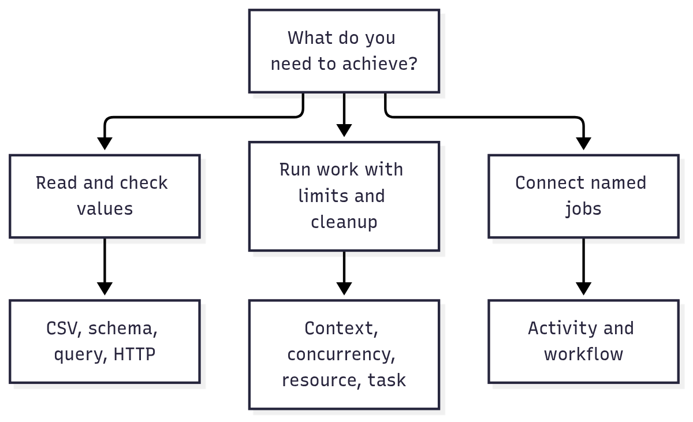

# @okikio/utils

`@okikio/utils` contains generic TypeScript mechanisms shared across Okikio projects. Focused `@okikio/*` packages own
their implementations; the `@okikio/utils` installation package gives applications one dependency declaration.

If those names are unfamiliar, start with [the illustrated learning path](docs/learn.md). A utility is a reusable piece
of code for a repeated problem: read a spreadsheet-like file correctly, limit how many jobs run at once, stop work when
its caller cancels, or check that an API returns the promised answer. Your application still decides what its users want
to achieve.

Read the picture as three different questions, not a requirement to learn the whole suite:



[Editable diagram source](docs/diagrams/overview.mmd). Choose a small capability first. Reading CSV does not require a
workflow, and running one function does not require an activity. The learning path shows when another package solves a
concrete problem and links to runnable demonstrations.

## Start with a useful outcome

Parse an import without losing quoted commas or turning text identifiers into numbers. This complete module uses the
public installation facade and performs no network or filesystem work:

```ts runnable=first-import.ts
import * as csv from '@okikio/utils/csv';

const document = csv.parse('Company,Website\n"Northstar, Inc.",https://northstar.example\n', { headerRow: 1 });
console.log(document.columns.map((column) => column.key).join(','));
console.log(JSON.stringify(document.rows[0]?.values));
```

```text output
company,website
["Northstar, Inc.","https://northstar.example"]
```

`parse()` returns a `CsvDocument` immediately. Its rows contain string cells; interpreting a website or company name is
application policy. This collecting form retains the parsed rows in memory and has configured source and row limits. It
throws `CsvParseError` for malformed input or exceeded limits and owns no resource to close.

Next, [stream and validate an import](docs/composition.md#import-rows-with-bounded-work) or
[filter discovered URLs](docs/composition.md#discover-allowed-pages). Those complete examples combine utilities to
produce a result while keeping input, cancellation, and cleanup ownership visible.

[Choose utilities by outcome](docs/outcomes.md) explains which capability to add when a job needs bounded work, reusable
resources, independent execution, or replay. Each package guide starts with a complete runnable module and its output,
then distinguishes further runnable examples from sketches with application-owned dependencies. Read
[the example convention](docs/composition.md#read-the-examples) before adapting a larger composition.

When Temporal is missing, the local [`duration/temporal`](packages/duration/temporal.ts) ponyfill supports directly
imported date arithmetic without changing globals. Lifecycle utilities currently use global Temporal; import the
explicit [`duration/polyfill`](packages/duration/polyfill.ts) at the executable entry point when the host lacks it.
Importing the ponyfill alone does not initialize those lifecycle utilities.

## Install

Deno and JSR are the canonical source and runtime model. These packages are experimental at version `0.0.0`; the
examples below are qualified against this workspace. Registry installation requires a published release:

```sh
deno add jsr:@okikio/utils
```

Import the capability used by the current module:

```ts
import * as context from '@okikio/utils/context';
import * as queue from '@okikio/utils/queue';
import * as workflow from '@okikio/utils/workflow';
```

A reusable package can depend on a focused package directly:

```sh
deno add jsr:@okikio/queue
```

```ts
import * as queue from '@okikio/queue';
```

Use `@okikio/utils/all` only at a composition root that intentionally needs the broad namespace graph.

## What the repository owns

The repository contains product-neutral mechanisms such as:

- execution context, cancellation, clocks, and disposal
- bounded concurrency, pools, queues, streams, and resilience
- schema, result, failure, fault, requirement, and permission mechanics
- HTTP, endpoint, service, gateway, process, activity, and workflow primitives
- generic CSV, HTML, CSS, robots, sitemap, email, and version utilities.

Applications own product policy, provider selection, global logging configuration, CLI presentation, and deployment
composition.

See [`docs/composition.md`](docs/composition.md) for dependency ownership and composition rules.

## Service compilation

`@okikio/server` compiles endpoint, middleware, resource, requirement, response, problem, and resilience definitions
before traffic begins. The resulting `CompiledService` contains a handler-free route plan and prepared operation
information that the Fetch runtime can consume directly.

```text
@okikio/http                 Web and HTTP protocol mechanics
        |
        v
@okikio/server               service compiler and Fetch runtime
        |
        +--> @okikio/hono    Hono host adapter
        +--> MCP adapter     protocol package or application adapter
        +--> gateway         network forwarding and trust policy
```

The service compiler remains independent of Hono and MCP. Protocol adapters use Web `Request` and `Response` rather than
changing endpoint definitions.

Read [`docs/server.md`](docs/server.md) for the compiler, request lifecycle, prepared routing, request state, mounts,
gateways, OpenAPI, and MCP transport hosting.

## Schema and HTTP representations

Standard Schema is the validator interoperability contract. Standard JSON Schema lets a validator describe accepted
input and validated output. HTTP query syntax and serialized responses can provide explicit wire schemas when those
representations differ from the validator's JavaScript values.

This separation keeps generated OpenAPI aligned with what an HTTP client sends and receives, including schemas that
coerce or transform values.

## Packages and tree-shaking

Applications can install `@okikio/utils` once while retaining focused imports:

```ts
import { parseQuery } from '@okikio/utils/http/request';
import { prepareRoutes } from '@okikio/utils/server/http';
```

The umbrella modules re-export focused package entries. They do not contain a second implementation. Release checks
compare representative focused and umbrella bundles to catch eager barrels and import-time effects.

Read [`docs/packaging.md`](docs/packaging.md) for public subpaths, side-effect rules, build output, tree-shaking
evidence, and package-artifact checks.

## Tests

Package-local tests protect focused contracts. Root [`tests/`](tests/) contains cross-package scenarios, public-import
checks, and consumer flows.

```sh
mise install
mise run install
mise run verify
```

Read [`docs/testing.md`](docs/testing.md) for test placement and evidence rules.

## Benchmarks

Package-local benchmarks measure focused mechanisms. Root [`bench/`](bench/) contains multi-package benchmark scenarios.

```sh
mise run bench
```

Read [`docs/benchmarks.md`](docs/benchmarks.md) for representative workloads, reference implementations, and
performance-reporting rules.

## Releases

Bumpy owns release intent, semantic version propagation, individual package changelogs, version PRs, Git tags, and
GitHub release notes. JSR remains the source-native publication target. npm packages are a separate Node distribution
projection; build and archive qualification are distinct from publishing a registry release.

```sh
mise run release-check
```

Read [`docs/releases.md`](docs/releases.md) for the release workflow.

## Documentation map

- [Public package contracts](docs/contracts.md) lists every focused package’s generated types, fields and functions.

- [`docs/composition.md`](docs/composition.md) explains package ownership and composition.
- [`docs/outcomes.md`](docs/outcomes.md) helps select the next capability from a concrete job.
- [`docs/runtime.md`](docs/runtime.md) separates source, artifact, host, and recovery claims.
- [`docs/comparison.md`](docs/comparison.md) explains retained and deferred differences from utility copies.
- [`docs/server.md`](docs/server.md) explains service compilation and request execution.
- [`docs/packaging.md`](docs/packaging.md) explains exports, tree-shaking, and artifact checks.
- [`docs/testing.md`](docs/testing.md) explains correctness and consumer tests.
- [`docs/http-parity.md`](docs/http-parity.md) runs one explicit API through pure Hono and pure Utils.
- [`docs/alternatives.md`](docs/alternatives.md) compares shared operations against established npm and JSR libraries.
- [`docs/benchmarks.md`](docs/benchmarks.md) explains performance evidence.
- [`docs/http-performance-closure-20261007.md`](docs/http-performance-closure-20261007.md) records the measured Hono
  gap, safe reductions, final qualification and delivery limits.
- [`docs/duplicates.md`](docs/duplicates.md) explains AST evidence, source-policy signals, and ownership review.
- [`docs/releases.md`](docs/releases.md) explains versioning and publication.
- [`docs/standards-review-20261007.md`](docs/standards-review-20261007.md) records guide applicability and documentation
  corrections.
