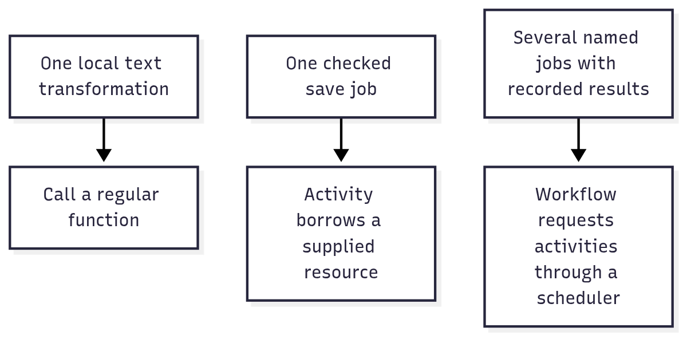

# Read definitions, owners and return values

When you call a utility, ask what you got back. A CSV parser may return rows you can read immediately. A download
returns a Promise for a result that may arrive later. A database connection also gives you something to close when
you finish. Those differences tell you how to use the function before you learn any other package.

The package README introduces the problem and supplies a complete runnable example. Its task guide adds contracts,
limits, and composition. The README includes the necessary setup and critical limits; use the guide for a deeper task,
not to reconstruct a missing quick start.

## Read the return value before learning the machinery

The code can feel unfamiliar when a definition, a running operation, and a cleanup owner look like the same kind of
call. Ask what each call returns. That tells you how to use it with normal JavaScript:

| Return shape           | Familiar way to use it                                     | Example                                                                          |
| ---------------------- | ---------------------------------------------------------- | -------------------------------------------------------------------------------- |
| Plain value            | Assign it and read its fields.                             | `csv.parse()` returns columns and rows.                                          |
| `Promise<Value>`       | `await` it to get the result.                              | `response.text()` returns the downloaded text.                                   |
| `AsyncIterable<Value>` | Read one result per `for await` iteration.                 | Bounded mapping returns your mapper's values.                                    |
| Owned object           | Keep it for a block and await its disposal.                | `context.timeout()` gives `fetch` a signal and owns the deadline wait.           |
| Definition             | Supply it to an implementation or runner.                  | An activity definition describes schemas; declaring it does not perform the job. |
| Workflow operation     | Hand the instruction to the workflow runner, which records its result. | `activity.request()` describes a job for the scheduler.             |

Start with an ordinary function. If a download needs a stop signal and cleanup, give it a Context. If the caller
needs to pause the work or see its progress, use a Task. An Activity names a job and checks what goes in and comes out.
A Workflow records the results of its steps so it can reuse them when it runs again. Add the piece that solves the
problem you have.

For example, [Context's download demo](../packages/context/README.md#download-with-a-budget) calls real `fetch`, reads
text, and returns `Promise<string>`. The context supplies a signal; it does not become the response or require a special
HTTP abstraction. Its next section shows the controller, clock wait, and cleanup stack underneath. The guide also
expresses disposal with familiar `try/finally` before asking you to adopt `await using`.

You can read the download example in that order: find the line that returns the text, then trace where its signal
comes from and who removes the deadline timer. Use the same approach when a larger example opens a client or runs a
job. Look for the result first, then find the owner of anything that needs cleanup.

## Let the common path own its setup

Being able to configure a system does not mean every caller must assemble it. Start with the entry that owns the
lifetime you need, then provide additional settings when a concrete requirement calls for them:

| Your task | Start with | Supply more when |
| --- | --- | --- |
| Borrow one lazily opened client | `resource.open(binding)` then `get(Definition)` | Pass the current request Context when access checks or cancellation belong to that request. |
| Retain separate live instances between actions | `session.open(binding)` then `create()` and `use(reference, action)` | Supply a shared registry and registered owner together when several processes coordinate admission. |
| Validate and call a local named operation | `activity.call(implementation, input)` | Attach resource bindings, policy interpreters, or an explicit execution identity when the operation declares them. |
| Keep an object only inside one action | `await using` or a disposable stack | Transfer a stack only when another owner must keep the object beyond the current function. |

These entries supply local bookkeeping. They cannot choose an account's permissions, invent a database connection,
or make a local object survive a crash. Those choices stay with the application because a wrong default would change
what the program is allowed to do or what data it can recover.

For example, the [browser session guide](./workflows/18-sessions.md) starts with a cookie jar that two actions share.
Only the distributed variation introduces a registry and placement: the registry decides whether an action may borrow,
and placement sends the action to the computer that still holds that cookie jar. Neither mechanism copies the browser.

## Choose a first demonstration

| You want to achieve                                           | Try                                                                                       | What you can observe                                                        |
| ------------------------------------------------------------- | ----------------------------------------------------------------------------------------- | --------------------------------------------------------------------------- |
| Read a contact export without splitting a quoted company name | [CSV](../packages/format/csv/README.md)                                                   | Text becomes rows with intact cells.                                        |
| Check an option before opening a server                       | [Record + Schema](./packages/15-record.md#try-checking-structure-before-checking-meaning) | An ordinary options map is accepted; port text becomes a valid number.      |
| Stop related operations and close what they opened            | [Context](../packages/context/README.md)                                                  | The owner carries a signal and deadline; leaving its block runs cleanup.    |
| Keep only a few operations active at a time                   | [Concurrency](../packages/scheduler/concurrency/README.md)                                | A limited mapper returns ordered or completion-ordered results.             |
| Share a supplied storage client                               | [Resource](../packages/capability/resource/README.md)                                     | A dependency is created when first borrowed and released by its collection. |
| Save a photo title as one checked job                         | [Activity](../packages/activity/README.md#save-a-photo-title-with-a-supplied-store)       | The store receives a label; the caller receives a validated receipt.        |
| Run named steps and reuse recorded completions                | [Workflow](../packages/workflow/README.md)                                                | Two passes return the same photo ID, with only one title and album entry.   |
| Save checked HTTP input and return a checked result           | [Service](../packages/server/service/README.md)                                           | A valid title is saved; a numeric title gets status 400 before the handler. |

These demonstrations use supplied local values. Their outputs do not establish that a database, remote service or
production deployment has been configured. Each guide names what the application must provide for that next step.

## Follow one photo through three levels of complexity

For a local label, a normal function is enough: trim the title and change its letters to uppercase. That transformation
alone does not need scheduling, resource ownership or recorded history.

Now suppose the label must be saved through a storage client. A **resource** describes the supplied client, and an
**activity** describes one checked save operation. The activity demo shows the store receiving `SUMMER TRIP` and
returning a receipt with `asset-1`. The store implementation owns what saving means; the activity does not choose a
database for you.

Finally, suppose preparing a photo takes several independently executed jobs. A **workflow** describes their sequence
and asks a scheduler for each result. Its configured history can reuse a recorded instruction completion. In the local
workflow demo, the second pass reuses the saved title's ID and the album update result without repeating either write.
Memory history remains local to that process. For a saved PostgreSQL queue and recovery across separate worker
containers, follow [background work](./workflows/01-basics.md).



[Editable diagram source](./diagrams/learn.mmd). Read each row as a different requirement. The arrows identify an
appropriate programming model, not automatic promotion through three levels. Do not add the third level when the first
level already solves the problem.

The separate pieces keep the familiar input-to-output relationship visible:

| Piece         | Input                                      | Output or responsibility                                                                 |
| ------------- | ------------------------------------------ | ---------------------------------------------------------------------------------------- |
| Text function | A title                                    | A changed title.                                                                         |
| Save activity | A title and declared access to a store     | A checked receipt from one attempt.                                                      |
| Workflow      | A run input and an exact program           | A result assembled from recorded or newly completed instructions.                        |
| Context       | An operation identity and lifetime options | Supporting cancellation, deadline and cleanup state. It does not return the saved photo. |

The [package index](./01-packages.md) links every package to its usage guide. Use examples to see what a call achieves.
Inspect source comments and the JSR reference for its exact inputs and return values.

## Read the small amount of code you need

`import` chooses the package used in that file. A name such as `@okikio/format/csv` selects a focused package; a name
such as `@okikio/utils/format/csv` selects its installation facade. It does not mean the example uses the whole suite.

`const` names a value so later lines can refer to it. `await` waits for an operation's eventual result, represented by a
Promise. `for await` reads results one at a time. `await using` also registers an owner for awaited cleanup when its
block ends. Cleanup closes the resource; cancellation asks active work to stop. They are related but separate actions.

Read the output block as an observation, not another command to execute. For example, `asset-1 SUMMER TRIP` is what the
activity demo prints after its store returns a receipt. The paragraph after the block explains why that result matters.
Try the suggested input change to follow the same rule with different data.

Several names recur across packages. Their meanings stay consistent:

| Term           | Meaning                                                                                                         |
| -------------- | --------------------------------------------------------------------------------------------------------------- |
| Schema         | A rule that checks or converts a value, such as requiring a title to be nonempty.                               |
| Definition     | A declared description of a job, resource or route. Declaring it does not start that work.                      |
| Implementation | The concrete function or factory that performs the declared behavior.                                           |
| Provider       | A supplied implementation of an external operation, client or execution location.                               |
| Owner          | The part of the program responsible for closing something. A borrower uses it without closing it independently. |
| Signal         | A notification that work should stop. The underlying operation must cooperate with it.                          |
| Engine         | An activity execution category. It is not itself a running thread or machine.                                   |
| Executor       | An owner that takes eligible queued jobs and calls their activity implementations.                              |
| Dispatch       | The queue owner that tracks jobs, current attempt permission, and accepted results.                             |
| Claim          | Temporary permission to finish an attempt. Replaced permission cannot publish a result.                         |
| Replay         | Running the instruction sequence using recorded completions where available.                                    |
| Polyfill       | Explicit setup that installs a missing API into the environment.                                                |
| Ponyfill       | An imported implementation used directly without installing it globally.                                        |

Context and Duration use local providers without requiring global installation. Import a polyfill only when your
application deliberately needs the corresponding global API. The [duration](../packages/duration/README.md) and
[disposal](../packages/dispose/README.md) guides explain that choice. Setup is separate from the operation's result.

Copy the imports shown in your selected example. Ordinary utility imports need no global installer; add explicit
setup only when your application uses a missing global API directly.

## Combine packages around a real result

For an import, follow [the complete CSV composition](./03-composition.md#import-rows-with-bounded-work). CSV reads
cells, Schema checks their meaning, Streams groups them, Concurrency limits active row operations, and Context carries
their stop request. The application chooses what to store and whether partially accepted rows should be rolled back.

For page discovery, follow [the Sitemap composition](./03-composition.md#discover-page-urls). Sitemap reads possible
page addresses. You decide which addresses you can fetch, which redirects to follow, and when to start each fetch.

For a local save, follow
[the resource and task composition](./03-composition.md#share-a-resource-with-a-finite-operation). The task performs
finite work; the resource collection owns its supplied store; the returned value remains the task's answer. These
examples show where each utility's job begins and ends.

## Run the demos and check their observations

In this checkout, copy a complete block marked `ts runnable` to the entry filename named by the guide, then run it
with Deno from the location that guide specifies. Simple single-file examples can live at the checkout root; an
example with relative imports needs its companion files beside its entry module. You do not need to place examples
inside the package's source directory.
Keep companion files together when a guide marks them `support=filename.ts`. The Process example needs run permission;
the Worker example needs its companion module and read permission. See
[the example convention](./03-composition.md#read-the-examples) for the precise setup.

From the repository root, the existing example checker compiles and runs the marked README and composition examples
through public package imports and compares their declared outputs:

```sh
deno run --allow-read --allow-write --allow-run tools/testing/examples.ts
```

This verifies executable demonstrations. It does not turn a diagram into a deployed system or prove that every
application's supplied provider is reliable. For an installed package, first install its published version and the
example's schema dependency; the repository's current `0.0.0` guides describe the checked-out experimental source.

## Transfer the model to another job

After running a package example, change one meaningful condition: make the input invalid, stop the consumer early,
cancel its owner, or select a different submodule. Predict the result, then compare it with the program. This tests your
understanding of the contract rather than familiarity with one set of names. The [workflow recipes](./recipes/README.md)
use contacts, search state, and photo jobs to show which mechanics transfer and which decisions remain application
policy.
