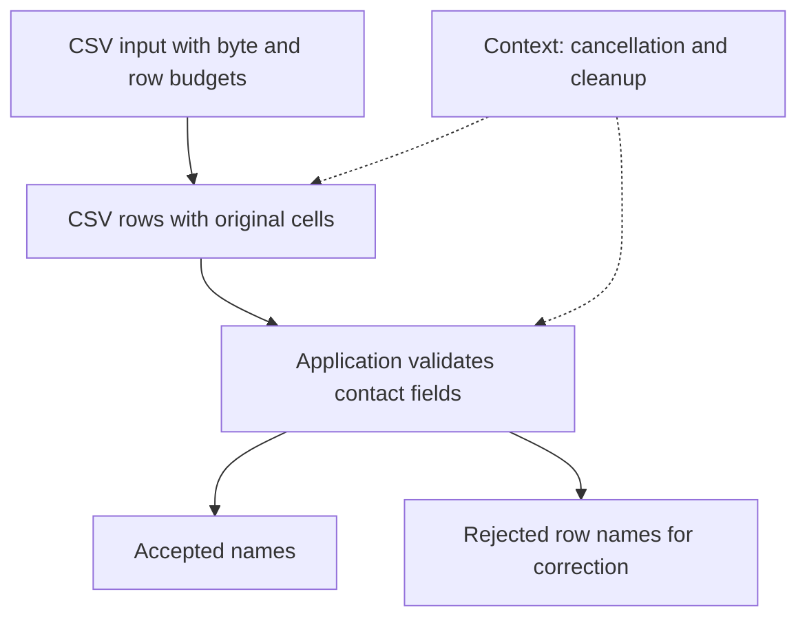

# Choose a utility when built-ins omit a needed guarantee

Start with the behavior you need. For example, a download can use plain `fetch`. If several downloads must stop
together when the user cancels, add a shared cancellation signal. Each package linked below includes an example, its
expected result, and the conditions that make the utility worth adding.
The `runnable` fence identifies a complete program through public imports; its following `output` fence records the
expected result. Unmarked fragments explain options and may require named application dependencies. Read the
[example convention](./03-composition.md#read-the-examples) before copying a fragment into a program.

The packages are experimental at version `0.0.0`. Native Web APIs remain useful: these utilities add explicit limits,
validated contracts, ownership or replay where a short built-in call does not capture the required behavior.

## Own and bound concurrent work

| Utility                                                    | What changes for the caller                                                                                                                                                                                                  |
| ---------------------------------------------------------- | ---------------------------------------------------------------------------------------------------------------------------------------------------------------------------------------------------------------------------- |
| [duration](../packages/duration/README.md)                 | Convert human-readable Temporal durations to one deterministic numeric value. A month needs a calendar anchor; repeating that decision across queues, retries and timeouts produces inconsistent answers.                    |
| [dispose](../packages/dispose/README.md)                   | Dispose owned values in a predictable order while preserving both the operation failure and any cleanup failure. Hand-written finally blocks often skip later cleanup when one callback throws.                              |
| [context](../packages/context/README.md)                   | Give nested work one cancellation signal, deadline, clock and cleanup owner. Passing separate signals and timers through every call otherwise makes it easy to outlive the caller or forget a temporary resource.            |
| [task](../packages/task/README.md)                         | Control one process-local operation with cooperative pause, cancellation and joined cleanup. A Promise alone cannot request a pause or communicate whether cancellation and resource disposal have finished.                 |
| [concurrency](../packages/scheduler/concurrency/README.md) | Bound active asynchronous work while choosing whether consumers need input order or completion order. Calling every async job before `Promise.all` waits gives it no admission limit or ownership of sibling cancellation.             |
| [capacity](../packages/scheduler/capacity/README.md)       | Reserve several scarce resources together. Separate counters can admit half of a request and leave work holding a browser while it waits forever for an upload slot.                                                         |
| [pool](../packages/pool/README.md)                         | Reuse a bounded set of expensive resources while retaining explicit lease ownership. Opening a connection for every request wastes setup work; sharing one connection without leases can interleave incompatible operations. |
| [queue](../packages/scheduler/queue/README.md)             | Give queued work an expiring claim and fenced completion. Removing an item from an array loses it when a worker dies; leaving it in place without a claim permits concurrent duplicate ownership.                            |
| [streams](../packages/streams/README.md)                   | Consume asynchronous data with explicit item, byte and line budgets. A successful Array.fromAsync can still exhaust memory if the source never ends or one record is enormous.                                               |
| [resilience](../packages/capability/resilience/README.md)  | Describe timeout, retry and admission policies as inspectable values before a host applies them. Putting retry loops around every call can repeat unsafe side effects and hide who owns the timer or storage.                |

Calling `items.map(async (item) => ...)` invokes the callback for every item. Those calls create the Promises that
`Promise.all` then waits for; the waiting operation does not start the jobs itself. A bounded mapper instead controls
how many callbacks may start. It still needs a cancellation owner to stop admitted work cooperatively.

## Name contracts and authority

| Utility                                                     | What changes for the caller                                                                                                                                                                                                        |
| ----------------------------------------------------------- | ---------------------------------------------------------------------------------------------------------------------------------------------------------------------------------------------------------------------------------- |
| [record](../packages/collection/record/README.md)           | Inspect plain data records without accidentally invoking hidden getters or trusting inherited configuration. Object.keys plus direct reads can execute accessors and silently ignore properties that validation never saw.         |
| [catalog](../packages/collection/catalog/README.md)         | Keep one canonical set of imported definitions and select subsets without losing exact object identity. A map keyed only by strings can silently replace a permission or response with a different same-ID definition.             |
| [schema](../packages/schema/README.md)                      | Use one Standard Schema validation call across validator libraries. Reading a validator-specific result shape in every utility otherwise forces consumers to use the same schema engine.                                           |
| [result](../packages/result/README.md)                      | Represent an expected success or failure as data and force call sites to choose a branch. Throwing for every missing value makes ordinary control flow indistinguishable from an unexpected provider fault.                        |
| [failure](../packages/result/failure/README.md)             | Give expected rejection a stable identity and validated data that can cross a process or storage boundary. Catching every Error by message makes a renamed sentence change application behavior.                                   |
| [fault](../packages/result/fault/README.md)                 | Project unexpected errors into bounded diagnostics without retaining the live object or invoking user getters. JSON.stringify(Error) usually drops the message; arbitrary coercion can execute application code.                   |
| [requirement](../packages/capability/requirement/README.md) | Keep declarations of required capabilities separate from the host that interprets them. Hard-coding a billing or permission SDK into each resource makes definitions impossible to inspect without starting that SDK.              |
| [authz](../packages/authz/README.md)                        | Declare roles and check exact permissions and schema-validated targets through an explicit evaluator. A boolean on a context cannot express actor-specific checks or distinguish two independently authored same-name permissions. |
| [entitlement](../packages/authz/entitlement/README.md)      | Declare which paid or enabled feature an operation requires without coupling its definition to a billing provider. Scattered plan-name comparisons otherwise make the same feature mean different things in different services.    |
| [resource](../packages/capability/resource/README.md)       | Create expensive dependencies once, borrow them through declared access and close them at their owner lifetime. Hand-built dependency bags make missing implementations, cycles and cleanup ordering hard to detect.               |
| [effect](../packages/capability/effect/README.md)           | Represent an externally visible fact separately from delivery. Logging that a file was saved does not prove an outbox or billing ledger accepted that fact.                                                                        |
| [meter](../packages/capability/effect/meter/README.md)      | Record a validated usage fact through the same authoritative effect owner as the operation. Incrementing an in-memory counter cannot prove a billing or audit sink accepted the measurement.                                       |
| [telemetry](../packages/telemetry/README.md)                | Report correlated diagnostic events without letting a broken reporter fail the operation. Console messages have no shared correlation contract and cannot buffer the useful history preceding a failure.                           |

## Place work and resume it

| Utility                                         | What changes for the caller                                                                                                                                                                                          |
| ----------------------------------------------- | -------------------------------------------------------------------------------------------------------------------------------------------------------------------------------------------------------------------- |
| [activity](../packages/activity/README.md)      | Turn a provider operation into a named, versioned unit of work with validated inputs, results and engine placement. A plain function leaves every caller to repeat those checks and decide which runtime may run it. |
| [worker](../packages/worker/thread/README.md)   | Call a standard Worker with validated, correlated requests instead of a hand-built postMessage listener. Correlation, reverse calls, cancellation and shutdown need distinct authority even when messages race.      |
| [process](../packages/worker/process/README.md) | Own subprocess termination and bounded output with one lifecycle contract across Deno and Node. A raw spawn plus scattered listeners can leave descendants alive or report success before output collection settles. |
| [workflow](../packages/workflow/README.md)      | Resume a named sequence from recorded instruction completions and send activities to eligible executors. Retrying a long function from its first line can repeat expensive work and duplicate an external commit.    |

## Build a host and a service

| Utility                                    | What changes for the caller                                                                                                                                                                                                  |
| ------------------------------------------ | ---------------------------------------------------------------------------------------------------------------------------------------------------------------------------------------------------------------------------- |
| [env](../packages/env/README.md)           | Parse configuration once into typed values and keep secret values out of diagnostics. Reading process.env throughout an application spreads defaults, coercion and validation across unrelated code.                         |
| [deno](../packages/runtime/deno/README.md) | Express Deno permission grants as data and convert them to correctly escaped CLI arguments. Hand-built flags can accidentally grant a whole directory or mishandle paths containing commas.                                  |
| [http](../packages/http/README.md)         | Preserve HTTP syntax and trust decisions before application validation. Collapsing repeated query parameters or forwarding incoming credentials blindly changes what the caller asked for and what the next service can see. |
| [server](../packages/server/README.md)     | Compose a portable fetch application from route and middleware values. A large if chain mixes routing, exception mapping and security headers, making it hard to mount the same service on another host.                     |
| [hono](../packages/hono/README.md)         | Reuse framework-neutral HTTP middleware around a Hono application. Reimplementing request correlation and response headers inside each framework makes the host contracts drift.                                             |
| [utils](../packages/utils/README.md)       | Install the suite once while importing only the focused surface a consumer needs. An eager namespace import can otherwise pull parsers, adapters and server implementations into a small program.                            |

## Read and represent external data

| Utility                                         | What changes for the caller                                                                                                                                                                        |
| ----------------------------------------------- | -------------------------------------------------------------------------------------------------------------------------------------------------------------------------------------------------- |
| [csv](../packages/format/csv/README.md)         | Turn a messy spreadsheet export into bounded text rows with header evidence and diagnostics. Splitting on commas loses quoted commas, multiline cells, duplicate headers and byte-encoding errors. |
| [sitemap](../packages/format/sitemap/README.md) | Read sitemap, feed and text discovery sources through one record model. Looking for every XML loc element loses source kind, alternate links and malformed-document evidence.                      |
| [codec](../packages/schema/codec/README.md)     | Describe both directions of a transport conversion together. Independent encoder and decoder functions easily drift when an API changes its timestamp format.                                      |

## Grow one useful job in stages

Suppose a person uploads three contact rows: Ada and Linus have valid addresses, but Grace's address is malformed.
They need a preview that lists accepted names and identifies the name on the row to correct. The
[bounded import recipe](./recipes/01-import.md) supplies that complete
program. Two different kinds of connection make it work:

Solid arrows carry row data. Dotted arrows show the lifetime supplied to work that can cooperate with cancellation;
they do not turn cancellation into a rollback. The recipe retains names in two in-memory arrays, not complete row
records. Choosing whether to retain full rows, save them, let a person correct them, or reject the entire upload remains application policy. Observation
can display progress, but only the import's returned result says which rows it accepted.

This small flow keeps the reason for each utility visible before adding a queue or separate worker. It omits network
fetching and durable storage; adding either requires an explicit owner and its own failure handling.

Begin with the [complete bounded import](./03-composition.md#import-rows-with-bounded-work), which validates two company
rows and stores their domain/name pairs. The [page URL example](./03-composition.md#discover-page-urls) combines Sitemap
data. Both mirror inspected consumer patterns with local inputs and an explicit result.

For an import that also enriches each row from a provider, add only the mechanisms its requirements need:

1. Parse a bounded input with `csv`, retaining the original column and row evidence. Use `streams.batch` for bounded
   writes. A naive comma split loses quoted cells; collecting an unbounded stream loses the memory budget.
2. Validate domain input with `schema`, then choose `result` or a declared `failure` for expected rejection. Reserve
   `fault` for unexpected diagnostics. A generic thrown string cannot tell a caller whether to fix input or report a
   provider incident.
3. Give the import a `context`. Derive deadlines for slow calls, use `concurrency` for bounded fan-out and `pool` when a
   provider resource can be reused. The caller now owns cancellation and cleanup through one lifetime rather than a
   collection of unrelated timers and connections.
4. Declare that provider as a `resource`, then declare an `activity` with its schemas, placement and requirements. The
   definition can be inspected without opening the provider. `permission` evaluates the current actor and target;
   declaration alone does not authorize the operation.
5. Compose activity requests in a `workflow` when recorded step results must be reused. The memory example preserves
   those results only while its process survives. Use the [PostgreSQL background-work path](./workflows/01-basics.md)
   for saved jobs, separate workers, and crash recovery. Keep external-write acceptance separate from telemetry, which
   only reports an observation.
6. Choose a local, `activity/worker` or `activity/process` provider. The scheduler and workflow keep their contract
   while the provider changes where the attempt runs. The provider sends validated data and correlated frames; it never
   serializes a live socket, JavaScript closure or cleanup stack.

The [activity example](../packages/activity/README.md) proves a local attempt. The
[workflow example](../packages/workflow/README.md) adds dispatch, history, scheduler and an eligible executor. The
[Worker example](../packages/worker/thread/README.md) has both complete modules; the
[process example](../packages/worker/process/README.md) starts a real child and collects bounded output. Read them in
that order when moving from one function to independent execution domains.

## What moving work actually means

An engine requirement selects an eligible executor capability. A provider owns one concrete Worker or process handle and
its transport. A workflow instruction and its input can cross that transport; its result comes back under the same
activity contract. An application can register providers for chosen threads or processes and make their eligibility
explicit.

When a worker stops, its running JavaScript stops with it. A replacement starts a new attempt and reuses results
that were recorded before the failure. The queue must also reject a late result from an attempt that no longer
has permission to finish.

The [Worker restart test](../tests/restartable-worker.test.ts) stops a Worker and checks that its replacement reuses
recorded results and that an old attempt cannot overwrite them. The
[child process test](../tests/process-orchestration.test.ts) stops a child, retries on a replacement, and gathers the
results. Both tests use memory, so stopping the process that holds the history loses it. If your backend saves
that history, it must also prevent two attempts from claiming or completing the same job at once.

The abstraction can represent future host, cluster, pod and container placement. This repository currently implements
local execution, standard Workers and child processes. It supplies no Kubernetes scheduler, container migration or
deployed cross-machine storage adapter. To add one, decide where jobs may run, how they cross machines, who closes each resource, and how to reject late
results from replaced workers. Test those rules against failures in that environment.

## Use local runtime APIs or install globals explicitly

Ordinary Utils operations use native Temporal when available and a local provider otherwise. Deadlines, logical clocks,
queue expiry and workflow timing work without installing a global. Import `@okikio/duration/temporal` when your own code
needs that local provider for instant or calendar arithmetic.

Import `@okikio/duration/polyfill` only when your application or another dependency accesses the Temporal global directly.
It installs the implementation only if that global is missing. Each Worker and child process has its own realm, so an
application that needs globals must arrange setup in each realm. The same optional entries are available through
`@okikio/utils/duration/*`. Neither approach makes a queue durable or a calendar month a fixed number of milliseconds;
the [duration guide](../packages/duration/README.md) explains calendar anchors and ownership limits.

For local cleanup, import `DisposableStack`, `AsyncDisposableStack`, `SuppressedError` and the protocol keys from
`@okikio/dispose/ponyfill`. These imports provide cleanup order and failure preservation without installing globals.
The [disposal guide](../packages/dispose/README.md) starts with one owned stack, then composes it with a CSV import.
Native `using` syntax needs the host's disposal protocol symbols; use the exported keys and explicit stack methods on
older hosts, or deliberately install missing globals through `@okikio/dispose/polyfill`.

## Find tests and measurements

Read [testing](./maintenance/01-testing.md) for behavioral and type contracts, [benchmarks](./benchmarks/01-running.md)
for measured workloads, and [runtime boundaries](./05-runtime.md) for portability and ownership.
Current checks commands and limitations live in those maintained guides;
a local historical review is not required to use the packages.
