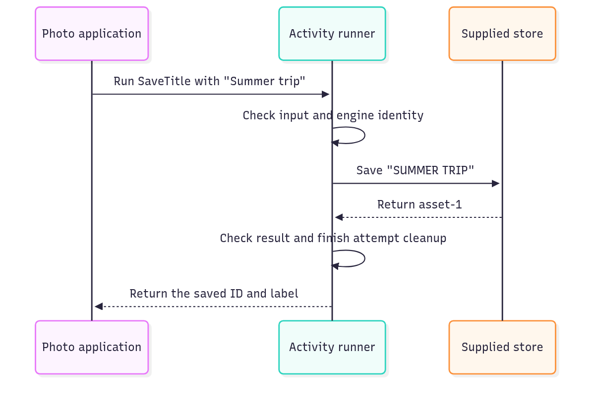

# A named job with checked input and output

An ordinary async function can validate input, borrow a client, call it, and validate the result. Activity definitions
make that contract reusable across local calls, workers, and processes. A definition does not run code. An
implementation supplies the code; its caller supplies resources.

Use a function when no reusable call contract or provider selection is needed. A local activity alone does not save work
after process loss.

## Save a title and reject an empty submission

The same save contract accepts a photo title and rejects a blank one before the store is called. The receipt contains
the new ID and normalized title; the final labels show exactly what reached the in-memory store.

Run from this checkout after `mise run prepare -- --kind deps`. Save the runnable block as `save-title.ts` at the checkout root and use
`mise exec -- deno run save-title.ts`.

The examples use a few names that can otherwise make this small idea feel larger:

| Name           | Meaning in this guide                                                                              |
| -------------- | -------------------------------------------------------------------------------------------------- |
| Definition     | The job's name, version, input and result rules. Declaring it starts no work.                      |
| Implementation | The function that actually performs the job.                                                       |
| Resource       | A supplied dependency, such as a store or browser. The job borrows it.                             |

The business operation is still an ordinary function: trim the submitted title, uppercase it, then
`await store.save(label)`. The declaration adds input/result checks around that call. Nothing is saved until
`activity.call()` invokes the implementation.

```ts runnable=save-title.ts
import * as activity from '@okikio/activity';
import * as resource from '@okikio/capability/resource';
import { SchemaValidationError } from '@okikio/schema';
import * as schema from '@okikio/schema';

// These declarations check a call contract; they do not launch a host or save data.
const InputSchema = schema.object({ title: schema.string({ pattern: /\S/ }) });
const ReceiptSchema = schema.object({ id: schema.string(), label: schema.string() });

/** The activity borrows this store; the surrounding resource collection owns it. */
const Store = resource.define<{ save(label: string): Promise<string> }>()({
	id: 'photo.store',
	description: 'Save a photo label and return its ID.',
});

// This example's only business state. Invalid input must never reach this array.
const labels: string[] = [];
// Supply a local demo store. The declaration above describes the resource; this implementation creates it.
const StoreLive = resource.implement(Store, {
	create: () => ({
		/** Keep demo data in memory; this method does not persist across process loss. */
		async save(label) {
			labels.push(label);
			return `asset-${labels.length}`;
		},
	}),
});

/** Reuse these input, result and dependency rules across callers. */
const SaveTitle = activity.define({
	id: 'photo.save-title',
	version: '1',
	input: InputSchema,
	result: ReceiptSchema,
	resources: [Store],
});

/** The runner validates input before this function borrows the store. */
// Bind behavior to the checked activity definition before running an attempt.
const SaveTitleLive = activity.implement(SaveTitle, {
	/** Borrow the declared store through this attempt's context, then return the declared result. */
	async run(ctx) {
		const store = await ctx.get(Store);
		const label = ctx.input.title.trim().toUpperCase();
		return { id: await store.save(label), label };
	},
});

// Share one lazily opened store across both calls; this scope owns its cleanup.
await using stores = await resource.open(StoreLive);
const receipt = await activity.call(SaveTitleLive, { title: 'Summer trip' }, { resources: stores.collection });
console.log(receipt.id, receipt.label);

// A second call proves that schema rejection happens before the storage write.
try {
	await activity.call(SaveTitleLive, { title: '   ' }, { resources: stores.collection });
} catch (error) {
	if (!(error instanceof SchemaValidationError)) throw error;
	console.log('Empty title rejected');
}
console.log('Saved labels:', labels.join(','));
```

```text output
asset-1 SUMMER TRIP
Empty title rejected
Saved labels: SUMMER TRIP
```

## Keep a save operation behind one checked contract

The local call hides details that matter only to a scheduler: generating a local attempt ID, setting its first attempt
number, and opening a cancellation/cleanup lifetime. It still validates input and result and enforces requirements.
It saves no job, makes no retry, and grants no permission. `activity.run()` remains available to a host that already
owns those attempt details.

The example borrows `stores.collection` so both calls share its lazily created store. For one call, pass
`{ resources: StoreLive }` and let the call own that store's lifetime. To cancel from an existing request, also pass
`{ ctx: requestContext }`; the call closes only its own child lifetime. A definition can opt into explicit engine
placement later. The default is `engine.local`, and `call()` never chooses a remote engine implicitly.

A photo title arrives from a form. Before a storage client sees it, the activity checks that it contains text. After the
client saves it, the activity checks the receipt. Different callers can use that same contract without copying
validation around every save. The example above shows both an accepted title and a rejected empty one.

The common path is `define()`, `implement()`, then `call()`. A host that already owns attempt identity can use the
lower-level `run()` instead:

| Call or contract                                            | What it contains or returns                                                              | What actually runs                                                       |
| ----------------------------------------------------------- | ---------------------------------------------------------------------------------------- | ------------------------------------------------------------------------ |
| `define()` → `ActivityDefinition`                           | ID, version, input/result schemas, placement, and optional dependencies/failures/effects | Declaration only; no job starts.                                         |
| `implement(definition, { run })` → `ActivityImplementation` | The exact definition and your function                                                   | Registration only; the function has not been called.                     |
| `call(implementation, input, options?)`                          | A result inferred from the definition, with a local engine and an owned call lifetime | One checked call; the caller supplies input and any application resources. |
| `run(options)` → `Promise<ActivityResult<Activity>>`        | A result inferred from the definition's result schema                                    | One checked local attempt with supplied input and dependencies.          |
| `ActivityContext` supplied to `run`                         | Typed `input`, `signal`, job ID, attempt number, `get()`, checkpoint and cleanup methods | Your function uses this state; it still returns its normal result value. |

The result schema determines the Promise's value type. Changing a definition's input schema changes the implementation's
typed `ctx.input`. Keeping those schemas on one definition prevents separate callers and remote hosts from quietly
drifting into different versions of the same job.

Underneath a direct `run()`, the runner checks engine and attempt identity, validates input, and creates an owned child
context. It adds the declared resource/permission/effect views, applies admission requirements, calls your function,
validates its result, and awaits attempt cleanup. Invalid input never reaches the function. Schemas may be asynchronous,
so the outward result is a Promise even when your function returns a string immediately.

`call()` supplies the local engine identity and owns those attempt details for you. The lower-level `run()` asks the
caller for them because a scheduler already owns that identity, retry count and resource lifetime. An engine is a named
execution capability, not a running process. Supplying its identity never launches a remote host or makes an external
write durable. Keep this lower-level control for the point where another owner actually needs it.

## Follow one job from input to result

Imagine saving a title for an uploaded photo. The activity checks the submitted title, asks the supplied store to save
it, and checks the returned receipt before giving it to the caller. Read this diagram from top to bottom; the caller,
activity runner and store are separate participants.



[Editable diagram source](../packages/activity/diagram.mmd). The store does the saving; the activity adds one consistent
call contract around it. Resource declarations describe and type the job's dependencies; they are not a sandbox for
untrusted implementations. This picture shows a successful local attempt. A failed input check stops before the
implementation runs. Cancellation asks cooperative work to stop; it does not undo a write that the store has already
accepted. Retries and durable scheduling belong to a host such as [workflow](../packages/workflow/README.md), rather
than to this direct call.

For shared terms such as `await` and `await using`, see
[the short glossary](./02-learn.md#read-the-small-amount-of-code-you-need).

For the exact functions, types and field explanations, read the
[package entry map](../packages/activity/README.md).

## Choose the next piece for your scenario

| You need to achieve                                   | Combine                                                                                                    | What changes for the caller                                                                              |
| ----------------------------------------------------- | ---------------------------------------------------------------------------------------------------------- | -------------------------------------------------------------------------------------------------------- |
| Validate and save one submitted title                 | Activity + [resource](../packages/capability/resource/README.md)                                           | The caller receives a checked receipt and the job borrows a declared store.                              |
| Stop an upload when its caller leaves                 | Activity + [context](../packages/context/README.md)                                                        | Pass cancellation to the actual upload operation and release its local resources.                        |
| Create a preview, then save its location              | Activities + [workflow](../packages/workflow/README.md)                                                    | The sequence requests named steps and can reuse recorded completions through its configured history.     |
| Run costly work outside the caller's execution thread | Activity [Worker provider](../packages/activity/worker.ts) + [worker](../packages/worker/thread/README.md) | Serializable input and results cross a transport; the receiving host supplies its own live dependencies. |

The workflow guide runs two real activity implementations through a local provider. Start there before adding a remote
host. Sharing dispatch and history across computers needs authoritative adapters; drawing an engine in a diagram does
not supply that infrastructure.

## Request a job from a workflow

Inside a workflow that declares `SaveTitle`, request the same job with its checked input:

```ts
const receipt = yield * ctx.trigger(SaveTitle, { title: 'Summer trip' });
```

The generator exposes a serializable instruction. Its scheduler chooses recorded reuse or execution; this line does
not call the implementation directly. The lower-level `activity.request()` form creates the same kind of instruction
when a caller needs it outside the workflow context convenience.

`activity.try()` creates the same request but converts only declared activity failures into `@okikio/result`. Unexpected
faults and cancellation still escape.

## Direct attempts

`activity.run()` executes one exact implementation in the current host. A host supplies the engine identity, input,
parent context, resource collection, job identity, attempt number, and optional permission/effect services.

The complete local calls above supply every dependency. The following larger composition sketch instead assumes your
application declares a `Download` activity with `Http` and `Storage` resources, a `ReadSource` permission, and a
`DownloadCommitted` effect. It also supplies `openWriter()`. Its input includes `url` and `id`; those are application
contracts rather than additional exports from this package.

```ts
const DownloadLive = activity.implement(Download, {
	/** Copy source chunks into an owned writer, then await the declared completion effect. */
	async run(ctx) {
		await permission.assert(ctx, ReadSource, { url: ctx.input.url });
		const http = await ctx.get(Http);
		// Register the writer immediately so failure or cancellation still joins its cleanup.
		const writer = ctx.use(await openWriter());

		for await (const chunk of http.get(ctx.input.url, ctx.signal)) {
			// This is where a cooperative pause can stop admission of the next write.
			await ctx.checkpoint();
			await writer.write(chunk);
			// Await the host's heartbeat reply; a local observation alone cannot renew authority.
			await ctx.heartbeat({ bytes: chunk.byteLength });
		}

		// Keep the consequence key stable when this logical download is retried.
		await effect.emit(ctx, DownloadCommitted, {
			url: ctx.input.url,
		}, {
			key: `download:${ctx.input.id}`,
		});

		return { ok: true };
	},
});
```

The direct attempt performs this sequence:

1. Validate the job and attempt identities.
2. Validate input with the activity schema.
3. Create one owned child context.
4. Attach the requirement runtime and reachable permission view.
5. Attach only the effects declared by the activity.
6. Expose the declared resource types to the implementation and retain collection requirement checks.
7. Apply direct active requirements unless a Scheduler already admitted them.
8. Run the initial cooperative checkpoint.
9. Invoke the exact implementation.
10. Validate the result schema.
11. Reject an expected failure that the activity did not declare.
12. Dispose attempt-owned values.

An implementation receives `ctx.get()` for borrowed resources and standard owned-context operations such as `use()`,
`adopt()`, and `defer()` for values it creates itself.

## Scheduler admission

The default workflow Scheduler applies an activity's direct active requirements before it reserves engine capacity. It
then records that this attempt already passed admission. The provider calls `activity.run()` with that attempt, which
binds dynamic permission/effect/resource scopes without repeating the admission check.

A caller that invokes `activity.run()` directly has no Scheduler above it, so direct requirements are applied by `run()`
itself.

## Engine placement

`@okikio/activity/engine` owns static execution-target definitions and placement choices:

```ts
const placement = engine.oneOf(
	engine.prefer(Browser),
	engine.allow(Server),
);
```

`require()` selects one exact engine. `prefer()` and `allow()` define an ordered fallback choice. Placement does not
start a process or Worker. Live engine providers run through `workflow.executor()`; `scheduler.register()` is the
attached-host convenience for that local scheduler path. For the PostgreSQL saved-work path, `workflow.serve()` binds
implementations directly and permits separate worker roles. The [worker guide](./workflows/03-policy.md#bind-a-worker)
explains that assembly.

## Provider subpaths

The package includes generic providers that compose existing runtime utilities:

- `@okikio/activity/local` executes an implementation in the executor host.
- `@okikio/activity/worker` composes `@okikio/pool` and `@okikio/worker/thread`.
- `@okikio/activity/process` composes `@okikio/pool`, `@okikio/worker/process`, and the typed process channel.

For the local scheduler path, dispatch owns queued job IDs, attempt numbers, and accepted results. Providers report
success, declared failure, unexpected fault, cancellation, or execution loss. Executors save retry decisions through
that same queue owner. They do not silently create a new logical job.

Permissions, effects, and heartbeats cross Worker/process transports as correlated reverse calls. The authoritative host
validates the permission target or effect definition again before it answers. A heartbeat becomes meaningful only after
the executor renews the current attempt's temporary queue permission.

## Pause and cancellation

Pause is cooperative. A running implementation pauses only when it calls `ctx.checkpoint()` or returns control. A
`fetch()`, codec call, filesystem mutation, or database operation is not suspended at an arbitrary JavaScript
instruction.

Cancellation changes the local `AbortSignal` immediately. Worker and process providers also send the matching
cancellation message. Cleanup still follows the owned activity context.

## Operations and failures you will reach for next

After the basic definition/request/run path, these exports cover composition and result handling:

- `catalog()` and `select()` build and narrow named activity definition sets.
- `document()` produces deterministic, JSON-safe definition metadata for tooling.
- `try()` converts a declared activity failure into a Result branch. Unexpected faults and cancellation still throw.
- `isFailure()` checks whether a result contains one declared activity failure.
- `InvalidEngineError` reports a provider that claims the wrong engine definition.
- `UndeclaredFailureError` reports an implementation that returns a failure the activity definition did not declare.

## Decide which bookkeeping to keep in your application

| Convenience                                  | Manual equivalent                                                                                                 | Concrete value                                                |
| -------------------------------------------- | ----------------------------------------------------------------------------------------------------------------- | ------------------------------------------------------------- |
| `activity.define()` + `activity.implement()` | freeze metadata, keep a handler map, then validate input/result/failure schemas around every call                 | one activity identity and validation contract                 |
| `activity.request()`                         | construct a typed workflow instruction, suspend the generator, dispatch it, then validate the completion yourself | scheduler-facing request semantics without transport coupling |
| `activity.try()`                             | catch declared failures separately from unexpected faults and rebuild the discriminated result                    | declared failure stays data instead of becoming an exception  |

`@okikio/activity` is a convenience layer, not a hidden runtime. You can reproduce its core mechanics with a function
call plus your own attempt IDs, permission checks, resource lookup, cancellation, and result transport.

Use the utility when those rules must stay identical across local, Worker, and process execution.

## Source guide

The paths below are relative to the [package directory](../packages/activity).

Start with the package README linked above, then use the source in this order when you need more detail:

1. `mod.ts` shows the supported runtime operations and the composition shape.
2. `types.ts`, when present, shows the public value and behavior contracts.
3. `*.test.ts` files show edge cases, cancellation, invalid input, and lifecycle behavior as executable examples.
4. `remote.ts` owns the common activity identity, catalog checks, and protocol schemas for process and Worker providers.
   `process.ts` and `worker.ts` retain their separate host startup, transport, and shutdown behavior.
5. Read other internal implementation files only when you need the exact state transition or performance-sensitive loop.

Use this guide for scenarios and design decisions, and [the package source](../packages/activity/mod.ts) for the
source-derived exported contracts.

## Unexpected runtime diagnostics

Unexpected thrown values are projected through `@okikio/result/fault` before they are sent to another runtime or saved to storage. This
is separate from `@okikio/result/failure`, which represents expected declared failures with stable application identity.
