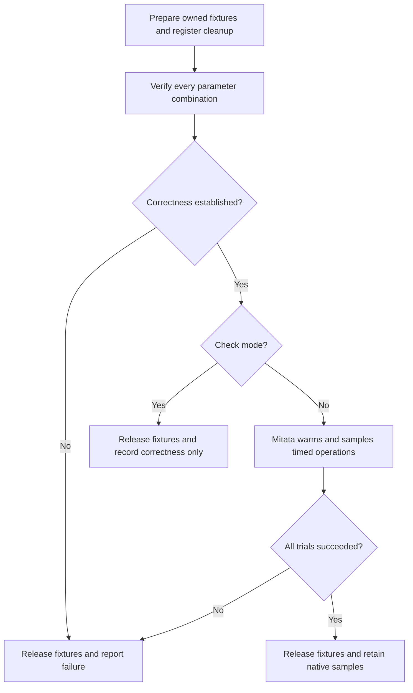

# Benchmarks

Suppose a CSV import takes longer than expected. First test that the parser still reads the same rows. Then measure the
same input before and after your change. If parsing gets faster, measure the full import too: the parser may account for
only a small part of the time the user waits.

Use the [profiling guide](./02-profiling.md) when you need to locate CPU work inside a trial. Profiling explains where
time goes; repeat unprofiled timings to establish a speedup.

The [compiled HTTP challenger guide](./04-challengers.md) compares Utils with Hono, Elysia and Vixeny on one runtime at
a time. It explains the literal preflight, the TypeScript-only Vixeny dependency emission, eight balanced fresh
processes and the different V8/JavaScriptCore profile boundaries.

A benchmark repeats a fixed operation to estimate its cost. A correctness check
first confirms that the operation produces the intended result; it is not a
performance measurement. Warmup lets the runtime prepare code before sampling.
The baseline is another implementation doing the same defined work, not an
unrelated faster operation. Read the workload and limits before comparing numbers.
A fast local sample cannot establish production throughput or failure recovery.

## Run the package first, then its larger workflow

When a utility becomes expensive, start with its own tests and benchmark. They isolate the public operation, make setup
and cleanup visible, and can run from that package using its declared development dependencies. The root collector can
still launch these programs in fresh processes and retain their reports.

```sh
deno task --cwd=packages/pool test
deno task --cwd=packages/pool bench:check
deno task --cwd=packages/pool bench
```

Each package owns `*.bench.ts`, nearby fixtures, its reference implementations and a small fixture-local Mitata runner.
These development files are excluded from published packages. Imports into another utility use its public exports;
package benchmarks never reach into root-private tooling. Ordinary relative imports within the same package remain
useful. Root `tests/` and `bench/` own composed workflows, installed consumers, real-host composition and recovery. A
shared launcher does not make a focused workload an integration benchmark.

`tools/bench/suite.ts` keeps separate package and integration registries. To retain raw reports for a focused suite or
validate its fixtures on a real runtime, use:

```sh
mise run bench -- --check --suite=packages
mise run bench -- --check --suite=packages --runtime=node
mise run bench -- --check --suite=packages --runtime=bun
mise run bench -- .tmp/artifacts/bench/package-pilot --suite=packages
mise run bench -- .tmp/artifacts/bench/integration-pilot --suite=integration
```

Use `--timeout-ms=120000` to stop a program after two minutes; a timeout retains its failure receipt. Output directories
must be new. The collector refuses to overwrite existing evidence. `--program` still selects one registered program, and
`--runtime=node` or `--runtime=bun` selects the actual host. Package-local `bench` commands print Mitata output; use the
collector when retaining metadata and machine-readable raw samples.

## Structure a workload before collecting samples

Keep three parts visible in each program: prepare representative inputs, verify their full expected results, then
register the timed operations. `--check` returns before Mitata runs its callbacks or generators. An oracle inside a
generator therefore does not test that workload in CI. Verify every registered parameter combination before calling
the runner.

The [Hash workload](../../packages/hash/hash.bench.ts) demonstrates this order. It prepares four byte sizes, compares
complete digests with Web Crypto, checks three stream chunk sizes at each size, and requires a `RangeError` for a
one-byte-over-limit input. EOF and rejection must both release the stream lock. Only then does it register parameterized
trials. Corpus allocation is excluded; native input copying and stream construction, reading and finalization remain
inside their respective timed operations.

The chart shows the shared execution contract. Both modes own cleanup, including when an oracle or timed operation
throws. It omits the collector's runtime metadata and source hashing, which are described below.



Use the [installed Mitata API](https://github.com/evanwashere/mitata#readme) deliberately:

- Use `.args()` for named size or workload dimensions and `.range()` when its scale fits the question. A generator
  prepares a trial before yielding the timed operation. Keep an independent preflight outside it.
- Use computed parameters only when per-invocation preparation must be excluded. Their recomputation order and call
  count are not guaranteed; do not acquire leases or hide required cleanup in them.
- Use `group()` for a workload family. Use `summary()` or a baseline ratio only when the compared work and parameters
  are equivalent. A primitive value read or tokenizer can remain a separately labelled cost reference.
- Use concurrency parameters for simultaneous operations when that is the question. Increasing concurrency changes
  offered load; it does not establish a fixed-work speedup. Keep total work and admission limits explicit.
- Consume outputs with `do_not_optimize()`. Preserve the runner's `throw: true` policy so a failed trial fails the task.
  Retain GC mode and runtime metadata when interpreting samples.

Compare complete results before timing. The [Collection workload](../../packages/collection/collection.bench.ts)
checks the value for every key, then checks that the result is immutable and has no prototype. Its JSON check
compares decoded values and key order. A sum or row count could match even if values went to the wrong keys.
The native mapping comparison does not protect keys or make the output immutable.

Resource cleanup is part of the selected measurement boundary. The [Pool workload](../../packages/pool/pool.bench.ts)
times lease return and joins accepted borrowers even if admission checks fail. Its warm pool is prepared once; rotation
scenarios include construction and shutdown. The [SQL outbox workload](../../bench/outbox.bench.ts) verifies exact keys
and payloads before measuring fixed sixteen-message cycles; each cycle includes acknowledgement and pruning, while its
connection pool and migration stay outside timing.

A registered callback can run long after its registration loop ends. The
[Task workload](../../packages/task/task.bench.ts) retains progress sources and projections in a module-owned
`DisposableStack` until `await run()` completes. A loop-local `using` would close them before measurement starts. The
[Context workload](../../packages/context/progress.bench.ts) uses the same ownership boundary for steady readers, while
each attach/publish/dispose trial owns a separate short-lived fixture. Check mode proves the untimed oracle; an actual
timed run is still needed to exercise the registered callbacks and generators.

Choose distinct fixture values when association or sequence matters. The streamed HTTP and Worker workloads use
different messages or byte patterns for successive chunks. The Scheduler map preflight checks every output in input
order, or checks full membership when completion order is permitted. A checksum alone would miss a duplicate paired with
a missing value. These assertions stay outside the timed operation when full comparison is not part of the cost being
measured.

## Choose a comparison that answers the question

An equivalent-work baseline must return the same required result with equivalent validation, ordering and cleanup. A
simpler native operation can instead expose the cost of additional guarantees, but its label must name what it omits.
For regression studies, preserve the previous source, fixtures and harness identity and compare them on the same host. A
wrapper around the same underlying parser is adapter evidence, not independent parser correctness.

## Reference implementations

An optimized implementation needs a separate correctness oracle when practical. The HTTP router benchmark compares
prepared lookup with an independent linear matcher. The correctness tests first prove that both implementations select
the same routes.

A performance result is useful only after the semantic comparison succeeds.

## Representative workloads

Measure the physical work that matters to the caller. Depending on the package, record throughput, latency distribution,
allocations, retained memory, startup, cleanup, cancellation latency, provider calls, writes, or active resources.

Router workloads should vary:

- route count
- static and parameterized route mix
- HTTP method mix
- path depth
- hit and miss ratio
- route specificity

A one-route microbenchmark cannot justify a routing architecture.

## Bundle and type-check performance

Runtime throughput, consumer bundle size, and TypeScript cost are separate budgets.

Use `tools/packages/bundles.ts` to detect bundle regressions between focused imports and the matching `@okikio/utils/*`
imports. Measure editor and type-check cost separately when public declaration graphs or generics become large.

## Run benchmarks

Run all registered benchmarks through mise:

```sh
mise run bench
```

Select one workload while retaining the same measurement metadata:

```sh
mise run bench -- .tmp/artifacts/bench/convenience-deno --runtime=deno --program=packages/duration/duration.bench.ts
mise run bench -- .tmp/artifacts/bench/convenience-node --runtime=node --program=packages/duration/duration.bench.ts
mise run bench -- .tmp/artifacts/bench/convenience-bun --runtime=bun --program=packages/duration/duration.bench.ts
```

The default complete suite runs on Deno because it includes Deno host fixtures. Node and Bun can run the focused
`--suite=packages` suite or an explicit `--program` selection that supports the requested host. The measurement owner
records the actual child executable and version separately from its Deno orchestrator. Node and Deno expose
`globalThis.gc()`; the pinned Mitata implementation selects `Bun.gc(true)` on Bun. Its default collects once before
sampling, and workloads can override that mode. Natural collection can still occur during timed allocations. These hooks
do not make different runtime collectors equivalent. Compare implementations within a runtime before making a
cross-runtime claim.

Record the runtime version, workload parameters, and comparison baseline with any published number. Do not report an
exploratory Node result as a Deno benchmark.

## What the current workloads measure

| Workload                | Semantic proof before timing                                                               | Measured boundary and limit                                                                           |
| ----------------------- | ------------------------------------------------------------------------------------------ | ----------------------------------------------------------------------------------------------------- |
| Environment             | Both parsed field values                                                                   | Parse and coerce an explicit record; no ambient environment read                                      |
| CSV collecting          | Every value in 10,000 five-column rows, plus a tiny fixture                                | Byte decoding, dialect/header discovery, row validation and document allocation                       |
| CSV streaming           | The same exact cells and row order                                                         | 64 KiB source chunks, parsing and incremental counting; consumer retains no row array                 |
| CSV tokenizer reference | The raw header plus the same exact data cells                                              | Tokenization only; excludes the utility's metadata, diagnostics and discovery                         |
| Queue                   | FIFO inputs, exact reference/result association and terminal counts                        | Add, claim and complete 1,000 items, including ownership and cleanup                                  |
| Array FIFO reference    | Primitive values consumed                                                                  | Cost reference only; no leases, expiry, fencing or stored completions                                 |
| Pool                    | Borrowed values and returned occupancy                                                     | Warm acquire/release and lease return; direct object binding reads are a separate primitive reference |
| Activity dispatch       | Unique job input and corresponding result for every reference                              | Add, claim and complete activities; no executor or workflow replay is measured                        |
| Coordination            | Result still belongs to its input and one of four pooled resources; no live leases/waiters | 100 queue jobs through a four-resource pool, including UUID creation and cleanup                      |
| HTTP composition        | Status, middleware headers and JSON payload                                                | Separate headers/body cancellation from complete JSON consumption; no network listener                |
| Discovery               | Exact CRM cells and sitemap URL set                                                        | Parse a fixed corpus; no fetch, DNS, cache or crawler scheduling                                      |
| Workflow identity       | Repeated instructions share fingerprints; changed instructions do not                      | Hash 32 timer instructions; no workflow execution, durable storage or restart                         |
| Router                  | Every prepared result agrees with an independent linear route selection                    | 16, 256 and 4,096 routes, 256 requests, static/parameter paths, HEAD fallback and misses              |

Run `mise run bench -- --check` for these oracles without collecting a performance number. A failed Mitata case also
fails the measuring command through its `throw` option. None of the workloads impose a minimum speed, exact duration,
exact generated ID or allocation count.

The CSV tokenizer, array FIFO and direct value read do less work than their utility counterparts. Their costs can
explain overhead; their ratios do not prove a faster equivalent implementation. The router candidates do equivalent
request selection for the supplied corpus. Separate correctness tests cover route overlap and specificity; the benchmark
does not claim to model every production route distribution.

The stream workload bounds application retention, not measured peak heap. Parser buffers, chunk size, headers and
runtime allocation still contribute. A bounded consumer test cannot substantiate a numerical memory claim. Add a native
heap experiment before publishing one, and include Unicode, quoting, encoding and chunk distributions when evaluating a
changed CSV implementation.

## Find the operation and its comparison

Every package has focused tests and at least one independently runnable benchmark. These cases explain local costs; they
do not establish that every export has been benchmarked or that a local winner wins in a complete workflow. The package
README gives the commands and connects results to its programming model.

| Package                                           | Focused workload                                                                                      | Comparison and interpretation                                                                                                                                                      |
| ------------------------------------------------- | ----------------------------------------------------------------------------------------------------- | ---------------------------------------------------------------------------------------------------------------------------------------------------------------------------------- |
| [activity](../../packages/activity/README.md)     | Local validated attempts and placement across 10–1,000 hosts                                          | Direct validated arithmetic; selection without a diagnostic report. Provider startup and remote execution remain root scenarios.                                                   |
| [authz](../../packages/authz/README.md)           | 1–256 local checks; redacted explanations for 10–1,000 denied leaves                                  | Direct predicate without scope, validation or evidence. This does not measure a remote policy service.                                                                             |
| [capability](../../packages/capability/README.md) | Resource lifetimes, effects, policy evidence and 10–1,000-definition inspection                       | Explicit value cleanup, direct sink and enforcement without reports. Provider I/O and durable delivery are excluded.                                                               |
| [collection](../../packages/collection/README.md) | 10–100,000 own keys and catalog definitions; mapping and sorted JSON                                  | Native trusted mutable records. Native references omit hostile-input checks and immutable output.                                                                                  |
| [context](../../packages/context/README.md)       | 1–10,000 projections, clock sleepers and observer delivery                                            | Manual reader/cell composition; callback versus Observable delivery. Snapshot migration through Storage remains a root workflow.                                                   |
| [dispose](../../packages/dispose/README.md)       | 1–1,024 cleanup callbacks, including registration and error handling                                  | Equivalent successful reverse finally-loop. The successful reference does not reproduce suppressed-error chains.                                                                   |
| [duration](../../packages/duration/README.md)     | Fractional units and a 23-hour calendar day                                                           | Direct pre-balanced Temporal values. Pre-balanced inputs omit numeric convenience validation.                                                                                      |
| [env](../../packages/env/README.md)               | Typed field parsing and validated two-source provenance                                               | Direct Zod parsing. Direct parsing omits source diagnostics and provenance.                                                                                                        |
| [format](../../packages/format/README.md)         | CSV startup, 10,000 rows, difficult chunk boundaries and Sitemap inspection                           | Tested @std/csv and csv-parse tokenizers; matched row validation. Tokenizer output is not a complete document model; collecting and streaming have different memory costs.      |
| [hash](../../packages/hash/README.md)             | SHA-256 at 1 KiB, 16 KiB, 256 KiB and 4 MiB; 16 KiB stream chunks                                     | Web Crypto with the same defensive copy; portable synchronous SHA-256. Byte-limit rejection is checked. These results do not compare different hash algorithms.                    |
| [hono](../../packages/hono/README.md)             | Successful and missing routes with fully consumed response bodies                                     | Direct Hono with the same request/body work. The local comparison has no middleware. Composed security middleware remains at root.                                                 |
| [http](../../packages/http/README.md)             | Streaming bodies, validators, cookies, retry planning and webhook replay admission                    | Native or reduced-contract references named by each case. There is no network listener in these package measurements.                                                              |
| [input](../../packages/input/README.md)           | Form values, key bindings and command discovery at configured scales                                  | Direct FormData/native lookup references. Synthetic input does not establish browser user-activation or device latency.                                                            |
| [pool](../../packages/pool/README.md)             | Warm leases, 8 active/32 waiting/32 rejected borrowers, reset and retirement                          | Direct reusable value reads; caller reset with the same owned rotation. Direct reads omit admission and cleanup guarantees. Saturation checks assert all leases return.            |
| [query](../../packages/query/README.md)           | Signed cursors with 1/4/8 order keys; query URL round trips with 1/32/100 values and rejection at 101 | Native signer over raw values. Raw signatures omit expiry, context binding and cursor-envelope validation.                                                                         |
| [result](../../packages/result/README.md)         | 1–10,000 values; successful, early, middle and late failures                                          | Equivalent explicit loop preserving frozen output and failure identity. Position-dependent cost is intentional; aggregation stops at the first failure.                            |
| [runtime](../../packages/runtime/README.md)       | 1 and 1,000 frozen host-evidence snapshots                                                            | Primitive feature checks only. Primitive checks omit the report. Real ports and host permissions remain root diagnostics.                                                          |
| [scheduler](../../packages/scheduler/README.md)   | Mapping at 1/8/64 concurrency, queue lifecycle and inspection                                         | Existing mapping owner; FIFO or reduced-contract references named in cases. Local queues are not durable database queues; ordered head-of-line costs need separate interpretation. |
| [schema](../../packages/schema/README.md)         | Tuple encode/decode; 100/10,000 invalid rows with capped/full issues                                  | Manual sequential validated decode; uncapped diagnostics. Bounded evidence changes diagnostic output and is not an equivalent full-report replacement.                             |
| [server](../../packages/server/README.md)         | 16, 256 and 4,096 routes with HEAD and misses                                                         | Independent linear route-selection reference. This isolates routing. Complete validated services and network behavior remain root workflows.                                       |
| [storage](../../packages/storage/README.md)       | 1–10,000 values; initialize, replace, reject stale version and read                                   | Three structured clones without validation/version arbitration. Memory slots lose data on process exit. PostgreSQL collection is an explicit external-service lane.                |
| [streams](../../packages/streams/README.md)       | Text, byte frames and validated JSON at the program’s explicit chunk scales                           | Native TextDecoderStream or explicit framing references. Chunking, materialization and validation differ between cases; no network throughput is implied.                          |
| [task](../../packages/task/README.md)             | Joined child lifetimes and shared-source progress snapshots                                           | Ordinary Task lifecycle; raw source read. Raw reads omit weighted progress; local Tasks do not establish durable orchestration.                                                    |
| [telemetry](../../packages/telemetry/README.md)   | 1–10,000 unique keys, bounded history and queued JSON writes                                          | Direct noop reporting or direct writes. Queue and retention policies add guarantees. Count caps do not establish an exact heap-byte bound.                                         |
| [utils](../../packages/utils/README.md)           | 1 and 1,000 duration conversions through focused and forwarded entries                                | The same focused function, with identity asserted. Warm calls cannot prove cold-import or bundle cost. Those remain root artifact measurements.                                    |
| [worker](../../packages/worker/README.md)         | 1–256 local successful/fault receipts with released correlations                                      | Explicit successful finally cleanup. This excludes transport, serialization and native Worker startup; root host scenarios measure those.                                          |
| [workflow](../../packages/workflow/README.md)     | 1,000 deterministic jobs through add/claim/complete                                                   | Native Map bookkeeping without placement, validation or leases. This local component benchmark is not process-death recovery; composed recovery stays at root.                     |

## Retain reproducible measurements

`mise run bench` executes every registered program serially. Each program owns a fresh Mitata registration realm. The
runner stores native JSON samples and stderr separately under `.tmp/artifacts/bench/<timestamp>/`, together with
runtime, CPU, platform, color policy, GC policy, exact child arguments and SHA-256 hashes of source, fixtures, manifests
and lockfiles. Source hashes are checked again after the last program. A changed input, failed workload, truncated
report or empty sample set cannot become a completed measurement. A watchdog bounds a stuck program; it is not a speed
gate. Pass a directory explicitly with `mise run bench -- /path/to/report` when preserving evidence outside the
checkout.

Mitata receives `throw: true` and `colors: false`. Package benchmark profiles explicitly grant `NODE_DISABLE_COLORS`,
`NO_COLOR`, `FORCE_COLOR` and `CI`; the serial runner uses a fixed plain-output policy. This prevents a terminal-policy
lookup from failing before a benchmark starts in a restricted Deno environment. Metadata identifies the available
collection hook: exposed `globalThis.gc()` on Node/Deno and Mitata's `Bun.gc(true)` on Bun. Each case can select its
collection mode; the default is once before sampling. Samples and available heap/GC observations remain in the native
report.

`mise run bench -- --check` runs the actual untimed fixtures and correctness oracles in isolated child processes. CI
runs this gate and does not use noisy shared-runner timings to accept a release. Full native measurements belong on an
idle machine. The report records the environment but cannot certify that unrelated work was absent. No throughput,
elapsed millisecond, heap size or fixed output-text threshold is part of the correctness contract.

The measurement task runs with full permissions because it launches the declared native host fixtures and reads Linux
cgroup quotas. Deno requires full permission for those special filesystem paths even when ordinary read and system
permissions are granted. Package benchmarks have restricted package-local profiles; the measurement owner has the
authority of the selected fixture programs.

Mitata reports how much heap allocation changes in the parent V8 process. It does not report peak resident
memory, include memory from Workers or subprocesses, or prove that the code has no memory leak. The stream cases
show that the caller reads in parts and measure how the cost changes with input size. They do not set a memory
ceiling.

Separate tests check which host releases each resource and how work finishes. To measure a browser, a deployed
storage adapter, or a remote cluster, run a benchmark in that environment.

After `mise run test -- --suite packages` creates the physical clean consumer, measure its ESM package
roots with `mise run bench -- --operation npm`. Read the owned temporary consumer path from
`.tmp/artifacts/npm/consumer-location.json` when supplying it explicitly. The consumer lives outside the checkout so
Node cannot find uninstalled workspace packages through ancestor directories. This separate program includes all
portable npm roots, the focused umbrella result subpath, the eager umbrella and matched empty-child baselines.
`@okikio/runtime/deno` is deliberately absent from npm. Every trial uses a fresh native Node process that resolves the
installed archives; it does not import workspace TypeScript. These costs include launch/exit and do not imply an OS
cache was cold.

To include those cases in the same retained serial report, pass both paths:
`mise run bench -- /path/to/report /path/to/physical-consumer`. The npm gate also retains strict all-subpath
ESM TypeScript diagnostics and owned declaration size in its clean consumer's `types-report.json`. That elapsed
time includes compiler startup and is a declaration correctness/size observation, not an editor responsiveness
guarantee.

## Capability delivery diagnostics

The 2026-11-04 implementation adds focused Mitata programs for native payload admission, Activity placement/providers,
Workflow fixtures, queue inspection and PostgreSQL state/migration planning. `activity-providers.bench.ts` owns actual
Deno module Workers and child processes; both peers use the same frame limit. Its warm batches are sequential, not a
concurrent throughput or p99 study. `worker-budgets.bench.ts` compares public native Worker requests with and without
logical admission budgets. Both paths use the same negotiated protocol, validators, transferred backing stores and
terminal cleanup receipts.

`storage.bench.ts` requires `UTILS_BENCH_DATABASE_URL` to name a disposable PostgreSQL database. Setup installs the
adapter schemas, creates a unique state namespace and deletes that namespace on joined teardown; it leaves the borrowed
pool's database and adapter schemas intact. It measures a current migration plan and 1 KiB/1 MiB state CAS competition
with 2/8 writers. It does not establish million-job queue scale, PostgreSQL crash durability settings or network tail
latency. It is registered as an optional external-service program and runs only when selected explicitly. The default
local suite does not open a database or require this environment variable.

For example, after starting a disposable PostgreSQL instance:

```sh
UTILS_BENCH_DATABASE_URL=postgres://localhost/disposable_utils deno run --frozen -A tools/bench/measure.ts \
  --program=bench/storage.bench.ts .tmp/artifacts/bench/storage-diagnostic
```

Retained reports are revision-specific. The implementation delivery ledger links focused reports, including failed
fixture attempts and their separately named corrected runs. Their native correctness oracles and source hashes are
required evidence; their initial timings do not replace the matched sampling and memory protocol described above.

`bench/outbox.bench.ts` is another optional SQL program, selected with `--program=bench/outbox.bench.ts`. It uses the
same explicit `UTILS_BENCH_DATABASE_URL`. Each sample accepts sixteen messages with 4 KiB text payloads, claims batches
of one or sixteen, acknowledges all messages and prunes the sample's retained rows. Startup and migration are outside
timing. Its untimed oracle checks that no message remains. See the [outbox guide](../postgres/02-outbox.md) for the
consumer contract and preflight command. This measures SQL coordination; it does not measure a sink or test crash
recovery, production capacity or retained memory.

## Collect evidence before drawing a performance conclusion

The initial package collection is a pilot: it checks whether the workload runs and establishes this host's distribution.
It is not a release speed claim or an optimization acceptance gate. Run correctness preflights first. Keep cold setup,
warm operations and cleanup-inclusive lifetimes separate, and consume results so the engine cannot discard the work.

For a decision between implementations, freeze the question, semantic oracle, fixtures, metric, smallest useful effect,
protected workflows and failure rule before collecting candidate results. Use balanced registration order and
independent fresh-process repetitions. Record source and fixture digests, the lockfiles, runtime and Mitata versions,
host conditions, raw samples, stderr and exit status. Do not choose thresholds after seeing a favorable result. Ordinary
shared CI checks fixture correctness; timing remains diagnostic until a controlled host has a stable baseline and an
investigating owner.

Use bounded scale lanes to find where costs change: increasing input/cardinality, concurrency, slow consumers, malformed
input, cancellation and cleanup. A configured limit and one value beyond it must produce a recorded result or rejection.
Timeouts, crashes and out-of-memory outcomes remain evidence; never drop them from a successful-only report. A finite
fixture bounds input, not necessarily intermediate allocation or process memory. Larger stress runs need explicit time,
input and host memory budgets before launch.

Package benchmark runs also write `<index>.resources.json`. On supported hosts, it reports peak resident memory
for the whole process. It also includes the final `memoryUsage()` readings. The process may still hold test
data and Mitata samples when it takes those readings. A reading cannot show how much memory one operation used
or whether the heap levels off after garbage collection.

Measure peak RSS separately from retained heap and allocation churn. Timed throughput does not prove bounded memory, and
a single before/after heap difference does not prove a leak. Repeated acquire/work/cancel/dispose cycles must reach a
plateau before making that claim. The current local timing suite does not establish that memory plateau for every
package. Likewise, process-local history replay must not be described as recovery after process death.
