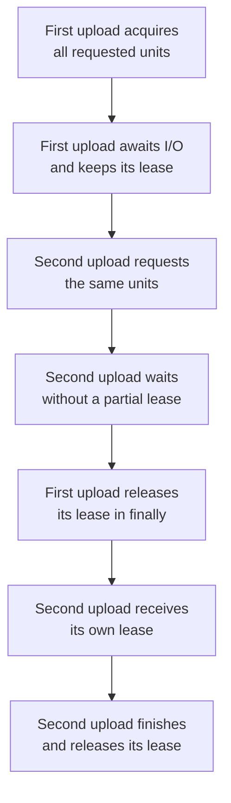

# Reserve room before starting work

An upload needs both a browser slot and room to send data. Reserve those quantities together before starting it, then
release them together when it finishes. If either limit is full, the caller waits without holding a partial reservation.
Cancelling that wait must leave the active uploads alone.

Capacity waits until the requested units are available. It does not authorize a caller, measure usage, execute jobs,
or save a durable queue.

A reservation is a counter that your application owns. It stays held across
`await` until you release it. An awaited fetch gives JavaScript time to run other
callbacks, but does not release a capacity lease or a mapper's active slot.
For CPU-heavy work, use a separate worker when the main thread must stay responsive.

Imagine uploading one file as three separate pieces. Each piece uses one upload slot while it is being sent.
This job reserves a browser instance and three upload slots together. The counters do not start those transfers.

## Reserve two limits together, then release them

A browser upload needs one browser slot and three upload slots at the same time. The first printout shows how many
slots are left during the upload. When the upload releases its reservation, both counts go back up.

Run from this checkout after `mise run prepare -- --kind deps`. Save the runnable block as `upload-capacity.ts` at the checkout root and use
`mise exec -- deno run upload-capacity.ts`.

```ts runnable=upload-capacity.ts
import * as capacity from '@okikio/scheduler/capacity';

const host = capacity.create({ browsers: 2, uploads: 4 });
const lease = await capacity.acquire(host, { browsers: 1, uploads: 3 });
try {
	// Waiting for asynchronous work does not return this upload's reservation.
	await Promise.resolve();
	console.log(JSON.stringify(capacity.available(host)));
} finally {
	// Release on success or failure so later work can use these counters again.
	lease.release();
}
console.log(JSON.stringify(capacity.available(host)));
```

Expected output:

```text output
{"browsers":1,"uploads":1}
{"browsers":2,"uploads":4}
```

## Keep a second upload waiting without taking half its room

Use the same two limits with one browser and three upload units. A second upload must wait even though it could reserve
some units separately. `maximumPending` bounds retained waiters; it does not limit the bytes in an upload.

```ts runnable=waiting-upload.ts
import * as capacity from '@okikio/scheduler/capacity';

const host = capacity.create({ browsers: 1, uploads: 3 }, { maximumPending: 1 });

// The first caller owns both limits until it explicitly releases them.
const first = await capacity.acquire(host, { browsers: 1, uploads: 3 });

// The second caller waits for all its limits; cancellation removes only this waiter.
const stop = new AbortController();
const waiting = capacity.acquire(host, { browsers: 1, uploads: 3 }, stop.signal);
const observed = waiting.then(() => 'unexpected admission', (reason) => String(reason));
console.log('Waiting:', capacity.snapshot(host).queuedRequests);
stop.abort('upload cancelled');
console.log(await observed);
console.log('Active upload still owns:', JSON.stringify(capacity.available(host)));

// Another caller can wait while the first upload is still active.
const replacement = capacity.acquire(host, { browsers: 1, uploads: 3 });
await Promise.resolve();
first.release();
(await replacement).release();
console.log('Restored:', JSON.stringify(capacity.available(host)));
```

```text output
Waiting: 1
upload cancelled
Active upload still owns: {"browsers":0,"uploads":0}
Restored: {"browsers":1,"uploads":3}
```

The cancelled caller never acquired a partial reservation. Releasing the first lease admits the replacement in FIFO
order. Put the actual upload inside `try/finally` or an `await using` lease block; cancellation does not undo already
sent bytes. The independent validation surface below checks host descriptions before admission is involved.

The same lifetime applies when the wait contains real I/O:



FIFO means first in, first out: the oldest waiting request gets the next chance. If that request needs three upload
units and only two are free, a later request for one unit waits too. This prevents a stream of small requests from
continually overtaking a larger one. It can leave some units temporarily unused. Cancelling the oldest wait removes
that request so the next one can be considered; it does not take units away from an admitted upload.

## Choose validation or live admission

Use `@okikio/scheduler/capacity` to answer two kinds of questions:

- **Do these numbers fit?** Use `unit()`, `field()`, `define()`, `compose()`, and `constraint()` to describe the
  rules. Then use `check()` or `assert()` to check the numbers through Standard Schema.
- **Can this upload start now?** Use `create()` and `acquire()` to reserve whole units such as browser slots.
  The request gets all its units or none. Use `available()` and `snapshot()` to inspect the counts.

These reservations live in one process. For work that needs queue claims, retries, or saved job state, use
`@okikio/scheduler/queue`.

## Validate a host topology

A schema validates one value. A unit explains what the value measures. A constraint explains how several validated
values relate.

```ts runnable=host-capacity.ts
import * as capacity from '@okikio/scheduler/capacity';
import * as schema from '@okikio/schema';

const count = capacity.unit('count', {
	description: 'A discrete number of items.',
	symbol: 'items',
});

const Count = capacity.field(schema.number({ integer: true, minimum: 0 }), count, {
	description: 'A non-negative item count.',
});

type Host = Readonly<{ cores: number; threads: number; threadsPerCore: number }>;
const ThreadsPerCore = capacity.constraint<Host, typeof count>({
	id: 'threads-per-core',
	description: 'Threads must fit the host core topology.',
	unit: count,
	used: (host) => host.threads,
	maximum: (host) => host.cores * host.threadsPerCore,
});

const HostCapacity = capacity.define({
	cores: Count,
	threads: Count,
	threadsPerCore: Count,
}, { constraints: [ThreadsPerCore] });

const result = await capacity.check(HostCapacity, {
	cores: 4,
	threads: 8,
	threadsPerCore: 2,
});
console.log(result.status);
```

```text output
hit
```

The `hit` result means the requested threads exactly match the available topology.

`assert()` runs the same validation and throws `CapacityExceededError` only when one or more relationships are exceeded.
Schema failures remain schema failures.

## Atomic admission

```ts
const work = capacity.create({ browserContexts: 4, uploadParts: 8 });

await using lease = await capacity.acquire(work, {
	browserContexts: 1,
	uploadParts: 2,
}, ctx);
```

A request receives all its units or none. Requests wait in the order they arrive. A later request cannot go first
just because it needs fewer units. If you cancel a waiting request, the pool removes it without taking any units.
Call `lease.release()` or leave the `await using` block to return the units. Releasing twice has no extra effect.

Read the [public source](../packages/scheduler/capacity/mod.ts) for the complete exported contracts and field
descriptions.

## Validator interoperability

Capacity authoring accepts Standard Schema contracts directly. The package does not expose Zod- or Valibot-named aliases
because those aliases did not add distinct behavior. Use the same capacity API with any Standard Schema implementation.

## Decide which bookkeeping to keep in your application

| Convenience                              | Manual equivalent                                                                                    | Concrete value                                      |
| ---------------------------------------- | ---------------------------------------------------------------------------------------------------- | --------------------------------------------------- |
| `capacity.check()` / `capacity.assert()` | read all capacity fields, execute each constraint, collect violations, and decide whether to throw   | one deterministic constraint report                 |
| `capacity.create()` + `acquire()`        | maintain counters, FIFO waiters, abort listeners, impossible-request checks, and release bookkeeping | a reusable admission semaphore with explicit leases |

If you write the pool yourself, keep a count for each kind of slot and a list of waiting requests. Check every count
before taking any slots. Remove cancelled requests and return the slots when work finishes.

## Reserve only the phase that uses a scarce resource

Suppose two downloads can wait on the network together, but only one downloaded
value should enter a constrained transform at a time. Fetch outside the compute
reservation. Acquire it immediately before the transform, and release it on both
success and failure. This finite example counts bytes rather than doing expensive
CPU work; it demonstrates when the reservation is held, not parallel CPU speed.

```ts runnable=phase-reservations.ts
import * as capacity from '@okikio/scheduler/capacity';

const host = capacity.create({ transforms: 1 });
const urls = ['data:text/plain,first', 'data:text/plain,second'];
const counts = await Promise.all(urls.map(async (url) => {
	// This wait consumes no transform reservation. A large input should also
	// have its own bounded download concurrency and per-response byte limit.
	const response = await fetch(url);
	if (!response.ok) throw new Error(`Download failed: ${response.status}`);
	const bytes = new Uint8Array(await response.arrayBuffer());

	const lease = await capacity.acquire(host, { transforms: 1 });
	try {
		// Put only work protected by this counter here. For real parallel CPU
		// execution, dispatch to a worker and retain the lease until it settles.
		return bytes.byteLength;
	} finally {
		lease.release();
	}
}));
console.log(JSON.stringify(counts));
console.log(JSON.stringify(capacity.available(host)));
```

```text output
[5,6]
{"transforms":1}
```

Splitting phases is safe only when the resource is not needed between them.
Do not release an exclusive browser-session borrow while its page operation is
still active. Do not start detached work inside the lease and release it before
that work settles. The counter tracks the interval you hold it; it cannot infer
physical resource use. See [resource sessions](./workflows/18-sessions.md) for
routing several actions to the same live object.
