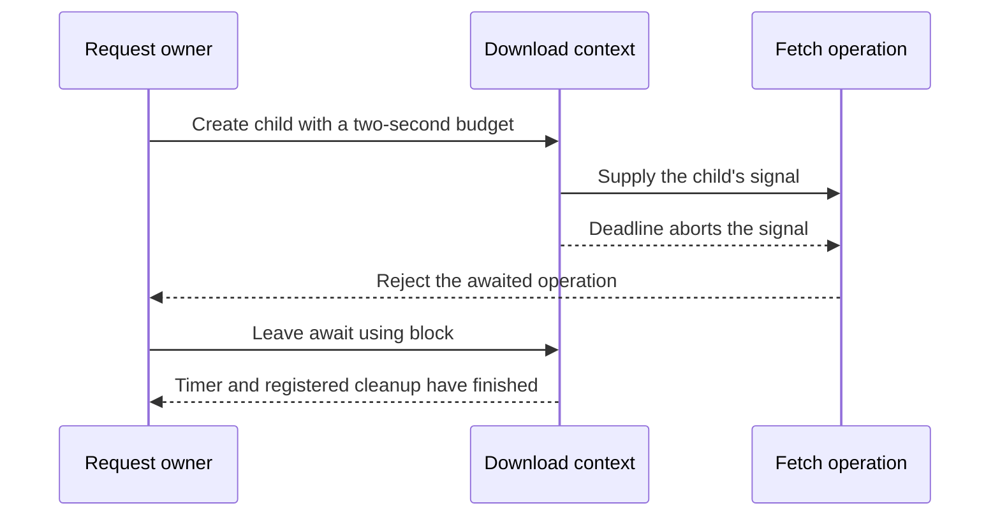

# Give related work a shared lifetime

An operation can have one useful result and several supporting concerns: a cancellation signal, a deadline, a clock, and
resources to close. Context carries those concerns while the operation keeps its ordinary parameters and result.

A request owns its context. Its helpers borrow that context, or create a child when a shorter-lived operation needs its
own cleanup. A view attaches fields to the same lifetime. It does not create another timer or another resource owner.

## Give a download its own deadline

Create a child lifetime for a download and pass its signal to the request. The child owns its deadline and cleanup; the
parent remains available for other work after the child closes.

Run from this checkout after `mise run prepare -- --kind deps`. Save the runnable block as a `.ts` file in your project and use
`mise exec -- deno run example.ts`.

```ts runnable=download-text.ts
import * as context from '@okikio/context';
import { sec } from '@okikio/duration';

await using request = context.create({ id: 'profile' });
// The child gets the shorter deadline; disposing it will not cancel the parent request.
await using download = context.timeout(request, sec(2));
// Passing the signal lets the I/O observe cancellation. Creating a context alone cannot stop fetch.
const response = await fetch('data:text/plain,Ada', { signal: download.signal });
if (!response.ok) throw new Error(`Download failed: HTTP ${response.status}`);
const name = await response.text();
console.log(name);
```

```text output
Ada
```

The program prints the response body. `await` waits for each Promise (a result that will arrive later). `await using` also gives the block a cleanup boundary: leaving it waits for the child to release its timer and registered resources. The data URL works offline; a real network URL additionally needs Deno network permission.

The download has three separate events: the signal can request a stop, Fetch can settle, and cleanup can finish. They
are not interchangeable. Read the following sequence from top to bottom; it shows the deadline path and omits response
formatting. A successful read also reaches the same final cleanup.



If Fetch or another operation ignores the signal, the stop request cannot make it terminate. The owner must account for
that work rather than treating the notification as proof of completion.

## Choose the lifetime and observation owner

| Value                 | What it permits                                                      | Who closes it                                                  |
| --------------------- | -------------------------------------------------------------------- | -------------------------------------------------------------- |
| `Context`             | Read identity, signal, clock, deadline, and borrowed instrumentation | The source owner                                               |
| `Owned`               | Context plus registration and awaited cleanup                        | The code that created it                                       |
| `state.Reader<T>`     | Read and observe progress                                            | The cell owner closes the source; subscribers close themselves |
| `state.Cell<T>`       | Replace values and complete observations                             | The code responsible for updates                               |
| `state.StoredCell<T>` | Persist replacements, reload, and lend the ordinary reader           | Its owner awaits disposal to join active storage work          |
| Event Observable      | Observe a borrowed producer during a lifetime                        | Subscription or abort removes the listener                     |

Cancellation asks cooperative work to stop. Disposal releases resources and joins registered cleanup. An operation that
ignores its signal can continue; no context can interrupt an indivisible synchronous call or terminate another process.

A local cell keeps synchronous updates simple. A stored cell adds an explicit asynchronous commit step: its reader
changes only after storage acknowledges the saved version. The cell borrows a single selected storage slot and its
client. Closing the cell does not delete that snapshot or close a shared database pool. Use the
[stored-state guide](./03-stored-state.md) when the same application value must be reopened after its owner ends.

Use the [state and event examples](../../packages/context/README.md#publish-progress-without-sharing-mutation) after the download above. Use Task when the operation itself needs pause, resume, and a terminal result handle.

Create one owner at the place that controls the operation. Give each helper the smallest view it needs. The helper's
return value remains its useful answer; context supplies the lifetime around that answer.

## Choose a child or a view

`child(parent)` creates a new cleanup stack and signal linked to the parent. Standard identity, clock, instrumentation,
and deadline fields are inherited. A child can shorten its deadline, never extend the parent's deadline. Custom
application capabilities are not automatically copied into a new child.

`view(base, extension)` borrows the base lifetime and retains its existing properties. It preserves non-enumerable
fields, inherited getters, and method receivers. Extra capability fields may be replaced explicitly; identity, clock,
signal, instrumentation, and cleanup fields cannot be replaced. Its return type removes each replaced field's former
type before adding the new one. A view's cleanup methods still refer to the original owner.

Attach a read-only progress reader or an application client explicitly. Use Capability's `scope` when the operation
needs declared resource access, requirement interpretation, or effect acceptance. A context does not discover providers.

## Work in elapsed time

`timeout`, `wait`, and `TestClock.advance` accept the same Duration inputs. Constructors such as `ns(1)`, `sec(2)`, and
`days(1)` return ordinary Temporal durations. For these elapsed operations, a day means 24 hours and a week means seven
days. Months and years reject because they require a calendar choice. To express a calendar deadline, calculate the
absolute instant with an explicit zone and date, then pass it to `deadline`.

Nanoseconds remain exact when calculating an absolute target and when reporting `remaining`. Runtime timers use
milliseconds, so a positive fractional millisecond rounds up at the timer call. Long deadlines and waits are split into
slices of at most 2,147,483,647 milliseconds. The target instant remains authoritative after every slice; a timer slice
is never reported as the full remaining budget.

`delay(number, signal)` is the low-level bounded millisecond timer. Use `wait(ctx, duration)` for elapsed units, long
waits, and the context's own clock. `TestClock` makes these rules deterministic without requiring a fast machine.

## Cancel, then release what is owned

Pass `ctx.signal` into Fetch and other cooperative I/O. Use `check(ctx)` between synchronous steps. It reports deadline
expiry or wraps the signal reason in `ContextCancelledError`, whose `reason` retains the original value, including
`null`. Low-level clock sleeps and `observe(signal, promise)` preserve the signal reason directly.

A signal abort alone does not dispose registered resources. Dispose the owner with `await using` or await
`owner[Symbol.asyncDispose]()`. Cleanup runs in reverse registration order. Repeated disposal joins the same work.
`closed` reports that cleanup has finished; the disposal Promise carries cleanup failure. Register cleanup with the
owner that actually acquired the resource. A child never disposes its parent's borrowed clients.

`observe(signal, promise)` stops waiting after cancellation but cannot terminate or join the underlying operation.
`settles(promise, milliseconds, clock)` reports whether fulfillment or rejection occurred before a clock timeout; it
also does not terminate that work. Use these only when the caller has a policy for the work that remains active.

## Observe progress and host events

State cells separate mutation from observation. A reader has `get`, `revision`, callback `subscribe`, and Observable
`changes`. Equal values do not advance revisions. `batch` coalesces synchronous updates and does not roll back committed
values if the callback throws. There is one pending aggregate; reentrant notifications are bounded to 32 passes by
default. Values remain borrowed rather than recursively proxied or frozen.

Callback subscriber failures cannot veto a committed state update. `observerError` retains the latest failure and
`onError` can report it. The Observable facade uses the owned Observables library's error/completion contract. Async
work started by a subscriber remains that subscriber's responsibility.

`state.open` lends the same reader while owning asynchronous saved changes. Register that owner with
`ctx.use(await state.open({ ..., signal: ctx.signal }))` when the context controls the writes. Await each mutation to
learn its storage outcome. A separate screen can observe the reader with its own signal and leave without closing the
writer. The [stored-state guide](./03-stored-state.md) explains representation, conflict recovery, and disposal during
I/O.

`events.from` is a cold adapter: each subscriber owns one listener. It supports native DOM event type inference and
structural typed mocks without realm-specific constructor checks. Abort completes the observation and detaches its
listener. Unsubscribe detaches just that subscription. The target stays borrowed. Listener options are captured when the
Observable is created.

## Restore transport data locally

`snapshot` contains identity and timing fields only. It carries no AbortSignal, resource handle, Observable, or live
instrument. `restore` creates a new local owner using the supplied clock, signal, and instrumentation. Connect remote
cancellation through an explicit protocol when required; serialization alone cannot propagate it.

The [package examples](../../packages/context/README.md) are runnable modules. Full field contracts are documented in
[types.ts](../../packages/context/types.ts); the [state](../../packages/context/state.ts) and
[event](../../packages/context/events.ts) subpaths describe their independent APIs.
