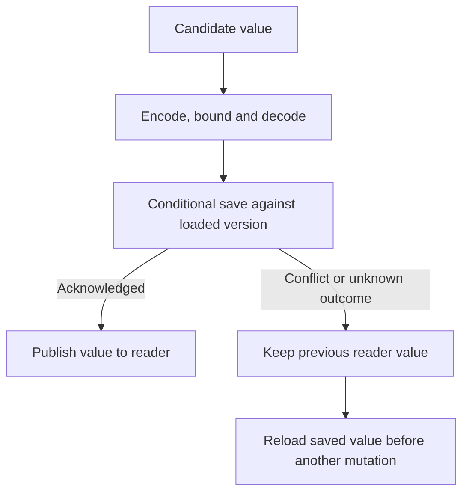

# Save one application value and reopen it

Suppose a crawler has finished page 1 and should start with page 2 when you open it again. Save `page-2` as its
**cursor**, the value that tells the crawler where to continue. A **stored cell** gives the crawler one value to read
and a way to save changes to it. When the first owner closes, a new owner can load that value from the same store.

Use the same pattern for a draft or small checkpoint. Give parts of the program that only display the value a
`Reader`, and keep saving with the cell owner. Your application chooses the store and its lifetime. An in-memory store
can outlive the cell that opened it, but it cannot outlive the process.

`state.create` remains synchronous. `state.open` is asynchronous because loading, decoding, and initial creation can
fail. Its `set`, `update`, and `reload` operations must be awaited. There is no asynchronous `batch`; the local cell's
notification grouping does not imply a storage transaction.

## Save a cursor, close it, then reopen it

From this experimental checkout, run `mise trust`, `mise install`, and `mise run prepare -- --kind deps`. Save this as `cursor.ts` and run `mise exec -- deno run cursor.ts`.

```ts runnable=cursor.ts
import * as state from '@okikio/context/state';
import * as stores from '@okikio/storage/state';
import * as schema from '@okikio/schema';

// This store outlives each state view, but its data still belongs to this process.
const store = stores.memory();

{
	// This owner loads the cursor and is the only writer exposed to this operation.
	await using cursor = await state.open({
		store,
		contract: 'crawl.cursor.v1',
		value: schema.string(),
		initial: () => 'page-1',
	});
	// Await the save acknowledgement before relying on the reader's new value.
	await cursor.set('page-2');
	console.log(cursor.reader.get());
}

// A new owner reads the retained snapshot; the old owner's lifetime has ended.
await using reopened = await state.open({ store, contract: 'crawl.cursor.v1', value: schema.string() });
console.log(reopened.reader.get());
```

```text output
page-2
page-2
```

The first owner saves `page-2` before its `set` Promise resolves. `await using` closes that owner at the end of the braces; it does not erase the saved value. The second owner loads the same store object. This memory store survives an owner's closure, not a process restart. The schema checks that the loaded value is still a string. The contract name identifies this application's saved representation; changing the name requires an explicit migration rather than silently reinterpreting old data.

## Select an adapter and representation

| Adapter                                                  | Survives                                        | Conditional-write scope                                  | Ownership                                   |
| -------------------------------------------------------- | ----------------------------------------------- | -------------------------------------------------------- | ------------------------------------------- |
| `storage/state.memory()`                                 | Reopening with the same in-process store object | Calls sharing that slot                                  | One retained envelope, no external resource |
| `storage/state/web.open({ mode: 'single-writer', ... })` | The supplied browser storage area's lifetime    | Application guarantees one writer                        | Borrowed synchronous Storage                |
| `storage/state/web.open({ mode: 'locked', locks, ... })` | The supplied browser storage area's lifetime    | Cooperating writers using the same lock service and name | Borrowed Storage and LockManager            |
| `storage/state/postgres.open(...)`                       | Process restart and new pool connections        | Database row and expected-version predicate              | Borrowed application-owned Postgres.js pool |

The store saves a record with four fields: the library's `format`, your application's `contract`, a `version`
to compare with later writes, and the encoded JSON `value`. The contract names the form of the saved value,
for example `crawl.cursor.v1`. Use a nonblank name of 1 to 256 Unicode code points. If you reopen with a different
contract, the cell rejects the call and leaves the saved value unchanged. To change its form, migrate it in
your application.

Use an identity Schema for JSON-shaped application state. Use an explicit two-way Codec for values such as Dates. Both
directions are checked before creation: a one-way transformation cannot silently discard information during save. Every
candidate is encoded, bounded, and decoded before it is committed, so publication uses the same conversion path as
reopening. Custom codecs should decode a saved representation consistently. A decoder receives a detached copy and
cannot mutate the wire candidate that will be saved. `JSON.stringify` is never used to silently drop functions,
undefined fields, or unsupported objects.

The encoded value defaults to at most 1 MiB of UTF-8 JSON and can be configured through `maximumBytes`, up to 16 MiB.
Depth, node count, and total string length also remain finite through the shared JSON schema. Adapter or host limits may
reject a smaller value. Raw database changes and malformed browser text are validated when loaded.

The same cursor can later carry a saved timestamp. A Codec supplies the two conversions between stored timestamp text and an application Date. This complete variation uses its own empty store and demonstrates that reopening restores a Date.

Save this complete variation as `stored-date.ts` and run `mise exec -- deno run stored-date.ts` after the same checkout setup.

```ts runnable=stored-date.ts
import * as state from '@okikio/context/state';
import * as stores from '@okikio/storage/state';
import * as schema from '@okikio/schema';
import * as codec from '@okikio/schema/codec';
import { DateSchema } from '@okikio/schema/time';

// This store outlives each state view, but its data still belongs to this process.
const store = stores.memory();
const value = codec.object({ cursor: codec.identity(schema.string()), savedAt: DateSchema });
{
	await using first = await state.open({
		store,
		contract: 'crawl.cursor.v1',
		value,
		initial: () => ({ cursor: 'page-1', savedAt: new Date('2026-11-01T00:00:00.000Z') }),
	});
	await first.update((current) => ({ ...current, cursor: 'page-2' }));
}
await using resumed = await state.open({ store, contract: 'crawl.cursor.v1', value });
console.log(resumed.reader.get().cursor, resumed.reader.get().savedAt instanceof Date);
```

```text output
page-2 true
```

Decoded objects remain application values. Treat them as immutable: mutating a returned object or Date neither saves it
nor advances a revision. Replace state through the owner. If a candidate object is passed to `set`, leave it unchanged
until that Promise settles because it remains borrowed while waiting for its queue turn.

## Open and publish in a defined order

Saving a cursor is useful only if the displayed cursor tells the truth about the accepted write. The cell therefore
checks a candidate before saving it, then waits for storage before changing its reader. Follow the arrows below as
decisions inside one mutation; they do not represent background polling:



An unknown outcome means the save might have reached storage even though its acknowledgement did not reach this owner.
Keeping the previous display avoids announcing success that the owner cannot prove. Reloading resolves what is actually
saved; it does not repeat the business action that produced the candidate. The failure table below covers cancellation
and disposal cases that this small flow omits.

Open loads first. If data exists, it validates the envelope, checks the application contract, and decodes it. The
`initial` factory runs only when the key is absent; omit it when missing state must be an error. A candidate initial
value is saved before open returns. If another atomic writer creates the key first, open loads that winner once. The
factory is not repeated and the winner is never overwritten.

Each cell runs accepted operations in the order they arrive. When an update starts, it passes the latest visible
value to your updater and calls it once. The updater must return synchronously; finish any asynchronous work
before you submit it. Until storage confirms the save, readers still see the previous value and the update Promise
has not resolved. The cell skips the write if the values match under `Object.is` or your supplied `equal` function.

`maximumPending` defaults to 64 operations, including the one in progress. The cell rejects extra calls without
holding on to their inputs. If you cancel a waiting update, the cell removes it without calling your updater.
The store keeps one saved value. The cell keeps its current value, the waiting operations, and a limited set of
pending notifications. It does not save a history or poll storage for changes.

`cell.version` identifies the last published saved envelope. Tokens are opaque equality identities, not sortable
counters. `reader.revision` counts local publications and starts at zero on every new owner. `reload` runs in the same
queue as writes so a delayed load cannot overwrite a newer local publication. A changed saved version produces a local
publication even when decoded values compare equal.

## Reconcile a failed mutation deliberately

| Result                                    | Reader                                                                     | Next step                                                          |
| ----------------------------------------- | -------------------------------------------------------------------------- | ------------------------------------------------------------------ |
| Validation or pre-save cancellation fails | Previous value                                                             | Correct the input or start another admitted operation              |
| `ConflictError`                           | Previous value; `needsReload` is true                                      | Reload, then decide whether the business operation still applies   |
| `CommitError` with `outcome: 'unknown'`   | Previous value; the candidate might be saved                               | Reload or reopen and compare its version with `error.version`      |
| `CommitError` with `outcome: 'committed'` | Previous value; saved version was acknowledged after cancellation/disposal | Reload if still usable, otherwise reopen                           |
| Subscriber/reporting callback fails       | The accepted value remains published                                       | Inspect `observerError` or `onError`; the write remains successful |

If the store reports a conflict and also sees a cancellation, the cell still requires a reload before the next
write. Once the cell has called the store, it treats a rejected save as uncertain. A custom store might have saved
the value and lost the reply, even if it normally reports failures before writing. The error's `cause` keeps the
original failure or cancellation reason, including `null` or explicit `undefined`.

After conflict or uncertainty, further mutations reject with `ReloadRequiredError` before invoking another updater. A
successful `reload` clears that state. A missing record, incompatible contract, malformed value, or failed load leaves
the previous reader unchanged. No automatic retry reruns application callbacks. A checkpoint save and an external
business effect are separate operations unless the application supplies a wider transaction or idempotency policy.

## Close the writer and keep the backing store

Use `await using`, or register the cell with the Context that owns its writes. A lifetime signal requests cancellation;
it does not replace awaited disposal. Disposing the cell marks `closed` immediately, rejects waiting calls, completes
observations, and waits for the active codec/store operation to settle. Repeated and reentrant disposal callers receive
the same Promise. The cell never publishes after disposal, including when an uncooperative store commits later.

A failing subscription unlink does not skip other subscriptions or Observable completion. Disposal preserves that
failure after attempting the other releases and joining active work; multiple cleanup failures retain their
`SuppressedError` chain. A signal that retains a listener and then throws during registration is rolled back before
subscription creation fails.

Cancellation cannot undo an acknowledged commit. An adapter that cannot interrupt I/O must still return its actual
result; the cell joins it instead of abandoning a hidden Promise. Consequently disposal can wait for an unresponsive
custom store. Configure database connection/queue timeouts and host request policy where the application owns them.

The cell does not dispose a supplied store, delete its key, or close its database pool. Browser adapters install no
storage listeners; observe native storage events separately if useful and decide when to call `reload`. Saved keys have
application lifetimes: delete them when their draft, crawl, or job is permanently retired.

## Supply another store

Implement the public `Store` interface where your application connects to storage. Choose one key when you
create the store. `load` returns a copy of the saved `SnapshotType`, or `undefined` if the key is missing.

`save` receives the new record with its own version and the version the caller expects to replace. Return `true`
only when storage confirms the save. Return `false` only when the versions conflict and no write occurred.

Copy the record, expected version, and signal before waiting for locks or storage. Changes to the caller's
options must not change a save already in progress. Check records with `SnapshotSchema`. A cell enforces its own
`maximumBytes`; callers using a store directly must follow that store's limits.

Declare `concurrency: 'atomic'` only when the host actually coordinates comparison and replacement for the documented
writers. Otherwise declare `'single-writer'` and require external exclusion. State the cancellation, commit, and client
ownership rules. Test restart, competing initial creation, stale versions, failed acknowledgements, and cleanup of late
work through that real host. The existing contract is sufficient for custom asynchronous adapters; Context does not need
another generic key/value interface.

Use Scheduler or Workflow storage when the data requires claims, leases, history, receipts, or task completion. A stored
cell is a small current-value owner and does not supply those protocols.
