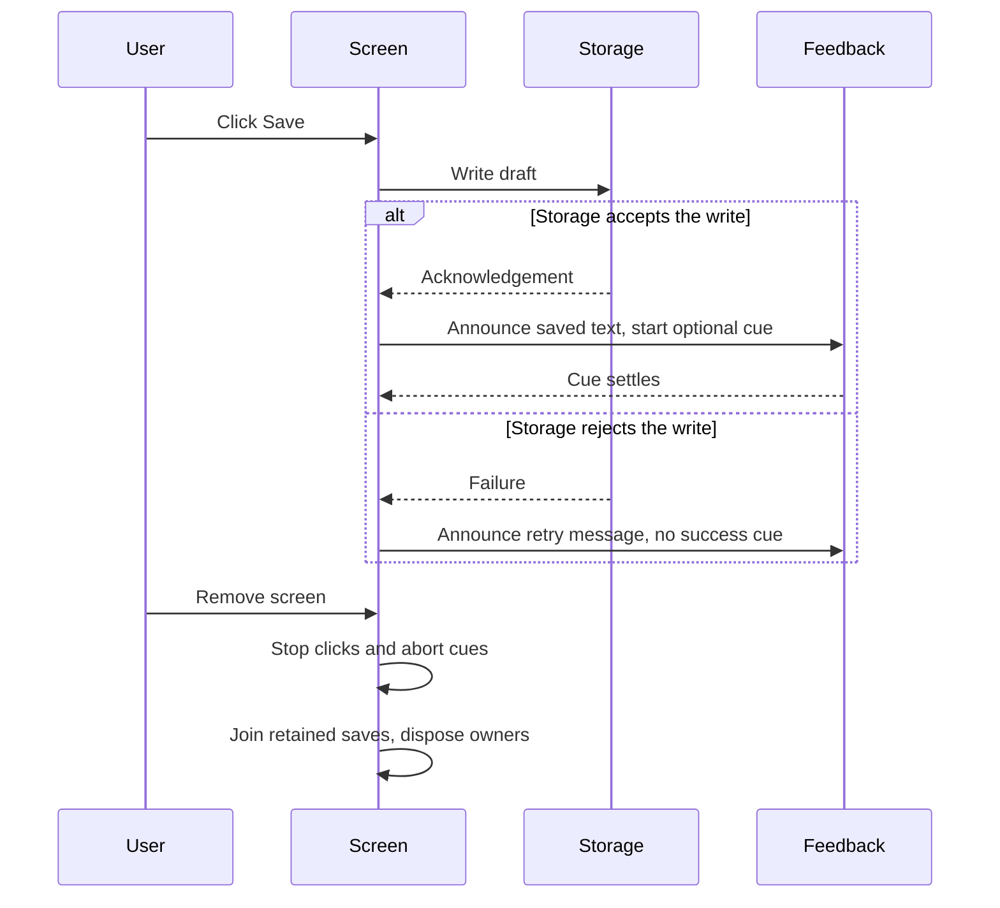

# Give an interaction useful feedback

An input describes what the user did. Feedback helps the user understand what the application did in response. Keep
those decisions separate: a keyboard shortcut, a pointer gesture and a gamepad button can all invoke the same Save
command, and that command can update a status message with optional sound, vibration or animation.

`@okikio/input/feedback` operates on host capabilities you supply. It does not create a global audio context, choose a
gamepad, discover a document or install a device service. The same operations are available through `input.feedback`
when importing the whole Input package.

## Show Save feedback in the browser

Edit the draft and click Save changes. After the browser storage adapter accepts the text, the mounted live region
changes to “Changes saved locally”. A brief brightness cue is optional;
reduced-motion or unsupported animation does not change business success. The native region is already mounted before
its first announcement. The promise join below makes visual cleanup explicit; sound or vibration would need their own
available devices and permission checks.

Prepare the checkout from its root with `mise trust`, `mise install` and `mise run prepare -- --kind deps` after reviewing
`mise.toml`. Create `feedback/`, then save the HTML as `feedback/save-feedback.html` and TypeScript as
`feedback/save-feedback.ts`. These names keep the HTML module reference and build
command aligned; another parent directory works if you update the commands.

```text
feedback/
├── save-feedback.html
├── save-feedback.ts
└── save-feedback.js  # Created by the bundle command below.
```

```html
<!doctype html>
<meta charset="utf-8">
<title>Save feedback</title>
<label>Draft <input id="draft" value="My first note"></label>
<button id="save" disabled>Save changes</button>
<p id="status" role="status">Ready</p>
<script type="module" src="save-feedback.js"></script>
```

The stored cell keeps the current draft string. Its Web Storage adapter saves that value under one chosen browser key;
reopening the same key loads it again. `contract` names the saved format so a later application version cannot silently
reinterpret it. The string schema checks loaded values. Here the application promises one writing tab; use the
locked adapter mode when cooperating tabs may write concurrently.

```ts support=save-feedback.ts
import { announcer, create, define } from '@okikio/input/feedback';
import * as state from '@okikio/context/state';
import * as web from '@okikio/storage/state/web';
import * as schema from '@okikio/schema';

// Borrow the mounted controls; this module owns only the listeners, stored cell and feedback handles.
const button = document.querySelector<HTMLButtonElement>('#save')!;
const region = document.querySelector<HTMLElement>('#status')!;
const input = document.querySelector<HTMLInputElement>('#draft')!;

/** The screen owns cancellation; feedback borrows its signal for each operation. */
const screen = new AbortController();
const status = announcer(region, { signal: screen.signal });
/** This screen owns one active cue; its native elements and live region remain borrowed. */
const player = create({ status, visual: button });
// This demonstration has one writing tab. A multi-tab application needs the locked adapter mode.
// Reopening the same storage key restores the draft, subject to browser storage retention.
let draft: Awaited<ReturnType<typeof openDraft>>;
/** Load saved text before enabling Save; storage access or invalid saved data can fail. */
async function openDraft() {
	return await state.open({
		store: web.open({ storage: localStorage, key: 'feedback.draft', mode: 'single-writer' }),
		contract: 'feedback.draft.v1',
		value: schema.string(),
		initial: () => input.value,
	});
}

// Finish startup before admitting any click. A failed load leaves Save unavailable.
try {
	draft = await openDraft();
	input.value = draft.reader.get();
	button.disabled = false;
} catch (error) {
	button.disabled = true;
	// Loading failed before click ownership began. Release the feedback owners too.
	try {
		await player.disposeAsync();
	} catch (cleanupError) {
		console.error(cleanupError);
	} finally {
		screen.abort();
		status.dispose();
		// Disposal restores the region, so leave the application-owned error afterward.
		region.textContent = 'The local draft could not be opened. Save is unavailable.';
	}
	throw error;
}

/** The same finite cue can be reused by a click, keyboard shortcut or command. */
const saved = define({ message: 'Changes saved locally', brightness: { amount: 1.12, duration: 180 } });

/** Retain in-flight feedback only until it settles, so teardown can join cleanup. */
const pending = new Set<Promise<void>>();

/** Announce accepted business work and join the optional visual cue separately. */
async function save(): Promise<void> {
	try {
		// Await the storage acknowledgement before announcing success or starting the cue.
		await draft.set(input.value);
	} catch (error) {
		status.announce('Changes could not be saved. Keep this page open and try again.');
		console.error(error);
		return;
	}
	const [cue] = await Promise.allSettled([player.play(saved, { signal: screen.signal })]);
	if (cue.status === 'rejected' && !screen.signal.aborted) console.error(cue.reason);
}

/** The DOM listener cannot await a Promise, so retain it for the screen's teardown. */
function onClick(): void {
	const work = save().catch(console.error);
	pending.add(work);
	void work.finally(() => pending.delete(work));
}
button.addEventListener('click', onClick);

/** Stop new clicks, cancel existing cues, then restore the announcer-owned region. */
async function close(): Promise<void> {
	button.removeEventListener('click', onClick);
	screen.abort();
	await Promise.allSettled(pending);
	try {
		await player.disposeAsync();
	} finally {
		try {
			await draft[Symbol.asyncDispose]();
		} finally {
			status.dispose();
		}
	}
}
window.addEventListener('pagehide', () => {
	void close();
}, { once: true });
```

Follow one click before considering shutdown. Storage acknowledgement is the success boundary. The status message
then makes that result available without requiring the optional brightness animation. A component can await `close()`;
a browser's `pagehide` event cannot keep the page alive until that asynchronous join completes.



The join includes saves already started by clicks. Cancelling the screen signal stops feedback; it does not undo an
acknowledged storage write. Page exit only requests this cleanup, so save important work before navigating away.

The browser loads the `.js` file named by the HTML script tag. The bundle command turns the TypeScript module and its
imports into that JavaScript file. The local HTTP server then serves the HTML and JavaScript to your browser.
Run these commands from the repository root:

```sh
mise exec -- deno bundle --platform browser feedback/save-feedback.ts -o feedback/save-feedback.js
python3 -m http.server 8000 --bind 127.0.0.1 --directory feedback
```

Open `http://127.0.0.1:8000/save-feedback.html`. Edit the note, save it, then refresh: the input restores the saved text.
A storage failure produces an error message and no success cue. This example uses one writing tab; see
[stored state](../context/03-stored-state.md) for cooperating writers and storage conflicts. Browser storage can be
cleared or evicted and is not a remote backup. Keep the server terminal open; stop it with Ctrl+C when finished.
After TypeScript edits, rebuild the bundle and refresh the browser. The HTTP server serves only `feedback/`; do not
expose it on a public address. The module requests cleanup on page exit. A browser does not wait for asynchronous
`pagehide` work, so that hook
cannot guarantee a completed shutdown. In an application, await `close()` when removing the screen while its JavaScript
realm is still alive. The browser interaction is separate from the portable example checks below.

## Check the announcer contract without a browser

A persistent text status gives feedback when optional hardware is missing or an animation is disabled. Create an
announcer on a dedicated, already-mounted live region before the first message. The following portable example uses the
same small contract as a native element. It also shows that disposal restores the values the announcer owns.

After the [checkout setup](../../README.md#work-on-the-repository), run `mise run prepare -- --kind deps` from the root.
Save the next complete TypeScript block as
`feedback-status.ts` at that root, then run `mise exec -- deno run feedback-status.ts`.

```ts runnable=feedback-status.ts
import { announcer } from '@okikio/input/feedback';

const attributes = new Map<string, string>();
const region = {
	textContent: 'Ready',
	getAttribute: (name: string) => attributes.get(name) ?? null,
	setAttribute: (name: string, value: string) => {
		attributes.set(name, value);
	},
	removeAttribute: (name: string) => {
		attributes.delete(name);
	},
};

{
	using status = announcer(region);
	status.announce('Saved 3 changes');
	console.log(region.textContent, attributes.get('aria-live'));
}
console.log(region.textContent, attributes.size);
```

```text output
Saved 3 changes polite
Ready 0
```

`announce()` writes `textContent`, so a message is never interpreted as HTML. Its default priority is `polite` and
`aria-atomic` is enabled. Use `assertive` only when the application's message warrants interrupting current speech. The
API reports a text update, not an acknowledgement from a screen reader. Keep one announcer per dedicated text region. An
external writer's changed text or attributes survive disposal.

## Choose the modality explicitly

| Operation                                  | What it controls                                        | What completion means                                                                            |
| ------------------------------------------ | ------------------------------------------------------- | ------------------------------------------------------------------------------------------------ |
| `vibrate(navigator, pattern, options)`     | The host's optional vibration capability                | `elapsed` means the requested time passed after acceptance; hardware playback is not observable. |
| `rumble(actuator, options)`                | A selected gamepad's dual-motor actuator                | The native operation reported complete or preempted.                                             |
| `tone(audio, options)`                     | One oscillator and gain node in a borrowed AudioContext | The scheduled source ended. It does not establish that audio was audible.                        |
| `animate(element, frames, options)`        | One finite Web Animation                                | Its finished promise resolved and the animation was released.                                    |
| `light(element, options)`                  | An element's temporary glow                             | The visual animation completed.                                                                  |
| `rotate(element, degrees, options)`        | An element's CSS rotation                               | The visual animation completed.                                                                  |
| `brightness(element, multiplier, options)` | An element's CSS filter brightness                      | The visual animation completed.                                                                  |
| `announcer(region, options)`               | Plain text and ARIA settings in a dedicated live region | An application-owned status is available for presentation.                                       |

Light, brightness and rotation here refer to rendered elements. They do not change a room light, a screen backlight or a
physical device's orientation. A physical controller can be supplied by an application through its own device
integration; this module does not pretend that the Web provides a universal controller for those devices.

Cue times accept milliseconds or Duration values such as `ms(80)` and `sec(0.2)`. Times must be non-negative and no
longer than one minute. Vibration accepts up to 128 alternating vibration/pause segments and rounds each segment up to a
whole millisecond. Visual animations accept up to 128 keyframes and run once. These limits keep a feedback request
finite; sustained media playback belongs to a media API.

## Reuse a cue across interaction sources

`define()` validates and freezes plain settings for a status message, vibration pattern, gamepad rumble, tone and
brightness pulse. Duration values become elapsed milliseconds, and a vibration pattern accepts at most 128 segments
and one minute in total. The definition retains no device, element, signal or current preference. The existing finite
operations remain available when a reusable description is unnecessary.

`create(hosts)` makes one owned playback scope. Its `play(cue, policy)` announces text first, then starts the configured
optional effects together. The result includes `announced` and an outcome for each requested modality. An unsupported
device does not prevent the other effects or the status text. A thrown host error cancels sibling effects, joins their
cleanup and rejects. Distinct failures remain visible in an `AggregateError`.

Pass preferences at each play so they reflect the current interaction:

| Policy | Behavior |
| --- | --- |
| `enabled: false` | Skip optional effects with `unavailable/disabled`; retain text status. |
| `muted: true` or `volume: 0` | Skip sound with `unavailable/muted`; retain other modalities. |
| `volume` | Multiply the defined tone gain by a zero-to-one amplitude ratio. |
| `reducedMotion` | Override the brightness target's motion preference; omission reads its own realm. |
| `signal` | Reject with the exact abort reason after all acquired effects release their resources. |

A new play on the same player supersedes the preceding play with an `AbortError`. The successor waits until the
previous effects release their resources, including an asynchronous gamepad reset. This is useful when repeated Save
interactions should replace an earlier cue rather than accumulate effects. Separate players remain independent, while
the existing per-host vibration and rumble rules still apply. No player intercepts native events or installs input
listeners: the click listener in the example remains application-owned.

Use `await using` or `disposeAsync()` when the interaction scope ends. Disposal prevents new plays, cancels the active
play and joins cleanup. It does not close an AudioContext or dispose an announcer supplied by the application. Prepare
and resume audio in an allowed native user interaction before passing it to the player; no automatic permission or
autoplay workaround is attempted. If a native cleanup never settles, disposal waits rather than releasing ownership
while a device operation is still active.

For saved cue settings, `CueSchema` validates the normalized plain-value representation and `CueType` describes its
output. Run loaded settings through `define()` before playback to enforce the total vibration duration and obtain an
immutable definition. Keep user preferences and borrowed hosts outside the saved record.

## Add optional feedback to a browser action

The application owns the button, status region, audio context and operation signal. This complete browser module leaves
activation of audio with that application. Call `audio.resume()` from an allowed user interaction before invoking
`saved()` when sound is desired.

```ts support=feedback-browser.ts
import { feedback } from '@okikio/input';
import { ms } from '@okikio/duration';

export function savedFeedback(
	button: HTMLButtonElement,
	region: HTMLElement,
	audio: AudioContext,
	signal: AbortSignal,
) {
	const status = feedback.announcer(region, { signal });
	return {
		async saved() {
			status.announce('Changes saved');
			return await Promise.allSettled([
				feedback.vibrate(navigator, ms(20), { signal }),
				feedback.brightness(button, 1.12, { duration: ms(180), signal }),
				feedback.tone(audio, { frequency: 660, duration: ms(80), gain: 0.08, signal }),
			]);
		},
		dispose: () => status.dispose(),
	};
}
```

The returned settled results make each cue's outcome visible, and `saved()` joins every cue even if one fails. A
fulfilled `unavailable` outcome includes `unsupported`, `denied`, `inactive` or `reduced-motion`. A native exception
rejects its cue promise, and cancellation rejects with the caller's exact reason. If cleanup also fails, the cue rejects
a `SuppressedError` whose `error` is the cleanup failure and whose `suppressed` is the original reason or error.
Multiple failed releases retain that nested order. For application shutdown, abort the supplied signal and await
outstanding `saved()` calls before closing borrowed audio or device resources.

A suspended audio context returns `unavailable/inactive` immediately. Feedback does not wait indefinitely for an
autoplay permission that it cannot grant. If the context stops running during a tone, the cue rejects and its nodes are
disconnected. A missing vibration method returns `unavailable/unsupported`; a native `false` return reports
`unavailable/denied`.

Visual feedback reads reduced-motion preference from the element's own window, including elements in an iframe. An
explicit `reducedMotion` value supports application settings and small test hosts. Animations use no persistent fill and
do not commit inline styles. During a brightness cue the animated `filter` temporarily controls that property; the
element's existing filter returns when the cue finishes or aborts.

## Compose feedback with a shared lifetime

One Context signal can stop listeners, live-region ownership and in-flight feedback. This runnable example verifies that
a canceled operation never tries to acquire a feedback device. An omitted device is a valid unsupported host; an
already-aborted operation still preserves cancellation as its result.

```ts runnable=feedback-lifetime.ts
import * as context from '@okikio/context';
import { feedback } from '@okikio/input';
import { ms } from '@okikio/duration';

await using operation = context.create({ id: 'save-settings' });
context.cancel(operation, 'screen closed');
const [outcome] = await Promise.allSettled([
	feedback.vibrate(undefined, ms(20), { signal: operation.signal }),
]);
console.log(outcome.status);
console.log(outcome.status === 'rejected' && outcome.reason === operation.signal.reason);
```

```text output
rejected
true
```

Each animation and audio cue owns only the object it created. Two animations on one element can therefore settle
independently. Vibration and gamepad motors are different: a host has one current effect. A newer request using the same
host supersedes the older request. The older request resolves as `preempted` and cannot later reset the newer effect. If
an actuator is already resetting, a newer request waits for that reset before starting. Canceling a waiting request does
not let a later request bypass the reset. Use the same host object for requests that share a physical device.

## Source contracts and practical limits

These adapters follow the [Vibration API](https://www.w3.org/TR/vibration/),
[Gamepad haptics](https://www.w3.org/TR/gamepad/#gamepadhapticactuator-interface),
[Web Audio](https://www.w3.org/TR/webaudio/), and [Web Animations](https://www.w3.org/TR/web-animations-1/) contracts.
Their capabilities and permission policies vary by host. The current Vibration specification explicitly describes
limited availability.

The [WCAG status-message guidance](https://www.w3.org/WAI/WCAG22/Understanding/status-messages.html) explains why a
status should be available to assistive technology. Respect
[reduced-motion preferences](https://www.w3.org/WAI/WCAG22/Understanding/animation-from-interactions.html) and avoid
designing repeated flashes from individual cues. Application composition remains responsible for its whole experience; a
finite cue alone cannot prove that a page meets accessibility requirements.
