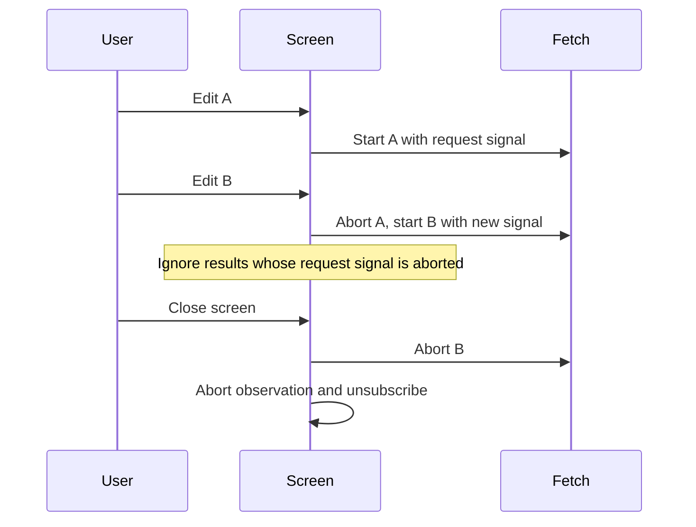

# Compose observation and screen lifetimes

A callback is enough to react to a value. Use an Observable when several operations should transform or consume a
sequence of values. `text.observe()` and `gamepad.observe()` use the existing `@okikio/observables` contract. They do
not introduce a second subscription protocol.

An **Observable** is a source you can subscribe to for future notifications. Calling `subscribe` starts a subscription;
calling `unsubscribe` ends that subscription. It is useful for a sequence of edits, while a Promise describes one future
completion. In this package, each new subscription attaches its own source listeners. Sharing one source between several
consumers is an explicit application decision.

## Follow one edit into the latest value

A subscription attaches a callback to future changes. A state cell separately retains the latest value, which a reader
can inspect even when no event is arriving. This local example makes the difference visible before adding a screen.

This portable example uses a standard EventTarget with a value property. Dispatching `input` stands in for the event a
browser text field emits. The Context reader changes while the observation is active and retains its last value after
cancellation.

After the [checkout setup](../../README.md#work-on-the-repository), run `mise run prepare -- --kind deps` from the root.
Save the next complete TypeScript block as
`text-observation.ts` at that root, then run `mise exec -- deno run text-observation.ts`.

```ts runnable=text-observation.ts
import * as text from '@okikio/input/text';
import * as state from '@okikio/context/state';

const field = Object.assign(new EventTarget(), { value: '' });
const screen = new AbortController();
using query = state.create(text.read(field));
using observation = text.observe(field, { signal: screen.signal }).subscribe(({ value }) => query.set(value));

field.value = 'Ada';
field.dispatchEvent(new Event('input'));
console.log(query.reader.get());
screen.abort();
field.value = 'Later';
field.dispatchEvent(new Event('input'));
console.log(query.reader.get(), observation.closed);
```

```text output
Ada
Ada true
```

## Keep updates and observation with different owners

This mount function feeds text changes into an owned Context state cell. The returned object exposes only its reader, so
a consumer can inspect current text or observe changes without acquiring mutation authority. `close()` ends the screen
observation and then closes the state owner.

```ts support=text-state.ts
import * as text from '@okikio/input/text';
import * as state from '@okikio/context/state';

export function mountSearch(field: HTMLInputElement) {
	const screen = new AbortController();
	const query = state.create(text.read(field));
	const subscription = text.observe(field, { signal: screen.signal }).subscribe({
		next: ({ value }) => query.set(value),
		error: (error) => console.error(error),
	});
	return {
		query: query.reader,
		close() {
			screen.abort();
			subscription.unsubscribe();
			query[Symbol.dispose]();
		},
	};
}
```

The source is cold: each `subscribe()` attaches its own listeners or polling loop. Two subscriptions mean two
acquisitions unless the application deliberately shares a source. Explicit unsubscribe detaches only that subscription.
Source-signal abort completes the source, and a pre-aborted signal acquires nothing. Neither operation closes the
borrowed field, gamepad or browser window.

Observable operators come from `@okikio/observables/operators`. Select their error and scheduling policies explicitly;
that package's default operator failures can travel as ObservableError values. A plain DOM source cannot slow down the
user's physical input merely because a consumer uses an async iterator. Use a bounded latest-value or batching policy
where downstream work is slower than event arrival.

## Try the same observation in a screen

Type Ada, then Lin. Each committed edit replaces the displayed search. The previous request is explicitly aborted,
not merely unsubscribed. A data URL produces no remote search or throughput evidence; it lets you inspect the same
fetch/signal pattern without supplying a server.

Prepare the checkout from its root with `mise trust`, `mise install` and `mise run prepare -- --kind deps` after reviewing
`mise.toml`. Save the HTML as `search-observation.html` and TypeScript as `search-observation.ts`.

```html
<!doctype html>
<meta charset="utf-8">
<title>Search observation</title>
<label>Search text <input id="search"></label>
<p id="results" role="status">Type a name</p>
<script type="module" src="search-observation.js"></script>
```

```ts support=search-observation.ts
import * as text from '@okikio/input/text';

// The screen borrows its DOM elements and owns the observation lifetime.
const field = document.querySelector<HTMLInputElement>('#search')!;
const output = document.querySelector<HTMLElement>('#results')!;
const screen = new AbortController();

// A request has a shorter lifetime: the next committed edit replaces it.
let current: AbortController | undefined;

const observation = text.observe(field, { signal: screen.signal }).subscribe(({ value }) => {
	// Cancel earlier I/O as well as guarding its eventual result against stale display.
	current?.abort('new search');
	const request = new AbortController();
	current = request;
	// A data URL keeps this demo local. Use your search endpoint with the same signal.
	void fetch(`data:text/plain,${encodeURIComponent(value)}`, { signal: request.signal })
		.then((response) => response.text())
		.then((result) => {
			if (!request.signal.aborted) output.textContent = `Search: ${result}`;
		})
		.catch((error: unknown) => {
			if (!request.signal.aborted) console.error(error);
		});
});

/** Stop both request work and future input notifications when the screen leaves. */
function close(): void {
	current?.abort('screen closed');
	screen.abort();
	observation.unsubscribe();
}
window.addEventListener('pagehide', close, { once: true });
```

Each controller has a specific job. The screen controller ends input observation; the current request controller
cancels the fetch started by the most recent edit. This sequence assumes B arrives before A finishes:



`unsubscribe()` removes a listener. It does not cancel or join a Promise that the listener already started. Here the
request signal reaches fetch, and the result guard prevents an aborted request from repainting the screen. `close()`
requests cancellation synchronously; it does not wait for those fetch Promises to settle.

The browser loads the `.js` file named by the HTML script tag. The bundle command turns the TypeScript module and its
imports into that JavaScript file. The local HTTP server then serves the HTML and JavaScript to your browser.
Run these commands from the repository root:

```sh
mise exec -- deno bundle --platform browser search-observation.ts -o search-observation.js
python3 -m http.server 8000 --bind 127.0.0.1
```

Open `http://127.0.0.1:8000/search-observation.html`. Keep the server terminal open; stop it with Ctrl+C when finished.
After TypeScript edits, rebuild the bundle and refresh the browser. The HTTP server serves this checkout locally; do not
expose it on a public address. The module owns its listeners and releases them on page exit. In an application, call its
teardown when removing the screen instead. The browser interaction is separate from the portable example checks below.

## Cancellation must reach the work it should stop

An Input handle owns listeners, recognition state, timers and polling that it creates. It does not own every Promise
started in an application callback. If a text change starts a fetch, pass an AbortSignal into fetch. If later searches
supersede earlier ones, the application or its chosen Observable operator must own those request controllers. An
unsubscribe alone does not prove that an unrelated network request stopped.

The same rule applies to form saves. The callback can return a Promise so the form listener can apply its pending policy
and report failure. The save operation still receives its own usable signal. Expected validation issues remain data in
the Schema result; an unexpected callback rejection goes to the listener's `onError`. Observable source failures go to
the subscriber's error path instead.

A text reader that fails during an edit closes its binding before reporting the exact failure to `onError`; without that
reporter the failure is thrown to the host. `text.observe()` forwards it to the subscriber's error callback and closes
the subscription. A failed initial read throws during listener setup before any host listeners are acquired.

## Test both host contracts

Small hosts need `addEventListener` and `removeEventListener`, plus the fields for the selected capability. Text needs a
value or reader; a form needs ordered entries; a gamepad needs a snapshot source and frame scheduler. They do not need
DOM constructors. The listener owner removes its exact registration directly, including when a mock aborts synchronously
while registering. Native target types are selected from the consumer's declared environment, so a real SVG pointer
callback retains pressure while a minimal pointer mock does not pretend to have it.

Mock tests prove collection policy, cancellation, geometry and cleanup. Browser tests prove native successful form
controls, submitters, IME dispatch, SVG types, real pointer capture, clipboard timing and visual/audio resource
lifecycles. Hardware behavior needs the actual device and permission state. Keep those evidence levels distinct in an
application's support claims.
