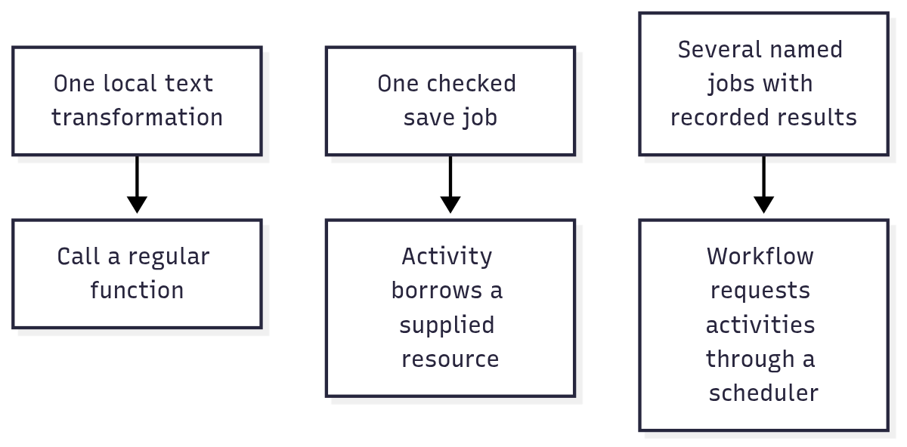

# Start with the outcome you need

You do not need to learn the entire utility suite before using one package. Start with a problem you can recognize: an
imported file has quoted commas, too many downloads run at once, cancelled work keeps using a connection, or an
interrupted job repeats its completed steps. Each package owns one part of that problem.

The package READMEs have three layers. Their opening story and visual explain the value without requiring you to read
TypeScript. The mini-demo supplies real input and shows the result. Later sections explain the contracts and limits you
need when putting that demo into an application.

## Read the return value before learning the machinery

The code can feel unfamiliar when a definition, a running operation, and a cleanup owner look like the same kind of
call. Ask what each call returns. That tells you how to use it with normal JavaScript:

| Return shape           | Familiar way to use it                                     | Example                                                                          |
| ---------------------- | ---------------------------------------------------------- | -------------------------------------------------------------------------------- |
| Plain value            | Assign it and read its fields.                             | `csv.parse()` returns columns and rows.                                          |
| `Promise<Value>`       | `await` it to get the result.                              | `response.text()` returns the downloaded text.                                   |
| `AsyncIterable<Value>` | Read one result per `for await` iteration.                 | Bounded mapping returns your mapper's values.                                    |
| Owned object           | Keep it for a block and await its disposal.                | `context.timeout()` gives `fetch` a signal and owns the deadline wait.           |
| Definition             | Supply it to an implementation or runner.                  | An activity definition describes schemas; declaring it does not perform the job. |
| Workflow operation     | Yield it from the program to obtain a recorded completion. | `activity.request()` describes a job for the scheduler.                          |

There is still an ordinary function doing useful work. A context carries its supporting state. A task adds a control
handle. An activity checks a named call contract. A workflow records instruction completions. Start with the smallest of
these that meets the requirement.

For example, [Context's download demo](../packages/context/README.md#download-text-with-a-two-second-budget) calls real
`fetch`, reads text, and returns `Promise<string>`. The context supplies a signal; it does not become the response or
require a special HTTP abstraction. Its next section shows the controller, clock wait, and cleanup stack underneath. The
guide also expresses disposal with familiar `try/finally` before asking you to adopt `await using`.

This is a reading pattern, not a proposed replacement API: **familiar job → usable result → supporting contract →
mechanics and tradeoff → optional composition**. Keeping those roles visible makes it possible to learn one package
without first learning the suite's vocabulary.

## Choose a first demonstration

| You want to achieve                                               | Try                                                                                                | What you can observe                                                        |
| ----------------------------------------------------------------- | -------------------------------------------------------------------------------------------------- | --------------------------------------------------------------------------- |
| Read a contact export without splitting a quoted company name     | [CSV](../packages/csv/README.md)                                                                   | Text becomes rows with intact cells.                                        |
| Check an option before opening a server                           | [Record + Schema](../packages/record/README.md#try-checking-structure-before-checking-meaning)     | An ordinary options map is accepted; port text becomes a valid number.      |
| Understand an email domain without declaring a person trustworthy | [Email + CSV](../packages/email/README.md#try-a-contact-import-with-explicit-classification-rules) | Each domain receives evidence from the demo's supplied list.                |
| Stop related operations and close what they opened                | [Context](../packages/context/README.md)                                                           | The owner carries a signal and deadline; leaving its block runs cleanup.    |
| Keep only a few operations active at a time                       | [Concurrency](../packages/concurrency/README.md)                                                   | A limited mapper returns ordered or completion-ordered results.             |
| Share a supplied storage client                                   | [Resource](../packages/resource/README.md)                                                         | A dependency is created when first borrowed and released by its collection. |
| Save a photo title as one checked job                             | [Activity](../packages/activity/README.md#save-a-photo-title-with-a-supplied-store)                | The store receives a label; the caller receives a validated receipt.        |
| Run named steps and reuse recorded completions                    | [Workflow](../packages/workflow/README.md)                                                         | Two passes return the same photo ID, with only one title and album entry.   |
| Save checked HTTP input and return a checked result               | [Service](../packages/server/service/README.md)                                                    | A valid title is saved; a numeric title gets status 400 before the handler. |

These demonstrations use supplied local values. Their outputs do not establish that a database, remote service or
production deployment has been configured. Each guide names what the application must provide for that next step.

## Follow one photo through three levels of complexity

For a local label, a normal function is enough: trim the title and change its letters to uppercase. That transformation
alone does not need scheduling, resource ownership or recorded history.

Now suppose the label must be saved through a storage client. A **resource** describes the supplied client, and an
**activity** describes one checked save operation. The activity demo shows the store receiving `SUMMER TRIP` and
returning a receipt with `asset-1`. The store implementation owns what saving means; the activity does not choose a
database for you.

Finally, suppose preparing a photo takes several independently executed jobs. A **workflow** describes their sequence
and asks a scheduler for each result. Its configured history can reuse a recorded instruction completion. In the local
workflow demo, the second pass reuses the saved title's ID and the album update result without repeating either write.
Memory history remains local to that process; a crash recovery system needs authoritative storage and additional host
services.



[Editable diagram source](diagrams/learn.mmd). Read each row as a different requirement. The arrows identify an
appropriate programming model, not automatic promotion through three levels. Do not add the third level when the first
level already solves the problem.

The separate pieces keep the familiar input-to-output relationship visible:

| Piece         | Input                                      | Output or responsibility                                                                 |
| ------------- | ------------------------------------------ | ---------------------------------------------------------------------------------------- |
| Text function | A title                                    | A changed title.                                                                         |
| Save activity | A title and declared access to a store     | A checked receipt from one attempt.                                                      |
| Workflow      | A run input and an exact program           | A result assembled from recorded or newly completed instructions.                        |
| Context       | An operation identity and lifetime options | Supporting cancellation, deadline and cleanup state. It does not return the saved photo. |

The [contract index](contracts.md) links to every package’s exact exported functions, types and field explanations. Use
the examples to see what a call achieves, then use the reference to inspect the values it accepts and returns.

## Read the small amount of code you need

`import` chooses the package used in that file. A name such as `@okikio/csv` selects a focused package; a name such as
`@okikio/utils/csv` selects its installation facade. It does not mean the example uses the whole suite.

`const` names a value so later lines can refer to it. `await` waits for an operation's eventual result, represented by a
Promise. `for await` reads results one at a time. `await using` also registers an owner for awaited cleanup when its
block ends. Cleanup closes the resource; cancellation asks active work to stop. They are related but separate actions.

Read the output block as an observation, not another command to execute. For example, `asset-1 SUMMER TRIP` is what the
activity demo prints after its store returns a receipt. The paragraph after the block explains why that result matters.
Try the suggested input change to follow the same rule with different data.

Several names recur across packages. Their meanings stay consistent:

| Term           | Meaning                                                                                                         |
| -------------- | --------------------------------------------------------------------------------------------------------------- |
| Schema         | A rule that checks or converts a value, such as requiring a title to be nonempty.                               |
| Definition     | A declared description of a job, resource or route. Declaring it does not start that work.                      |
| Implementation | The concrete function or factory that performs the declared behavior.                                           |
| Provider       | A supplied implementation of an external operation, client or execution location.                               |
| Owner          | The part of the program responsible for closing something. A borrower uses it without closing it independently. |
| Signal         | A notification that work should stop. The underlying operation must cooperate with it.                          |
| Engine         | An activity execution category. It is not itself a running thread or machine.                                   |
| Executor       | A host that claims eligible activity work and invokes its provider.                                             |
| Dispatch       | The owner of admitted activity items, claims and accepted results.                                              |
| Claim          | Temporary authority to work on an item; stale authority cannot replace its accepted result.                     |
| Replay         | Running the instruction sequence using recorded completions where available.                                    |
| Polyfill       | Explicit setup that installs a missing API into the environment.                                                |
| Ponyfill       | An imported implementation used directly without installing it globally.                                        |

The demos' explicit duration and disposal polyfills support hosts missing the required APIs. The
[duration](../packages/duration/README.md) and [disposal](../packages/dispose/README.md) guides explain direct imports,
global installation and ownership. Setup imports are not the operation's result.

Each imported binding must participate in the demonstrated job. A setup import belongs only where the example actually
needs that missing runtime API. The first runnable example must use the package it teaches and show a recognizable
outcome. A larger example adds another package only when it owns a needed rule or resource. Printing metadata or calling
a method merely to make an import look used is not evidence that the extra setup helps the reader.

## Combine packages around a real result

For an import, follow [the complete CSV composition](./composition.md#import-rows-with-bounded-work). CSV reads cells,
Schema checks their meaning, Streams groups them, Concurrency limits active row operations, and Context carries their
stop request. The application chooses what to store and whether partially accepted rows should be rolled back.

For page discovery, follow [the robots and sitemap composition](./composition.md#discover-allowed-pages). Sitemap
provides candidate URLs and Robots reports whether its supplied policy allows them. The application still owns fetching,
redirects and scheduling.

For a local save, follow [the resource and task composition](./composition.md#share-a-resource-with-a-finite-operation).
The task performs finite work; the resource collection owns its supplied store; the returned value remains the task's
answer. These examples show where each utility's job begins and ends.

## Run the demos and check their observations

In this checkout, copy a complete block marked `ts runnable` to a `.ts` file in its owning package and run it with Deno.
Keep companion files together when a guide marks them `support=filename.ts`. The Process example needs run permission;
the Worker example needs its companion module and read permission. See
[the example convention](./composition.md#read-the-examples) for the precise setup.

From the repository root, the existing example checker compiles and runs the marked README and composition examples
through public package imports and compares their declared outputs:

```sh
deno run --allow-read --allow-write --allow-run tools/check-examples.ts
```

This verifies executable demonstrations. It does not turn a diagram into a deployed system or prove that every
application's supplied provider is reliable. For an installed package, first install its published version and the
example's schema dependency; the repository's current `0.0.0` guides describe the checked-out experimental source.
