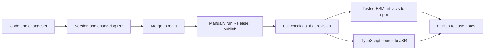

# Release a tested version to npm and JSR

A release starts with an explanation of a user-visible change. Sampo turns that explanation into package versions and
changelogs. The Release workflow then tests one Git revision before publishing its ESM artifacts to npm and its
TypeScript source to JSR. GitHub release notes appear only after both registry jobs succeed.

For example, suppose you fix cancellation in `@okikio/streams`. A changeset is a small file that names the package,
the version change, and the note for users. Add a patch changeset for this fix while it is still in review:

```sh
mise run release -- --operation add --project streams --bump patch --message 'Stop reading when the consumer cancels.'
mise run release -- --operation plan
```

Commit the generated file in `.sampo/changesets/` with the fix. The plan previews the PR base branch (or `main` locally) and is read-only: it shows version changes,
dependent-package changes and changelog entries. Review that output, including changes to the umbrella package.
Choose `minor` for new compatible capabilities and `major` for incompatible public changes. Documentation-only or
private-tool changes do not need an artificial package bump. Sampo has no `none` bump type.

## From a changeset to a version PR

After changesets reach `main`, the workflow prepares a `release/versions` PR. It runs Sampo's native release command,
then projects the resulting npm versions into the Deno manifests. Review the package changelogs and passing checks
before merging. This PR prepares metadata; it does not publish anything.



To inspect the same preparation locally, use a clean checkout of `main`:

```sh
mise run release -- --operation version --check
# The following command writes versions and consumes changesets. Review its diff.
mise run release -- --operation version
mise run check -- --kind versions
```

Read `package.json` for the package name, version, source exports, and npm dependency ranges. Sampo chooses
the next version and writes the changelog. `tools/releases/versions.ts` copies that version to `deno.jsonc`
without changing comments or other fields. If the package names disagree, it stops before writing anything.
Deno still reads JSR imports, compiler settings, and source publishing rules from its own config. Each lockfile
records the dependencies its tool resolves.

## Check the hosted setup without publishing

Select **validate** in the Release workflow on `main`. This is the default manual operation. It runs the full shared
checks and reads repository information with a short-lived GitHub App token. It does not create a version PR, push tags,
upload packages or create GitHub releases. The App requests the same contents and pull-request write permissions that
preparation needs, but the validation job performs only reads. Token creation confirms those permissions can be granted;
it does not prove that a future branch write will pass every repository rule.

This operation must first exist on the hosted revision. Local workflow edits cannot be dispatched from GitHub. A passed
validation run proves the checked revision and App access, but **does not prove registry publication is authorized**.
Registry bindings are separate settings. A package dry run checks contents without testing an authenticated upload.

## Publish the revision that passed the checks

Run the **Release** workflow on `main`, selecting **publish**, after the version PR has merged. Pending changesets and an uncommitted source tree block
publication. The workflow checks out the triggering revision, calls the full shared quality workflow, and publishes only
when those jobs succeed. It does not infer readiness from a different CI run or a moving branch tip.

The installed-package job builds and tests the npm candidates, then uploads those exact staged directories. The npm job
downloads them; it does not rebuild. Each source package's `publishConfig.directory` points pnpm at its staged package.
Sampo discovers the source workspace and invokes native pnpm publication. The staged manifest contains ESM JavaScript
and declaration exports, rather than source-only TypeScript exports. The JSR job publishes source at the same revision
with Deno's frozen lockfile. Tsdown is not needed to publish JSR subpaths.

For local inspection, these commands perform no upload:

```sh
mise run test -- --suite packages
mise run check -- --kind jsr
mise run release -- --operation publish --target npm --check
mise run release -- --operation publish --target jsr --check
```

The npm dry run requires prepared artifact directories. Publication also requires a Git checkout; ordinary source and
consumer tests can run from a ZIP checkout. See [packaging](./02-packaging.md) for artifact inspection and inference checks.

## Configure the hosted release identity

Before the first hosted release, the repository owner must configure these external settings:

| Setting | Why it is needed |
| --- | --- |
| `BUMPY_APP_ID` and `BUMPY_APP_PRIVATE_KEY` | A GitHub App installed on this repository with contents and pull-request write access creates the version PR. Its push can trigger ordinary PR checks. |
| `publish` environment | Allow only `main` to reach either registry job. |
| npm trusted publishing | Register owner `okikio`, repository `utils`, workflow `release.yml`, environment `publish`, and allow direct publication for each npm package. The job requests an OIDC token instead of storing a long-lived registry token. |
| JSR scope, packages and GitHub repository association | Permit Deno's GitHub Actions OIDC publication for the package names in the manifests. |
| Branch protection | Require the relevant source, runtime and installed-consumer checks on version PRs. Formatting and linting remain separate advisory jobs. |

The App secret names predate Sampo. They refer to the existing installed App, not to a Bumpy dependency. The existing
workflow used `BUMPY_APP_ID` as the App's **client ID**; keep that input contract when reusing the secret. Do not create
or rotate a private key just to change release tools. Restrict the App installation to the repositories it needs.

For each **existing** npm package, an owner can inspect its trusted-publisher settings and add the binding above. With
npm 11.15 or later, the equivalent command is shown below. This changes registry settings; it does not publish a version.
Check existing bindings first rather than replacing another release identity.

```sh
npm trust list @okikio/streams
npm trust github @okikio/streams --repo okikio/utils --file release.yml --env publish --allow-publish
```

npm requires the package to exist before a trusted publisher can be added. A new name therefore needs an explicitly
authorized first publication before this setup can be completed. Do not treat a missing package as a failed OIDC binding,
or perform a first publication as part of a settings check. For JSR, create the intended package in the scope and link it
to `okikio/utils` in its settings. Check all workspace packages, including newly added ones; one configured package does
not authorize the rest. See [npm trusted publishing](https://docs.npmjs.com/trusted-publishers/),
[the npm trust CLI](https://docs.npmjs.com/cli/v11/commands/npm-trust/), and
[JSR publication settings](https://jsr.io/docs/publishing-packages).

The pinned CLI is `sampo@0.24.0`. It supports npm workspace releases, not a native JSR adapter. The JSR job is an explicit
Deno step, not a claim of upstream JSR support. Registry configuration and real hosted publication need to be checked by
the repository owner; local dry runs cannot prove those credentials or permissions.

## Recover from a partial release

npm and JSR cannot commit a version atomically. If npm succeeds and JSR fails, the npm version remains published.
Do not edit that version's source, move its tag or reuse its version number for different contents.

Inspect the failed job, correct its external cause, and rerun the failed jobs of the **same workflow run**. Sampo checks
already-published npm versions and Deno skips existing JSR versions. Successful npm tags are pushed even when another
npm package fails. Those tags record npm progress; they do not prove JSR completion. The final GitHub-release job waits
for both registry jobs and skips release records that already exist.

If the correction changes package contents, prepare a new changeset and version instead. Keep the failed run and registry
receipts for comparison. Never describe a dry run, an existing npm tag, or a passed source test as a completed two-registry
release.

Upstream contracts: [Sampo CLI and release flow](https://github.com/bruits/sampo/blob/main/crates/sampo/README.md),
[pnpm publication directory](https://github.com/pnpm/pnpm/blob/main/pnpm/docs/package_json.md),
[Deno publishing](https://docs.deno.com/runtime/reference/cli/publish/).
