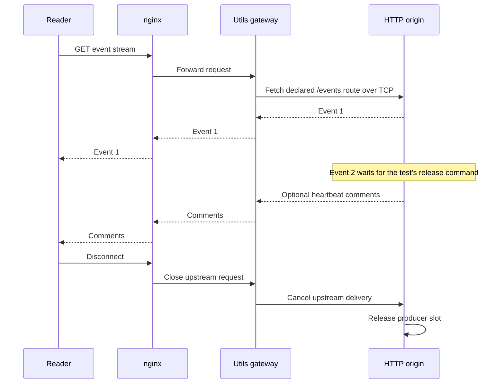

# Test streaming and database recovery on a real host

A customer watching a long-running job needs two things: progress must arrive while the job runs, and a reconnect must
not erase work already saved. A passing parser test cannot show either outcome through a proxy or a failed database.
The root integration fixtures exercise those extra owners. Package tests remain responsible for individual operations.

Use this page to reproduce the checks and interpret their limits. Follow the
[checkout setup](../../README.md#work-on-the-repository) first. The fixtures own disposable resources; they do not
use an application database. Start from the Utils checkout with `mise install` and `mise run prepare -- --kind deps` complete.
Docker must be running, and the selected Deno and Node versions come from `mise.toml`.

Run the complete container fault matrix with `mise run test -- --suite containers`. It includes native placement,
resource sessions, streaming and SQL recovery. Use file selectors when investigating a particular boundary:

```sh
mise run test -- --suite containers tests/workflows/streaming-load.test.ts tests/workflows/postgres-failover.test.ts
```

The [stream pressure and proxy test](../../tests/workflows/streaming-load.test.ts) and
[database promotion test](../../tests/workflows/postgres-failover.test.ts) contain the executable assertions.
The runner selects two files containing three tests. A successful run reports three passes and no skips. PostgreSQL
18.3 and nginx 1.28 images are pinned by digest in the tests. The streaming host runs on Deno; Node runs the controlling
tests and the interrupted database writer. The first run can download images.

Every test prints a fresh `.tmp/tests/recovery/<scenario>-<time>-<id>/` directory. Native runner logs and receipts
also remain in `.tmp/tests/native/`. These directories are ignored local evidence. The tests close their owned
sockets, child processes, containers and network; they retain measurements, proxy configuration, database logs and a
successful promoted-database SQL dump. Keep failed runs as well as successful ones when comparing a repair.

The [nested container drill](../../tests/workflows/nested-containers.test.ts) first commits one activity result,
then blocks the next attempt until its physical owner is killed. Recovery must retain the committed result and finish
the interrupted activity with a different resource instance. Observing a claimed SQL row followed by a short sleep
would not prove interruption: the activity could finish before Docker delivers the kill.

The [session container drill](../../tests/workflows/session-containers.test.ts) uses fixture budgets that leave room
for native transport and host scheduling. Its 4.8-second owner lease and 2.4-second borrow lease produce an 800 ms
renewal tick. Delaying initial publication by 1.8 seconds still crosses two ticks, including after a crash replacement.
The ordinary idle deadline is six seconds; pool-selection cases retain their separate 15-second idle budget.
Contention and retirement hold a real borrow until the test opens a committed SQL release gate. Test scope cleanup
opens that gate, joins the pending call and removes its control row. This also permits release after a retiring host
has stopped admitting activities. Borrow cancellation can end the wait independently. These control rows belong to
the fixture; production session migration does not create them.
These test settings do not change production defaults or permit late renewal. The explicit SQL expiry and promotion
drills below separately check rejection after authority has expired. An overloaded machine can still exceed these
budgets; retain its rejected status and resource observations rather than treating `lost` as a missing result field.

## Find where a slow reader changes the outcome

The synthetic feed sends 64 events of 32 KiB payload each, about 2 MiB per reader before SSE framing. It produces each
event when the stream asks for it, rather than preparing the whole response in an array. Readers check the actual
payload and increasing event IDs. The workload isolates delivery from SQL query cost.

| Workload | What it checks | What to inspect |
| --- | --- | --- |
| 1, 4 and 8 fast readers | All events arrive with their original order and content. | Event counts and elapsed milliseconds, using the single reader as the scaling baseline. |
| 4 readers delaying 2 ms after each event | A slower consumer still receives the complete finite response. | Elapsed time includes the deliberate reader delay. |
| 8 paused native HTTP responses | Producers stop advancing before exhausting their output budget; the status route remains reachable. | Per-reader generated counts reach a stable observation window. |
| A ninth reader while all slots are occupied | The application returns 503 and `Retry-After: 1`. | The refused count increases once. |
| Disconnect, then open another reader | Every stalled source releases its slot and a later complete read succeeds. | Active sources return to zero. |

The eight-slot cap is **fixture application policy**. Neither `http.create()` nor `events.write()` supplies a global
connection limit. A connection permits at most 32 MiB of encoded output, 16,384 messages and 64 KiB per event. Those
budgets stop excessive output; they do not define socket buffer sizes or disconnect a reader merely because it is slow.
The transport can read ahead into its own buffers before backpressure reaches the source.

`measurements.json` records the idle baseline, each workload, runtime versions, sampled peak process memory and final
memory. RSS is the operating system's resident-memory measurement; JavaScript heap is only part of it. The test samples
the host every 20 ms and rejects growth above a deliberately wide 256 MiB guard relative to idle. Sampling can miss
short peaks, and a finite run without forced garbage collection does not prove stable retained memory over hours.
These are correctness and resource-pressure tests, not throughput benchmarks or production capacity targets.

This fixture also exposes a limitation: eight stalled readers occupy every slot. A real service may need per-account
limits, a write deadline, admission fairness and a durable cursor before it can disconnect a slow reader safely. The
[durable greeting feed](../server/10-http-streaming.md#recover-the-same-feed-after-the-http-process-dies) checks replay
separately. Synthetic event IDs in the load fixture do not provide durable recovery.

## Follow an event through nginx and the gateway

A second test sends requests through an independent nginx container and a real Utils gateway. The gateway makes a
native Fetch request back to the HTTP origin. The gateway and origin share a Deno process, but communicate through a
second TCP connection. This is not a simulated Fetch adapter.



The diagram shows delivery ownership, not durable event storage. Before testing the paused second event, eight
mixed-speed readers check 512 complete events through this path. An undeclared route returns 404.
Healthy-load readers use a five-second nginx idle budget. The gated idle/heartbeat controls use their separate
one-second route, so the healthy-load test does not depend on meeting that deliberately short expiry policy.
The Deno fixture has a 30-second assembly deadline, including module loading; `startup.json` records the actual wait.

The same tiny gated response then distinguishes three deployment behaviors:

| Proxy configuration | Observation |
| --- | --- |
| Buffering enabled | The origin generates event 1, but the first body read stays pending during a 300 ms observation window. Releasing event 2 completes delivery. |
| Buffering disabled, no heartbeats | Event 1 arrives before the origin can finish. nginx's one-second idle timeout later interrupts the already successful 200 response body. |
| Buffering disabled, 100 ms heartbeat comments | Comments arrive for more than two idle-timeout windows. Releasing event 2 completes the stream. Comments have no event ID. |

The test then aborts another active stream and waits until the origin has no active source. `nginx.conf`, `nginx.log`,
`proxy-load.json` and `result.json` preserve the actual settings and observations. The gateway has a separate ten-second
total deadline; heartbeats do not extend that deadline. An idle timeout measures silence between reads, whereas a total
deadline limits the entire operation.

The fixture disables gzip and exercises plain HTTP/1.1. It does not test TLS, compressed streams, HTTP/2 or HTTP/3,
a CDN, rolling proxy restarts or your ingress configuration. nginx defaults to response buffering; the meaning of
[`proxy_buffering` and `proxy_read_timeout`](https://nginx.org/en/docs/http/ngx_http_proxy_module.html) explains why both
controls need testing. Preserve the first-event observation when adapting this fixture; waiting only for the complete
body cannot detect buffering.

The nginx container reaches the owned host through `host.docker.internal`; the test supplies Docker's `host-gateway`
mapping. This worked on the tested Docker Desktop host. Other Docker installations must provide a working route to the
host. The fixture binds its temporary Deno listener on `0.0.0.0` for that route, so run it on a trusted development host.

## Recover saved work after the database writer disappears

The database drill starts a primary and copies it into a physical standby with `pg_basebackup`. The standby continuously
receives PostgreSQL's write-ahead log, which records database changes. Before accepting test writes, the fixture waits
for synchronous replication and selects `synchronous_commit = remote_apply`: a successful commit waits for the standby
to apply it. This makes the acknowledged-write checks meaningful for this specific topology.

The drill saves a cursor, claims a queue item, completes one note workflow and accepts another. It also starts a
transaction in the same process that inserts a row, runs a slow query and queues another query without committing.
It waits until PostgreSQL reports the slow query as active, then kills the primary and promotes the standby.

```mermaid
sequenceDiagram
    participant App as Utility consumers
    participant Primary
    participant Standby
    participant Operator as Test operator
    App->>Primary: Save cursor, claim, accepted jobs and completed receipt
    Primary->>Standby: Replicate and apply committed changes
    Standby-->>Primary: Applied acknowledgement
    Primary-->>App: Commit succeeded
    App->>Primary: Same process inserts row and queues queries
    Operator->>Primary: SIGKILL and keep old writer stopped
    Primary-->>App: Transaction and queued queries reject
    Operator->>Standby: Promote to writer
    App->>Standby: Existing multi-host pool reconnects
    Standby-->>App: Saved cursor, jobs and receipt
    App->>Standby: Reject old callback SQL; keep new transaction intact
    App->>Standby: Replace expired claim; complete pending work
```

The operator deliberately fences the old writer by leaving its container stopped. Fencing means preventing that writer
from accepting more writes; choosing a new connection address alone would not prevent two independent writers.
The test does not provide an election service. After promotion it removes the inherited synchronous-standby requirement
because the new single writer has no replica; production must explicitly choose how to restore redundancy or trade
availability against durability.

The assertions check the useful outcomes through public utility APIs:

- The same Postgres.js multi-host pool reaches the promoted writable server. Snapshot reopening returns cursor 2 and
  permits a new save of cursor 3.
- Repeating the queue command returns its original identity. A replacement claim has attempt 2, rejects completion by
  the old claimant and publishes the recovered result.
- Repeating the completed workflow returns the same run. Its business write stays single, the accepted pending workflow
  completes, and the final database holds exactly two notes and two matching receipts.
- The interrupted transaction's row is absent. The replica's SQL dump and replication state remain available for inspection.

**Use Postgres.js 4.0.0 for this recovery path.** The original 3.4.9 drill exposed an uncaught scheduled socket write
when the primary died ([upstream report](https://github.com/porsager/postgres/issues/1208)). The official
[4.0.0 release](https://github.com/porsager/postgres/releases/tag/v4.0.0) replaces the connection machinery and prevents
queries from a lost transaction reaching the connection's next user. The checkout now pins that released dependency;
there is no local driver patch or uncaught-exception handler.

The drill interrupts `begin()` inside the test process, with one query running and another queued. Both queries and
the transaction must reject. It then uses the **same single-connection pool** against the promoted writer. A paused
callback from the lost transaction resumes while a new transaction is open: its attempted write must reject, and the
new transaction must retain its transaction ID. This checks that reconnecting does not silently move old work into a
new transaction. The final query confirms that neither uncommitted row exists.

Rejecting `begin()` does not stop JavaScript that is still running in its callback. The driver rejects SQL through the
lost transaction; the application still owns cancellation and any external effects. Check that permission before an
external write, and reconcile its saved identity before retrying it.

The initial crash logs and supervised recovery run remain under the preserved initial failover run.
The upgrade investigation, compatibility checks and new runs are retained under `.tmp/artifacts/postgres-inprocess-20261105/`.
Each promotion run also saves its process ID, rejected-query outcomes, replication state, database logs and SQL dump
under the unique `.tmp/tests/recovery/postgres-failover-*` directory printed by the test.

**Upgrade the application's borrowed pool too.** The storage adapters do not replace a pool supplied by the caller.
The same drill passed on Node 26.10.0, Deno 2.9.7 and Bun 1.4.2. Version 4 requires Node 20 or later, or a supported
Deno/Bun host. It removes `sql.array(values)`; pass arrays directly and cast them in SQL (`::text[]` for a text array). Parameter types now come from PostgreSQL by default. Cast ambiguous parameters, such as
`${date}::timestamptz`, or explicitly select `infer: true` when migrating code that requires v3 inference. Review the
[upstream upgrade guide](https://github.com/porsager/postgres/tree/v4.0.0#upgrading-from-v3) for date/time behavior outside UTC and the remaining public API changes. These are migration
requirements, not consequences of retrying a query.

A dropped connection around COMMIT can leave the outcome unknown. This drill kills a transaction known to be waiting
before COMMIT, so its absence is expected. A crash during COMMIT, asynchronous replication data loss, a network
partition, automatic election, restoring the old primary and cross-region latency remain separate checks work.
The following drills add continuous writes during promotion and deterministic loss of a COMMIT reply. PostgreSQL's [standby documentation](https://www.postgresql.org/docs/18/warm-standby.html)
explains the difference between asynchronous and synchronous replication; this test's result must not be applied to a
different replication policy.


## Keep writes running while the primary is unavailable

A service does not stop receiving work just because its database is changing writers. The
[continuous-write drill](../../tests/workflows/postgres-load.test.ts) keeps a fixed number of producers active before,
during and after primary loss. Each producer saves a note and a matching Workflow receipt in one transaction. It reads
the receipt before inserting, so repeating an uncertain operation can return its saved result.

Run this separately from package unit tests. It creates and destroys three isolated primary/standby pairs and normally
takes a little over two minutes:

```sh
mise run test -- --suite containers tests/workflows/postgres-load.test.ts
```

The command selects three tests: two load profiles and the COMMIT-reply drill below. Each prints a unique local evidence
directory under `.tmp/tests/recovery/`. Keep those directories when comparing failures with later passing runs. Temporary
reports, logs, dumps and diagnostic entry points belong in `.tmp/`; the existing `.tmp/artifacts/` history remains in place.
Before primary loss, each producer must have committed work. This is a recovery precondition, not a minimum throughput
target: a slower host must still prove exact reconciliation after promotion.

| Setting | Lower contention | Higher contention |
| --- | --- | --- |
| Producers / pool connections | 2 / 2 | 8 / 2 |
| Write period | 60 seconds | 60 seconds |
| Primary loss | After eight seconds of successful writes | Same |
| Promotion delay | Three seconds with no primary | Same |
| Per-producer admission | One operation in flight, then a four-millisecond pause | Same |
| Application transaction | Guard current claim, read receipt, insert payload, three-millisecond SQL delay, save receipt | Same |
| Retry limit per operation | 20 seconds or 400 retries, with a 50-millisecond pause | Same |

These profiles compare the same work with different contention. They do not compare Utils with a bare SQL insert,
which has neither claim checks nor receipt reconciliation. The deliberate SQL delay keeps transactions in flight; its
latency is part of the workload. Each producer can issue at most 10,000 logical operations. The claim and host leases
last three minutes, longer than this finite drill; this does not test lease renewal during an outage.

The first run exposed a connection-selection problem: **Postgres.js 4.0.0 with PostgreSQL 18.3 can select a physical
standby with `target_session_attrs: 'read-write'`.** The driver uses `default_transaction_read_only` when startup
parameters are available, but a hot standby forces read-only transactions even when that default is `off`. The
[upstream startup code](https://github.com/porsager/postgres/blob/v4.0.0/src/startup.js) shows that distinction.
Both promotion fixtures now use **`target_session_attrs: 'primary'`**. That rejects an unpromoted standby rather than
sending guarded writes to it. It selects the server role; database permissions and any read-only policy on the primary
still apply. The adapters borrow the application's pool, so the application must select this option on its own pool too.

During the intentional outage, the caller can receive a connection error or PostgreSQL shutdown code `57P01`, `57P02`
or `57P03`. The fixture retries only those declared failures, with the **same operation key and input**. It does not
ignore a read-only error or an invalid claim. This policy is suitable here because the SQL write and receipt commit
together; it is not permission to repeat an arbitrary HTTP call or another external effect.

After promotion, every acknowledged operation must have exactly one matching business row and receipt. The business
table has no unique constraint that could hide a repeated insert. The test compares every ID and payload, joins all
producers before closing their store, and requires progress in at least 30 sampled one-second windows after recovery.
`result.json` records completions, error codes, maximum active operations, latency percentiles, RSS samples and IDs.
The retry window is checked after failed attempts; it does not cancel an in-flight SQL statement. Pool connection
attempts have a two-second timeout and owned statements a five-second timeout.
The SQL dump independently preserves final database state. Compare the cumulative completion samples to see the pause
and recovery. Rare outage delays can fall outside the reported percentiles, so inspect those samples too.
RSS samples are observations, not a proved memory ceiling or leak test.

## Recover when COMMIT succeeded but its reply disappeared

Suppose a note and its receipt commit, then the connection breaks before the caller learns that they committed.
The rejected promise tells the caller that the reply was lost. It does **not** prove that the note is absent.
The third test places a small plaintext TCP proxy between the receipt owner and its disposable database. Unlike a
timer-based disconnect, this proxy inspects PostgreSQL protocol messages to choose the exact interruption point.

| Injected failure, repeated three times | Independent database observation | Recovery with the original identity |
| --- | --- | --- |
| Drop the COMMIT request before forwarding it | Neither business row nor receipt is visible | A permitted retry writes both. |
| Observe PostgreSQL's `CommandComplete(COMMIT)`, then discard it and close the socket | Business row and receipt are visible, although the write promise rejected | Read the receipt and return its saved result. |

PostgreSQL defines the [command completion and ready messages](https://www.postgresql.org/docs/18/protocol-flow.html).
The proxy withholds the successful COMMIT response and all later bytes on that connection. A separate database pool
checks the business row. Receipt lookup also checks the current claim before returning a result; a retained receipt
does not grant an expired or unrelated caller permission to write.

The sequence below shows the committed case. The caller cannot see the response that the test proxy uses as evidence.

```mermaid
sequenceDiagram
    participant Caller as Receipt owner
    participant Proxy as Test TCP proxy
    participant DB as Synchronous primary
    participant Standby
    Caller->>DB: Write note and receipt through proxy
    Caller->>Proxy: COMMIT
    Proxy->>DB: COMMIT
    DB->>Standby: Apply committed write
    Standby-->>DB: Applied acknowledgement
    DB-->>Proxy: CommandComplete(COMMIT)
    Proxy--xCaller: Discard reply and close socket
    Note over Caller: Promise rejects; outcome is uncertain
    Note over DB,Standby: Operator fences primary and promotes standby
    Caller->>Standby: Read receipt under current claim
    Standby-->>Caller: Return saved result
```

After all six interruptions, the test kills the primary and promotes its synchronous standby. The proxy redirects new
connections to that writer, and the **same receipt owner** reconnects. For every original identity, two concurrent
reconciliation calls must return the same result. The final database must contain six notes and six receipts, with no
duplicate business writes. Changing the input under a saved key must fail. The proxy records only injection tags and
errors, not authentication frames; it is a local test fixture and does not test TLS proxies or production poolers.

For application recovery, preserve the accepted command, input and receipt key. After reconnecting, let an owner with
current permission read the receipt before doing more work. If it exists, use that result. If it is absent, execute a
transaction that checks it again before writing; that second check closes the race with another reconciler. The
[complete SQL note example](../../packages/storage/workflow/postgres/README.md) uses this transaction pattern. Its claim
belongs to the store that issued it; do not copy it to a newly constructed store. A replacement worker must obtain its
own current claim rather than bypassing that ownership check.

These are finite local test cases. They do not make a client-side exception reveal the commit outcome,
provide automatic election, promise survival under asynchronous replication, or prove multi-hour throughput and memory
behavior. The three-second outage also does not test outages longer than the retry or claim budget. A service that
uses different replication, payloads, isolation, proxies or lease timing must repeat the checks with those settings.

## Keep permission alive during a long database run

A long-lived activity needs more than a reconnecting pool. Its host registration and attempt claim each expire unless
renewed. A lease is that time-limited permission to work; it is not proof that work made progress. Once it expires,
the old owner must stop writing. A replacement needs its own claim, even if the original JavaScript callback is still
running.

The [lease drills](../../tests/workflows/postgres-leases.test.ts) exercise both sides of that boundary with real
physical promotion. They also check concurrent renewal against the same host row. Run them as part of ordinary
container checks:

```sh
mise run test -- --suite containers tests/workflows/postgres-leases.test.ts
```

| Scenario | Expected owner behavior | What the test verifies |
| --- | --- | --- |
| PostgreSQL is physically paused and cannot answer client requests | The test's progress watchdog closes its owned pool, then joins outstanding work | Pending SQL and the watchdog reject; no connection or queued request remains. Separate fixture administration pools also close, and PostgreSQL resumes before the SQL dump. |
| Both pool connections are held by callers | Reject work that exceeds its separate connection-admission budget | The queued transaction never enters its callback. Both admitted connections remain usable, and the pool accepts a new transaction after they are released. |
| Four concurrent renewers sharing two pool connections, repeated eight times | Serialize updates without deadlocking or replacing the host | All 32 renewals succeed; the original claim remains live and can save a guarded write. |
| Three-second promotion delay within a 30-second lease | Reconnect, renew the host, then renew its attempt while both are still live | An actual renewal fails during the outage; the same claim renews after promotion and writes again. Its database expiry advances. |
| Five-second promotion delay exceeding a three-second host and attempt lease | Reject the original owner and admit replacement work through recovery | Host renewal, attempt renewal and old-claim writes reject. Recovery issues a new claim with the next sequence; the replacement reuses the original receipt without repeating its business write. |
| Five-second promotion delay exceeding a three-second attempt lease, with a 30-second host lease | Keep host registration separate from permission for this attempt | Host renewal succeeds, but attempt renewal and its SQL write reject. Independent database timestamps show the live host and expired attempt. |

The delays above are intentional waits; connection failure detection and promotion add to the actual outage.

The store checks expiry using PostgreSQL's
[`clock_timestamp()`](https://www.postgresql.org/docs/18/functions-datetime.html#FUNCTIONS-DATETIME-CURRENT).
A timer waking up on time is not authority. A renewal response lost in transit can be retried only while the stored
host and claim are still live. Neither `renewHost()` nor `renew()` revives an expired owner. Renewing an attempt also
does not move its fixed activity deadline.

Renewal must acquire its host update lock before checking and extending that host. If two renewers first hold shared
locks on the row and then both try to update it, neither can proceed until the other releases its shared lock.
PostgreSQL [detects that cycle and aborts a transaction](https://www.postgresql.org/docs/18/explicit-locking.html#LOCKING-DEADLOCKS).
The store therefore takes the update lock at the start of
renewal, while ordinary guarded writes still share the host row. Ancestor locks retain their root-first order.
This overlap can occur when a readiness check renews the host while its claim loop is also renewing registration.
The concurrent-renewal regression uses a real database and checks every result; retries do not hide a deadlock.

For a longer correctness check, the [soak test](../../tests/workflows/postgres-soak.test.ts) keeps eight producers sharing
two pool connections for **two elapsed hours**. Each producer has one long-lived activity claim. It writes a succession
of small notes and receipts, with at most one operation in flight and a 250-millisecond pause between operations.
This stresses the store's guarded transaction and renewal paths, not activity dispatch throughput. The test kills the
primary halfway through, waits three seconds and promotes its synchronously replicated standby.

Run it explicitly on a machine that can remain awake with Docker available for the whole period. It is excluded from
ordinary runtime and container tasks so that a short CI run cannot silently stand in for a multi-hour check:

```sh
mise run test -- --suite soak
```

To check the harness before committing that time, use its short mode. This runs the same assertions and midpoint
promotion, but **does not test multi-hour behavior**:

```sh
UTILS_POSTGRES_SOAK_SECONDS=90 mise run test -- --suite soak
```

`UTILS_POSTGRES_SOAK_SECONDS` accepts whole seconds from 90 to 14,400; its default is 7,200. The value is elapsed test
time, excluding database startup and final reconciliation. The host and attempt leases are 30 seconds. The test renews
the host first, then all eight claims, waits two seconds and repeats. Activity deadlines are fixed at the requested
write period plus two minutes. Each renewal round first extends the host, then admits the eight independent claim
renewals together. They still share the same two pool connections with the writers. Sequentially admitting each claim
would make it wait behind another writer batch and could exhaust the lease despite continuous business progress.
The fixture joins every admitted renewal before retry or shutdown; `renewals.jsonl` records host and per-claim waits.
The pool's connection cap does not bound its waiting queue. Transaction-local SQL timeouts begin after a connection
is acquired. The fixture-owned Postgres.js pools set a separate 20-second `queue_timeout`; the admission regression
uses a shorter budget while holding both connections and proves that rejected queued work does not close them.
A queue timeout is a failed soak, not permission to replay an expired claim. Applications must also bound pending writes
and leave enough lease margin for connection admission,
transactions and host scheduling. The borrowed pool does not automatically reserve a connection for renewal.
Server-side timeouts also require a responsive server. They cannot bound transport silence while a database VM or
Docker engine is unavailable. The application owns transport policy and the borrowed pool's lifecycle; this store
does not destroy an application's pool to force an operation to settle.
The soak owns its fixture pool. Its independent client-side watchdog closes that pool if no write is acknowledged
for 25 seconds, then joins queued and active operations. Any other fatal loop error, including a failed journal write,
also closes the owned pool before joining. This prevents failed evidence capture from disabling the watchdog while
leaving SQL admission unresolved. A real-container test pauses PostgreSQL so it cannot run SQL timeouts, then verifies
that the watchdog rejects and the owned pool has no connections or queued work. The server resumes before its SQL
dump is captured. Closing a connection can leave commit outcome unknown; this path always fails the soak.
The watchdog cannot interrupt a hung Docker control command or a stopped JavaScript event loop. The final native
receipt remains necessary to establish that SQL dump capture and container teardown actually completed.
Declared connection/shutdown failures have a 20-second or 400-retry budget, with a
50-millisecond pause. Other failures, including `stale_claim`, stop the run. The test owns this explicit renewal and
retry loop; it does not exercise the `workflow.serve()` scheduler. That scheduler cancels an attempt when its automatic
renewal fails. Its callback must cooperate with cancellation; a stored claim still guards subsequent SQL writes.

After a ten-second pause, the soak performs a bounded recovery scan, checks that all eight jobs retain their original claim
generation, observes remaining lease time, and appends a sample to `.tmp/tests/recovery/postgres-soak-*/progress.jsonl`.
The sample records completion counts, renewal rounds, active operations, heap/RSS and database connections. It must
observe progress within 25 seconds. Valid authority observations must remain less than 60 seconds apart, including
startup and the final unsampled tail. An unavailable sample does not reset that clock. This bounds monitor liveness;
it does not extend the 30-second lease or prove authority between samples. SQL queries and journal writes consume
time, so a fixed count derived from a zero-cost ten-second timer would reject healthy runs. Each sample records its
actual observation and authority gaps. Fixed counters and latency
buckets replace per-write arrays. Evidence grows on
disk, while the test does not retain all IDs or samples in JavaScript memory. Database rows and receipts deliberately
grow; their storage cost is part of this workload.

At the end, SQL compares every expected producer/sequence ID, payload and saved receipt value. It also counts all rows
to detect extras. The business table has a non-unique lookup index, so duplicate writes remain visible. A passing
`reconciliation.json` records the exact write count and whether the run lasted at least two hours. The native runner's
passing receipt proves that later teardown also completed; a progress file or a `result.json` marked `reconciling`
does not prove completion. Each database pair retains logs and a SQL dump before its owned containers are removed.

If a run fails or is interrupted, keep its unique directory. Read the last complete journal line, the fault and
promotion records, and the native runner log before changing retry or lease settings. A partial run is useful diagnosis,
but cannot satisfy the two-hour gate. Start a fresh run after a correction rather than joining partial durations.
The evidence is local to `.tmp/`; retain it separately before deleting that directory.

Check the Docker engine as well as PostgreSQL when progress stops. During the 2026-11-05 follow-up, Docker's backend
explicitly requested engine shutdown because writing its VM log failed with `no space left on device`. Both owned
database containers stopped with `OOMKilled=false`. The last workload journal recorded 1,191 seconds and 33,441
acknowledged writes, before the planned midpoint promotion. That interrupted run is not a fresh two-hour pass.
Restore host storage headroom and stable engine operation before restarting the full elapsed-time test; do not join
partial durations or reinterpret a restarted database as uninterrupted recovery. Retain the engine's shutdown cause
alongside database state, logs and the failed run's SQL dump.

A two-hour pass supports this particular workload and one controlled promotion. It does not prove a memory ceiling,
production capacity, automatic election, repeated failback, partition safety, asynchronous replication durability or
lease renewal under an outage longer than the available lease margin. Compare memory and connection samples across
the run when investigating growth; a rising RSS sample alone does not identify a leak. Applications with different
payload sizes, retention, isolation or pool contention must repeat the test with those settings.
