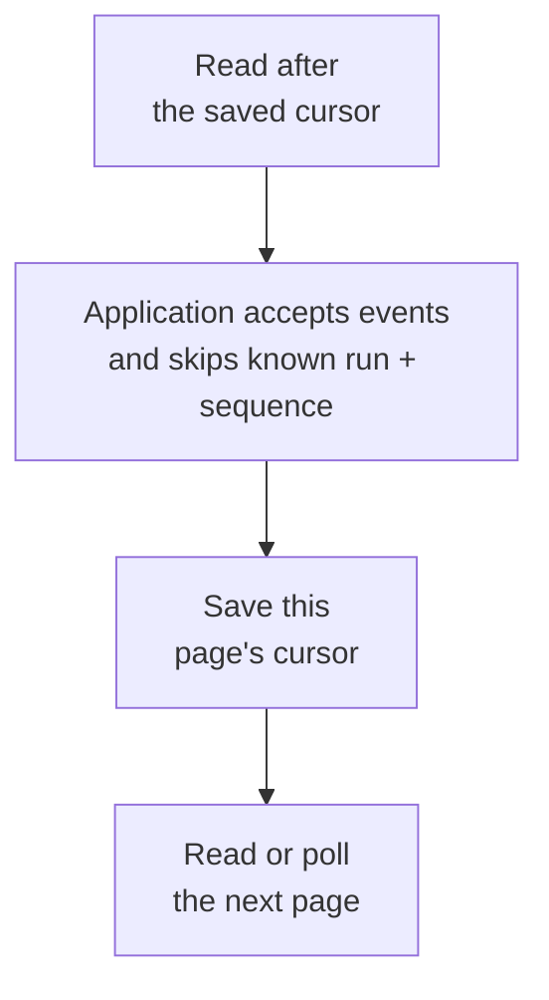

# Inspect saved workflow execution

A service that accepts background work can return before the work finishes. Its status page therefore needs saved
answers to questions such as “is this import waiting, running, or complete?” The inspector reads those answers from
storage. Reading a snapshot does not grant permission to execute or repair that work.

Use `postgres.inspector()` to construct that reader. Importing the module or constructing the inspector performs no
database work. Its read methods use the application's existing connection pool. The inspector does not close the
pool, start workers, recover expired claims, renew leases, or upgrade database tables.

The following excerpt belongs inside an application that already has `databaseUrl`, its authorization policy, and a
shutdown path. It is not a complete database setup. Start with the [save-one-note example](../../packages/storage/workflow/postgres/README.md#save-one-accepted-note-and-reopen-its-result)
if you need the pool, migration, worker, and final cleanup together.

Use the existing public workflow export:

```ts
import postgresjs from 'postgres';
import * as postgres from '@okikio/storage/workflow/postgres';

const database = postgresjs(databaseUrl, { max: 8 });
const operations = postgres.inspector({ database, namespace: 'imports' });

// ref is the saved ReferenceType returned by client.submit() or client.trigger().
const current = await operations.inspect(ref);
const attempts = await operations.attempts(ref);
const waits = await operations.waits(ref);

console.log(current.run.state, current.run.control.paused);
console.log(current.totals.claimedJobs, attempts.items, waits.items);
// The application closes database after every consumer has finished using it.
```

The inspector requires schema revision 2. Apply migrations explicitly through the deployment procedure described in
[saved execution](./01-workflow.md). Opening an inspector never upgrades an older database.

## Choose a view

Start with `inspect(ref)` when someone asks why a particular import has stopped. If it is waiting, use `waits(ref)`
to find the timer, event, or child it needs. If a worker has tried the job, use `attempts(ref)` to see what happened.
Use `history(ref)` when the question is about the order of saved changes, such as whether an operator paused it before
the latest attempt finished.

Every list accepts a page `limit` from 1 through 100, with a default of 25. Each method returns `observedAt`, a UTC
database timestamp, and an explicit `next` cursor. Schemas and their derived TypeScript output types are exported from
`@okikio/storage/workflow/postgres` together with `inspector`.

| Method                                  | Returned data                                                                                                                  | Order                           |
| --------------------------------------- | ------------------------------------------------------------------------------------------------------------------------------ | ------------------------------- |
| `inspect(ref, options?)`                | Run identity, state, pause revision, chain relationship, host lease, timestamps, whole-run totals, and a page of activity jobs | Jobs by UUID                    |
| `attempts(ref, { job?, ...options }?)`  | Saved attempt disposition, generation, attempt number, start/end time, elapsed milliseconds, and outcome kind                  | Job UUID, then generation       |
| `waits(ref, options?)`                  | Saved sleeps, absolute timers, event waits, and child workflow waits, including their resolved status                          | Operation path                  |
| `progress(ref, options?)`               | Latest accepted progress metadata for each job and effect: attempt, generation, sequence, revision, timestamp, and byte count  | Job UUID, then effect ID        |
| `history(ref, options?)`                | Durable run, job, and operator transitions, with retention coverage and a resumable cursor                                     | Per-run event sequence          |
| `queue({ scope, states?, ...options })` | Runs in one authorized scope, matching totals, and oldest accepted/due times                                                   | Acceptance timestamp, then UUID |
| `hosts(options?)`                       | Namespace-wide host registrations, generations, leases, and activation/activity capacity counts                                | Host ID                         |

`inspect` returns `jobs` instead of the generic `items` field. Its `totals` cover the full run regardless of the page
size. These include total/ready/claimed jobs, unresolved saved waits, attempts, latest progress records, lifecycle event
count, and lifecycle row bytes.

`queue` defaults to unfinished states: `ready`, `advancing`, `waiting`, `settling`, and `blocked`. Select terminal
states explicitly when building a completed-work view. `continued` is the terminal state of a segment that handed its
execution to another segment. `run.chain` identifies its chain root, segment index, and successor UUID when present.

## Authorize the request before reading

Every run-specific method verifies the complete reference against the same saved run: namespace, UUID, scope, definition
kind, definition ID, and definition version. A mismatch or missing run produces `ExecutionError` with code
`inspection_reference`. Supplying a real UUID with another tenant's scope is rejected. An `attempts` job filter must
also belong to the exact referenced run.

These checks prevent accidental identity confusion. They do not authenticate a user. The application must authorize the
reference or queue scope before it invokes the inspector. A cursor is a position marker, not a bearer credential.
`hosts()` exposes a whole namespace and should be available only to an operator with that authority.

Queries select declared metadata columns. Responses omit admission keys and inputs, saved result bodies, error codes and
messages, policy bodies, trace baggage, progress values and occurrence keys, event values and correlation keys, and
free-form operator reasons. Outcome metadata contains only `success`, `failure`, `fault`, or `cancelled`. Operator
history includes the actor, action, and `hasReason`; it does not expose the reason text.

Definition IDs, operation paths, host IDs, event names, effect IDs, and actor names are still application metadata.
Avoid embedding credentials or private payloads in those identifiers. The application controls who can see them. The
inspector preserves the exact identifiers already accepted by storage, including long legacy host names and operation
paths. Page size bounds rows, not response bytes. Apply request and response size policies in the application; the
inspector does not truncate identifiers or cursor ordering keys.

## Read pages and refresh live views

Ordinary lists return `next: null` at the end of the current result. A cursor is bound to its method, namespace, full
reference or scope, and filters. Reusing a queue cursor with another scope, state filter, or method is rejected.
Changing only `limit` is allowed.

```ts
const first = await operations.queue({ scope: authorizedScope, limit: 50 });
const second = first.next === null
	? undefined
	: await operations.queue({ scope: authorizedScope, limit: 50, after: first.next });
```

Each call uses one PostgreSQL repeatable-read, read-only transaction. The run metadata, totals, page, and database time
in that response come from one consistent snapshot. Each SQL statement has a five-second timeout. Pool acquisition and
the total duration of a call are still governed by the application's pool and request handling; this is not a
five-second end-to-end deadline.

A cursor does not hold that transaction open between calls. Queue and job membership can change, newer attempts can
appear, and latest progress rows can be replaced. A new row committed before a previously returned ordering key may not
appear in the remaining pages. Restart the listing to refresh a live display. These lists do not promise a stable export
snapshot.

Queue cursors preserve all six PostgreSQL timestamp fractional digits. The parameter is bound as text before SQL
converts it to `timestamptz`; a JavaScript `Date` conversion would discard microseconds and could repeat or skip runs
accepted within one millisecond. UUID breaks ties between identical timestamps. Do not decode and reconstruct cursors in
an application.

Returned timestamps and sequence values survive JSON serialization. Regular timestamps have millisecond display
precision. History sequences are decimal strings because PostgreSQL `bigint` exceeds JavaScript's safe integer range.
Counters reject values outside that safe range instead of silently rounding them.

## Resume the durable lifecycle timeline

`history` records committed transitions, not periodic snapshots. Schema triggers append changes to run state or control,
job state, and attributable operator actions in the same transaction as the underlying change. The adapter holds the
owning run lock before job and operator mutations. That lock serializes allocation of event sequences within the run, so
a later committed event cannot appear below a returned history cursor. Rollbacks leave no event behind. There is no
cross-run ordering guarantee.

The history cursor has a deliberate difference from ordinary page cursors: `next` remains available at the current end
so the caller can resume after a process restart. `hasMore` tells you whether the observed snapshot has another page.
Polling that saved tail cursor after all available events have been delivered returns an empty `items` array until a new
transition commits.

| View | At the current end | How to continue |
| --- | --- | --- |
| Ordinary lists, such as `queue()` | `next: null` | Start a new listing when refreshing the display |
| Lifecycle `history()` | A resumable `next` cursor, with `hasMore: false` | Save that cursor, then poll from it for later committed events |

The consumer must accept a page before advancing its saved position. Otherwise a crash could permanently skip events
that were read but never applied:



The saved cursor is the restart boundary. A crash has different consequences on either side of its save:

| Crash point | Next read | Required consumer action |
| --- | --- | --- |
| Before accepting the page | Reads the page again | Accept its events |
| After acceptance, before cursor save | Can repeat already accepted events | Skip known run-and-sequence pairs, then save the cursor |
| After cursor save | Continues after that page | Accept later events |

For example, if the application records event sequence `12` and crashes before saving its cursor, the next read can
include `12` again. Deduplicate by the full run identity plus `event.sequence`, then accept the rest of the page and
save its cursor. A sequence alone is insufficient because each run has its own sequence. If acceptance and cursor
storage share one application transaction, the application can make that local boundary atomic; an external recipient
still needs its own duplicate protection.

```ts
// Resume from the last page whose events the application accepted.
let page = await operations.history(ref, {
	limit: 50,
	...(
		savedCursor === undefined ? {} : { after: savedCursor }
	),
});

for (;;) {
	await application.acceptLifecycleEvents(page.items);
	// Persist after accepting events. Re-delivery after a crash is possible; deduplicate by run + sequence.
	await application.saveLifecycleCursor(ref, page.next);
	// Stop this scan at its observed tail; keep next for a later poll.
	if (!page.hasMore) break;
	page = await operations.history(ref, { limit: 50, after: page.next! });
}
```

The caller's event acceptance and cursor storage are application operations. The inspector does not make those two
writes atomic, deliver events automatically, or guarantee exactly-once delivery to an external consumer.

History reports its coverage explicitly:

| Field or value             | Meaning                                                                             |
| -------------------------- | ----------------------------------------------------------------------------------- |
| `coverage: 'created'`      | The retained sequence begins with the run's creation event                          |
| `coverage: 'migration'`    | The first event is a schema-upgrade baseline; earlier transitions were not recorded |
| `coverage: 'retained'`     | An initial part of the timeline has been removed                                    |
| `coverage: 'empty'`        | The run still exists but no lifecycle rows remain                                   |
| `availableFrom`, `through` | Minimum and maximum retained event sequences at `observedAt`                        |
| `hasGaps`                  | A sequence is missing inside that retained range                                    |
| `events`, `bytes`          | Retained event count and PostgreSQL `pg_column_size` sum for those rows             |

A cursor that would skip removed events raises `inspection_history_gap`. Encountering an interior gap while reading a
page raises the same error. An application should surface incomplete history and request a fresh snapshot instead of
treating the missing interval as an empty, successful read. Pruning may remove a whole run, in which case its reference
is no longer available. A fabricated cursor beyond the current tail is rejected.

Lifecycle storage is separate from the policy's replay `historyBytes` limit. The reported row bytes include timeline
metadata and attribution; they exclude index storage, other runtime tables, and application payloads. There is no
automatic truncation of a live run's timeline. Explicit retention maintenance can remove rows from a wholly terminal
family after its promised retention window, and a bounded pruning pass can leave partial history visible until a later
pass finishes. Operators should monitor growth and retain/export evidence according to their application needs.

## Interpret times, progress, and capacity

`createdAt` is run acceptance time. `updatedAt` advances on material state, outcome, reason, pause, epoch, or
continuation changes; lease refresh alone does not advance it. `finishedAt` is set when a run enters a terminal state
and clears if it becomes nonterminal again. For terminal rows that predate revision 2, migration supplies a conservative
migration-time retention baseline, not an invented historical completion time. The initial `updatedAt` and progress
`reportedAt` for older rows likewise reflect the migration baseline.

Attempt `elapsedMs` is the floor of the milliseconds from `startedAt` to `endedAt`, or to `observedAt` while the attempt
has no end time. Older abandoned attempts may lack `endedAt`; their elapsed value is then an upper bound, not a measured
execution duration. Generations and attempt numbers retain the runtime's own meanings and are not inferred from elapsed
time.

`progress()` reports the most recently accepted report for each job and effect. An older report sequence in the same
generation does not refresh its timestamp or revision. A retry can replace the latest report with a new generation, so
this view is not a complete history of intermediate values. Use `client.watch` for the application's current progress
values and use `history` for lifecycle transitions. Neither view turns intermediate progress reports into a durable
replay log.

Queue `oldestRunAt` describes the oldest accepted run among the selected states. `oldestDueAt` describes the oldest
availability time among their ready jobs whose scheduled time has arrived. Subtract these times from `observedAt` for
the corresponding age. `dueJobs` includes paused runs and does not prove a compatible host, available capacity, or
dispatch permission exists.

For each host, `limit` is its registered activation or activity capacity. `active` counts unexpired claims belonging to
that host's current generation. `expired` counts expired claims awaiting recovery. `free` is the nonnegative difference
between limit and active, and is zero for an expired or draining host. Parked workflows do not occupy activation
capacity. These are saved admission counts; they do not measure CPU use, thread availability, or reserved
control/finalizer capacity as separate dimensions. Aggregate across the appropriate registered hosts when the
application uses separate registrations for those lanes.

## Limits and verification

Rows returned per page are bounded, but whole-run and scope totals can still scan substantial data. The SQL timeout
bounds each statement, not the amount of database storage examined. This surface provides current operator visibility
and a durable per-run lifecycle log; it does not supply an autoscaler, an authorization layer, automatic polling, a
cross-run event bus, or a telemetry backend. Existing OpenTelemetry instrumentation remains responsible for metrics and
traces.

The focused integration suite uses the public exports and real PostgreSQL. It verifies scope and definition isolation on
every run view, cursor binding, microsecond and UUID pagination, progress freshness, actual host claims and park
release, attempt completion, child/event/timer waits, replacement-pool history resumption, uncommitted and rolled-back
transitions, retained gaps, migration baseline disclosure, metadata-only responses, and reads that leave leases
unchanged.

```sh
UTILS_INSPECTION_TEST_DATABASE_URL=postgres://user@localhost/isolated_inspection \
  node --test --test-isolation=none tests/workflows/inspection.test.ts
```

When that environment variable is absent, the suite owns a PostgreSQL 18.3 container pinned by digest. Give it a
dedicated database when sharing a local server with migration test suites. Only the test reads this environment
variable to select its database; the inspector receives its database connection explicitly.
