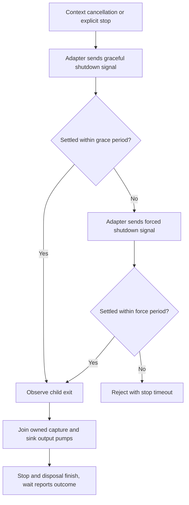

# Own a child process and its streams

A media converter runs as a child process. Its owner must read output, wait for exit, and stop the child when the
operation is cancelled. Capturing a short reply needs a byte limit; a large export instead needs a destination that can
consume the output as it arrives.

The program receives bytes through **stdin** and writes ordinary output to **stdout**. **stderr** is a separate stream
for diagnostics. A pipe connects one of these streams to your application. If you do not read an output pipe, a child
that fills it can stop making progress even though it has not exited.

A local command and a portable activity protocol have different contracts. Use streaming for large output. Process exit,
cancellation request, and completed cleanup are separate facts. Cancellation asks the process owner to stop work; the
awaited result and cleanup tell you when the owned process and streams have actually settled.

Stopping has several boundaries. A signal is a request; an observed exit and joined stream cleanup are evidence that
the owned operation has finished:



Check whether the adapter can signal a child and stop its descendants. A result that says the direct child exited
does not tell you whether its children also exited. Ask for process-tree support only when the adapter supplies it.

The process waits for output it manages, such as capture buffers or a destination you pass to it. If you pipe
`stdin`, write to it and close it yourself. If you choose `type: 'stream'`, read or cancel that output yourself.
Waiting for the process does not wait for those caller-managed reads or writes. If output or shutdown fails, the
process reports the error.

## Run a child and capture a bounded response

Run the current Deno executable as a child and collect its short reply. The example keeps up to 1,024 bytes
from standard output and discards standard error. The command returns its result after the child and its
cleanup finish.

After `mise run prepare -- --kind deps`, save the program as `example.ts` and run `mise exec -- deno run --allow-run example.ts`.
The permission allows the program to start its child.

```ts runnable
import * as context from '@okikio/context';
import * as process from '@okikio/worker/process';
import * as deno from '@okikio/runtime/deno/process';
await using ctx = context.create({ id: 'tool-output' });
const exit = await process.exec(ctx, deno.create(), {
	command: Deno.execPath(),
	arguments: ['eval', 'console.log("ready")'],
	stdout: { type: 'capture', maximumBytes: 1024 },
	stderr: { type: 'discard' },
});
console.log(new TextDecoder().decode(exit.stdout).trim());
```

Expected output:

```text output
ready
```

## Separate process ownership from the native spawn API

`@okikio/worker/process` starts and stops one child. It can limit captured output, send input, and report how
the child exited. It also decides when to ask the child to stop and when to force it. The runtime adapter does
the host-specific work: it spawns the child and translates those requests to the platform's APIs.

That split keeps process ownership consistent when a library runs in Node or Deno. It also prevents importing the
generic package from pulling `node:child_process`, `Deno.Command`, or another host-specific process API into unrelated
runtimes.

Use this package when an independently useful capability must own a subprocess. Keep queues, workflows, and
domain-specific process meaning outside it.

Do not add a second watcher or restart supervisor around a runtime command that already owns that lifecycle. For
example, `deno serve --watch` already watches the module graph, stops the previous server, and rebinds its listener. If
unrelated services restart together, inspect their static import graph and composition ownership before introducing
another process layer.

## Choose finite execution or a live child

Choose the adapter where you start the application, then pass it to `start()` or `exec()`.

```ts
import * as context from '@okikio/context';
import * as process from '@okikio/worker/process';
import * as node from '@okikio/runtime/node/process';
import nodeProcess from 'node:process';

await using ctx = context.create({ id: 'tool-version' });
const result = await process.exec(ctx, node.create(), {
	command: nodeProcess.execPath,
	arguments: ['--version'],
	stdout: { type: 'capture', maximumBytes: 64 * 1024 },
	stderr: { type: 'capture', maximumBytes: 64 * 1024 },
});
console.log(new TextDecoder().decode(result.stdout).trim());
```

`exec()` starts the child, sends any input you supplied, and waits for the child to exit. It also reads the
output it manages and checks capture limits. Its final `ProcessExitType` describes how the child ended.

Use `start()` when you need a handle before the child exits. After it starts, call `wait()` for the exit result
or `stop()` to ask it to shut down. Calling `stop()` again does not start a second shutdown. Closing the handle or
cancelling the parent Context follows the same shutdown steps.

## Keep a live child when the caller owns its lifetime

```ts
await using child = await process.start(ctx, node.create(), {
	command: nodeProcess.execPath,
	arguments: ['-e', 'setTimeout(() => {}, 60_000)'],
	stdout: { type: 'discard' },
	stderr: { type: 'capture', maximumBytes: 64 * 1024 },
});

console.log(child.pid);
await child.stop('host shutdown');
const exit = await child.wait();
console.log(exit.success, exit.code);
```

`stop()` is idempotent. Disposing the handle and parent-context cancellation use the same shutdown path rather than
competing cleanup mechanisms.

## Stream large output instead of capturing it

Capture mode is intentionally bounded because it retains bytes in memory. When output can be large, ask for a pipe and
consume the Web stream incrementally:

```ts
await using child = await process.start(ctx, node.create(), {
	command: nodeProcess.execPath,
	arguments: ['large-output.mjs'],
	stdout: { type: 'stream' },
	stderr: { type: 'capture', maximumBytes: 64 * 1024 },
});

if (child.stdout === undefined) throw new Error('stdout was not piped');
for await (const chunk of child.stdout) {
	await destination.write(chunk);
}

const exit = await child.wait();
if (!exit.success) throw new Error(`Output command failed with code ${exit.code}.`);
```

The caller owns consumption of a piped stream. `@okikio/worker/process` still owns the child lifetime and final shutdown
path.

## Runtime adapters

`@okikio/runtime/node/process` creates a Node child through `node:child_process`. `@okikio/runtime/deno/process` creates
a Deno child through `Deno.Command`. `direct-child` is available on every supported host. On POSIX hosts, both adapters
also support `posix-process-group`: the child starts as the leader of a detached process group and shutdown signals
target that complete group. This lets shutdown target descendants even after the group leader exits. The host must still
reap orphaned children, for example through a container init process: sending termination signals does not reap them.
Windows remains `direct-child` only until a tested Windows process-tree or Job Object adapter can provide a stronger
guarantee. A request for an unsupported tree mode fails with `UnsupportedTreeModeError` instead of silently degrading.

Adapters expose Web streams to the generic owner. They do not decide output limits, shutdown timing, cancellation
behavior, or final result semantics. A future Bun or operating-system-specific process-tree adapter can therefore add
host capability without duplicating the lifecycle implementation.

Set `maximumBytes` when you capture output. If the child writes more, the utility stops it and reports
`OutputLimitError`. When you stream output or send it to a destination instead, a slow reader makes the
process adapter wait rather than collect everything in memory.

## Expected stop failure

`ProcessStopTimeoutError` means the child did not report an exit before the graceful and forced shutdown
windows elapsed. Treat that child as still needing attention. A timeout does not tell you that it exited.

## Unexpected channel faults

Before the channel puts an unexpected error in a JSON message, `@okikio/result/fault` turns it into a small
report. A circular object, getter, or custom string converter should not decide what goes on the channel.
Expected failures still use `@okikio/result/failure`.

Read the [public source](../packages/worker/process/mod.ts) for the complete exported contracts and field descriptions.

## Prove group shutdown separately

A denied TERM or KILL does not prove an owned group disappeared. Shutdown accepts that race only after independently
observing leader settlement and group absence within the budget. Unknown liveness and permission-denied probes remain
failures.

Deno hosts may explicitly choose `create({ groupHost: 'system-kill' })` from `@okikio/runtime/deno/process`. This
adapter uses literal `/bin/kill` only for the owned POSIX group, instead of requiring unrestricted `Deno.kill`
permission. It is optional and unsupported on Windows. The real group test covers the current host; cross-platform
diagnostic handling still needs checks on each supported OS.

## Decide which bookkeeping to keep in your application

| Convenience       | Manual equivalent                                                                                                             | Concrete value                                             |
| ----------------- | ----------------------------------------------------------------------------------------------------------------------------- | ---------------------------------------------------------- |
| `process.start()` | spawn the child, convert Node streams to Web streams, link cancellation, enforce output limits, and own stop/cleanup yourself | one cross-runtime child-process lifetime                   |
| `process.exec()`  | consume configured stdout/stderr with byte bounds while awaiting exit and preserving failure information                      | finite execution with explicit capture or streaming policy |

The same behavior can be built with Deno.Command or node:child_process plus AbortSignal and manual
stdout/stderr/process-tree cleanup.

The utility keeps process lifetime, cancellation, disposal, and runtime adapters under one provider-neutral contract.
