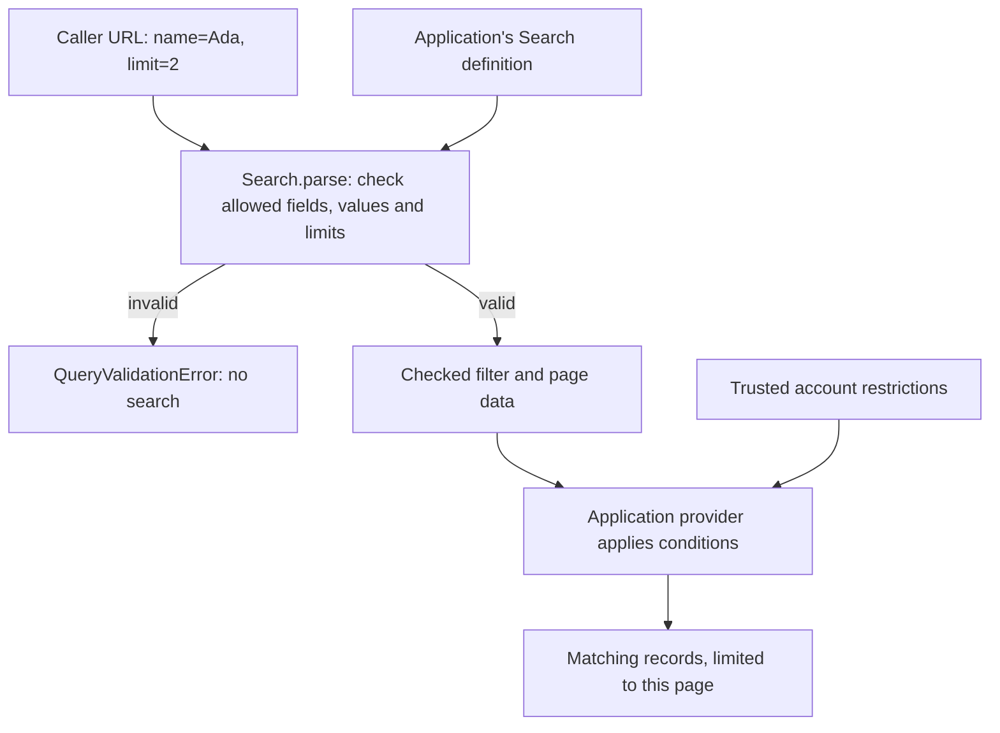
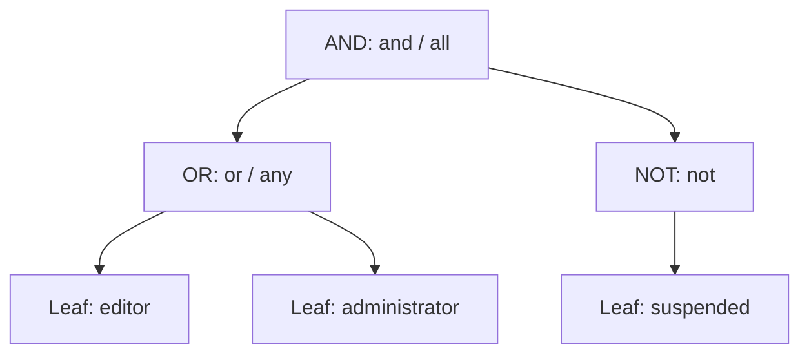

# Give a collection one allowed search language

A directory endpoint may accept a name filter, a minimum score, a sort, a field selection, and a page. Those are user
requests, not permission to address arbitrary storage columns. Query declares the allowed requests and returns checked
data that an adapter can apply.

Start with the [package examples](../packages/query/README.md). This guide shows independent expressions and pages, then
whole-query and provider composition.

A **field** is one named property, such as `name`. A **filter** keeps matching
records, a **sort** orders them, and a **page** limits how many are returned.
Field selection chooses which properties the caller wants to receive. These are
requests within an application-approved vocabulary. They do not grant access to
private records. Apply trusted account or tenant restrictions in the provider too.

The flow below separates checking a request from finding records. Follow the valid branch to the provider;
the invalid branch ends before any search. Authentication and trusted account restrictions are application work.



The arrow into the provider matters: parsing a URL does not search storage or
protect a tenant by itself. The example below implements only its declared name
filter and page on a small array, so you can see each step without a database.

## Search people with a checked name filter

Declare a name equality filter and a bounded page, parse a caller URL, then apply those checked values to a small people
array. This local provider lets you see actual matching rows before learning alternate representations.

Run `mise run prepare -- --kind deps` in the checkout. Save the block as `example.ts` at the checkout root and run
`mise exec -- deno run example.ts` there.

`parse()` means “read and validate this request,” not “run this search.” The returned filter is data describing
conditions. `conjunction()` reads conditions joined by AND: every condition must match.
It returns an empty list when no filter was supplied, and `undefined` for an OR or NOT group. This example's definition
allows only AND groups, so its array provider can safely use `every()` on that list. It applies every condition rather
than silently using only the first one.

```ts runnable=example.ts
import * as query from '@okikio/query';
import * as schema from '@okikio/schema';

// This is the public search vocabulary, not the database table definition.
const Search = query.define({
	fields: {
		name: query.field(schema.string()),
	},
	filters: { name: [query.eq] },
	pagination: query.offset({ defaultLimit: 2, maximumLimit: 10 }),
});

// Treat URL parameters as untrusted input. parse() checks the field, operator,
// operand and page limit, then returns data that this provider understands.
const checked = await Search.parse(
	new URL('https://example.test/people?filter[name]=Ada&limit=2'),
);

if (checked.pagination.kind !== 'offset') {
	throw new Error('This provider supports offset pages.');
}

// conjunction() reads a list of conditions that must ALL match.
// This definition permits AND groups only; never flatten OR or NOT into AND.
const conditions = query.conjunction(checked.filter);
if (conditions === undefined) {
	throw new Error('This provider needs an AND-only filter.');
}

// Parsing does not retrieve people. These array operations are the provider.
const people = [
	{ name: 'Ada' },
	{ name: 'Lin' },
];
const matches = people.filter((person) => {
	return conditions.every((condition) => person.name === condition.value);
});
const { offset, limit } = checked.pagination;
const rows = matches.slice(offset, offset + limit);

console.log(JSON.stringify(rows));

// A disallowed field is rejected before it reaches the provider.
try {
	await Search.parse(new URL('https://example.test/people?filter[password]=secret'));
} catch (error) {
	if (!(error instanceof query.QueryValidationError)) throw error;
	console.log('Unknown filter rejected before searching');
}
```

```text output
[{"name":"Ada"}]
Unknown filter rejected before searching
```

The URL supplies a name and a page bound. Query checks which fields and operators are allowed, then returns ordinary
checked data. Our array provider applies that exact equality and page. `Search.parse()` only checks the request; it retrieves no rows.
The optional `@okikio/query/postgres` compiler can translate that checked request into SQL, which the application executes.
The rejected password filter never reaches the provider. A production adapter must preserve every operation enabled
by its definition and add trusted tenant/access restrictions separately.


## Three values with different jobs

| Value            | Job                                                                              | Example                                                             |
| ---------------- | -------------------------------------------------------------------------------- | ------------------------------------------------------------------- |
| Query definition | Declare allowed fields, operators, default sorts, projection, and limits once.   | `query.define({ fields, filters, pagination })`                     |
| Input            | Express what a caller wants, as URL parameters or typed semantic data.           | `filter[name]=Ada` or `Search.condition('name', 'eq', 'Ada')`       |
| Checked query    | Hold validated operands, the expression tree, ordered sorts, fields, and a page. | The `QueryValue` returned by `Search.parse()` or `Search.create()`. |

The input's values follow field schema input types. Checked operands follow schema output types. A numeric text field
can therefore accept `'12'` and produce `12`. That transformation does not provide an inverse automatically; URL links
need an explicit encoder when output is not also accepted input.

## One validation path, several useful entrypoints

`Search.parse(input)` reads HTTP-shaped input. `Search.create(input)` reads semantic authoring data. Both check the same
field validators, operator permissions, expression limits, sort rules, projection, and page policy. Adapters receive the
same `QueryValue` from either operation.

The standalone `/pagination` entry checks a page without requiring fake search fields. `/expression` composes a caller's
own leaves without schema or storage knowledge. `/url` supplies functional parse/encode operations when a caller keeps
the definition separate from its transport code.

This is a deliberate layered API. The root makes the normal collection-search job convenient. Independent subpaths
expose complete capabilities rather than internal functions that require mutable issue arrays or parser state.

## Preserve author intent while deriving identity

The checked filter is an ALL/ANY/NOT tree. Sort entries remain in priority order. `encode()` preserves the authored
structure and page/offset style. `normalize()` creates a separate canonical representation for comparison, and
`stringify()` writes that representation as URL text. Here **canonical** means a consistent representation useful
for comparing requests or building cache keys. It is not a database execution plan or permission to reuse another
account's cached results.

Use `encode()` for a link you will parse again under the same definition. It uses explicit group indices when
compact field keys would change the authored tree. `stringify()` is for identity: normalization can merge nested
groups of the same kind into a wider group, so the canonical text need not fit the original request's sibling limit.

`conjunction(value.filter)` uses the formal word **conjunction**, meaning conditions joined by AND. It reads an
already checked filter for a simple adapter limited to AND. It does not build a rule or evaluate a condition.

| Checked filter | Result from `conjunction()` | What a simple provider can do |
| --- | --- | --- |
| No filter | Frozen empty list | Keep every record; `every()` on an empty list is true. |
| One condition or nested AND groups | Frozen list of all conditions | Apply every condition to each record. |
| Any OR or NOT group | `undefined` | Evaluate the full tree or reject unsupported logic; never ignore the group. |

The full tree remains in `value.filter`. An OR cannot be replaced with an AND list without changing the request.
This advanced reader is optional: an adapter that already walks expressions does not need to flatten them first.

## The application still owns access and execution

A checked query limits public search syntax. It does not replace tenant restrictions, authentication, authorization, or
row access checks. Add those trusted restrictions separately in the provider adapter.

The adapter owns parameterized provider expressions, collation, null behavior, keyset traversal, cursor verification,
and row retrieval. `validateAdapter()` catches declared capability gaps before a request runs. An adapter must reject
unsupported semantics instead of dropping an operator or flattening ANY into ALL.

For a small in-memory list, the same rule can be expressed with ordinary array operations and `/expression` evaluation.
The cookbook defines the exact subset that such an adapter implements.

## What the utility saves

Without Query, each endpoint would need to maintain field permissions, operand validation, bracket parsing, repeated
parameters, typed literal escaping, expression budgets, sorting, field selection, page bounds, canonical identity, and
schema documentation. These rules interact, so keeping them in one contract gives more than a set of unrelated parsing
helpers.

The checked result remains ordinary data. Applications can inspect it, pass it to a different adapter, serialize a URL,
or test provider behavior without constructing a server or workflow runtime.

Each example starts from the public package or a supported subpath. Keep the allowed search definition, authored input,
and checked data sent to an adapter distinct as you follow the examples.

## Read an expression as a tree of decisions

Suppose a publishing tool allows an editor or an administrator to publish, but a suspended account must be refused.
Write that rule in ordinary words first:

**(editor OR administrator) AND NOT suspended**

A query **expression** is data that describes a rule. A **tree** means each group contains other groups or individual
conditions. Its top group is the **root**. A condition with no children is a **leaf**. These are shapes in ordinary
JavaScript data, not database rows or an executing search.

The builders use familiar Boolean names. OR is inclusive: either condition may match, and both may match too.

| Familiar logic | Builder | What the group asks |
| --- | --- | --- |
| AND | `and(a, b)` or `all(a, b)` | Did every child match? |
| OR | `or(a, b)` or `any(a, b)` | Did at least one child match? |
| NOT | `not(a)` | Did the child fail to match? |
| NOR | `nor(a, b)` or `none(a, b)` | Did none of the children match? |
| NAND | `nand(a, b)` | Did at least one child fail to match? |
| XOR | `xor(a, b)` | Did exactly one of these two children match? |
| XNOR | `xnor(a, b)` | Did these two children give the same answer? |

`and` is the same function as `all`, and `or` is the same function as `any`. `none` is the same function as `nor`.
Choose the wording that makes your rule easiest to read; those pairs have identical types and behavior. AND, OR,
NOR and NAND require at least one child. NOT takes one child; XOR and XNOR take exactly two.

Read this tree from the top. The AND group needs a positive answer from both branches. Its left branch asks for at
least one role. Its right branch reverses the suspension answer. The diagram omits evaluation order; the evaluator
checks shape first, then compares children in the order written in code.



The builders only construct that data. They do not know whether an account is an editor, whether a
name matches a person, or how SQL compares a value. `evaluate()` supplies the missing step: it walks a structurally
valid expression and combines true/false answers from **your** comparison function. It returns one Boolean for the
whole rule. It does not return matching records, grant authorization, or call a database.

The next example supplies two different functions. `isAccountFact()` recognizes a leaf instead of a group; it checks
what kind of data the node is. The comparison passed to `evaluate()` checks whether that fact is true for this one
account. Keeping those jobs separate lets the same expression structure describe other domains.

```ts runnable
import { and, evaluate, inspect, not, or } from '@okikio/query/expression';

type AccountFact = 'editor' | 'administrator' | 'suspended';

/** Recognize this example's leaf values; group nodes are objects, not these strings. */
function isAccountFact(value: unknown): value is AccountFact {
	return value === 'editor' || value === 'administrator' || value === 'suspended';
}

// Describe the policy without evaluating a particular account yet.
const rule = and(
	or('editor', 'administrator'),
	not('suspended'),
);

// This account is an editor and is not suspended.
const accountFacts = new Set<AccountFact>(['editor']);
const canPublish = evaluate(
	rule,
	isAccountFact,
	(fact) => accountFacts.has(fact),
);

console.log(canPublish);

// Inspection counts the three authored conditions, not accounts or matches.
console.log(inspect(rule, isAccountFact).leafCount);
```

```text output
true
3
```

For this account, `editor` matches, so OR is true. `suspended` does not match, so NOT is true. Both answers are true,
so AND returns true. OR does not need to compare `administrator` after finding `editor`; this is **short-circuiting**.
The three-leaf inspection count still includes it, because inspection measures the full rule rather than executed checks.
This is a local rule example, not an authentication system: trusted application code must supply the actual facts.

The evaluator validates the entire structure before calling the comparison, including branches short-circuiting would
skip. Cycles and invalid groups throw. Comparisons must be synchronous and return booleans. `and()` and `or()` need
at least one child. They copy their child arrays but borrow leaf objects, so changing a borrowed object can change
what a later comparison sees.

Standalone inspection defaults to depth 64, 10,000 leaves, and 1,000 children per group. Pass a `QueryExpressionLimits`
object to choose a smaller budget. These standalone limits are separate from a collection definition's HTTP budgets.
Use [the collection example below](#apply-a-real-search-to-an-array) to see how evaluating a filter for each person
produces a matching array.

## Choose which conditions belong together

Put each pair of parentheses into its own builder call. For example, “(Ada or Lin) and active” requires either
person to be active. “Ada or (Lin and active)” lets Ada match regardless of activity. The outer builder controls
which answers are combined last; there is no precedence rule to remember.

```ts runnable=mixed-groups.ts
import * as query from '@okikio/query';
import { evaluate } from '@okikio/query/expression';
import * as schema from '@okikio/schema';

const People = query.define({
	fields: { name: query.field(schema.string()), active: query.field(schema.boolean()) },
	filters: { name: [query.eq], active: [query.eq] },
	expressions: ['all', 'any'],
	pagination: query.offset(),
});

const ada = People.condition('name', 'eq', 'Ada');
const lin = People.condition('name', 'eq', 'Lin');
const active = People.condition('active', 'eq', true);

// The same three conditions describe two different rules.
const requireActivity = query.and(query.or(ada, lin), active);
const allowInactiveAda = query.or(ada, query.and(lin, active));

type Condition = query.QueryFilter<typeof People.fields>;
/** Recognize a checked field condition rather than a Boolean group. */
function isCondition(entry: query.QueryExpression<Condition>): entry is Condition {
	return 'field' in entry;
}

const person = { name: 'Ada', active: false };
for (const filter of [requireActivity, allowInactiveAda]) {
	const checked = await People.create({ filter });
	const sharedLink = People.encode(checked);
	const reopened = await People.parse(sharedLink);

	// This request always includes a rule. Refuse to run an unfiltered search if it is absent.
	if (reopened.filter === undefined) throw new Error('Missing filter.');
	console.log(evaluate(reopened.filter, isCondition, (condition) =>
		person[condition.field] === condition.value
	));
}
```

```text output
false
true
```

The first root is `all` with an `any` child. The second root is `any` with an `all` child. For an inactive Ada,
only the second rule matches. A PostgreSQL adapter puts parentheses around each group; a local adapter can
walk the same tree with `evaluate()`. Enable `any` in the definition when a request may contain OR at any depth.

## Choose inclusive, exclusive, or inverted logic

A notification setting can allow email, SMS, both, or neither. Inclusive OR accepts either or both. XOR accepts
exactly one of the two. XNOR accepts equal answers: both enabled or both disabled. This truth table describes the
standalone evaluator, whose leaf comparison returns only `true` or `false`:

| Email | SMS | AND | OR | NOR / none | NAND | XOR | XNOR |
| --- | --- | --- | --- | --- | --- | --- | --- |
| false | false | false | false | true | true | false | true |
| false | true | false | true | false | true | true | false |
| true | false | false | true | false | true | true | false |
| true | true | true | true | false | false | false | true |

Read each row as one saved choice. NAND means “not both”; it is different from NOR, which means “neither”.
The next complete program selects email only, then evaluates four questions against that same selection:

```ts runnable=notification-choice.ts
import { evaluate, inspect, nand, none, xnor, xor } from '@okikio/query/expression';

type Channel = 'email' | 'sms';

/** Recognize a channel name; Boolean groups remain separate objects. */
function isChannel(value: unknown): value is Channel {
	return value === 'email' || value === 'sms';
}

// The same saved choices give every leaf comparison a stable answer.
const selected = new Set<Channel>(['email']);
const exactlyOne = xor('email', 'sms');
const neither = none('email', 'sms');
const notBoth = nand('email', 'sms');
const sameAnswer = xnor('email', 'sms');

console.log('Exactly one:', evaluate(exactlyOne, isChannel, (channel) => selected.has(channel)));
console.log('Neither:', evaluate(neither, isChannel, (channel) => selected.has(channel)));
console.log('Not both:', evaluate(notBoth, isChannel, (channel) => selected.has(channel)));
console.log('Same answer:', evaluate(sameAnswer, isChannel, (channel) => selected.has(channel)));

// XOR expands into existing groups; inspection counts occurrences in that tree.
console.log('Leaf occurrences:', inspect(exactlyOne, isChannel).leafCount);
```

```text output
Exactly one: true
Neither: false
Not both: true
Same answer: false
Leaf occurrences: 4
```

XOR and XNOR deliberately accept two children. With three inputs, “an odd number is true” and “exactly one is true”
are different rules; these binary builders do not choose a hidden interpretation for that case.

The stored expression still uses only `all`, `any`, and `not` kinds. NOR composes NOT with OR; NAND composes NOT
with AND. XOR and XNOR repeat their child expressions when composing those existing groups. This needs no new URL
syntax or adapter operator, but it increases tree depth and leaf occurrences. Budgets apply to the expanded tree,
and a leaf can be compared more than once. Comparisons must be deterministic for the record being tested; do not use
them to send messages, mutate records, or perform other commands. Short-circuiting can reduce calls, so the inspected
leaf count is a structural cost bound, not a promise that every occurrence is compared.

A collection definition enables the underlying kinds through `expressions: ['all', 'any', 'not']`. Familiar builder
names do not bypass that policy. `conjunction()` still refuses a tree containing OR or NOT, including groups created
by NOR, NAND, XOR, or XNOR.

Database comparisons need one more distinction. The standalone evaluator accepts Boolean answers only. PostgreSQL
comparisons can also produce **unknown** for NULL, and NOT does not turn unknown into true. Query's PostgreSQL
adapter preserves those rules; it does not silently replace unknown with false. Its equality and membership operators
use null-safe distinctness, while other comparisons retain SQL's three-valued logic. See the
[PostgreSQL contract](../packages/query/README.md#compile-a-checked-request-for-postgresql) before assuming the local
truth table describes nullable database values.

## Read pagination without searchable fields

A table, an activity log, or a feed may need page controls without a filter language. Import `/pagination` directly.

```ts runnable
import * as page from '@okikio/query/pagination';

// Reuse this page policy across incoming requests.
const policy = page.offset({ defaultLimit: 20, maximumLimit: 100 });

// page=2 and per_page=20 mean skip 20 records, then return up to 20.
const current = page.parse(policy, new URLSearchParams('page=2&per_page=20&view=compact'));
if (current.kind !== 'offset') {
	throw new Error('Expected an offset page.');
}
console.log(current.offset, current.limit);

// Write the third page as a link; encoding checks the offset agrees with page 3.
const next = page.encode(policy, { ...current, page: 3, offset: 40 });
console.log(next.toString());

// A request beyond maximumLimit is rejected without a throwing validation API.
console.log(page.safeParse(policy, new URLSearchParams('limit=1000')).success);
```

```text output
20 20
page=3&per_page=20
false
```

Page numbers start at one; offsets start at zero. The policy bounds the page size and maximum offset. Unknown unrelated
parameters such as `view` are ignored. Repeated names still count toward the standalone default budget of 32 parameters.

`parse()` throws `QueryValidationError` for invalid user input. `safeParse()` returns issues for a form or HTTP error
response. `encode()` checks that the page remains within policy and that page number, offset, and limit describe the
same window.

Opaque cursors use a different policy. The application selects the field names and authenticates the token separately.

```ts runnable
import { min } from '@okikio/duration';
import * as page from '@okikio/query/pagination';

const policy = page.cursor({
	defaultLimit: 25,
	maximumLimit: 100,
	ttl: min(15),
	parameters: { cursor: 'after', limit: 'count' },
});
const value = page.parse(policy, new URLSearchParams('after=opaque%2Ftoken&count=5'));
console.log(value.kind, value.limit);
console.log(page.encode(policy, value).get('after'));
```

```text output
cursor 5
opaque/token
```

A cursor TTL is fixed elapsed time. Months, years, zero, and negative TTLs reject. A TTL declaration does not itself
check an incoming token's expiry. A trusted codec and adapter own that check.

`pagination({ cursor, offset, default })` enables both modes. A request cannot combine cursor, offset, and page
controls. A first cursor page with no token is representable only when cursor is the default; otherwise the wire request
has no cursor marker that distinguishes it from the default offset page.

## Share a definition between code and HTTP

A definition connects each field's schema to the operators clients may request. Typed authoring avoids bracket strings;
URL parsing accepts those strings from an HTTP request.

```ts runnable
import * as query from '@okikio/query';
import * as schema from '@okikio/schema';
import * as parameters from '@okikio/query/url';

// Expose only the supported fields and operators; a client cannot name arbitrary data fields.
const Search = query.define({
	fields: {
		name: query.field(schema.string()),
		score: query.field(schema.number()),
	},
	filters: { name: [query.eq, query.in], score: [query.gte, query.between] },
	expressions: ['all', 'any', 'not'],
	pagination: query.offset({ defaultLimit: 20 }),
});

// Build and validate the request using the same definition as URL callers.
const value = await Search.create({
	filter: query.or(
		Search.condition('name', 'in', ['a,b', '', '雪']),
		Search.condition('score', 'gte', 90),
	),
	fields: ['name'],
	pagination: { kind: 'page', page: 2, limit: 5 },
});

// Turn checked data into a shareable link, then read the same request back.
const url = new URL('https://example.test/people');
url.search = parameters.encode(Search, value).toString();
const restored = await parameters.parse(Search, url);
console.log(Search.stringify(restored) === Search.stringify(value));
console.log(restored.pagination.kind === 'offset' ? restored.pagination.offset : 0);
```

```text output
true
5
```

The tagged scalar codec preserves literal commas, empty strings, bigint, dates, booleans, and negative zero. Callers do
not have to escape a list operand manually. Encoding returns only the query's parameters. If an application also owns
unrelated URL parameters, it decides how to merge or replace those separately.

`Search.condition('score', 'between', [10, 20])` is a pair. `Search.condition('name', 'in', ['Ada'])` is a nonempty
list. A null operator takes no operand. Type inference rejects unknown fields, operators disabled for a field, wrong
operand types, and wrong arity. The same rules remain runtime checks for JavaScript and unknown data.

`safeCreate()` checks a semantic request without throwing `QueryValidationError`; `safeParse()` does the same for wire
input. The condition helper checks its declared field/operator and argument count at construction, while `create()` owns
actual schema validation of values.

## Keep transformed input and output connected

A transform such as numeric text to a number has different input and output types. Use the existing Schema codec to
declare both directions together. Query uses the decode schema for validation and the encode schema when writing a URL.

```ts runnable
import * as query from '@okikio/query';
import * as schema from '@okikio/schema';
import * as codec from '@okikio/schema/codec';

const Score = codec.define({
	decode: schema.transform(schema.string(), Number),
	encode: schema.transform(schema.number(), String),
});

// Expose only the supported fields and operators; a client cannot name arbitrary data fields.
const Search = query.define({
	fields: { score: query.field(Score, { outputJsonSchema: { type: 'number' } }) },
	filters: { score: [query.gte] },
	pagination: query.offset(),
});

// Build and validate the request using the same definition as URL callers.
const value = await Search.create({ filter: Search.condition('score', 'gte', '12') });
// This request has one score condition. Inspect its transformed number;
// this is an encoding demonstration, not an implementation of a search provider.
const scoreCondition = query.conjunction(value.filter)?.[0];
console.log(scoreCondition?.value);
console.log(Search.stringify(await Search.parse(Search.encode(value))) === Search.stringify(value));
```

```text output
12
true
```

The authoring operand is a string and the checked operand is a number. `outputJsonSchema` supplies the output projection
because an arbitrary transformation cannot be inspected to infer that type. The decode schema already supplies its
string input projection.

A field may instead use `field(schema, { encode(value) { ... } })` for a focused synchronous inverse. That callback has
the schema's output-to-input types. Query's URL encoding is synchronous, so a codec encoder that returns a promise is
rejected with a clear error. The general Schema codec remains available for asynchronous conversions elsewhere; Query
does not invent a competing codec abstraction.

Encoders must be deterministic and return supported scalar input. Query applies its literal escaping after the field
conversion. A one-way transform with no inverse can still validate a request, but cannot promise that its output can be
written back into a URL accepted by the same schema.

## Apply a real search to an array

This adapter supports name equality, minimum score, Boolean groups, simple projection, and offset pages. Those are
concrete promises. Its declaration excludes sorting and cursor pagination, so it does not need to guess their semantics.

For each person, the comparison returns true or false for one condition. `evaluate()` combines those answers using
the expression's AND/OR/NOT groups, and `Array.filter()` keeps people whose whole expression is true. Ada matches
by name; Lin matches by score; Bea matches neither. Selecting only `name` is called **projection** here: it chooses
properties in the returned record, independently of which people matched.

```ts runnable
import * as query from '@okikio/query';
import { evaluate } from '@okikio/query/expression';
import * as schema from '@okikio/schema';

const Search = query.define({
	fields: {
		name: query.field(schema.string()),
		score: query.field(schema.number()),
	},
	filters: { name: [query.eq], score: [query.gte] },
	expressions: ['all', 'any', 'not'],
	pagination: query.offset(),
});

// The array provider below promises these features, and no sorting or cursors.
const compatibility = Search.validateAdapter({
	operators: ['eq', 'gte'],
	expressions: ['all', 'any', 'not'],
	pagination: ['offset'],
	fieldSelection: ['simple'],
	maximumSorts: 0,
});
if (!compatibility.valid) {
	throw new Error('This definition needs a different adapter.');
}

// Request people named Ada OR people with a score of at least 90.
const checked = await Search.create({
	filter: query.or(
		Search.condition('name', 'eq', 'Ada'),
		Search.condition('score', 'gte', 90),
	),
	fields: ['name'],
	pagination: { kind: 'offset', limit: 2 },
});

const people = [
	{ name: 'Ada', score: 40 },
	{ name: 'Lin', score: 95 },
	{ name: 'Bea', score: 10 },
];
type Condition = query.QueryFilter<typeof Search.fields>;

/** Recognize a validated field condition rather than an all/any/not group. */
function isCondition(entry: query.QueryExpression<Condition>): entry is Condition {
	return 'field' in entry;
}

// Evaluate the whole rule once for each person. true means keep that person.
const matches = people.filter((person) => {
	if (checked.filter === undefined) return true;

	return evaluate(checked.filter, isCondition, (condition) => {
		// These comparisons give field conditions their meaning for this data source.
		if (condition.field === 'name' && condition.operator === 'eq') {
			return person.name === condition.value;
		}
		if (condition.field === 'score' && condition.operator === 'gte') {
			return person.score >= condition.value;
		}
		throw new Error('Unsupported field/operator pair.');
	});
});

if (checked.pagination.kind !== 'offset' || checked.fields.kind !== 'simple') {
	throw new Error('Unsupported page or field selection.');
}

// Filtering chooses people; pagination chooses a window; projection chooses properties.
const { offset, limit } = checked.pagination;
const selected = checked.fields.fields;
const rows = matches.slice(offset, offset + limit).map((person) =>
	Object.fromEntries(selected.map((field) => [field, person[field]]))
);
console.log(JSON.stringify(rows));
```

```text output
[{"name":"Ada"},{"name":"Lin"}]
```

This is an actual end-to-end consumer of the definition, expression, pagination, and projection contracts. The leaf
comparison belongs to the adapter, so Query does not silently choose string collation, database null behavior, or
ordering for arbitrary values.

For a storage adapter, use parameterized provider expressions instead of the array filter. Add trusted tenant and
authorization restrictions separately. The checked client expression never replaces them.

## Sort and paginate a provider-backed collection

Mark sortable fields explicitly and declare a stable tiebreaker when cursor pagination is enabled.

```ts runnable
import * as query from '@okikio/query';
import * as schema from '@okikio/schema';

// Expose only the supported fields and operators; a client cannot name arbitrary data fields.
const Search = query.define({
	fields: {
		id: query.field(schema.string(), { sortable: true }),
		score: query.field(schema.number(), { sortable: true }),
	},
	filters: { score: [query.gte] },
	order: [query.asc('id', { tiebreaker: true })],
	pagination: query.cursor({ defaultLimit: 25 }),
});
const value = await Search.parse(new URLSearchParams('sort=score:desc&limit=5'));
console.log(value.order.map((sort) => sort.field).join(','));
console.log(value.pagination.limit);
```

```text output
score,id
5
```

The adapter's maximum sort count includes the appended tiebreaker. A limit of one client-selected sort can therefore
require two provider sort keys. The provider must use that complete order to build seek predicates and cursor payloads.

## Failures, budgets, and schema projections

| Input budget                             | Default |
| ---------------------------------------- | ------: |
| Filter leaves                            |      20 |
| Client-selected sorts                    |       5 |
| Selected fields                          |     100 |
| Values per filter                        |     100 |
| String/bigint text length                |    4096 |
| URL parameters, including repeated names |     200 |
| Expression depth, including leaves       |       8 |
| Children in a Boolean group              |     100 |

A malformed query produces stable issue codes and paths. Examples include `unknown-field`, `unknown-operator`,
`invalid-value`, `pagination-conflict`, and the `too-many-*` limits. Safe parsing does not invoke accessor properties
from plain-data input and rejects cyclic semantic expression records.

The definition implements Standard Schema from wire input to checked `QueryValue`; it is a transforming validator.
`wireSchema()` is its explicit HTTP documentation projection. Standard JSON Schema input conversion throws because
tagged operands must first be decoded and checked by their field validators. A prefix pattern cannot represent that
operation. Input metadata cannot stand in for a differently typed output projection.

Wire documentation requires inline field `jsonSchema` metadata. Documents containing resource IDs, anchors or references
fail with the field name and a request for inline constraints, because separate HTTP parameter schemas cannot preserve
that shared scope. Output projection can keep identified resources and rejects collisions across different field
documents.

Standard JSON Schema output describes the parsed structural type, including field constraints, permitted operators,
expression depth, immediate group limits, sorts, selected fields and page variants. It does not replace parser-only
checks that span values: total leaves, total resource selections, unique sort fields or page/offset arithmetic. A
structurally valid JSON value is not automatically a checked `QueryValue`. Use `parse()` for wire data and `create()`
for semantic input. See the [package contract](../packages/query/README.md#validation-and-documentation) for exact scope
and reference-resource requirements.

`normalize()` and `stringify()` derive canonical identity without rewriting the original authored tree or reordering
sort priority. Neither performs a search or authenticates a cursor.
