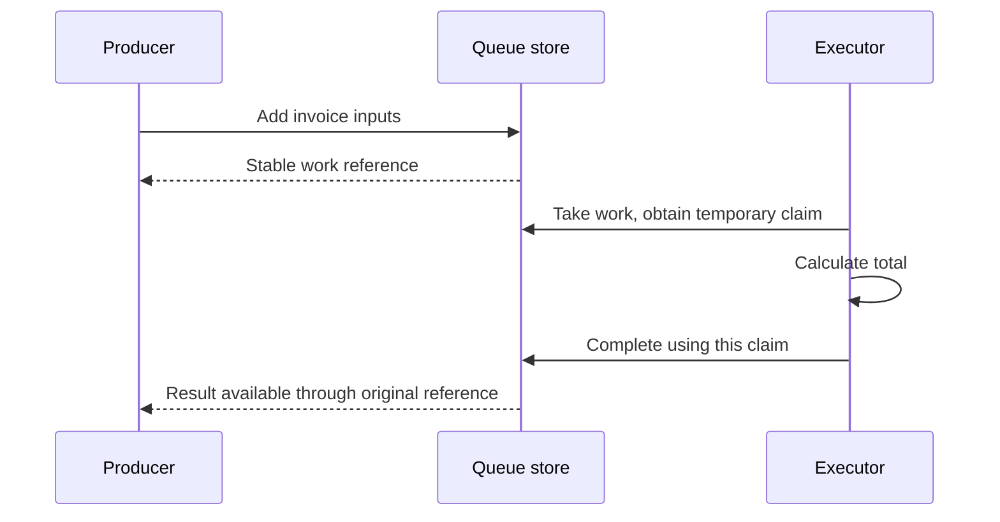

# Separate accepted work from a worker's attempt

A caller submits an invoice calculation and needs its final total. A worker takes temporary ownership of that item,
computes it, and records the result. If ownership expires first, another worker can recover the item; the old worker
must no longer be able to replace the result.

This queue is in memory. Restarting a scheduler around the same queue differs from losing its process. Use the
[PostgreSQL queue adapter](../packages/storage/queue/postgres.ts) when these items must survive process death. A
[Workflow](./workflows/01-basics.md) is a separate choice for recorded multi-step execution.

The **producer** submits work, the **executor** attempts it, and the **queue store**
records who may publish a result. A claim is temporary permission for one attempt;
it is not the final answer. A newer attempt can replace expired permission, so an
old executor must present its claim when completing work. That rejection cannot
undo a payment or other external write the old executor already performed.



The example runs all three roles in one process. The diagram describes logical
ownership, not a network service or automatic worker fleet. Memory state ends
with that process; persistent stores and real host delivery are separate choices.

## Queue an invoice and retrieve its total

Add two prices, take the queued calculation, and publish its total. The caller retrieves that result through the
original item reference. The queue and its result exist only in this process.

Run from this checkout after `mise run prepare -- --kind deps`. Save the runnable block as a `.ts` file in your project and use
`mise exec -- deno run example.ts`.

```ts runnable
import '@okikio/duration/polyfill';
import '@okikio/dispose/polyfill';
import * as queue from '@okikio/scheduler/queue';
await using jobs = queue.fifo(queue.memory<readonly number[], number>());
const ref = await jobs.add([1999, 500]);
// Claim one attempt before computing its answer. The queue result is still pending at this point.
const task = await jobs.take();
if (task === undefined) throw new Error('No work was available.');
await task.complete(task.value.reduce((cents, price) => cents + price, 0));
console.log(`$${((await jobs.result(ref)) / 100).toFixed(2)}`);
```

Expected output:

```text output
$24.99
```

## Choose a FIFO view or an explicit claim

`@okikio/scheduler/queue` defines a claimed-work queue and provides a process-local queue for tests, simulations, and
local composition.

`@okikio/scheduler/queue` can be used in two ways.

The FIFO view keeps the call site small: add work, take one claim, perform the work, then explicitly complete, fail,
or retry that claim. Taking an item does not remove it. Even a consumer that never looks up results must settle claims.

The claimed-work approach adds ownership, lease time, retry state, and result tracking. That extra state matters when
some work does not end after the first claim. A task can stop before completion, another task may need to recover the
same item, and a caller may need the final result later.

`@okikio/scheduler/queue` keeps that extra state explicitly:

- a stable item reference for later result lookup;
- a claim token for current ownership;
- a lease expiry time for recovery;
- retry state for another attempt;
- terminal states for completion, failure, and cancellation;
- blocked waiters for future work and future results.

The result is closer to a local work broker with leases than to a minimal container.

## Follow one item from admission to completion

Start with the smallest useful path.

Create a FIFO-friendly queue:

```ts
import * as queue from '@okikio/scheduler/queue';

await using jobs = queue.fifo(queue.memory<string, string>());
// jobs is a FIFO-friendly queue wrapper.
```

Then add one item and take it:

```ts
const ref = await jobs.add('transcode file');
// ref might be: { id: 'item-1' }

const task = await jobs.take();
// task might be:
// {
//   id: 'claim-1',
//   itemId: 'item-1',
//   owner: 'fifo',
//   value: 'transcode file',
//   attempt: 1,
//   ...
// }
```

`task?.value` is `'transcode file'`.

Finish that claim before moving on:

```ts
if (task === undefined) throw new Error('No work was available.');
await task.complete('transcode finished');
```

`result(ref)` is optional observation. Claim settlement is required: choose `complete`, `fail`, or `retry` according to
what happened. Disposal alone chooses none of them. An abandoned claim remains recoverable after expiry and its work may
run again.

Use this mental model for both FIFO and lower-level claims:

- `QueueRef` names the logical item.
- `take()` gives one task a temporary lease on that item.
- `complete()` publishes the successful outcome for that item.
- `retry()` returns the same item to the queue for another attempt.
- `result(ref)` reads the terminal outcome later.

## Idempotent admission

Use `key` when repeated producer attempts must resolve to the same logical queue item. The queue treats the key itself
as authoritative identity. It does **not** compare two arbitrary `Input` values because a generic queue cannot know
whether two domain values mean the same work.

```ts
const first = await jobs.add('render report revision 7', {
	key: 'report:customer-42:revision-7',
});

const retry = await jobs.add('render report revision 7', {
	key: 'report:customer-42:revision-7',
});

// The producer retry reattaches to the first logical item.
console.log(retry.id === first.id); // true
```

If the payload changes the meaning of the work, change the key too. A useful durable key often includes a domain ID plus
a stable version or fingerprint:

```ts
await jobs.add('render report revision 8', {
	key: 'report:customer-42:revision-8',
});
```

Do not reuse one key for unrelated input and expect the queue to detect the conflict. Manually, this queue behavior is
the same as keeping a `Map<string, QueueRef>` beside the work table: once a key points at an item, another admission
with that key returns the same reference and leaves the retained input unchanged.

The tracked-outcome path looks like this:

```ts
const ref = await jobs.add('transcode file');
// ref might be: { id: 'item-1' }

const task = await jobs.take();
// task.value might be: 'transcode file'

// Publish a successful outcome for the logical item.
await task?.complete('ok');

// Read that outcome later through the stable item reference.
const output = await jobs.result(ref);
console.log(output); // ok
```

`output` is `'ok'`.

Use the simple path when FIFO-like behavior is enough:

- keep priorities equal;
- do not delay items with `availableAt`;
- take one item at a time;
- read `task.value` and finish work outside the queue.

The fuller path adds one rule that a plain FIFO queue does not keep. The queue keeps the item record after `claim()`.
The task receives a claim token instead of removing ownership from the queue.

A claim carries:

- the item id;
- the task identity;
- the claim start time;
- the claim expiry time;
- the attempt number.

Later calls such as `complete()`, `fail()`, `retry()`, and `renew()` must use the live claim. If the claim expired, the
queue rejects the old claim. If another task claimed the item again, the queue rejects the old claim.

Use the fuller path when retries, recovery, delayed work, or later result observation matter.

The simple wrapper uses the larger queue under the hood. `fifo()` maps `take()` to `claim({ limit: 1 })`. The taken item
then maps `complete()`, `fail()`, `retry()`, and `renew()` back to the underlying claimed-work queue.

## QueueClaim lifecycle

One item moves through these states.

```text
ADD WORK
===============================================================================

caller
  |
  | add(input)
  v
queued

CLAIM WORK
===============================================================================

queued
  |
  | claim(owner, duration)
  v
claimed
  claim id
  owner
  attempt
  claimedAt
  expiresAt

FINISH OR RETURN
===============================================================================

claimed
  |
  +-- complete(output) -----------------------------> completed
  |
  +-- fail(encoded failure) ------------------------> failed
  |
  +-- cancel(reason) -------------------------------> cancelled
  |
  +-- retry(delay or availableAt) -----------------> queued
  |
  `-- claim expiry without completion -------------> queued

SAFETY RULE
===============================================================================

Only the current claim id and owner may change claimed work.

Old claim after expiry or re-claim
  -> StaleClaimError
```

The queue keeps item identity even after terminal state. `result(ref)` can still find the same logical item later.

## Common situations

The first situation is the simple path.

```text
producer adds item A
  -> task takes item A
  -> task uses item A
```

The same simple path in code looks like this:

```ts
await using jobs = queue.fifo(queue.memory<string, string>(), { id: 'fifo-basic', owner: 'task-a' });

const ref = await jobs.add('resize image');
// ref might be: { id: 'item-1' }

const task = await jobs.take();
// task?.value is: 'resize image'
```

The next situation explains why `retry()` exists.

```ts
await using jobs = queue.fifo(queue.memory<string, string>());

const ref = await jobs.add('resize image');
// ref might be: { id: 'item-1' }

const task = await jobs.take({ duration: { seconds: 30 } });
// task?.attempt is: 1

// The same logical item goes back to the queue.
// The next take gets a new lease attempt for that item.
await task?.retry({ delay: { seconds: 10 } });

const immediate = await jobs.take();
console.log(immediate, ref.id); // No item is ready; ref still identifies the delayed work.
```

After the delay passes, another `take()` call can receive the same item with a higher attempt number.

The next situation explains why lease expiry exists.

The failure case is concrete. A task can stop after claim time and before completion. That stop can come from process
exit, cancellation, a crash, or lost connectivity. Without lease expiry, the item can stay stuck forever. Without a
claim token, an old task can wake up later and overwrite newer work.

The failure and recovery flow looks like this:

```text
task-a takes item A
  -> task-a stops before completion
  -> lease expires
  -> item A returns to queued
  -> task-b takes item A
  -> task-b completes item A
  -> old task-a result is rejected
```

```ts
import * as context from '@okikio/context';
import * as queue from '@okikio/scheduler/queue';

const clock = new context.TestClock();
await using raw = queue.memory<string, string>({ clock });
await using jobs = queue.fifo(raw, { id: 'fifo-recovery', clock });

const ref = await jobs.add('value');
// ref might be: { id: 'item-1' }

// task-a gets the first lease for the item.
const first = await jobs.take({ duration: { seconds: 5 } });
// first?.id might be: 'claim-1'

// Time moves past the lease expiry.
clock.advance({ seconds: 6 });

// task-b gets a new lease for the same logical item.
const recovered = await jobs.take({ duration: { seconds: 5 } });
// recovered?.id might be: 'claim-2'

// task-b publishes the successful terminal result.
await recovered?.complete('recovered');

// The stable item reference still points at the same logical item.
const result = await jobs.result(ref);
console.log(result); // recovered
```

`result` is `'recovered'`.

If `task-a` later tries to finish the old take, the queue throws `StaleClaimError`.

The stale write looks like this in code:

```ts
// task-a still holds the old lease object.
// The queue rejects that stale write because task-b owns the newer lease.
await expect(first?.complete('late result')).rejects.toThrow(queue.StaleClaimError);
```

The next situation explains why `result()` is separate from `claim()`.

```text
producer adds work
  -> task takes work
  -> task completes, fails, or retries work
  -> observer waits on result(ref)
  -> queue wakes observer on terminal state
```

`result()` waits for terminal state. `result()` does not claim ownership.

The matching code looks like this:

```ts
await using jobs = queue.fifo(queue.memory<string, string>());

const ref = await jobs.add('render report');
// ref might be: { id: 'item-1' }

const task = await jobs.take();
// task?.value is: 'render report'

// One caller can wait for the final outcome.
const waiting = jobs.result(ref);
// waiting will later resolve to: 'ready'

// Another caller can publish the outcome.
await task?.complete('ready');

const output = await waiting;
console.log(output); // ready
```

The first situation is enough for FIFO-like use. The later situations explain why the queue keeps more state than a
plain FIFO queue.

Queue state changes wake blocked callers. Two wait groups exist:

- claim waiters wait for eligible work;
- result waiters wait for one item to reach terminal state.

Wake-ups happen when work is added, delayed work becomes claimable, a claim expires, an item completes, fails, retries,
or is cancelled, or the queue closes.

## Connect queue claims to Activity and Workflow

`@okikio/context` supplies caller identity, cancellation, optional deadline, and the clock used for claim expiry and
delayed availability.

`@okikio/result/failure` supplies the encoded failure shape used when work reaches the failed state.

`@okikio/scheduler/queue` does not implement durable storage, broker replication, or a full workflow engine. Concrete
durable adapters belong in `packages/`.

Read [types.ts](../packages/scheduler/queue/types.ts) first when you want the public vocabulary. Read
[mod.test.ts](../packages/scheduler/queue/mod.test.ts) next when you want short behavior stories. Read
[mod.ts](../packages/scheduler/queue/mod.ts) last when you want the step-by-step state rules.

## Expected queue errors

Queue failures are explicit so callers can distinguish state from infrastructure faults:

- `QueueClosedError` means the queue no longer accepts/serves work.
- `QueueCapacityError` means active-item admission reached the configured bound.
- `QueueItemNotFoundError` means a `QueueRef` does not identify retained queue state.
- `QueueItemFailedError` is what `result(ref)` raises for a terminal encoded failure.
- `QueueItemCancelledError` is what `result(ref)` raises for a cancelled logical item.

`StaleClaimError`, shown in the lifecycle discussion above, protects a newer owner from a late mutation by an expired
owner.

Read the [public source](../packages/scheduler/queue/mod.ts) for the complete exported contracts and field descriptions.

## Decide which bookkeeping to keep in your application

| Convenience                         | Manual equivalent                                                                                                                   | Concrete value                                           |
| ----------------------------------- | ----------------------------------------------------------------------------------------------------------------------------------- | -------------------------------------------------------- |
| `queue.memory()`                    | maintain item state, keyed admission, claim leases, expiries, waiters, results, retries, cancellation, and close semantics manually | one authoritative logical-work state machine             |
| `renew()` / `complete()` / `fail()` | compare claim identity before every mutation and reject stale owners yourself                                                       | temporary ownership is fenced from logical item identity |

`@okikio/scheduler/queue` is a convenience layer, not a hidden runtime. You can reproduce its core mechanics with a Map
of items, a ready list, claim tokens, timers, waiter promises, and stale-owner checks.

The in-memory implementation is the reference form. Durable implementations persist the same logical states and fences
in a provider package.
