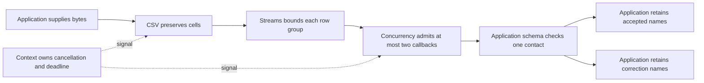

# Import contacts with validation and bounded work

A user uploads contacts and needs to know which rows were accepted and which need correction. CSV owns quoting and row
boundaries. The application owns the contact rules and the destination. Start with those two facts before adding
execution control.

From the checkout root, review `mise.toml`, run `mise trust`, `mise install`, then
`mise run prepare -- --kind deps`. Save the first complete block as `preview.ts`
and run `mise exec -- deno run preview.ts`. Save the larger block as `import.ts`
and run `mise exec -- deno run import.ts`. Each supplies its own local input and
needs no database, network, environment or filesystem permission. The output
blocks show the expected results, so you can compare before changing the input.

## First preserve the source fields

The company name contains a comma, so splitting the input text on commas would corrupt a cell. This complete program
only parses the file; it makes no contact-validity decision.

```ts runnable=preview.ts
import { parse } from '@okikio/format/csv';

const document = parse('Name,Email\n"Ada, Inc.",ada@example.test\n', { headerRow: 1 });
console.log(JSON.stringify(document.rows[0]?.values));
```

```text output
["Ada, Inc.","ada@example.test"]
```

The returned document is ordinary buffered data. Keep this smaller form when the input is small and parsing is the whole
job. A malformed email is still a valid CSV cell.

## Add bounded validation and a receipt

Now require a nonempty name and a simple email shape, keep invalid rows available for correction, and admit at most two
row callbacks at once. The schema below is an example application policy, not a comprehensive email-address
specification. The destination remains an explicit array so the example needs no database.

```ts runnable=import.ts
import * as context from '@okikio/context';
import { sec } from '@okikio/duration';
import { parseStream } from '@okikio/format/csv';
import { sha256 } from '@okikio/hash';
import { mapPooledOrdered } from '@okikio/scheduler/concurrency';
import * as schema from '@okikio/schema';
import { batch } from '@okikio/streams';

const ContactSchema = schema.object({
	name: schema.string({ minLength: 1 }),
	email: schema.string({ pattern: /^[^@ ]+@[^@ ]+\.[^@ ]+$/ }),
});
const input = 'Name,Email\nAda,ada@example.test\nGrace,missing-address\nLinus,linus@example.test\n';
await using parent = context.create({ id: 'contact-import' });
await using owner = context.timeout(parent, sec(2));
await using document = await parseStream(new Response(input).body!, {
	headerRow: 1,
	maximumBytes: 20000,
	maximumRows: 1000,
	signal: owner.signal,
});
const accepted: string[] = [];
const rejected: string[] = [];
for await (const rows of batch(document.rows, { maximumItems: 20, signal: owner.signal })) {
	const checked = mapPooledOrdered({
		items: rows,
		concurrency: 2,
		signal: owner.signal,
		async map(row, { signal }) {
			signal.throwIfAborted();
			const name = row.values[0] ?? '';
			const result = await schema.validate(ContactSchema, { name, email: row.values[1] ?? '' });
			return result.issues === undefined ? { accepted: true, name: result.value.name } : { accepted: false, name };
		},
	});
	for await (const row of checked) (row.accepted ? accepted : rejected).push(row.name);
}
const digest = await sha256(input);
console.log('Accepted:', accepted.join(', '));
console.log('Correct:', rejected.join(', '));
console.log('Receipt digest length:', digest.length);
```

```text output
Accepted: Ada, Linus
Correct: Grace
Receipt digest length: 64
```

The digest identifies the exact supplied text, including the rejected row. It is evidence of those input bytes, not
proof of a database commit. The example chooses positional columns because its own input fixes their order; an uploaded
file should validate and map header names first, as shown in the CSV README.

## Follow data and ownership



The arrows show responsibilities, not threads or transactions. The customer sees an accepted list and a correction list
because the application retains both outcomes. Context requests cancellation; each I/O call and callback must observe
its signal.

| Change                                     | What happens                                            | Application decision                                                             |
| ------------------------------------------ | ------------------------------------------------------- | -------------------------------------------------------------------------------- |
| Grace gets a valid email                   | All three rows enter the accepted list.                 | Decide whether to rerun the whole input or only corrections.                     |
| The input exceeds the byte or row budget   | Parsing rejects instead of silently accepting a prefix. | Show the failure and choose a deliberate larger limit or smaller upload.         |
| The caller cancels                         | New work stops and admitted callbacks are joined.       | Pass the signal to any real lookup or save too.                                  |
| A real save succeeds and a later row fails | Earlier effects may remain.                             | Stage writes or use an explicit transaction if partial acceptance is unsuitable. |

The final arrays grow with accepted and rejected rows. Batching bounds working groups, not retained output. A large
import should write to a bounded destination or explicitly budget its draft. Add Task when the UI needs cooperative
pause/resume; add Workflow and persistent Storage when accepted work must resume after process loss. Neither is required
for this finite local import.

[CSV](../../packages/format/csv/README.md), [Schema](../../packages/schema/README.md),
[Concurrency](../../packages/scheduler/concurrency/README.md), and [Context](../../packages/context/README.md) explain
their independent contracts.
