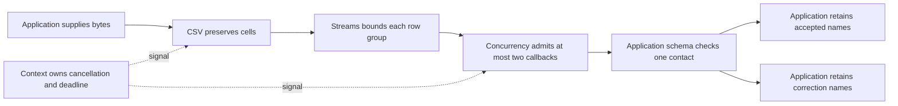

# Import contacts with validation and bounded work

Build a contact import that tells someone what to fix in their spreadsheet. At the end, your program will print
`Accepted: ["Ada, Inc.","Linus"]` and `Correct: ["Grace"]`. Grace's row has a missing email address. Ada’s row is for a business,
and the comma in its name belongs inside one cell. First check the name, then import the full list.

From the checkout root, review `mise.toml`, run `mise trust`, `mise install`, then
`mise run prepare -- --kind deps`. Both programs supply their own input. You can run them without a database or
permissions for network, environment, or file access.

## 1. Check that the company name stays in one cell

Start with Ada's row. Splitting the line at every comma would turn `Ada, Inc.` into two cells. Save this program as
`preview.ts` in the checkout root and run `mise exec -- deno run preview.ts`.

```ts runnable=preview.ts
import { parse } from '@okikio/format/csv';

const document = parse('Name,Email\n"Ada, Inc.",ada@example.test\n', { headerRow: 1 });
console.log(JSON.stringify(document.rows[0]?.values));
```

```text output
["Ada, Inc.","ada@example.test"]
```

The returned document is ordinary buffered data. Keep this smaller form when the input is small and parsing is the whole
job. A malformed email is still a valid CSV cell.

## 2. Sort the contacts into accepted rows and corrections

Keep Ada's row and add Grace and Linus. CSV still separates the cells, but your application now decides which rows
are usable. It requires a name and a value that looks like an email address. This example checks the shape of the
address; it cannot tell you whether someone can receive mail there.

Save the complete program as `import.ts` in the checkout root and run `mise exec -- deno run import.ts`. It keeps the
results in arrays and runs at most two row checks at once. That limit gives you a place to control simultaneous work
if you later add a lookup or save for each row.

```ts runnable=import.ts
import * as context from '@okikio/context';
import { sec } from '@okikio/duration';
import { parseStream } from '@okikio/format/csv';
import { sha256 } from '@okikio/hash';
import { mapPooledOrdered } from '@okikio/scheduler/concurrency';
import * as schema from '@okikio/schema';
import { batch } from '@okikio/streams';

const ContactSchema = schema.object({
	name: schema.string({ minLength: 1 }),
	email: schema.string({ pattern: /^[^@ ]+@[^@ ]+\.[^@ ]+$/ }),
});
// Reuse the quoted company name. Grace has a cell, but no usable email.
const input = 'Name,Email\n"Ada, Inc.",ada@example.test\nGrace,\nLinus,linus@example.test\n';
await using parent = context.create({ id: 'contact-import' });
await using owner = context.timeout(parent, sec(2));
await using document = await parseStream(new Response(input).body!, {
	headerRow: 1,
	maximumBytes: 20000,
	maximumRows: 1000,
	signal: owner.signal,
});
const accepted: string[] = [];
const rejected: string[] = [];
for await (const rows of batch(document.rows, { maximumItems: 20, signal: owner.signal })) {
	const checked = mapPooledOrdered({
		items: rows,
		concurrency: 2,
		signal: owner.signal,
		async map(row, { signal }) {
			signal.throwIfAborted();
			const name = row.values[0] ?? '';
			const result = await schema.validate(ContactSchema, { name, email: row.values[1] ?? '' });
			return result.issues === undefined ? { accepted: true, name: result.value.name } : { accepted: false, name };
		},
	});
	for await (const row of checked) (row.accepted ? accepted : rejected).push(row.name);
}
const digest = await sha256(input);
console.log('Accepted:', JSON.stringify(accepted));
console.log('Correct:', JSON.stringify(rejected));
console.log('Receipt digest length:', digest.length);
```

```text output
Accepted: ["Ada, Inc.","Linus"]
Correct: ["Grace"]
Receipt digest length: 64
```

The digest identifies the exact supplied text, including the rejected row. It is evidence of those input bytes, not
proof of a database commit. The example chooses positional columns because its own input fixes their order; an uploaded
file should validate and map header names first, as shown in the CSV README.

## 3. Fix Grace's row and run it again

Change `Grace,\n` in the input string to `Grace,grace@example.test\n`. Grace should move to the accepted list and the
correction list should be empty. The CSV structure was valid in both runs. What changed was the result of the contact
rule you supplied.

## See what each part contributes



The arrows show responsibilities, not threads or transactions. The customer sees an accepted list and a correction list
because the application retains both outcomes. Context requests cancellation; each I/O call and callback must observe
its signal.

| Change                                     | What happens                                            | Application decision                                                             |
| ------------------------------------------ | ------------------------------------------------------- | -------------------------------------------------------------------------------- |
| Grace gets a valid email                   | All three rows enter the accepted list.                 | Decide whether to rerun the whole input or only corrections.                     |
| The input exceeds the byte or row budget   | Parsing rejects instead of silently accepting a prefix. | Show the failure and choose a deliberate larger limit or smaller upload.         |
| The caller cancels                         | New work stops and admitted callbacks are joined.       | Pass the signal to any real lookup or save too.                                  |
| A real save succeeds and a later row fails | Earlier effects may remain.                             | Stage writes or use an explicit transaction if partial acceptance is unsuitable. |

The two output arrays grow as the importer reads more contacts. Batching limits how many rows you work on
at once, but it does not limit the arrays. For a large file, limit what you keep or write results out as you go.

Add Task if a user needs to pause and resume the running import. Add Workflow and persistent Storage if the
import must resume after the process stops. The local example can finish without either.

[CSV](../../packages/format/csv/README.md), [Schema](../../packages/schema/README.md),
[Concurrency](../../packages/scheduler/concurrency/README.md), and [Context](../../packages/context/README.md) explain
their independent contracts.
