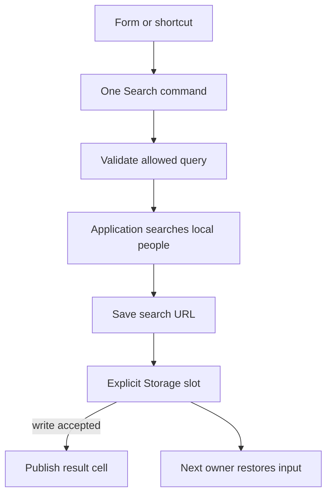

# Reuse a search action and restore its input

A user searches for a person, leaves the screen, and returns to the same saved search text. Several UI controls can
invoke one command. Query owns the allowed search grammar, Commands owns the reusable action, Context owns state
observation, and Storage supplies an explicitly chosen snapshot slot.

This program uses a local array as its provider and a memory store as its backing slot. It exercises the actual command
and stored-state APIs without pretending to render a browser screen.

## Run the saved-search workflow

At the checkout root, review `mise.toml`, run `mise trust`, `mise install` and `mise run prepare -- --kind deps`. Save the complete
program below as `search.ts` and run `mise exec -- deno run search.ts`; it needs no network or filesystem permissions.
Follow four steps: parse the permitted name filter, search the local people, save the exact URL, then reopen that saved
URL under a new owner. `await` waits for an asynchronous step before the next one. `using` closes the result cell and
`await using` joins each saved-state owner's cleanup. Neither deletes the memory store, which is why reopening works.

Parsing checks that the caller used the allowed field, comparison and page size. It does not search people.
This definition allows only name equality joined by AND, meaning every supplied condition must match. The local
provider reads all of those conditions with `conjunction()` and applies each one; it never treats an unsupported
group as an absent filter. The [Query walkthrough](../query.md#read-an-expression-as-a-tree-of-decisions) explains
trees and full expression evaluation when a provider also supports OR or NOT.

```ts runnable=search.ts
import * as query from '@okikio/query';
import * as schema from '@okikio/schema';
import * as commands from '@okikio/input/commands';
import * as state from '@okikio/context/state';
import { memory } from '@okikio/storage/state';

const Search = query.define({
	fields: { name: query.field(schema.string()) },
	filters: { name: [query.eq] },
	pagination: query.offset({ defaultLimit: 10, maximumLimit: 20 }),
});

// The provider owns its records; the store owns the saved URL between screen lifetimes.
const people = ['Ada', 'Grace', 'Linus'];
const store = memory();
using results = state.create<readonly string[]>([]);

{
	// This owner publishes only after its backing slot accepts a write.
	await using draft = await state.open({
		store,
		contract: 'people.search.v1',
		value: schema.string(),
		initial: () => '',
	});

	const SearchPeople = commands.define({
		id: 'people.search',
		label: 'Search people',
		/** Validate the request, apply every allowed condition, then save and publish the result. */
		async invoke(url: string) {
			const checked = await Search.parse(new URL(url));
			if (checked.pagination.kind !== 'offset') {
				throw new Error('This provider needs offset pagination.');
			}

			const conditions = query.conjunction(checked.filter);
			if (conditions === undefined) {
				throw new Error('This provider needs an AND-only filter.');
			}

			// Empty conditions keep every person; otherwise every equality must hold.
			const matchingPeople = people.filter((name) => {
				return conditions.every((condition) => name === condition.value);
			});
			const { offset, limit } = checked.pagination;
			const matches = matchingPeople.slice(offset, offset + limit);

			// Save before publishing. These remain two separate state changes.
			await draft.set(url);
			results.set(matches);
			return matches;
		},
	});

	console.log((await commands.run(SearchPeople, 'https://example.test/people?filter[name]=Ada')).join(', '));
	console.log(results.reader.get().length);
}

// Open a new saved-state owner over the same backing slot.
await using restored = await state.open({ store, contract: 'people.search.v1', value: schema.string() });
console.log(new URL(restored.reader.get()).searchParams.get('filter[name]'));
```

```text output
Ada
1
Ada
```

The first line is the command result. The second reads the result cell exposed to a renderer. The third proves that
another owner can reload the saved URL from the same memory slot. Disposing the first draft does not delete that slot.

## What the screen would connect

A form submit, menu action, or keyboard binding can call the same command and await its result. Give the renderer only
`results.reader`; keep the cell's mutation and disposal with the screen owner. Commands creates no global shortcut,
listener, or UI on import.



Follow the command downward: validation and local search happen before saving, and the backing slot accepts the
write before the result cell publishes. Reopening reads the same slot under a new owner. Saving and publishing remain
separate operations, not an atomic transaction. Browser event binding and rendering are
deliberately outside the local program. The cell reports results; it does not become the authority for authorizing a
search.

## Adapt the workflow deliberately

| Requirement                                         | Change                                                                          | Ownership or failure consequence                                                            |
| --------------------------------------------------- | ------------------------------------------------------------------------------- | ------------------------------------------------------------------------------------------- |
| Preserve input after page reload                    | Select `storage/state/web` and supply Storage plus a writer policy.             | The application chooses the key, retention, and coordination; memory alone is insufficient. |
| Query a server                                      | Replace the local array provider and pass cancellation into fetch.              | Query validation does not grant access or translate automatically to SQL.                   |
| Handle unsupported filters                          | Catch `QueryValidationError` and show its issues.                               | Do not turn a rejected query into an unrestricted search.                                   |
| Prevent an old slow search replacing a newer result | Add cancellation or an application revision check before saving and publishing. | Commands does not serialize or cancel overlapping invocations automatically.                |
| Save succeeds but result publication fails          | Reconcile the saved draft and visible state explicitly.                         | Saving the draft and publishing results are not one transaction.                            |

Change the filter from Ada to Grace and both the result and restored input change. Change the field name to an
undeclared field and parsing rejects before either save or publication. The local provider applies exactly the declared
equality filter and offset page; a production provider must preserve every enabled operation.

See [Query](../../packages/query/README.md), [Input commands](../../packages/input/README.md#choose-an-entry-point), and
[stored state](../context/03-stored-state.md) for focused options and conflict recovery.
