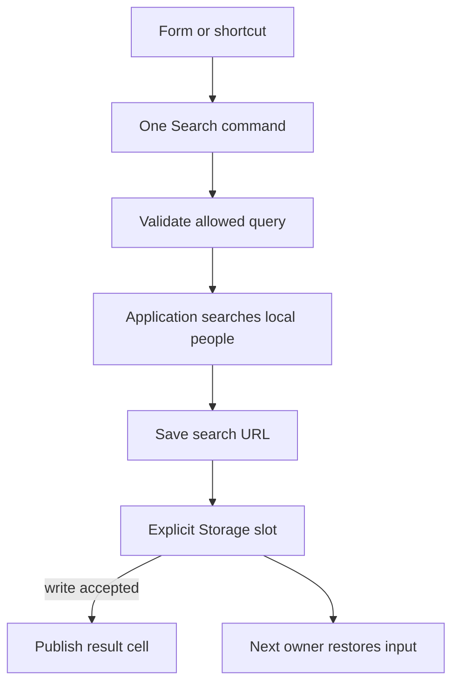

# Reuse a search action and restore its input

A user searches for Ada, leaves the screen, and returns to find `Ada` still in the search box. A button and a keyboard
shortcut can call the same function, which checks the search, finds matches, and saves the search URL. Here that
reusable action is a **command**.

The program searches an array of names and saves the URL in memory. It prints the matches and then reads the saved URL
after closing and reopening access to it. No browser is needed. Restarting the program loses the saved URL.

## Run the saved-search workflow

Check three things in the output: the command finds Ada, the screen's result list has one entry, and a fresh owner
loads Ada back into the search box. The third check reads the saved input; it does not run the search again.

At the checkout root, review `mise.toml`, run `mise trust`, `mise install` and `mise run prepare -- --kind deps`. Save the complete
program below as `search.ts` and run `mise exec -- deno run search.ts`; it needs no network or filesystem permissions.
Follow four steps: read the requested name from the URL, search the array, save the exact URL, then read it back.
`await` waits for a step to finish. `results` is a cell: it holds the latest matches and lets another part of the
program read them. `using` closes the cell at the end of its scope, and `await using` waits for saved-state cleanup.
Neither deletes the memory store, which is why reopening works.

Parsing checks that the caller used the allowed field, comparison and page size. It does not search people.
This definition allows only name equality joined by AND, meaning every supplied condition must match. The local
provider reads all of those conditions with `conjunction()` and applies each one; it never treats an unsupported
group as an absent filter. The [Query walkthrough](../query.md#read-an-expression-as-a-tree-of-decisions) explains
trees and full expression evaluation when a provider also supports OR or NOT.

```ts runnable=search.ts
import * as query from '@okikio/query';
import * as schema from '@okikio/schema';
import * as commands from '@okikio/input/commands';
import * as state from '@okikio/context/state';
import { memory } from '@okikio/storage/state';

const Search = query.define({
	fields: { name: query.field(schema.string()) },
	filters: { name: [query.eq] },
	pagination: query.offset({ defaultLimit: 10, maximumLimit: 20 }),
});

// The provider owns its records; the store owns the saved URL between screen lifetimes.
const people = ['Ada', 'Grace', 'Linus'];
const store = memory();
using results = state.create<readonly string[]>([]);

{
	// This owner publishes only after its backing slot accepts a write.
	await using draft = await state.open({
		store,
		contract: 'people.search.v1',
		value: schema.string(),
		initial: () => '',
	});

	const SearchPeople = commands.define({
		id: 'people.search',
		label: 'Search people',
		/** Validate the request, apply every allowed condition, then save and publish the result. */
		async invoke(url: string) {
			const checked = await Search.parse(new URL(url));
			if (checked.pagination.kind !== 'offset') {
				throw new Error('This provider needs offset pagination.');
			}

			const conditions = query.conjunction(checked.filter);
			if (conditions === undefined) {
				throw new Error('This provider needs an AND-only filter.');
			}

			// Empty conditions keep every person; otherwise every equality must hold.
			const matchingPeople = people.filter((name) => {
				return conditions.every((condition) => name === condition.value);
			});
			const { offset, limit } = checked.pagination;
			const matches = matchingPeople.slice(offset, offset + limit);

			// Save before publishing. These remain two separate state changes.
			await draft.set(url);
			results.set(matches);
			return matches;
		},
	});

	console.log((await commands.run(SearchPeople, 'https://example.test/people?filter[name]=Ada')).join(', '));
	console.log(results.reader.get().length);
}

// Open a new saved-state owner over the same backing slot.
await using restored = await state.open({ store, contract: 'people.search.v1', value: schema.string() });
console.log(new URL(restored.reader.get()).searchParams.get('filter[name]'));
```

```text output
Ada
1
Ada
```

The first line is the command result. The second reads the result cell exposed to a renderer. The third proves that
another owner can reload the saved URL from the same memory slot. Disposing the first draft does not delete that slot.

## What the screen would connect

A form submit, menu action, or keyboard binding can call the same command and await its result. Give the renderer only
`results.reader`; keep the cell's mutation and disposal with the screen owner. Commands creates no global shortcut,
listener, or UI on import.



Follow the arrows from the search control down. The command checks the query and finds matching names before
it saves the URL. Once storage confirms the save, the command gives the new results to the screen. A later
screen can open the same slot to restore the input.

If saving succeeds but updating the screen fails, the saved URL can still change. The program does not update
both in one transaction. It leaves the actual browser listeners and rendering to your application. A result
cell can display names, but your application still decides which searches are allowed.

## Adapt the workflow deliberately

| Requirement                                         | Change                                                                          | Ownership or failure consequence                                                            |
| --------------------------------------------------- | ------------------------------------------------------------------------------- | ------------------------------------------------------------------------------------------- |
| Preserve input after page reload                    | Select `storage/state/web` and supply Storage plus a writer policy.             | The application chooses the key, retention, and coordination; memory alone is insufficient. |
| Query a server                                      | Replace the local array provider and pass cancellation into fetch.              | Query validation does not grant access or translate automatically to SQL.                   |
| Handle unsupported filters                          | Catch `QueryValidationError` and show its issues.                               | Do not turn a rejected query into an unrestricted search.                                   |
| Prevent an old slow search replacing a newer result | Add cancellation or an application revision check before saving and publishing. | Commands does not serialize or cancel overlapping invocations automatically.                |
| Save succeeds but result publication fails          | Reconcile the saved draft and visible state explicitly.                         | Saving the draft and publishing results are not one transaction.                            |

To try a different search, replace `filter[name]=Ada` with `filter[name]=Grace` in the command call. Keep the last line
reading `filter[name]`. The program should now print `Grace`, `1`, and `Grace`. Next, try `filter[city]=Ada`. The
program rejects that request before it saves input or updates the result cell: the application never declared `city`
as a searchable field. In your own provider, apply each filter and page option you let callers request.

See [Query](../../packages/query/README.md), [Input commands](../../packages/input/README.md#choose-an-entry-point), and
[stored state](../context/03-stored-state.md) for focused options and conflict recovery.
