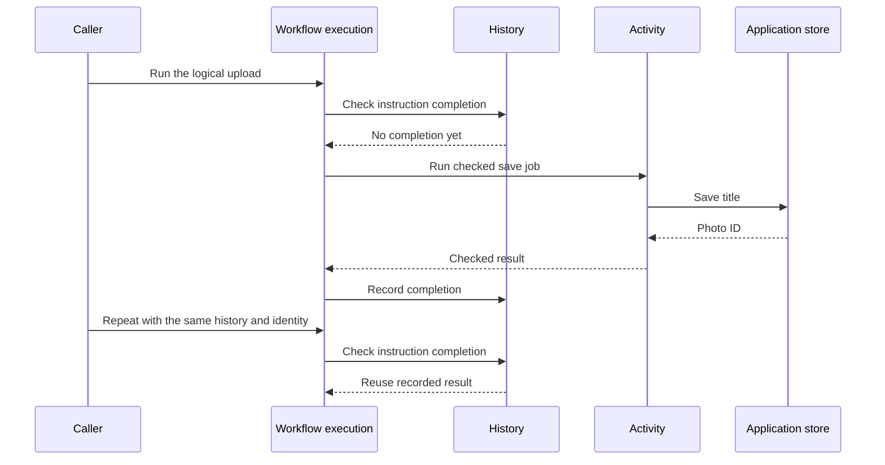

# Reuse completed jobs in a multi-step operation

A photo upload saves a title, then adds the returned photo ID to an album. Repeating the same logical operation should
reuse recorded completions. A normal function is sufficient until that reuse becomes a requirement; Workflow adds
recorded instructions while Activity keeps each job's input, dependencies, and result explicit.

## See why ordinary repeated calls repeat writes

Start with array-backed storage so every write can be inspected. After observing repeated ordinary calls, add memory
dispatch and history to retain the results in this process. Those memory owners disappear after process loss.

Save this first program as `ordinary-upload.ts` and run `mise exec -- deno run ordinary-upload.ts`.
It uses only ordinary JavaScript and needs no package setup. Before recording anything, consider those calls. Each call to `save` appends a title. Repeating the function
therefore appends twice, even though its input is unchanged:

```ts runnable=ordinary-upload.ts
const titles: string[] = [];
const album: string[] = [];
async function save(title: string): Promise<string> {
	titles.push(title.toUpperCase());
	return `asset-${titles.length}`;
}
async function upload(title: string): Promise<string> {
	const id = await save(title);
	album.push(id);
	return id;
}
console.log(await upload('summer trip'), await upload('summer trip'));
console.log(titles.length, album.length);
```

```text output
asset-1 asset-2
2 2
```

## Record the same two writes

Keep those two writes, but ask the scheduler for each result instead of calling it directly. In a workflow generator,
`yield* ctx.trigger(SaveTitle, input)` means “request this named job, then continue with its result.” JavaScript pauses
this generator at the instruction. The scheduler either supplies a compatible recorded answer or runs the job. `await`
still belongs inside the ordinary activity implementation that actually writes the data.

These objects divide responsibility for running and remembering the two photo writes:

| Owner | Role in this upload |
| --- | --- |
| Activity definition / implementation | Describe checked save/album calls / supply their ordinary async functions. |
| Resource collection | Acquire the photo store and own its cleanup; activities borrow it. |
| Engine and local provider | Select and execute implementations in this process. Declaring an engine starts nothing. |
| Dispatch and executor | Retain pending jobs / take those jobs and run the provider. |
| History and scheduler | Retain completed instructions / decide whether a request reuses or runs work. |
| Context | Supply cancellation and local cleanup lifetime. It does not persist an execution. |

From the repository root, run `mise run prepare -- --kind deps` once. Save the next block as `recorded-upload.ts` and run
`mise exec -- deno run recorded-upload.ts`. Clock and cleanup support use local providers. These workspace imports need no published package or network service.

```ts runnable=recorded-upload.ts
import * as activity from '@okikio/activity';
import * as engine from '@okikio/activity/engine';
import * as local from '@okikio/activity/local';
import * as context from '@okikio/context';
import * as resource from '@okikio/capability/resource';
import * as dispatch from '@okikio/workflow/dispatch';
import * as history from '@okikio/workflow/history';
import * as workflow from '@okikio/workflow';
import * as schema from '@okikio/schema';

// Schemas and engine identity describe calls; they do not start the executor.
const TextSchema = schema.string();
const Local = engine.define({ id: 'local' });

// Activities borrow this contract. The collection below owns its live implementation.
const Store = resource.define<{
	/** Append a title and return the new application asset ID. */
	save(title: string): Promise<string>;
	/** Append that asset ID to this example's album and return it. */
	addToAlbum(id: string): Promise<string>;
}>({ id: 'photo.store', description: 'Save titles and append photo IDs to an album.' });

// These arrays are the entire business store; a restart loses them.
const titles: string[] = [];
const album: string[] = [];
const store = resource.implement(Store, {
	create: () => ({
		/** Simulate the title write so the final array reveals any repeat. */
		async save(title) {
			titles.push(title);
			return `asset-${titles.length}`;
		},
		/** Keep the album write separate so replay must remember both instructions. */
		async addToAlbum(id) {
			album.push(id);
			return id;
		},
	}),
});

// Declare each checked business operation before supplying its implementation.
const SaveTitle = activity.define({
	id: 'photo.save-title',
	version: '1',
	input: schema.string({ minLength: 1 }),
	result: TextSchema,
	placement: engine.require(Local),
	resources: [Store],
});
const AddToAlbum = activity.define({
	id: 'photo.add-to-album',
	version: '1',
	input: TextSchema,
	result: TextSchema,
	placement: engine.require(Local),
	resources: [Store],
});

const saveTitle = activity.implement(SaveTitle, {
	async run(ctx) {
		const photos = await ctx.get(Store);
		return await photos.save(ctx.input.toUpperCase());
	},
});
const addToAlbum = activity.implement(AddToAlbum, {
	async run(ctx) {
		const photos = await ctx.get(Store);
		return await photos.addToAlbum(ctx.input);
	},
});

// The generator requests jobs. It does not perform the array writes itself.
const UploadPhoto = workflow.define({
	id: 'photo.upload',
	version: '1',
	input: TextSchema,
	result: TextSchema,
	activities: [SaveTitle, AddToAlbum],
});
const uploadPhoto = workflow.implement(UploadPhoto, function* (ctx) {
	const id = yield* ctx.trigger(SaveTitle, ctx.input);
	return yield* ctx.trigger(AddToAlbum, id);
});

// Lifetime owners close in reverse order; activities borrow the resource collection.
await using parent = context.create({ id: 'photo-parent' });
await using stores = resource.create(resource.implementations(store), { ctx: parent, host: {} });

// Dispatch retains requests; history retains their recorded answers in this process.
await using jobs = dispatch.memory();
await using records = history.memory();
await using scheduler = workflow.scheduler({
	activityDispatch: jobs,
	history: records,
});

// This executor takes pending jobs and runs the local provider.
await using executor = await workflow.executor({
	dispatch: jobs,
	engine: Local,
	hostId: 'photo-host',
	capacity: 1,
	provider: local.create({ engine: Local, implementations: [saveTitle, addToAlbum], resources: stores }),
});

// Both passes use the same run identity and history, so the second reuses completed instructions.
for (const pass of ['first run', 'replay']) {
	await using run = await workflow.context({
		definition: UploadPhoto,
		runId: 'photo-upload-1',
		input: 'summer trip',
		ctx: parent,
	});
	console.log(pass, await workflow.run({ ctx: run, implementation: uploadPhoto, scheduler }));
}
console.log('Saved titles:', titles.join(','));
console.log('Album entries:', album.join(','));
```

Expected output:

```text output
first run asset-1
replay asset-1
Saved titles: SUMMER TRIP
Album entries: asset-1
```

## Read the composition from the returned value backward

The final photo ID comes from the job implementation. Workflow assembles that value from its instructions; Context
supplies lifetime information and does not replace the result.

| Owner                            | What it receives                                 | What it owns                                                 |
| -------------------------------- | ------------------------------------------------ | ------------------------------------------------------------ |
| Application store implementation | Title or photo ID                                | The actual writes to the two arrays.                         |
| Resource collection              | Store implementation and parent lifetime         | Lazy acquisition and owned instance cleanup.                 |
| Activity                         | Checked input and declared resource access       | One job implementation and its checked result.               |
| Local engine                     | Activity implementations                         | Execution in this process; no background host is launched.   |
| Dispatch                         | Job requests and executor registrations          | Logical job state and temporary attempts.                    |
| History                          | Deterministic instructions and their completions | Which completed instruction can be reused.                   |
| Workflow scheduler               | Program, dispatch, history, and engine           | Connecting requested jobs to execution and recorded results. |

The same resource mechanism could supply a report store instead of a photo store. The workflow mechanism is unchanged;
the application's schemas, writes, identities, and repeat-safety policy change.



The diagram isolates one save instruction so its reuse is visible. The runnable program includes the album instruction
too. It does not depict a transaction between an external write and history recording.

## Understand the failure window before choosing persistence

If a write succeeds and the process stops before its completion is recorded, a replacement can repeat that write.
Recording instructions alone cannot eliminate this window. A database receipt committed with the business write or a
receiver-side idempotency key supplies a different guarantee and belongs to that write's owner.

Try using fresh memory history to see why the retained history matters. Do not keep the same identity while changing the
meaning of the input or program and assume an old result still represents the new request. Changing a recorded program
needs an explicit version and migration decision.

For process-loss recovery, choose [PostgreSQL storage](../../packages/storage/workflow/postgres/README.md), migrate
explicitly, and run service and executor hosts. The [background-work walkthrough](../workflows/01-basics.md) supplies
that complete setup; [recovery](../workflows/04-recovery.md) explains the write windows, and
[operations](../workflows/16-operations.md) covers saved-work maintenance. These are separate operational tasks rather
than prerequisites for understanding this local example.
