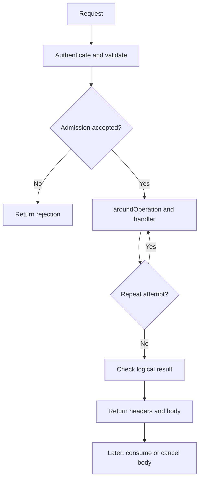

# Server: service

A service groups request contracts with the code and dependencies that satisfy
them. Defining says what can be called; implementing supplies the functions;
compiling checks that those pieces fit; creating acquires the live runtime.
Compilation here prepares ordinary JavaScript data, not a new executable file.
The first program follows one note through all four stages and sends actual
requests directly to the resulting Fetch application.

Start with the [complete package example](../../packages/server/service/README.md). The sections below continue that
example.

## Run a complete task

Run the same notes route with a text title and a number. The service uses an array as its store so you can see
whether either request reached the save callback.

After the [checkout setup](../../README.md#work-on-the-repository), save the block as `complete-task.ts` at the
checkout root and run `mise exec -- deno run complete-task.ts`.

```ts runnable=complete-task.ts
import * as endpoint from '@okikio/server/endpoint';
import * as response from '@okikio/http/response';
import * as service from '@okikio/server/service';
import * as schema from '@okikio/schema';

const Saved = response.ok(schema.object({ title: schema.string() }), {
	id: 'note.saved',
	description: 'Saved note title.',
});
const Save = endpoint.post({
	id: 'note.save',
	path: '/notes',
	json: schema.object({ title: schema.string({ minLength: 1 }) }),
	responses: [Saved],
});
const Api = service.define({ id: 'notes', path: '/', endpoints: [Save] });
const notes: string[] = [];
const implementation = service.implement(Api, {
	endpoints: [endpoint.handler(Save, ({ input }) => {
		const title = input.json.title.trim();
		notes.push(title);
		return response.create(Saved, { title });
	})],
});
await using runtime = service.create(service.compile(implementation), { host: {} });
for (const title of [' First note ', 42]) {
	const outgoing = await runtime.fetch(
		new Request('https://service.invalid/notes', {
			method: 'POST',
			headers: { 'content-type': 'application/json' },
			body: JSON.stringify({ title }),
		}),
	);
	const body = await outgoing.json();
	console.log(outgoing.status, body.title);
}
console.log(notes.length);
```

Expected output:

```text output
200 First note
400 Invalid request
1
```

The first request reaches the save callback. The numeric title gets a `400` before the callback runs,
so the final count is one. Saving here means appending to an array; restarting the program loses that note.

## Why four setup calls?

The calls separate reusable API facts from live application behavior. Each produces a concrete value:

| Call                                                     | Value returned          | Work done now                                                                                           |
| -------------------------------------------------------- | ----------------------- | ------------------------------------------------------------------------------------------------------- |
| `define({ id, path, endpoints, ... })`                   | `ServiceDefinition`     | Snapshots the API description; starts no work                                                           |
| `implement(Api, { endpoints, middleware?, resources? })` | `ServiceImplementation` | Associates exact definitions with callbacks/factories                                                   |
| `compile(implementation)`                                | `CompiledService`       | Checks the graph and prepares routes, operation plans and a JSON-safe manifest                          |
| `create(compiled, { host, ... })`                        | `ServiceRuntime`        | Creates an owned context/resource collection and exposes `fetch`, `routes`, `resources`, async disposal |

The `host` is an application-supplied object that handlers and factories borrow. The runtime does not close borrowed
host values. Its resource collection acquires declared resources lazily, shares in-flight acquisition and owns the
values it creates. Await runtime disposal to finish that collection's cleanup. `await using` is the compact JavaScript
syntax for calling and awaiting `Symbol.asyncDispose` at scope exit.

### One request, one level deeper

For the note example, the runtime matches POST `/notes`, creates the request lifetime, runs the configured middleware
lanes, parses the declared JSON input, invokes the linked callback, checks that the result belongs to `Saved`, validates
the body, and constructs a Web `Response`. Reading the response completes its body lifetime and releases request-owned
state. Returning headers alone does not mean a streaming body has finished.

With `json: schema.object({ title: schema.string() })` on a POST endpoint, the callback receives a typed
`input.json.title` only after byte limits, JSON parsing and schema validation. With an undeclared or invalid handler
result, the runtime returns its framework problem response rather than silently sending that value. Host adapters
provide real authentication, requirements and resilience behavior; the compiler does not invent those implementations.

This design lets one API definition feed request validation, output validation, OpenAPI and gateway routing. If a single
local function with a native response meets your need, start with
[plain HTTP routes](../../packages/server/http/README.md) instead. The
[full service contracts](../../packages/server/README.md) show the optional parts.

## Build on the example

To make the notes API durable or private, add [endpoint input rules](../../packages/server/endpoint/README.md), a database
[resource](../../packages/capability/resource/README.md), authentication
[middleware](../../packages/server/middleware/README.md) and
[permission checks](../../packages/authz/permission/README.md). A resource is a declared live client or service used by
the handler, with an explicit lifetime. The host supplies actual clients and interpreters; declarations alone do not
connect to a database or implement authorization.

For a public edge in front of the service, import its definition into a
[gateway](../../packages/server/gateway/README.md). For a Hono application, mount the runtime through the
[Hono adapter](../../packages/hono/README.md). Neither host changes the endpoint's input and output rules. Read or
cancel response bodies, then await runtime disposal to join owned cleanup. Later sections explain requirements, effects,
observers and resilience after this basic request flow.

## Define, implement, compile, create

The note program performs four steps. `Api` describes the service without starting it. The implementation connects
`Save` to the function that saves a note. `service.compile(implementation)` checks the connections between the
declared parts. `service.create(..., { host: {} })` gives you a live handler and an object to close when you finish.
The example passes an empty host because it needs no application clients.

To keep notes after a restart, add a Resource definition for your database and connect it to the code that opens
the client. Defining the resource does not open the database. The service opens it when code first asks for it.
The [resource example](../../packages/capability/resource/README.md) shows how to supply that code. Your application
chooses the client, credentials, and when to shut it down.

## Service extensions

A _service extension_ is a reusable mechanism that adds policy, runtime data, required consequences, observation, or
execution behavior without moving that behavior into endpoint business logic. Some extension mechanisms are direct
compiler inputs. Others attach typed capabilities to the execution context.

| Extension mechanism | What it means                                                       | Typical examples                                    |
| ------------------- | ------------------------------------------------------------------- | --------------------------------------------------- |
| Request values      | Typed application values added while a request runs                 | authentication, principal, membership               |
| Requirements        | Open families of rules that can become active                       | permission, entitlement, quota, consent, compliance |
| Effects             | Typed announcements that an externally visible side effect occurred | usage event, meter reading, billing outbox record   |
| Observers           | Non-authoritative lifecycle observation                             | metrics, logs, traces                               |
| Resilience          | Request protection and failure behavior                             | timeout, idempotency, rate limit, retry             |
| Resources           | Live runtime capabilities                                           | graph client, database, cache, billing ledger       |
| Query contracts     | Dedicated request/data contracts                                    | filters, sorting, fieldsets, pagination             |

These mechanisms can grow independently. A new permission model implements the existing `permission` requirement family
instead of adding a server field. A new metrics exporter handles observer events instead of becoming request policy. A
usage meter announces an effect instead of pretending that measurement is an admission check. Query stays a dedicated
endpoint/data contract because its parsing and generated documentation have different semantics again.

A future capability that does not fit one of these mechanisms should define its own contract and lifecycle explicitly.
The compiler can then add that extension class without turning all extensions into one generic runtime object.

## Runtime adapters and request values

`ServiceRuntimeAdapters` contains live behavior that the generic server must call during request execution. The current
adapters are authentication, requirement interpretation, optional effect ownership, and adapter-owned resilience.

Authentication can add provider-neutral request values. Endpoint handlers keep the exact application types without
depending on a provider SDK.

This type excerpt names the smallest application value a private notes handler might borrow. It reuses `Save`, `Saved`, `endpoint` and `response` from the complete program. The executable must supply an authentication adapter that actually produces this principal before selecting this handler; a TypeScript interface alone does not authenticate a request.

```typescript
interface NoteRequestValues extends service.ServiceRequestValues {
	readonly principal: { readonly id: string };
}
const PrivateSaveHandler = endpoint.handler<
	typeof Save,
	endpoint.EmptyEndpointHost,
	NoteRequestValues
>(Save, ({ principal, input }) => {
	const title = `${principal.id}: ${input.json.title.trim()}`;
	return response.create(Saved, { title });
});
```

This excerpt only demonstrates typed request values. It does not save to the first program's array or provide a complete private-notes deployment. Add declared authentication requirements and a real adapter before using it as access control. Membership, organization and provider SDK types remain application-owned extensions of the same request-value contract.

The runtime stores these values separately from the middleware context store. `requestValues` contains typed application
values. `values` remains the identity-keyed middleware context store. Runtime adapters cannot replace the Request, host,
validated input, resource resolver, execution context, or compiled operation.

## Requirements and complex permission models

Requirements are the open policy-family mechanism. The compiler preserves the family, action, exact definition identity,
and where the requirement came from. It does not implement the policy engine.

A permission interpreter can therefore use any authorization model:

- a local role or ACL check
- a database-backed object permission table
- a relationship graph
- Zanzibar-style tuples
- SpiceDB or another remote graph service
- a product-specific evaluator

The endpoint contract remains the same:

For a private notes application, the service or endpoint declares the exact imported permission and the host supplies its permission-family interpreter. Keep that declaration with `Save`; apply target-specific checks only after a concrete note ID is known. The [complete Requirement example](../packages/16-requirement.md) shows declaration, binding and active enforcement without undefined permission clients. The [Permission guide](../../packages/authz/permission/README.md) then supplies a permission-specific checker.

Direct requirements apply before the endpoint operation runs. Reachable requirements describe rules that a declared
resource or handler path can activate later when the concrete target becomes known. This distinction allows an object
permission check to wait for an object ID without removing the requirement from the compiled service contract.

## Effects, usage, and billing

Declare an effect when a handler may need to announce something to another part of the application. For example,
it may announce that it saved a note. The declaration allows the announcement. The handler still has to call
`effect.emit()`, and your application must provide a recipient that can accept it.

For the running example, a required announcement would mean “this note save was accepted.” Its schema can keep the same title value. This declaration excerpt uses the imports above and adds `effect`; no emitter is installed just by constructing it.

```typescript
import * as effect from '@okikio/capability/effect';
const NoteSaved = effect.define({
	id: 'note.save-accepted',
	value: schema.object({ title: schema.string() }),
});
const TrackedSave = endpoint.post({
	id: 'note.save-tracked',
	path: '/notes',
	json: schema.object({ title: schema.string({ minLength: 1 }) }),
	effects: [NoteSaved],
	responses: [Saved],
});
```

Use `TrackedSave` in place of the original endpoint and attach the handler to that exact definition. After saving a
note, call `effect.emit(ctx, NoteSaved, { title }, { key })`. Use the saved note operation's stable key so a retry
does not look like a new announcement. Supply the recipient in `adapters.effect` when you create the service.
The [effect walkthrough](../effect/01-guide.md) shows what happens when the recipient accepts or rejects it.

The compiler carries exact effect definitions from service, policy, group, path, operation, and middleware contributions
into each effective operation. A service can start without `adapters.effect` because a declaration only says that
runtime code may announce an effect. An actual `effect.emit()` still requires an emitter, and emitting an undeclared
effect still fails.

`@okikio/capability/effect/meter` announces measurements through `@okikio/capability/effect`. Billing, usage, audit,
notification, or webhook-delivery systems can own those announcements without becoming generic service callbacks.

When you retry the same announcement, reuse its key. A recipient with durable storage can check that key to avoid
recording the same event twice.

A recipient can accept the announcement separately from the note write. If you need both writes to succeed or
fail together, arrange that in your application. For example, save the note and its outbox entry in one database
transaction.

## Observers, metrics, and logging

Observers receive credential-free lifecycle events. They are observational. An observer failure cannot change the
service response, cancellation, or cleanup.

This integration excerpt assumes an application-owned `host` and `telemetryScope`, plus the `serverTelemetry` adapter. Declare the same `Diagnostics` in the service before compilation; the observer handler belongs to the live host. For an executable adapter setup, use the [Telemetry README](../../packages/telemetry/README.md).

```typescript
const Diagnostics = service.observer.define({
	id: 'notes.diagnostics',
	description: 'Observe notes request lifecycle.',
});
// Select the declaration before compilation; the live host binds that exact observer below.
const ObservedApi = service.define({
	id: 'notes-observed',
	path: '/',
	endpoints: [Save],
	observers: [Diagnostics],
});
const observed = service.implement(ObservedApi, {
	endpoints: [endpoint.handler(Save, ({ input }) => response.create(Saved, { title: input.json.title.trim() }))],
});
const compiled = service.compile(observed);

await using runtime = service.create(compiled, {
	host,
	observers: [serverTelemetry.service(Diagnostics, telemetryScope)],
});
```

The event sequence distinguishes response headers from body completion:

```text
started
   |
   +--> failed                 execution failed before a response
   |      |
   |      `--> response        server produced a problem response
   |
   `--> response              response headers are ready
           |
           +--> completed      response body reached EOF
           +--> aborted        consumer cancelled the body
           `--> failed         response body errored
```

Metrics, logs, and traces can derive from these events without becoming application authorization or billing authority.

## Resilience

Resilience has two independent dimensions.

| Question                  | Values                              | Meaning                                                          |
| ------------------------- | ----------------------------------- | ---------------------------------------------------------------- |
| Who executes the policy?  | `server`, `adapter`                 | Whether the generic server has enough state to execute it itself |
| When does the policy run? | `request`, `admission`, `operation` | Which part of the request lifecycle the policy protects          |

`@okikio/capability/resilience` exposes `owner(policy)` and `stage(policy)` so tooling can inspect both dimensions. The
[resilience package](../../packages/capability/resilience/README.md) contains the full policy map.

## Request lifecycle

The outer request stages run once. A retry policy may repeat only the inner operation attempt. This distinction keeps
an operation retry from accidentally authenticating or admitting the same logical request again:



Read downward for time. Only the attempt box repeats. A failure at a request gate returns a rejection before that
loop. The chart omits exception projection and individual adapters, whose contracts are described above.

| Lifetime | Runtime work | Why the boundary matters |
| --- | --- | --- |
| Once per request | Middleware around the request, authentication, parsing, validation, admission and direct requirements | A handler retry does not repeat request admission. |
| Each permitted attempt | Operation policy, `aroundOperation` middleware and the handler | A retry can create a fresh attempt. |
| After headers return | Body consumption, completion observation and cleanup | Returning a Response does not prove its stream finished. |


Admission resilience runs once for the logical HTTP request. Operation resilience wraps endpoint execution. A retry can
therefore recreate `aroundOperation` middleware for each attempt without repeating authentication or direct requirement
interpretation.

## What compilation means

Compilation is graph linking and partial evaluation. It does not transpile TypeScript.

The compiler:

1. Flattens endpoint groups, selections, and endpoint definitions.
2. Calculates canonical service paths.
3. Merges service, policy, group, endpoint, and operation contributions.
4. Resolves the complete resource graph.
5. Keeps direct requirements separate from reachable requirements.
6. Resolves exact effect declarations available to each execution.
7. Normalizes middleware and resilience plans.
8. Binds exact imported definitions to exact runtime implementations.
9. Rejects missing, duplicate, conflicting, unreachable, or unsafe contracts.
10. Produces immutable operation plans and JSON-safe service artifacts.

Each effective operation contains the handler, middleware plan, request inputs, requirements, effect declarations,
resource closure, response/problem definitions, and prepared resilience execution plan. Request execution consumes that
prepared data instead of rediscovering policy on every request.

## Host and listener ownership

`service.create()` owns service resources and request contexts. It does not bind a network port.

```text
service.create()
    |
    +--> routes
    +--> fetch
    +--> resources
    `--> asyncDispose
             |
             v
       Deno / Node / edge host
             |
             v
        network listener
```

The deployment host owns listener startup and shutdown. Disposing the service runtime releases service-owned resources.

## Validation

| Time                       | What is checked                                                      |
| -------------------------- | -------------------------------------------------------------------- |
| Definition creation        | Local IDs, paths, and request-contract invariants                    |
| Service compilation        | Route conflicts, missing handlers, resource cycles, policy conflicts |
| Runtime creation           | Configured adapters, optional effect owner, and observer handlers    |
| HTTP parsing               | Header, cookie, query, form, JSON, and body-size limits              |
| Standard Schema            | Request values and schema transformations                            |
| Requirement interpretation | Permission, entitlement, quota, consent, or another active family    |
| Handler return             | Declared response/problem membership                                 |
| Response validation        | Output schema and transport representation                           |

## Raw responses

An operation must set `rawResponse: true` before its handler can return a native `Response`. Use raw responses for
protocols such as SSE, WebSockets, transparent proxying, and provider-native streams. Ordinary endpoints should return
declared response/problem values so validation, OpenAPI, generated clients, and observers remain inspectable.

## Publish a contract without live bindings

`compileDefinition(definition)` resolves effective routes, effects, requirements, resource declarations, policies and a
manifest without handlers, environment reads or resource factories. Pass that result to `openapi` or `document`. Runtime
execution still uses `compile(implement(definition, bindings))`, which verifies exact handler and resource coverage.
Both paths resolve the same static contract.

`routes`, `route` and `routePath` derive method/path data from canonical service and endpoint objects. A multi-method
endpoint requires an explicit method selection. Route parameters are encoded and unknown or missing names reject. The
host supplies caller-facing OpenAPI security schemes and per-operation alternatives explicitly.

Pass raw configuration in `source` or already checked values in `environment`, never both. With `source`, the
resource checks its settings when the service first needs it. The request body and middleware use the same
deadline. If a resource reports `UnavailableError`, the caller receives a safe 503. The generated API document
lists that response for operations that declare resources. Keep the private cause in diagnostics.
