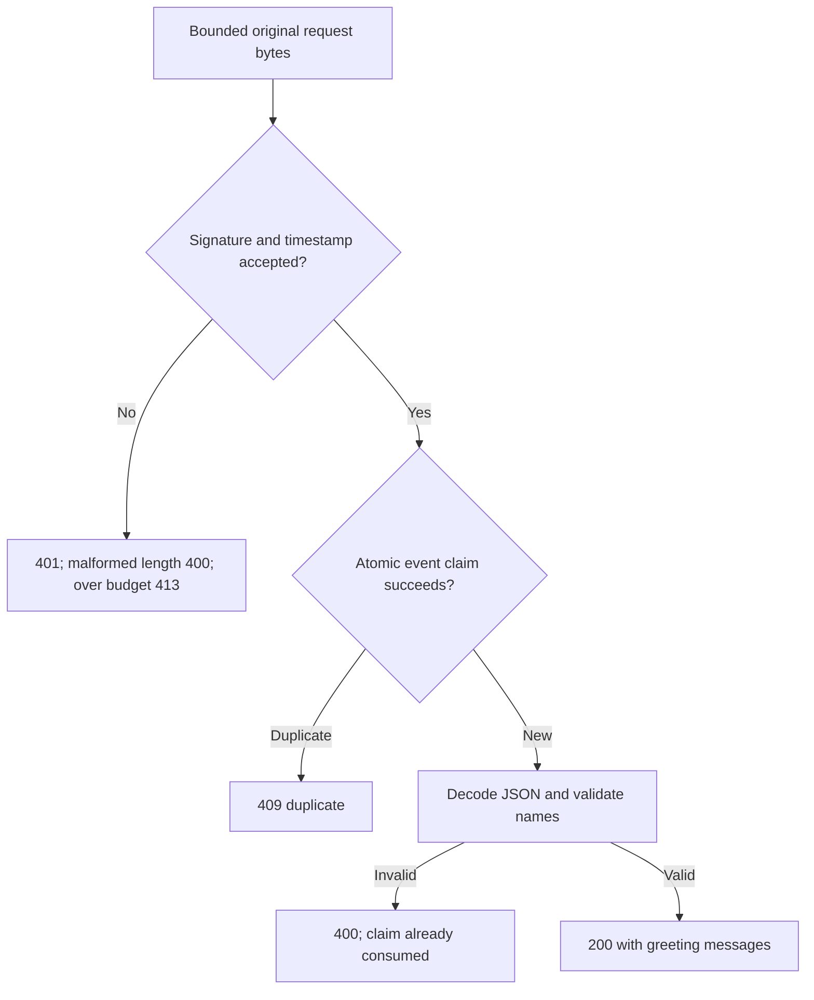

# Receive greeting requests from forms and signed callbacks

The [first greeting handler](./04-http.md) reads a name from a URL. Now let someone send a name as JSON or submit two
names on a form. Another service can send a signed callback, called a webhook. Each route still makes greetings;
the difference is what the route must check before trusting the name.

Run the check below to see Sam accepted, a form preserve Sam and Jo as separate names, and a second delivery of the
same signed callback return `409` without generating another greeting.

This guide uses Web `Request`, `Response` and `FormData` values. You can call the application locally before choosing a
network host. From the Utils checkout, review `mise.toml`, run `mise trust`, `mise install`, and `mise run prepare -- --kind deps`.
Save the next two files at the repository root, then run `mise exec -- deno run greeting-input-check.ts`.

## Admit bytes, check names, then create greetings

`parseJson()` and `parseForm()` read at most 4,096 body bytes here. Parsing tells us what was sent; `answer()` decides
whether it is an acceptable greeting name. Repeated form fields remain separate values. A `File` is a valid form value,
but this operation accepts text names, so uploading a file as a name returns 400.

For callbacks, verify the signature over the exact received bytes before interpreting JSON. `verifyRequest()` reads a
bounded clone, leaving the original request available to `parseJson()`. Changing whitespace or reserializing JSON before
signature verification would change those signed bytes.

Save `greeting-input.ts`:

```ts support=greeting-input.ts
import * as http from '@okikio/server/http';
import { parseForm, parseJson, RequestTransportError } from '@okikio/http/request';
import * as webhook from '@okikio/http/webhook';

/** Own the local greeting routes, bounded replay fixture and readiness state. */
export function createGreetings() {
	const now = new Date(1000_000);
	// Reproducible fixture only. Deployment supplies a private, rotated secret and real clock.
	const signer = webhook.standard.create({
		secret: 'whsec_' + btoa(String.fromCharCode(...new Uint8Array(32).fill(1))),
	});
	const claims = new Map<string, number>();
	const verifier = webhook.protect(signer, {
		namespace: 'greetings:v1',
		maximumIdentityBytes: 256,
		maximumAgeSeconds: 300,
		maximumFutureSeconds: 0,
		store: {
			claim(identity, expiresAt) {
				// Prune expired claims, then test-and-insert without an await between them.
				for (const [key, expires] of claims) {
					if (expires <= now.getTime()) {
						claims.delete(key);
					}
				}
				if (claims.has(identity)) {
					return false;
				}
				if (claims.size >= 32) {
					throw new Error('Replay store capacity exhausted.');
				}
				claims.set(identity, expiresAt);
				return true;
			},
		},
	});
	let ready = false;
	const phases: string[] = [];
	const limits = { maximumBodyBytes: 4096 };

	/** Validate application meaning after transport parsing, before producing greetings. */
	function answer(names: unknown): Response {
		const values = Array.isArray(names) ? names : [names];
		if (
			values.length < 1 || values.length > 3 ||
			values.some((value) => typeof value !== 'string' || value.trim().length < 1 || value.length > 80)
		) {
			return Response.json({ error: 'Supply one to three text names of 1–80 characters.' }, { status: 400 });
		}
		return Response.json({ messages: values.map((name) => `Hello, ${String(name).trim()}!`) });
	}
	const app = http.create({
		routes: [
			http.route('POST', '/greeting', async (request) => {
				// Bound bytes before JSON decoding; answer() owns the separate field rules.
				const value = await parseJson(request, limits);
				return answer(value !== null && typeof value === 'object' && 'name' in value ? value.name : undefined);
			}),
			http.route('POST', '/greeting/form', async (request) => {
				const fields = await parseForm(request, limits);
				return answer(fields.name);
			}),
			http.route('POST', '/greeting/webhook', async (request) => {
				// Authenticate original bytes and atomically admit the identity before application parsing.
				const verified = await webhook.verifyRequest(request, verifier, { now, maximumBodyBytes: 4096 });
				if (!verified.ok) {
					// Map each admission failure to an HTTP response before doing greeting work.
					let status = 401;
					if (verified.code === 'body-too-large') {
						status = 413;
					} else if (verified.code === 'duplicate') {
						status = 409;
					} else if (verified.code === 'invalid-content-length') {
						status = 400;
					}
					return Response.json({ error: verified.code }, { status });
				}
				// Bound bytes before JSON decoding; answer() owns the separate field rules.
				const value = await parseJson(request, limits);
				return answer(value !== null && typeof value === 'object' && 'name' in value ? value.name : undefined);
			}),
			http.route('GET', '/health', http.health({ service: 'greetings' })),
			http.route('GET', '/ready', http.ready(() => ({ ready, checks: { recipientStore: ready } }))),
		],
		middleware: [
			http.access((event) => {
				phases.push(event.kind);
			}),
			http.timing(),
			http.catchErrors(),
			async (request, next) => {
				try {
					return await next(request);
				} catch (error) {
					if (!(error instanceof RequestTransportError)) {
						throw error;
					}
					const code = error.issues[0]?.code;
					const status = code === 'body-too-large' ? 413 : code === 'unsupported-content-type' ? 415 : 400;
					return Response.json({ error: 'Request format rejected.' }, { status });
				}
			},
		],
	});
	return {
		app,
		signer,
		phases,
		setReady(value: boolean) {
			ready = value;
		},
	};
}
```

The order of middleware matters. `access()` and `timing()` surround `catchErrors()`, so they also see safe error
responses. The innermost middleware maps known transport failures to deliberate 400, 413 and 415 responses. An unexpected
failure continues outward to the safe 500 response. Log private diagnostics through an application-owned observer;
do not return exception messages or signed payloads to the caller.

The signed route has an extra gate before the ordinary input path:



Follow the accepted path downward. Claiming an event and creating a greeting are separate steps; the replay store does
not commit a business transaction. Operational verifier/store exceptions reach the safe error middleware instead of
being treated as accepted events.

## Exercise the successful and rejected requests

Save `greeting-input-check.ts`. The signer plays the sending provider for this local check. Each call creates a fresh
Request: a consumed body is not an input you can send again.

```ts runnable=greeting-input-check.ts
import { createGreetings } from './greeting-input.ts';
const { app, signer, phases, setReady } = createGreetings();
async function send(path: string, body: BodyInit, headers?: HeadersInit) {
	const response = await app.fetch(new Request('http://localhost' + path, { method: 'POST', body, headers }));
	console.log(response.status, await response.text());
}
await send('/greeting', JSON.stringify({ name: 'Sam' }), { 'content-type': 'application/json' });
await send('/greeting', '{', { 'content-type': 'application/json' });
await send('/greeting', 'name=Sam', { 'content-type': 'text/plain' });
await send('/greeting', 'x'.repeat(4097), { 'content-type': 'application/json' });
const form = new FormData();
form.append('name', 'Sam');
form.append('name', 'Jo');
await send('/greeting/form', form);
const file = new FormData();
file.append('name', new File(['Sam'], 'name.txt'));
await send('/greeting/form', file);
const body = JSON.stringify({ name: 'Sam' });
const headers = { ...await signer.sign({ id: 'event-1', timestamp: 1000, body }), 'content-type': 'application/json' };
await send('/greeting/webhook', body, headers);
await send('/greeting/webhook', body, headers);
await send('/greeting/webhook', JSON.stringify({ name: 'Eve' }), headers);
await send('/greeting/webhook', body, { ...headers, 'content-length': 'invalid' });
console.log('live', (await app.fetch(new Request('http://localhost/health'))).status);
console.log('ready', (await app.fetch(new Request('http://localhost/ready'))).status);
setReady(true);
const ready = await app.fetch(new Request('http://localhost/ready'));
console.log('ready', ready.status, ready.headers.has('server-timing'));
console.log('observed', phases.includes('start'), phases.includes('response'));
```

It prints:

```text output
200 {"messages":["Hello, Sam!"]}
400 {"error":"Request format rejected."}
415 {"error":"Request format rejected."}
413 {"error":"Request format rejected."}
200 {"messages":["Hello, Sam!","Hello, Jo!"]}
400 {"error":"Supply one to three text names of 1–80 characters."}
200 {"messages":["Hello, Sam!"]}
409 {"error":"duplicate"}
401 {"error":"invalid-signature"}
400 {"error":"invalid-content-length"}
live 200
ready 503
ready 200 true
observed true true
```

Each request in the check exercises one boundary in order:

| Check input | Expected status | Reason |
| --- | --- | --- |
| JSON name `Sam` | 200 | Accepted text name |
| Broken JSON `{` | 400 | Decoding fails |
| `text/plain` on the JSON route | 415 | Unsupported media type |
| 4,097 body bytes | 413 | Exceeds the 4,096-byte ceiling |
| Two form names | 200 | Repeated names preserved |
| File supplied as a name | 400 | Domain requires text |
| First signed event | 200 | Authenticated and newly admitted |
| Same signed event again | 409 | Identity already claimed |
| Changed bytes with old signature | 401 | Signature does not match |
| Invalid Content-Length | 400 | Malformed framing metadata |
| Health probe | 200 | Process can answer |
| Readiness before/after toggle | 503, then 200 | Dependency fixture not ready, then ready |

Read the failures as different questions:

| Result | What the route decided | What the caller can change |
| --- | --- | --- |
| 400 | JSON was malformed, or names failed the field rules | Correct the syntax or provide one to three text names |
| 413 | The body exceeds the byte budget | Send less data; changing Content-Length cannot bypass actual byte counting |
| 415 | This route does not accept the supplied body format | Send JSON with its JSON media type, or use the form route |
| 401 | Callback authentication failed | The sending provider must sign the exact transmitted bytes with an accepted key |
| 409 | This authenticated callback identity was already admitted | Follow this receiver's duplicate-delivery policy |
| 503 | The readiness probe says its required dependency is unavailable | Restore the dependency before routing useful traffic here |

Form parsing buffers a bounded complete body. It is not a streaming file-upload API. For large objects, design an upload
route or object-store transfer with its own streaming, content, storage and cancellation limits; do not raise this form
budget without accounting for concurrent uploads and retained `File` values.

## Decide what survives retries, restarts and observation

The replay store is deliberately process-local and capped at 32 live identities. Its synchronous claim gives one caller
admission in this process; it throws when full instead of evicting still-valid identities. The fixed key and fixed clock
are fixtures. Use a private rotated key, a real clock and an atomic shared store before multiple replicas receive the
same callbacks. Authentication alone does not prevent replay.

> A successful replay claim is admission, not a committed business result. This example claims before parsing and creating
> the greeting. A crash or invalid payload after admission can consume that identity. For reliable work, commit the
> authenticated identity and a durable inbox entry together, then make the resulting effect idempotent. The webhook
> wrapper does not create that transaction for you.

This receiver reports duplicates as 409 to make the check visible. A real provider may retry every non-2xx response.
Choose an acknowledgement policy deliberately—for example, acknowledging an already committed inbox record as 2xx—and
match the provider's delivery contract. See the [webhook README](../../packages/http/webhook/README.md) for rotation,
protocol choice and replay ownership.

Liveness says that the process can answer a request. Readiness says whether this application's dependency check passes.
The fixture toggles that dependency state; it does not connect to a database. A real probe must have its own deadline
and safe diagnostics. `/ready` does not itself disable the other routes; the deployment must use it for admission.

`access()` reports request start and response creation. `timing()` measures time until the handler returns a response.
Neither proves that a streaming body was delivered. Observers should avoid retaining whole Requests, headers or bodies;
the `phases` array is a finite check receipt. For body completion, early cancellation and replay, continue with
[streaming the same greetings](./10-http-streaming.md). For a shared validated contract instead of the manual `answer()`
checks, use [Endpoint and Service](../../packages/server/README.md).
