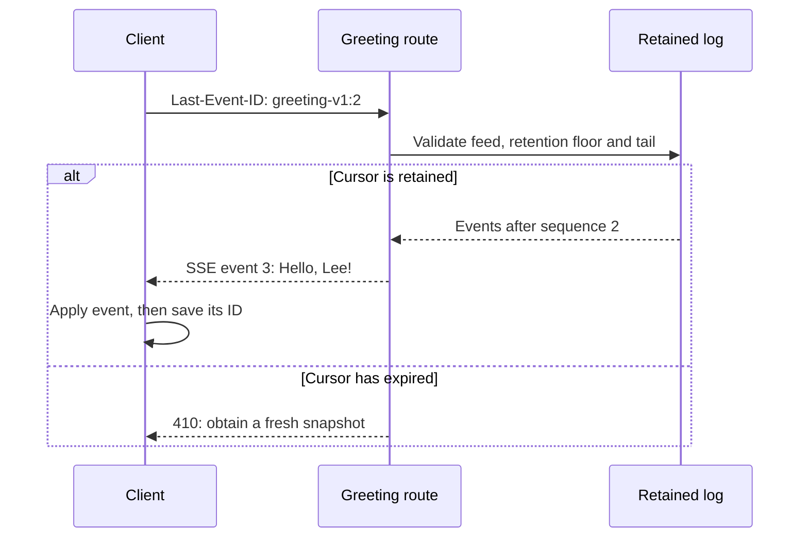

# Stream greetings and resume a retained event feed

A single JSON response is useful when all results are ready together. A stream lets the caller receive one result while
later results are still being produced. This matters for generated text, long searches and progress feeds: the reader can
start work early, and can stop work when it has enough. The HTTP route still returns one Response; its body is read over
time.

Keep the greeting application from the [HTTP introduction](./04-http.md). This time it returns three greeting records as
newline-delimited JSON (NDJSON), then exposes a retained feed using server-sent events (SSE). NDJSON puts one JSON value
on each line. SSE adds named events and IDs that an application can use when reconnecting. Neither format provides
persistent storage or exactly-once work.

From the Utils checkout, review `mise.toml`, run `mise trust`, `mise install`, and `mise run prepare -- --kind deps`. Save the next
two files together at the Utils checkout root. Run `mise exec -- deno run greeting-streams-check.ts`; no listener or network is required.

## Let the reader control how much it consumes

Save `greeting-streams.ts`. An async generator is a function that can yield several values over time. Its `finally`
block releases the work it owns when iteration finishes or is closed. `streams.readable()` adapts that generator to a
Web stream. `jsonl()` serializes bounded finite JSON into a native Response and tracks its body outcome separately from
source cleanup.

```ts support=greeting-streams.ts
import * as http from '@okikio/server/http';
import * as events from '@okikio/http/events';
import { jsonl, jsonlCompletion } from '@okikio/http/response';
import * as streams from '@okikio/streams';

// Immutable fixture: the retained feed contains sequence numbers 2 and 3.
// Sequence 1 has expired. A real application must persist its log and epoch.
const retained = [
	{ sequence: 2, name: 'Jo' },
	{ sequence: 3, name: 'Lee' },
];
/** Own one app instance and its per-response completion observations. */
export function createGreetingStreams() {
	let closed = 0;
	const deliveries = new WeakMap<Response, Promise<string>>();
	/** Yield application records; finally marks this generator's owned work as closed. */
	async function* greetings() {
		try {
			for (const name of ['Sam', 'Jo', 'Lee']) {
				yield { message: `Hello, ${name}!` };
			}
		} finally {
			closed += 1;
		}
	}

	// The routes adapt application records into two different wire formats.
	const app = http.create({
		routes: [
			// NDJSON has one JSON value per line; body completion and source cleanup are separate.
			http.route('GET', '/greeting/lines', (request) => {
				const response = jsonl(streams.readable(greetings()), {
					maximumBytes: 1024,
					maximumRecordBytes: 256,
					maximumItems: 3,
					projection: { maximumDepth: 3, maximumNodes: 10, maximumStringCodeUnits: 80 },
					signal: request.signal,
				});
				// Observe the exact factory Response before any middleware replaces its identity.
				deliveries.set(
					response,
					jsonlCompletion(response).then(async (outcome) => {
						await outcome.cleanup;
						return outcome.outcome;
					}),
				);
				return response;
			}),

			// SSE adds event IDs so an application can ask for a later retained sequence.
			http.route('GET', '/greeting/events', (request) => {
				// Decide whether replay is possible before sending 200 or acquiring a source reader.
				const raw = request.headers.get('last-event-id');
				let after = 1; // No cursor: start with currently retained events, not full history.
				if (raw !== null) {
					const match = /^greeting-v1:(0|[1-9][0-9]*)$/.exec(raw);
					if (!match) return Response.json({ error: 'Invalid greeting cursor.' }, { status: 400 });
					after = Number(match[1]);
					if (!Number.isSafeInteger(after) || after > 3) {
						return Response.json({ error: 'Unknown future cursor.' }, { status: 400 });
					}
					if (after < 1) return Response.json({ error: 'History expired; obtain a fresh snapshot.' }, { status: 410 });
				}
				const source = streams.readable(
					retained.filter((item) => item.sequence > after).map((item) => ({
						id: `greeting-v1:${item.sequence}`,
						event: 'greeting',
						data: JSON.stringify({ message: `Hello, ${item.name}!` }),
					})),
				);
				return new Response(
					streams.readable(events.write(source, {
						maximumBytes: 1024,
						maximumEventBytes: 256,
						maximumEvents: 2,
						signal: request.signal,
					})),
					{ headers: { 'content-type': 'text/event-stream', 'cache-control': 'no-store' } },
				);
			}),
		],
	});

	// Keep observations on the exact Response identities created by the NDJSON factory.
	return { app, completion: (response: Response) => deliveries.get(response), closed: () => closed };
}
```

The helper contains four roles: the retained SSE fixture, the NDJSON record generator, the two route adapters, and the
returned body-completion lookup. The fixture is immutable application data; the routes own each new stream. The lookup
observes the exact NDJSON Response rather than treating a wrapper with a new identity as the same factory result.

The NDJSON route limits each serialized record, the total output and the number of items. The projection limits bound
how much JSON structure and string data the serializer traverses per item. Validate business meaning upstream; these
serialization limits do not establish that a generated answer is correct or safe.

The SSE route owns a small, immutable log. Sequence 1 has expired; sequences 2 and 3 remain. A cursor names both the
feed version and the last event the caller processed. The server validates that cursor before creating a streaming body.
For a fresh connection without a cursor, this policy sends currently retained events only.

## Read fully, stop early, then reconnect

Save `greeting-streams-check.ts`:

```ts runnable=greeting-streams-check.ts
import { createGreetingStreams } from './greeting-streams.ts';
import * as events from '@okikio/http/events';
const { app, completion, closed } = createGreetingStreams();
const lines = await app.fetch(new Request('http://localhost/greeting/lines'));
console.log((await lines.text()).trim());
console.log('body', await completion(lines), 'closed', closed());
const partial = await app.fetch(new Request('http://localhost/greeting/lines'));
// Reading one chunk does not finish the response. Cancel explicitly when the consumer has enough.
const reader = partial.body!.getReader();
console.log('first', new TextDecoder().decode((await reader.read()).value).trim());
await reader.cancel('Reader has enough.');
// Release the reader lock after cancellation; the body completion receipt below reports producer cleanup.
reader.releaseLock();
console.log('body', await completion(partial), 'closed', closed());

/** Read one finite replay. The caller supplies the cursor it has already applied. */
async function replay(cursor: string) {
	const response = await app.fetch(
		new Request('http://localhost/greeting/events', { headers: { 'last-event-id': cursor } }),
	);
	if (!response.ok) {
		console.log(cursor, response.status);
		await response.body?.cancel();
		return;
	}
	for await (
		const event of events.read(response.body!, {
			maximumBytes: 1024,
			maximumChunkBytes: 1024,
			maximumEventBytes: 256,
			maximumEvents: 2,
		})
	) console.log(event.id, JSON.parse(event.data!).message);
}
await replay('greeting-v1:1');
await replay('greeting-v1:2');
await replay('greeting-v1:0');
await replay('greeting-v1:4');
await replay('other-feed:2');
```

It prints:

```text output
{"message":"Hello, Sam!"}
{"message":"Hello, Jo!"}
{"message":"Hello, Lee!"}
body completed closed 1
first {"message":"Hello, Sam!"}
body cancelled closed 2
greeting-v1:2 Hello, Jo!
greeting-v1:3 Hello, Lee!
greeting-v1:3 Hello, Lee!
greeting-v1:0 410
greeting-v1:4 400
other-feed:2 400
```

The first read reaches the end. The second cancels after the first record; the generator closes and its cleanup is
joined before the check prints `closed 2`. Pull-driven adapters can buffer ahead, so cancellation does not prove that
only one source value was ever produced. A real provider must also observe cancellation in any pending I/O; closing a
generator cannot interrupt an arbitrary Promise that never settles.

The reconnect calls show two different readers. One resumes after event 1 and gets Jo and Lee. Another resumes after
event 2 and gets Lee. Seeing Lee twice across those calls is expected. The client must save its cursor after applying an
event and make repeated application safe when a connection breaks between applying an event and saving its cursor.



The cursor belongs to the reader's completed application work. Advancing a server iterator or enqueueing bytes is not
an acknowledgement from that reader.

`events.read()` parses wire messages; it does not start a reconnect loop or retain a browser's last-event-ID state.
Comments and ID-only messages can also appear. The finite check produces only data-bearing greeting events. A general
consumer must handle the event forms it permits and persist its own cursor. The browser's `EventSource` has its own
reconnection behavior; custom Fetch clients must implement theirs explicitly.

## Make the production boundary explicit

| Concern | What this program demonstrates | What a live system must own |
| --- | --- | --- |
| Slow reader | Pull-driven reads and bounded serialization | Concurrent connection limits, provider buffers and deadlines |
| Cancellation | Early reader cancellation and generator cleanup | Cancelling upstream model/network/database work and joining its cleanup |
| Completion | Body completed, cancelled or errored; cleanup can settle later | Bounded telemetry export and a shutdown owner that joins outstanding work |
| Resume | Feed-scoped IDs, retained records and explicit expired/future-cursor rejection | Durable ordered storage, retention, authorization and a fresh-snapshot route |
| Replay into live traffic | Finite replay from an immutable fixture | An atomic replay-to-live handoff that cannot miss events or enqueue them without a bound |
| Authentication | None; local greeting data is public | Authenticate each connection and authorize its feed before sending or replaying data |

Do not reuse `greeting-v1` after replacing its data with unrelated events. Persist a feed epoch with durable records or
invalidate old cursors explicitly. Do not acknowledge an event ID before it is durably appended. This guide does not
implement a live subscription, heartbeat timer or snapshot endpoint; those need a separate owner and bounded lifetime.

Once headers have been sent, a later serialization or upstream failure errors the body. An outer `catchErrors()` cannot
replace an already-started 200 with a new JSON error response. The client must treat an interrupted body as incomplete.
`jsonlCompletion()` distinguishes that failure from cancellation, and its `bytes` count means bytes enqueued locally,
not bytes acknowledged by a remote client. It recognizes only the original Response created by `jsonl()`; record it
before header-changing middleware wraps that response.

For streaming admission and cleanup contracts, see [HTTP response](../../packages/http/response/README.md),
[HTTP events](../../packages/http/README.md#choose-an-entry-point) and [Streams](../streams.md). For exposing a tool to an AI client, continue with
[MCP](./11-mcp.md); generic SSE cursors are not automatically an MCP transport-resume feature.


## Recover the same feed after the HTTP process dies

The finite example above teaches the protocol without a database. The repository also has a real PostgreSQL/TCP
checks of the same greeting feed in [streaming.test.ts](../../tests/workflows/streaming.test.ts), with its
[separate HTTP host](../../tests/workflows/scenarios/streaming.ts). The database outlives that host. The test kills the
host with SIGKILL while its HTTP connection is still reading, checks that the old body fails, commits a new greeting
while the host is dead, starts a fresh process and reconnects with the last applied ID.

```mermaid
sequenceDiagram
    participant Writer
    participant DB as PostgreSQL feed
    participant Host as HTTP host
    participant Client
    Writer->>DB: Lock feed row, allocate sequence and append in one transaction
    DB-->>Host: Read committed rows after cursor, at most 2 per query
    Host-->>Client: Greeting event 2
    Client->>Client: Apply event 2; retain cursor
    Note over Host: Process is killed
    Writer->>DB: Commit greeting event 3
    Note over Host: Fresh process starts with database URL and feed ID
    Client->>Host: Reconnect after event 2
    Host->>DB: Read rows after 2
    Host-->>Client: Greeting event 3
```

Both historical and newly committed events come from one ordered SQL log. There is no separate switch from a replay
query to a volatile subscription where an event could disappear. The writer allocates sequence numbers under the feed
row lock in the append transaction. A rolled-back append does not consume the accepted sequence. A bare auto-increment
ID would not alone establish commit order: a slower transaction could commit an earlier ID after a reader advanced.
This is application-owned storage in a test fixture, not a new durable-feed API supplied by `events.write()`.

Use a disposable PostgreSQL database, never application data. From the checkout:

```sh
# Replace this URL with a disposable database you created for test.
export UTILS_TEST_DATABASE_URL=postgres://localhost/utils_test
mise run test -- --suite postgres tests/workflows/streaming.test.ts
```

The runner maps that explicit URL to the suite and the suite owns an isolated application schema. It tears down its
child processes and schema. The database service remains the caller's responsibility.

The two checks cover rollback, replay reaching the live tail before a new append, disconnect cleanup, actual host death,
fresh-process replay, expired/future/foreign cursors and a failure after 200 headers. Each SQL read holds at most two
rows; a connection may emit at most 16 events, 8,192 bytes total and 512 bytes per event. Reconnecting from an earlier
client cursor deliberately redelivers events even if the old host had already read them. Apply events idempotently.

These checks ran successfully against PostgreSQL 18.3 over loopback. They do not measure retained heap, concurrent
writer pressure, proxy buffering, database failover or production connection capacity. Retention is changed only
between connections in this fixture; coordinating pruning with an active reader still needs application test.
A database query already in flight must settle before this source can finish; the request signal is not a PostgreSQL
query-cancellation protocol.


## Check slow readers and the deployed forwarding path

The [load and recovery drills](../maintenance/07-recovery.md) extend this example's evidence with a separate
synthetic workload. They check 1, 4 and 8 readers, delayed consumption, eight stalled sockets, admission refusal,
sampled memory and slot release. A real nginx → Utils gateway → HTTP origin test distinguishes first-event delivery
from buffering, expires a silent stream, keeps a heartbeat stream alive and follows caller cancellation to the source.
The database drill separately promotes a physical standby and checks saved snapshots, queue fencing and workflow receipts.

These checks do not turn the finite greeting log above into a durable service. The database drill uses Postgres.js
4.0.0 and verifies same-process recovery: interrupted queries reject, the existing pool reconnects, and old transaction
callbacks cannot write into a replacement transaction. That does not decide whether a write committed when its reply
was lost. Read the workload, operator steps, driver migration instructions and remaining limits before applying the
results to your deployment.

The [continuous-write and lost-COMMIT-reply drills](../maintenance/07-recovery.md#keep-writes-running-while-the-primary-is-unavailable)
keep guarded writes active during promotion and verify that a rejected write can already have a committed receipt.
Use `target_session_attrs: 'primary'` for the tested Postgres.js 4.0.0 topology; its `read-write` selection can admit
an unpromoted standby. Reconcile the original receipt identity under a current claim before repeating a SQL write.
The finite load cases do not establish a production capacity or multi-hour availability target.
