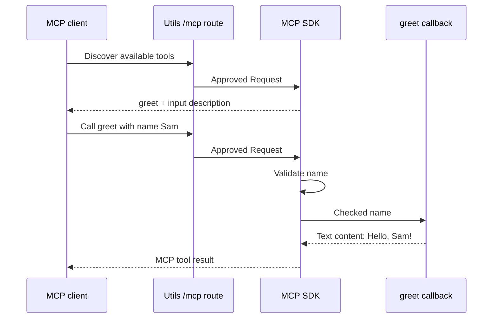

# Let an AI application discover and call the greeting

The [HTTP greeting](./04-http.md) receives a name and returns `Hello, Sam!`. An AI application needs a little more:
it must discover which operations exist, learn their input rules, and call the chosen operation. Model Context Protocol
(MCP) defines that conversation. A **tool** is an operation that an MCP client can discover and call.

Keep the same greeting. We will expose it as a tool named `greet`, then use an actual MCP client to discover and call it.
You do not need a model or an AI application to run this check. The client and server talk through a loopback HTTP listener,
so you can inspect every result without connecting to an external service.

If you want to try it first, use the runtime table below and expect `Hello, Sam!`.
Then return to the diagram to see which part performed each step.

Think of a chat application asked to “greet Sam.” The model can suggest a tool call;
it does not open a socket itself. The **host** is that application. Its **client**
asks this **server** which tools exist, supplies their descriptions to the model,
and sends an approved call. The host decides whether to ask the person for permission.
Our check replaces the model and host UI with ordinary JavaScript calls, so the
server behavior can be tested without buying model access.

`registerTool()` gives the server a name, input rules, description and callback.
Discovery advertises that contract; it does not run the callback. A call supplies
arguments such as `{ name: 'Sam' }`, and the server returns content for the host
to show or send back to the model. Two MCP servers do not automatically connect
to each other: a host can run a client for each server it wants to use.
See the [MCP architecture](https://modelcontextprotocol.io/docs/2026-07-28/learn/architecture)
for the other primitives, resources and prompts.

| Familiar HTTP concept | Its role in this example |
| --- | --- |
| A request handler | Utils receives `/mcp` requests and passes approved requests to the MCP SDK. |
| Input validation | Schema describes a text name of 1–80 characters. The SDK checks it before calling the tool. |
| Application function | The `greet` callback creates the message. It does not parse protocol messages. |
| Response formatting | The SDK writes MCP replies, including text content and tool errors. |
| A caller using Fetch | The SDK client discovers tools and builds protocol requests through its transport. |

The sequence below shows one successful call after discovery. The SDK owns the protocol conversation; the outer route
owns HTTP admission. Progress notifications and long-running work are omitted from this small task.



## Choose a runtime and keep the files together

The tested program lives in [examples/mcp](../../examples/mcp/README.md). Clone this repository and run
`mise run prepare -- --kind deps` at its root, then open `examples/mcp`. The example pins MCP SDK **2.4.0**;
it does not use the older `@modelcontextprotocol/sdk` import paths. This source checkout supplies the
unreleased Utils workspace packages. When copying the files into an application, install your chosen
published Utils version and the pinned SDK there instead of copying workspace dependency ranges.

```text
mcp/
├── package.json   # Dependencies; the checkout uses workspace Utils packages.
├── server.ts      # Fetch application and the greet tool.
├── listen.ts      # HTTP listener and stream cleanup.
├── start.ts       # Operator entrypoint; Ctrl+C requests shutdown.
└── check.ts       # Real client: discovery, calls, input rejection and cleanup.
```

Keep the relative imports between these files. Their parent directory is your choice.
From that directory, select one command column:

| Task | Deno | Node | Bun |
| --- | --- | --- | --- |
| Verify the complete workflow | `deno run --frozen --allow-net=localhost,127.0.0.1 check.ts` | `node check.ts` | `bun check.ts` |
| Start the listener | `deno run --frozen --allow-net=localhost:8000,127.0.0.1:8000 start.ts` | `node start.ts` | `bun start.ts` |

The checkout pins Deno 2.9.7, Node 26.10.0, and Bun 1.4.2. The listener uses native `Deno.serve` on Deno and Node's HTTP stream API on Node/Bun;
the application itself receives the same Web Requests.
No model, credentials, or external AI service is needed for verification.

## Keep library versions separate from protocol versions

“SDK v1” and “SDK v2” name TypeScript library APIs. Protocol versions are dated
message contracts, such as `2025-11-25` and `2026-07-28`. The `version: '1.0.0'`
on our greeting server identifies this example application; it is neither of those.

This example installs SDK 2.4.0. Its client uses automatic protocol-version selection.
An older client's requirements can include both older messages and a different
transport. An old HTTP+SSE endpoint is not the same endpoint as Streamable HTTP.
Do not install two SDK majors or add an untested fallback merely because a client
is called “v1.” Identify its protocol and transport, then run that client against
the server. This example has no old HTTP+SSE endpoint.

Use the SDK's [v1-to-v2 migration](https://ts.sdk.modelcontextprotocol.io/v2/migration/upgrade-to-v2),
[protocol version selection](https://ts.sdk.modelcontextprotocol.io/v2/protocol-versions.html)
and [older-client guide](https://ts.sdk.modelcontextprotocol.io/v2/serving/legacy-clients.html)
when an actual client needs that support. Those pages describe the SDK; the commands
on this page test the pinned example, not every client/version combination.

## Give the SDK one checked greeting operation

Read `server.ts`. `createMcpHandler()` supplies a Fetch-compatible SDK handler. Its factory registers the
tool on a fresh `McpServer`. The tool's input schema and callback describe what the application can do. They do not own
HTTP routing, listeners or user credentials.

```ts source=../../examples/mcp/server.ts
import {
	createMcpHandler,
	hostHeaderValidationResponse,
	McpServer,
	originValidationResponse,
} from '@modelcontextprotocol/server';
import * as schema from '@okikio/schema';
import * as http from '@okikio/server/http';

/**
 * Create a local HTTP application that exposes one MCP tool.
 * The caller owns the returned close() operation. Creating this application
 * does not open a network port or authenticate a user.
 */
export function createGreetingMcp() {
	// The SDK creates a fresh protocol server for each HTTP request.
	// Keep durable application state in a separate owner, not this callback.
	const mcp = createMcpHandler(() => {
		const server = new McpServer({ name: 'greetings', version: '1.0.0' });
		// Registration advertises this operation during discovery. Only a call runs
		// the callback; the description helps a client decide when to offer it.
		server.registerTool('greet', {
			description: 'Greet one person.',
			inputSchema: schema.object({ name: schema.string({ minLength: 1, maxLength: 80 }) }),
		}, async ({ name }) => {
			// The SDK checked name before entering this function. Tool replies use
			// protocol content blocks; the SDK turns them into the HTTP response.
			return { content: [{ type: 'text', text: `Hello, ${name}!` }] };
		});
		return server;
	});

	const app = http.create({
		routes: [
			http.mount('/mcp', async (request) => {
				// Refuse unapproved hostnames before the SDK reads a protocol message.
				// These development guards are separate from user authentication.
				const rejected = hostHeaderValidationResponse(request, ['localhost']) ??
					originValidationResponse(request, ['localhost']);
				return rejected ?? mcp.fetch(request);
			}, { requestPath: 'strip-prefix' }),
		],
	});
	return { app, close: () => mcp.close() };
}
```

Follow one request into the function. Utils matches `/mcp`, strips that prefix for the child handler and preserves the
method, headers, query, body and signal. The hostname guards can return a refusal immediately. Otherwise `mcp.fetch()`
lets the SDK interpret the message. On a tool call, the SDK validates `name`, invokes the callback, and serializes its
content blocks. Returning a content block is different from returning an ordinary `Response.json()` value.

The hostname helpers accept missing Origin and match the hostname rather than an exact scheme/host/port combination.
They are suitable for this local demonstration, not an exact browser-origin allowlist. They do not authenticate a person
or authorize private data. A real host must supply verified authentication and per-tool authorization. A user ID in a
tool argument is still untrusted input.

## Discover the tool, call it, then try the rejection paths

Save `check.ts`. A **transport** carries protocol messages between client and server. Here the SDK's
Streamable HTTP transport builds real protocol requests and sends them to the loopback listener.
`client.connect()` establishes the protocol conversation before discovery or tool calls.

```ts source=../../examples/mcp/check.ts
/** Discover and call a real tool without a model; assert failures and close every owned connection. @module */
import { Client, StreamableHTTPClientTransport } from '@modelcontextprotocol/client';
import { createGreetingMcp } from './server.ts';
import { listen } from './listen.ts';
import { strict as assert } from 'node:assert';

const host = createGreetingMcp();
const socket = await listen(0);
const client = new Client({ name: 'greeting-check', version: '1.0.0' }, { versionNegotiation: { mode: 'auto' } });
try {
	// Use the actual SDK transport over a real loopback connection.
	// The network client supplies Host; the outer route checks it before MCP.
	await client.connect(
		new StreamableHTTPClientTransport(socket.url),
	);

	// Discovery tells a client which tools exist; calling one is a separate step.
	const names = (await client.listTools()).tools.map((tool) => tool.name);
	assert.deepEqual(names, ['greet']);
	console.log(JSON.stringify(names));
	const greeting = await client.callTool({ name: 'greet', arguments: { name: 'Sam' } });
	assert.deepEqual(greeting.content, [{ type: 'text', text: 'Hello, Sam!' }]);
	console.log(JSON.stringify(greeting.content));
	const invalid = await client.callTool({ name: 'greet', arguments: { name: '' } });
	assert.equal(invalid.isError, true);
	console.log('invalid', invalid.isError);

	// Exercise the outer HTTP policy independently of valid protocol input.
	const badHost = await host.app.fetch(
		new Request('http://localhost/mcp', {
			method: 'POST',
			headers: { host: 'attacker.invalid' },
		}),
	);
	const badOrigin = await host.app.fetch(
		new Request('http://localhost/mcp', {
			method: 'POST',
			headers: { host: 'localhost', origin: 'https://attacker.invalid' },
		}),
	);
	assert.equal(badHost.status, 403);
	assert.equal(badOrigin.status, 403);
	console.log('blocked', badHost.status, badOrigin.status);
	await badHost.body?.cancel();
	await badOrigin.body?.cancel();
} finally {
	// Each side owns resources. Closing the server must still be attempted if
	// closing the client rejects, so the two cleanup operations are nested.
	try {
		await client.close();
	} finally {
		try {
			await host.close();
		} finally {
			await socket.close();
		}
	}
}
```

Use the runtime command above. For an additional Deno type check, run `deno check server.ts listen.ts check.ts`.
The check opens an OS-selected loopback port, uses the real SDK client over HTTP, asserts every expected
result, and closes both the client and listener. A failed assertion exits unsuccessfully.

Expected output:

```text
["greet"]
[{"type":"text","text":"Hello, Sam!"}]
invalid true
blocked 403 403
```

The first line proves discovery. The second is the tool's protocol content. `invalid true` shows that an empty name did
not produce a successful greeting. The final two 403 responses come from HTTP admission, before the SDK parses a tool
request. These are different failure owners; a tool error is not automatically an HTTP 4xx status.

The client, host, and listener close in `finally`, including when a call fails. The nested cleanup still attempts host closure if
client closure fails. Neither side should be left alive because the success path was the only path tested.

## Let another application connect

Run `start.ts` with the command for your runtime, then point a compatible MCP client at
`http://localhost:8000/mcp`. Press Ctrl+C to stop admission and close protocol resources.
[listen.ts](../../examples/mcp/listen.ts) converts Node HTTP input to a Web Request and streams
the response with backpressure. [start.ts](../../examples/mcp/start.ts) owns signal handling.
An operating-system kill can still skip cleanup. Deployment needs TLS, authentication,
accepted host/origin policy, bounded bodies, connection limits and bounded tool execution.
The mount does not supply those policies.

## Protect private tools before they run

The example is intentionally public and loopback-only. Host and Origin checks stop
some unwanted HTTP callers; they do not prove who a caller is. **Authentication**
establishes identity. **Authorization** decides whether that identity may perform
this tool on this record. A well-formed argument is still not permission.

For a private deployment, put token verification before `mcp.fetch()`. Verify an
access token issued for this service, then check its scopes and the requested
resource in the tool's application logic. Do not treat a user-supplied account ID
as the verified account. OAuth resource metadata tells clients where authorization
is available; it does not make this greeting server an identity provider. Use the
SDK's [authorization recipe](https://ts.sdk.modelcontextprotocol.io/v2/serving/authorization.html)
with your identity provider rather than inventing a token format here.

```text
HTTP request -> Host/Origin policy -> verified identity -> tool/resource permission
                                                        -> application operation
```

A denial must happen before a private read or write. A reconnect is another
request and must pass the required checks again. A proxy must preserve the
headers the SDK needs and must not forward credentials to unrelated services.
The example tests host/origin denials, not a deployed OAuth flow.

## Understand what streams during a tool call

Ordinary HTTP can return one JSON document. A Streamable HTTP response can instead
carry SSE messages over time. SSE is text framing inside an HTTP body, not a
WebSocket. The SDK parses those messages; a tool callback still returns its final
content result. Progress messages report work before completion. They are not
necessarily text tokens and are not proof that a write succeeded.

```text
call greet -> validate arguments -> run callback -> final tool content
long call  -> validate arguments -> progress -> progress -> final tool content
```

The greeting is too short to need progress. For a longer tool, the SDK's
[progress and cancellation API](https://ts.sdk.modelcontextprotocol.io/v2/servers/logging-progress-cancellation.html)
explains the request token and callback context. Pass cancellation into the actual
work and await cleanup. Choosing streaming on a transport does not make a callback
emit progress automatically, and choosing a JSON-only response can omit intermediate
notifications. Test the selected response mode with the intended client.

## Add longer work without confusing delivery and durability

The SDK factory makes a new protocol server for each request. Keep durable application state under a separate owner.
For long operations, follow the pinned SDK's progress and cancellation contracts, pass cancellation into cooperating
upstream work, and decide who owns a job after its caller disconnects. An interrupted connection cannot roll back an
external write that already committed.

If the job must survive the client, use [Workflow](../workflows/README.md) and return an application-owned job identity.
[Telemetry](../telemetry/01-guide.md) can observe the tool, but it does not own the job's terminal result. Retain bounded
safe diagnostics rather than prompts, credentials or whole Requests.

The [SSE replay workflow](./10-http-streaming.md) is an application event feed. Its cursor convention does not establish
MCP transport resume, sessions or reconnect support. Test the actual SDK/protocol/client versions before promising
those capabilities. This program checks discovery, calls, schema rejection, admission and cleanup. It does not by itself
test an external AI application, multi-replica execution or durable recovery.
