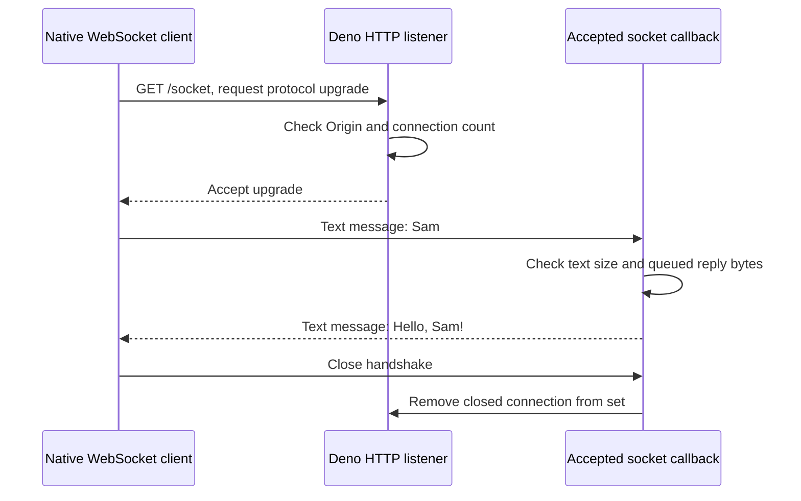

# Keep a two-way conversation open

Suppose a page sends a name whenever a person edits a field and wants a greeting
back without opening a new request each time. A WebSocket carries those messages
in both directions over one connection. It is a delivery channel, not a saved job
or a database. If the connection disappears, your application decides which
messages to repeat and how to recognize a duplicate.

If you just want to try it, run the [complete greeting example](../../examples/websocket/README.md).
It supplies a Deno host and a native client that runs on Deno, Node and Bun.
The host answers `/status` through the Utils HTTP router and upgrades `/socket`
with Deno's native API. These are separate responsibilities.

## Follow one name from the client to the server

The first exchange is still HTTP. The client asks to upgrade; the host can refuse
before switching. After a successful switch, the connection carries WebSocket
messages instead of ordinary route responses. Read this diagram from top to bottom;
it shows one text reply and a normal close, not reconnect or authentication.

In `client.ts`, the `open` event means the switch succeeded. Only then does the
client call `send('Sam')`. `send()` queues output; it does not wait for a server
operation to finish. The `message` event carries the application's reply. The
client waits for that reply and then waits for closure in `finally`, including
when the reply fails or times out. `await` yields JavaScript execution while the
network waits; it does not create another CPU thread.

In `server.ts`, the HTTP listener checks the URL first. `/status` goes to
`app.fetch(request)`. `/socket` asks Deno to upgrade and returns the special
response from `Deno.upgradeWebSocket()`. This response contains native connection
state. An ordinary `new Response(..., { status: 101 })` cannot replace it.
Generic Fetch forwarding does not transfer an upgraded socket to another host.
A Node or Bun server needs that host's upgrade API or an explicit WebSocket
server library. See [Deno's WebSocket server API](https://docs.deno.com/runtime/fundamentals/http_server/#websocket-support).

## Decide what a message means

The example deliberately uses one text name and one text answer. A real
application needs message shapes and a rule for matching replies to requests.
For example, a `requestId` can correlate a reply; a saved operation ID can prevent
a duplicate write. Correlation and deduplication solve different problems.

| Requirement | Application decision |
| --- | --- |
| A single result | Use ordinary HTTP; a persistent socket adds ownership you may not need. |
| Server updates while the caller only listens | Consider [SSE](./10-http-streaming.md); define event IDs and retention before promising replay. |
| Two-way interaction | Define allowed message types, validation, ordering and reply IDs. |
| Reconnect after a disconnect | Decide which work survives, which messages can repeat and where replay records live. |
| Private data | Authenticate at admission, then authorize each operation and recheck long-lived access as policy requires. |

The example permits no Origin header for command-line clients and one exact
browser origin for local development. Origin is the web page's origin, not the
WebSocket destination. It is not identity and must not substitute for login or
record permissions. Do not expose this development listener as a private service.

## Bound the connection and the work it owns

The host accepts at most two sockets. Each socket can submit only a short text
name, and the host closes a socket whose queued reply bytes have grown too far.
`bufferedAmount` measures locally queued output, not remote acknowledgement.
These checks do not prove transport-level incoming memory bounds: the native API
has already delivered a message before the application checks its size.

For an expensive async callback, also limit active operations and queued input.
An `async` listener can start work on a new message while an earlier message
is waiting for a file or network response. If you need a limit, count the work
already running. When the limit is reached, decide whether to reject the new
message or pause until there is room. A CPU-heavy synchronous loop still blocks that JavaScript
thread; [Worker](../../packages/worker/thread/README.md) supplies a separate runtime.

Shutdown closes every accepted socket before awaiting listener shutdown. A
remote peer or failed network can delay a close handshake. A production host
needs its own bounded drain policy, heartbeat/liveness policy, idle timeout and
abrupt-disconnect tests. Closing a socket cannot undo an external write that has
already committed. Use [resource sessions](../workflows/18-sessions.md) when
several messages must reuse a live object on one physical owner, and
[Workflow](../workflows/README.md) when accepted work must survive the connection.
