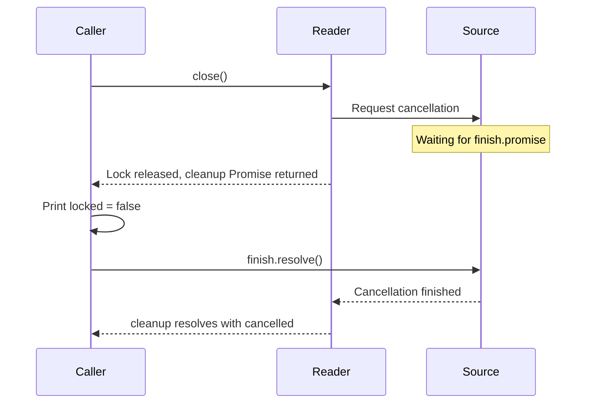

# Pass bounded data while respecting the reader

A log export arrives in chunks while its destination accepts one batch at a time. The reader must reconstruct lines
across chunk boundaries and wait for the destination before retaining more data. Streams supplies those small operations
so an ordinary async loop can connect them.

Streaming avoids whole-input materialization only when transforms also stay incremental. Each item and batch can still
be large; bound bytes as well as item counts where required.

A producer supplies values; a consumer asks for and uses them. Network chunks
are arbitrary pieces of bytes, not complete lines, characters or JSON records.
A decoder may need to hold an unfinished character or record until the next
chunk arrives. A limit must bound that unfinished piece too.

**Backpressure** means the consumer's pace controls requests for more data. In a
`for await` loop, awaiting the destination write before asking for the next value
keeps that part of the pipeline paced. Starting detached writes or appending
every value to an array defeats that benefit. A producer can still have its own
native buffers; a stream is not a promise of zero retained memory.

```text
request next -> decode one record -> await destination write -> request next
       producer buffers + unfinished record + current write remain owned
```

If the consumer stops early, close or cancel the reader under its ownership
policy. Cancelling a pending read can finish before the source's cleanup does;
join the separately exposed cleanup when your operation owns that obligation.

## Group records and read complete lines

Three records become two bounded groups. A separate byte stream becomes two text lines. These small inputs let you
inspect the returned values before introducing a network source or a destination that applies backpressure.

Run from this checkout after `mise run prepare -- --kind deps`. Save the runnable block as `example.ts` at the checkout root and use
`mise exec -- deno run example.ts`.

```ts runnable=package-task.ts
import * as streams from '@okikio/streams';

// Materializing is deliberate here: these fixtures contain only three records.
// Limit each batch, not the total source. This tiny source is safe to collect for display.
const batches = streams.batch(['a', 'b', 'c'], { maximumItems: 2 });
console.log(JSON.stringify(await Array.fromAsync(batches)));

// Line framing handles byte chunks, which need not arrive on newline boundaries.
const bytes = new Response(`first
second
`).body!;
console.log(JSON.stringify(await Array.fromAsync(streams.lines(bytes, { maximumLineBytes: 64 }))));
```

Expected output:

```text output
[["a","b"],["c"]]
["first","second"]
```

## Batch without materializing the source

`batch()` retains only the current bounded group. At least one of `maximumItems` or `maximumBytes` is required. When
byte limits matter, provide a `size(value)` function so the utility can enforce the same unit you care about. Here each
name is destined for a UTF-8 text payload, so encoded bytes, rather than JavaScript character count, determine the
group.

```ts runnable=payload-batches.ts
import { batch } from '@okikio/streams';

const names = ['Ada', 'Zoë', 'Grace'];
const encoder = new TextEncoder();
for await (
	const group of batch(names, {
		maximumItems: 2,
		maximumBytes: 8,
		size: (name) => encoder.encode(name).byteLength,
	})
) {
	console.log(JSON.stringify(group));
}
```

```text output
["Ada","Zoë"]
["Grace"]
```

The estimate above excludes separators and transport headers. Include those in your size policy if the destination's
limit counts them. A single item larger than the byte bound throws rather than entering an oversized group.

Use `collect()` only when the caller intentionally wants a finite source in memory and can supply explicit limits. The
manual equivalent is an ordinary `for await` loop that tracks the same counters before retaining each value.

## Import chunked logs and stop after one batch

Save as `log-import.ts` and run `mise exec -- deno run log-import.ts` after the setup above.
The producer intentionally splits a UTF-8 character and a JSON record across chunks. The consumer saves one bounded
batch, then stops; this demonstrates early cancellation rather than pretending the complete log was accepted.

```ts runnable=log-import.ts
import * as streams from '@okikio/streams';
import * as json from '@okikio/streams/json';

const bytes = new TextEncoder().encode('{"name":"Zoë"}\n{"name":"Ada"}\n{"name":"Lin"}\n');
/** Next unread byte. Three-byte chunks deliberately split the UTF-8 and JSON input. */
let offset = 0;
/** Records cancellation of the unread remainder after the consumer stops early. */
let cancelled = false;
const source = new ReadableStream<Uint8Array>({
	pull(controller) {
		if (offset === bytes.length) {
			controller.close();
			return;
		}
		const end = Math.min(offset + 3, bytes.length);
		controller.enqueue(bytes.slice(offset, end));
		offset = end;
	},
	cancel() {
		cancelled = true;
	},
}, { highWaterMark: 0 }); // Do not prefetch another chunk while the consumer saves a batch.

const saved: string[] = [];
/** Validate each parsed value before retaining names in this finite, in-memory demonstration. */
async function saveBatch(records: readonly unknown[]): Promise<void> {
	for (const value of records) {
		if (typeof value !== 'object' || value === null || !('name' in value) || typeof value.name !== 'string') {
			throw new Error('Log record needs a name.');
		}
		saved.push(value.name);
	}
}

// Pull only the next bounded batch; saving it finishes before asking for another.
for await (
	const group of streams.batch(
		json.lines(source, {
			maximumBytes: 256,
			maximumLineBytes: 64,
			maximumItems: 3,
		}),
		{ maximumItems: 2 },
	)
) {
	await saveBatch(group);
	break;
}
console.log(saved.join(','));
console.log('Reader released:', !source.locked, 'Cancellation requested:', cancelled);
```

```text output
Zoë,Ada
Reader released: true Cancellation requested: true
```

`json.lines()` bounds original bytes, each line, and the number of records. JSON syntax alone does not check your
application record, so `saveBatch()` validates `name` before saving it. `batch()` holds at most two records; the sink
must not retain all records in a real large import. The local array makes this small output visible. `break` closes the
iterator chain and requests source cancellation. It is not successful end of input (EOF): later malformed lines were never checked.

Remove `break` to read all three records. Lower `maximumLineBytes` below the first line's byte size to see a bound
failure. Previously saved batches remain partial work if a later record fails. Use a staging table and a separate
publication step when the destination requires all-or-nothing visibility. An arbitrary producer may finish cancellation
later; the reader cleanup example below explains how to retain and join that eventual outcome.

## Release a reader promptly and join source cleanup separately

`@okikio/streams/reader` exposes the same reader owner used by bytes, lines, and format parsers. Its synchronous Dispose
stack releases the abort subscription and reader lock even if one release fails. Source cancellation has a separate
promise because a source or tee sibling can keep cancellation pending. `close()` always returns the same `cleanup`
promise; that promise resolves to an outcome and never rejects.

```ts runnable=reader-cleanup.ts
import { open } from '@okikio/streams/reader';
// Simulate a producer whose cancellation cannot finish until its own work is released.
const finish = Promise.withResolvers<void>();
const source = new ReadableStream<number>({ cancel: () => finish.promise });
const reader = open(source);

// close() releases our reader lock now, while retaining the producer's pending cleanup.
const cleanup = reader.close();
console.log(source.locked);

// The source owner finishes later. Only then can the cleanup outcome say cancelled.
finish.resolve();
console.log((await cleanup).status);
```

```text output
false
cancelled
```

The first print happens while source cancellation is still pending. The source is unlocked because the reader
has released its ownership, not because all producer work has stopped:



Choose `preventCancel: true` when the source remains borrowed; cleanup then reports `released`. At EOF it reports
`completed`. A late cancellation or local release failure reports `{ status: 'failed', error }`. When both fail, `error`
is a `SuppressedError` retaining the local release failure and the source cancellation failure. The outcome lets the
enclosing owner decide when to join the source without keeping its reader lock held.

## Ownership

This package does not own process lifecycle, retries, persistence, durable jobs, or domain-specific codecs.
`@okikio/worker/process` owns child process lifecycle. `@okikio/scheduler/queue` owns claimed work. Product-specific
durable representations belong in product packages.

## Bound failures

`StreamLimitError` reports a byte/item collection bound being exceeded. `StreamLineLimitError` reports one decoded line
exceeding the configured line limit. Both errors carry the relevant configured limit so a caller can produce a useful
diagnostic without inspecting stream internals.

The [public source](../packages/streams/mod.ts) lists every public function and type. These examples teach the common
paths and the design decisions behind those contracts.

## Bound byte and JSON input

`bytes(source, maximumBytes, signal)` materializes exact bytes within a budget. `lines` can also limit total original
bytes, individual line bytes and strict UTF-8 decoding. Cancellation releases the consumer reader without waiting
indefinitely for source cleanup; the producer owner remains responsible for eventual cleanup.

The optional `@okikio/streams/json` subpath provides `read`, incremental `lines`, `encode` and `write`. JSON Lines
parsing requires explicit total-byte, line-byte and item budgets. A later failure does not validate previously yielded
records as a complete manifest. Only successful EOF establishes complete input. JSON output borrows its writer and never
closes it; serialization can invoke trusted values' accessors or `toJSON`, and the output limit does not bound temporary
serialization allocation.

## Decide which bookkeeping to keep in your application

| Convenience                           | Manual equivalent                                                                                                       | Concrete value                                         |
| ------------------------------------- | ----------------------------------------------------------------------------------------------------------------------- | ------------------------------------------------------ |
| `streams.lines()`                     | read chunks, incrementally decode UTF-8, carry partial lines, enforce byte/line bounds, and release the reader yourself | correct line framing across arbitrary chunk splits     |
| `batch()` / `map()` / bounded helpers | write async-iterator loops with explicit buffers, concurrency, cancellation, and cleanup every time                     | small composable streaming mechanics with backpressure |

`@okikio/streams` is a convenience layer, not a hidden runtime. You can reproduce its core mechanics with ReadableStream
readers, async iterators, TextDecoder, and explicit byte counters.

The utility centralizes cancellation, line framing, bounded collection, batching, and conversion rules that are easy to
get subtly wrong.
