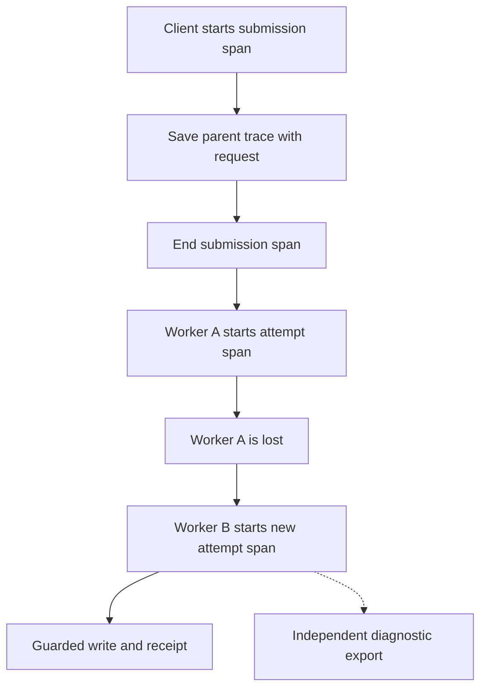

# Collect logs, traces, and metrics across a workflow

A customer submits an import. The service saves the request in PostgreSQL. A worker reads that request and writes rows.
If the worker dies, another worker reads the saved progress and continues.

PostgreSQL answers **what completed**. Telemetry answers **what happened while code ran**. A trace or log is not proof
that a write committed. A missing trace is not proof that it failed.

This adapter exports logs, traces and metrics. CPU and memory profiles answer a different question and require
separate runtime tools; the table below keeps that boundary visible.

| Signal   | Question                                             | Current support                                                          |
| -------- | ---------------------------------------------------- | ------------------------------------------------------------------------ |
| Logs     | What happened at a point in time?                    | Native LogTape logs exported through the collection's sink.              |
| Traces   | Which operations belong together? Where did time go? | Named utility operations and saved workflow trace identity.              |
| Metrics  | How does behavior change across many operations?     | Operation count, duration, active operations, and lifecycle event count. |
| Profiles | Which functions used CPU or allocated memory?        | Use runtime tools separately. This adapter starts no profiler.           |

## Start with application ownership

The Node adapter starts OpenTelemetry providers only when the application calls `open()`. A provider records and exports
one kind of signal. Importing a module installs no providers and starts no exporters.

The application supplies a service name and an OTLP HTTP base URL. OTLP is OpenTelemetry's export protocol. The adapter
appends `/v1/logs`, `/v1/traces`, and `/v1/metrics`. A collector receives those exports and forwards them to an
operator's storage and dashboards. This package does not supply Grafana, Datadog, storage, or alert rules.

The collection owns the SDK providers. LogTape borrows the returned sink. The application still calls LogTape's own
`configure()` and `reset()`. Read the complete [setup and shutdown example](./04-setup.md).

Only one collection can own the process at a time. Startup rejects a conflicting OpenTelemetry provider instead of
replacing it. An application with existing providers can use the portable instrumentation entry directly. It owns its
own setup and logging bridge in that case.

## Follow a request into a worker

1. `client.submit()` starts a short submission span. A span measures one operation and has a trace ID and its own span
   ID.
2. Admission saves that span's identity with the run. A trace ID groups related operations across processes.
3. Submission ends after the store accepts the request. No span stays active while the request waits in the queue.
4. A worker starts an attempt span from the saved parent identity. A replacement creates a different span under the same
   trace.
5. A guarded PostgreSQL transaction records its own duration. Reusing a saved receipt emits a lifecycle event.
6. The worker reports its result to PostgreSQL. That durable result controls recovery. Exported diagnostics have no
   authority over it.

The saved parent connects attempts even when the first worker disappears. Time spent waiting in the queue is not
represented by a span held open in a worker. The dashed export arrow below is deliberately separate from the
PostgreSQL receipt that recovery trusts:

A shared parent means these attempts belong to one trace; it does not make them the same attempt or give either one
permission to overwrite the other's work. The workflow store and its guarded writes decide that authority.

Saved identity contains only `{ version: 1, traceparent }`. It contains no baggage, application payload, credentials, or
vendor state. Invalid diagnostic data is discarded. Old rows with no identity remain valid. The additive `trace` column
is installed by the workflow migration. Run that migration before deploying this adapter against an older database.
Readiness rejects a database that has not installed the column. Older workers can ignore the column. This does not
change command identity or write permission.

A killed process cannot flush its buffers. Its last spans may be missing. A replacement can still continue the original
trace from PostgreSQL. A collector failure cannot repeat an activity or undo a write. Customer recovery remains the
workflow's responsibility.

This release does not automatically accept an incoming HTTP `traceparent` or wrap arbitrary outgoing HTTP/SQL clients.
That boundary needs an application trust policy. The server span begins within the service; workflow submission inherits
any trusted active context the application already established.

## Know what is measured

| Utility                   | Automatic operation       | Boundary                                                              |
| ------------------------- | ------------------------- | --------------------------------------------------------------------- |
| Workflow client           | `workflow.submit`         | Validation and store acceptance.                                      |
| Workflow worker           | `workflow.advance`        | One finite replay advance. Dormant waits end the span.                |
| Workflow worker           | `workflow.attempt`        | One attempt through result recording. A retry gets another span.      |
| PostgreSQL workflow store | `postgres.workflow.write` | Guarded receipt transaction, including commit.                        |
| Pool                      | `pool.acquire`            | Wait for acquisition. This is not the lifetime of the borrowed value. |
| Resource                  | `resource.acquire`        | Creation or acquisition of a resource value.                          |
| Server service            | `server.request`          | Through response availability. Streaming body lifetime is separate.   |

`utils.operation.count` counts completed operations. `utils.operation.duration` records seconds.
`utils.operation.active` records the reporting process's active operations. It is not shared queue depth.
`utils.event.count` counts fixed lifecycle facts such as retries, receipt reuse, and handled failures.

Metric labels contain fixed operation/event names and success/error outcomes. Customer, run, job, and attempt IDs belong
on spans and logs. They do not become metric labels. The package does not emit a span per CSV row or stream chunk.

Debug start/finish logs are optional under normal LogTape filtering. Disabling those logs does not disable operation
metrics or spans. Utility categories start with `utils`, followed by the operation's first two name segments. Ordinary
application logs use the categories the application chooses. Within an instrumented operation, the configured async
storage adds trace and operation fields. The OpenTelemetry sink attaches the active span's identity as well.

Application code still names business operations that utilities cannot infer. Use the configured OpenTelemetry APIs or
`@okikio/telemetry/instrument` to time such an operation. Use fixed names. Avoid payloads and secrets in attributes.
This integration is observation; it does not add cancellation, transaction, authorization, or retry authority.

## Bound diagnostic costs and failures

The default trace policy samples 10 percent of root traces and respects parent sampling decisions. Set `sample: 1` for a
small test. Logs are controlled separately by LogTape. Metrics aggregate independently of trace sampling.

Completed span and log queues each default to 2048 entries. `capacity` bounds each queue. Full SDK queues can drop
records. Export failures increment `collection.errors` and call `onError` if supplied. That counter is not a count of
all dropped records. SDK overload drops are not all reported by that callback. Do not log recursively through a failing
sink in `onError`. Throwing from the observer cannot change application results.

Metrics export every 10 seconds by default. The application can select an interval from 1 second to 1 hour. Spans and
logs use the SDK's batch schedule. Shutdown flushes completed records within one shared deadline, 5 seconds by default.
The deadline bounds the caller's wait. It cannot force a blocked network or runtime operation to complete.

Span and log attribute counts and string values are bounded by SDK limits. Applications still own their log message
sizes, attribute content, and metric names. These limits are not a replacement for application redaction or a general
memory budget. Business usage records from `meter` remain separate. A lost billing record has different consequences
from a lost diagnostic measurement.

## Verify the supported path

The collection adapter targets Node. Its SDK dependencies load only through `open()`. Portable instrumentation reuses
configured OpenTelemetry APIs. Do not assume identical profiling or export behavior on every JavaScript runtime.

`packages/telemetry/node.test.ts` uses a real local OTLP receiver. It checks native LogTape correlation, nested/saved
parents, metric labels, provider ownership, repeated close, invalid policy, and export failure isolation. The container
scenarios configure independent service and worker collections. They kill a worker after a Core write, start a
replacement, and compare exported attempt identity with the parent saved in PostgreSQL. The Intelligence scenario also
runs with telemetry enabled across separate worker roles and crash recovery.

These tests establish the exercised behavior. They do not establish production throughput, automatic distributed queue
metrics, arbitrary transport propagation, profiles, or measured instrumentation overhead. Add those capabilities only
with their own explicit contracts and representative evidence.
