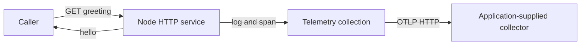

# Set up collection and shut it down

Send one greeting request and check two destinations: the caller receives the greeting, and a collector can receive
the diagnostic records. The application uses `open()` to start and own the telemetry providers, and LogTape’s
`configure()` to choose where its logs go. Neither call starts a workflow worker.

A **collector** is a separate service that receives diagnostic records and forwards or stores them. OpenTelemetry
Protocol (OTLP) defines how the application sends those records. The collector's **endpoint** is its receiving URL;
it is separate from the greeting API URL.
LogTape is the application's logging API, and the configured **sink** is the callback that forwards its records.

One request therefore follows two paths: the HTTP response goes back to the caller, while diagnostic records go to the
collector. Either can succeed while the other fails. Read the arrows independently; collector storage and dashboards
are outside this example.




## Prepare a collector and run the greeting service

This is the Node-specific collection owner, not the portable memory reporter. You need an OTLP HTTP collector reachable
at a base URL such as `http://127.0.0.1:4318`; its storage, authentication and network access belong to your deployment.
The checkout does not install or start a collector. To check the local HTTP behavior alone you can use an unavailable
URL, but exporter errors then mean no successful delivery has been demonstrated.

From the checkout root, review `mise.toml`, run `mise trust`, `mise install` and `mise run prepare -- --kind deps`. Save the complete
module below as `telemetry-service.ts`. Run its Node APIs through the prepared Deno source workspace:

```sh
OTEL_URL=http://127.0.0.1:4318 mise exec -- deno run --allow-env --allow-net telemetry-service.ts
```

For a native Node deployment, first build and install the npm projection as described in the
[packaging guide](../maintenance/02-packaging.md); Node does not resolve Deno workspace imports by itself.
In a second terminal, `curl http://127.0.0.1:3000` sends a request to the local service and prints `hello`.
That confirms the greeting, but does not check delivery to the collector. Look for the log `Greeting requested` in
your collector. The example keeps about 10% of traces, so one request might not produce an `app.greet` trace.

Press Ctrl+C in the service terminal when finished. The service stops accepting requests, waits for active responses,
resets LogTape, and closes the collection.

```ts support=telemetry-service.ts
import { createServer } from 'node:http';
import { once } from 'node:events';
import process from 'node:process';
import { configure, getLogger, reset } from '@logtape/logtape';
import * as telemetry from '@okikio/telemetry/node';

const endpoint = process.env.OTEL_URL;
if (endpoint === undefined) throw new Error('OTEL_URL is required.');

await using collection = await telemetry.open({
	service: 'imports',
	endpoint, // For example: http://localhost:4318. Supply the base URL, not /v1/traces.
	traces: { sample: 0.1 },
	metrics: { interval: 10_000 },
	capacity: 2048,
	shutdown: 5000,
	onError(error) {
		console.error('Telemetry export failed:', error);
	},
});

try {
	await configure({
		contextLocalStorage: collection.storage,
		sinks: { otlp: collection.sink },
		loggers: [
			{ category: ['app'], lowestLevel: 'info', sinks: ['otlp'] },
			{ category: ['utils'], lowestLevel: 'info', sinks: ['otlp'] },
			{ category: ['logtape', 'meta'], lowestLevel: 'warning', sinks: [] },
		],
	});
	const log = getLogger(['app']);
	const server = createServer((_request, response) => {
		void collection.instrument.span('app.greet', {}, async () => {
			log.info('Greeting requested');
			response.end('hello');
		}).catch(() => response.destroy());
	});
	const stopped = Promise.withResolvers<void>();
	const stop = () => stopped.resolve();
	process.once('SIGTERM', stop);
	process.once('SIGINT', stop);
	try {
		server.listen(3000, '127.0.0.1');
		await once(server, 'listening');
		await stopped.promise;
	} finally {
		process.removeListener('SIGTERM', stop);
		process.removeListener('SIGINT', stop);
		// Stop admission and join outstanding responses before shutting down diagnostics.
		await new Promise<void>((resolve, reject) => server.close((error) => error ? reject(error) : resolve()));
	}
} finally {
	await reset();
}
// Leaving this scope disposes collection after LogTape resets. Explicit collection.close() is equivalent.
```

Run an OTLP HTTP collector at `OTEL_URL`. Configure its storage and access credentials separately. Supply collector
authentication through `headers` when needed. The adapter does not inspect application configuration or start a
collector. The SDK may consult its own standard environment settings. For deterministic deployment policy, set those
deliberately.

The example suppresses LogTape's own internal diagnostics. A deployed application can give its meta category a separate
console sink. Keep that sink independent of a failing collector.

## Use the same setup in a workflow service and worker

Configure each process once. Use a different service name for the HTTP service and each worker deployment role. Keep
ordinary calls to `workflow.client()`, `client.submit()`, `postgres.open()`, and `workflow.serve()` unchanged. They take
no telemetry collection or logger argument. The library observes its own operations through the configured APIs.

The [container service](../../tests/workflows/scenarios/service.ts) and
[container worker](../../tests/workflows/scenarios/host.ts) show the full assembly with database connections, resource
bindings, policy selection, readiness, drain, and cleanup. Their telemetry setup is visible at the top of each file.
These are test consumers of utils. They do not change Core or Intelligence.

To shut down a worker, stop taking new jobs and wait for work already in progress to finish. Then close
the resources and database. Reset LogTape afterward so the cleanup messages still have somewhere to go. Close the
telemetry collection last. If the process is killed, those steps may not run. The replacement worker uses the
progress saved in PostgreSQL.

## Choose what to collect

Omitting `open()` leaves portable instrumentation without SDK exporters. Importing a utility does not start collection.
With an open collection, `traces: false` disables its tracer provider and `metrics: false` disables its meter provider.
Logs remain available through the sink. Use LogTape's normal category and level filters to select them.

`close()` is idempotent. It reports diagnostic delivery failures through `onError` and the collection's error count. It
does not throw those failures into application work. Configuration errors and conflicting provider ownership still
reject `open()`. A collector outage does not make a workflow worker unready. Database access, registered work, and
application dependencies still determine readiness.

The adapter starts no profiler and does not instrument arbitrary application dependencies. See
[signal coverage and limits](./03-design.md) before deciding which observations an application still needs to add.
