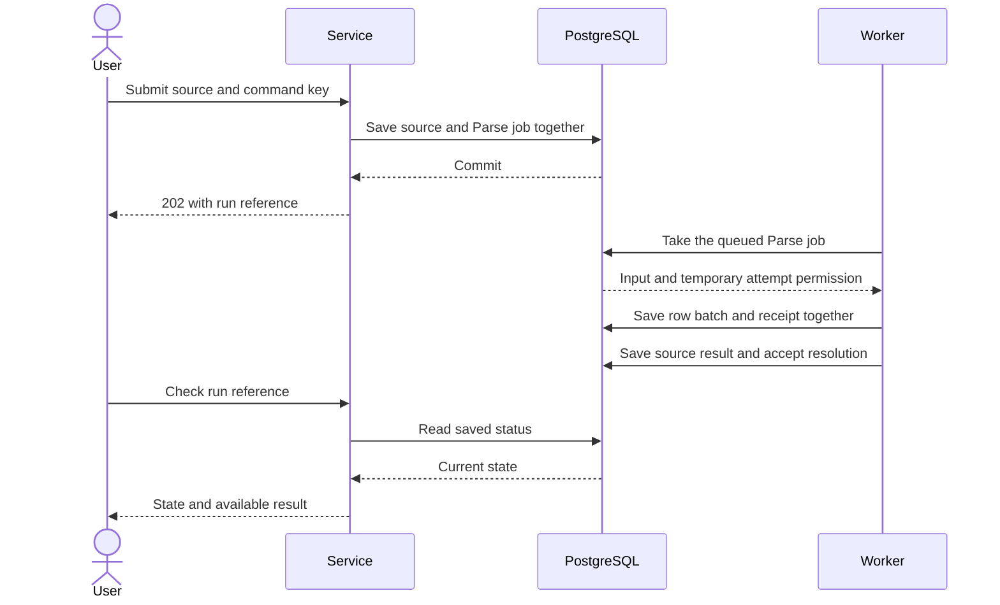

# Run background work that survives a worker restart

A customer uploads a dataset. They expect the import to finish after they close the page. They also expect saved
corrections to remain intact if a worker crashes. A research customer has a similar need. Research must finish once, and
temporary capture data must expire later.

This guide builds that system one decision at a time. It describes the current utils code, not a proposed application
migration. Core, Intelligence, and Signals remain unchanged. The examples reproduce selected import and research rules
with small test datasets.

## Start with a function

An ordinary async function runs code and returns a result:

```ts
const rows = await readRows(file);
await saveRows(rows);
```

This is enough when the caller can wait and repeat the operation safely. If the process dies, its local variables and
unfinished promises disappear. A Promise does not remember which rows reached the database.

Use [`task`](../../packages/task/README.md) when this local operation needs Pause, Resume, Cancel, and awaited cleanup.
A task still lives in one process. Its `done` promise settles after its owned cleanup finishes. It does not save a
restart point in PostgreSQL. You do not need a Task handle around every background job.

## Let the request finish before the work finishes

An HTTP request should not stay open throughout a large import. The service can instead save a request to do the work
and return its ID. A separate **worker** runs the saved work later. Here, a worker means a running application process
that calls `workflow.serve()`. A container is one way to deploy that process.

The first complete flow is:

1. The user sends an import to the HTTP service.
2. The service validates the input and saves the source and job in one transaction.
3. PostgreSQL commits the transaction.
4. The service returns HTTP `202` with the run reference.
5. A worker takes the saved job and imports the rows.
6. The user checks the run reference to see the result.

`202` means **accepted**, not **finished**. The worker can be offline at step 4. The service can also restart after step
4 without losing the accepted work.

The complete [service source](../../tests/workflows/scenarios/service.ts) implements admission and status over HTTP. It
never calls `serve()`. The complete [worker source](../../tests/workflows/scenarios/host.ts) supplies implementations
and calls `serve()`. It does not accept customer commands. These fixture endpoints trust their isolated test callers. A
deployed service must authorize each command and status lookup.

Read the following diagram from top to bottom. It shows the successful admission and row-write path. The later sections
add follow-up work, finalization, and recovery.



## Give the job a name and checked inputs

An **activity definition** describes one kind of work. It supplies a stable name, a version, input and result
validators, allowed engines, and required resources. An **activity implementation** supplies the function that does that
work. Creating either value does not start the function.

For example, `Parse` describes importing one source. `bindParse(client)` returns its implementation with an explicit
client for requesting follow-up work. That function is application code in
[core.ts](../../tests/workflows/scenarios/core.ts). It does not create pools, workers, or hidden configuration.

These are three different things:

| Item       | Example                 | What exists                            |
| ---------- | ----------------------- | -------------------------------------- |
| Definition | `Parse`                 | A reusable description of import work  |
| Job        | Import source `abc`     | One saved request to run that activity |
| Attempt    | Worker A tries that job | One invocation of the implementation   |

A definition is neither active nor dormant. A **job** can be queued, running, or finished. A **workflow run** can wait
for a job, a child workflow, or a timer. Those workflow waits use saved database rows rather than a sleeping JavaScript
function. The current workflow turn can return its activation slot while the wait remains saved. An activity awaiting
ordinary network I/O is different: it remains an active invocation and retains its activity slot until its code and
cleanup settle.

For a local call, use `activity.run()` with an explicit implementation and resources. For accepted background work,
submit the activity directly:

```ts
const ref = await client.submit(Parse, input, {
	scope: input.scope,
	key: `source:${input.source}`,
});
```

A single activity does not need an extra workflow around it. The [activity README](../../packages/activity/README.md)
shows a complete local call. The [API guide](./03-policy.md) explains these durable client calls.

## Use PostgreSQL as the saved queue and progress record

The `@okikio/storage/workflow/postgres` adapter stores jobs and progress in PostgreSQL. The worker repeatedly checks for
work that is ready to run. This database queue is part of the adapter. You do not need Redis, a second queue service, or
`@okikio/scheduler/queue` for this path.

`@okikio/scheduler/queue` provides a separate claimed-work contract, with memory and PostgreSQL implementations. Its
memory items disappear with their process. Select its SQL adapter explicitly for persisted standalone queue items;
placing a memory queue beside a workflow does not persist it, and this saved-workflow path already owns its queue.

The database stores a few distinct records:

| Record      | Question it answers                                                       |
| ----------- | ------------------------------------------------------------------------- |
| Run         | Which accepted command is this, and what is its current state?            |
| Job         | Which activity needs to run next?                                         |
| Attempt     | Which worker tried that job, and how did that try end?                    |
| Instruction | Which step did the workflow request, and what result did it receive?      |
| Receipt     | Which application write already committed, and what result belongs to it? |
| Host        | Which worker registration is still valid, and what code can it run?       |
| Audit entry | Who requested a manual retry, and why?                                    |

The application still owns its business tables, such as `sources` and `accounts`. The adapter owns the tables in
`utils_workflow`. A run ID is an inspection reference. It does not grant a user permission to inspect another customer's
work.

## Separate the client from the worker

The application opens its SQL pool. Deployment setup explicitly runs `postgres.migrate({ database: sql })`. Opening a
store borrows that pool. It does not migrate or start a worker.

```ts
import * as workflow from '@okikio/workflow';
import * as postgres from '@okikio/storage/workflow/postgres';

await using store = postgres.open({ database: sql, namespace: 'imports' });
const client = workflow.client({ store, policy: CorePolicy });

const ref = await postgres.begin(sql, async (tx) => {
	await tx`insert into sources(scope,id,revision,digest,body)
    values (${input.scope},${input.source},${input.revision},${input.digest},${body})`;
	return await client.in(tx).submit(Parse, input, {
		scope: input.scope,
		key: `source:${input.source}`,
	});
});
```

This fragment uses the application's `sql`, input, source body, and imported `CorePolicy` and `Parse` definitions. The
[service file](../../tests/workflows/scenarios/service.ts) supplies the full runnable composition. The source insert and
job acceptance commit together. If either operation fails, PostgreSQL rolls both back.

`postgres.begin()` passes the real Postgres.js transaction to the callback. It also records which pool owns that
transaction and when its callback ends. This lets `client.in(tx)` reject a foreign or finished transaction. A raw
`sql.begin()` transaction has not been registered by this bridge and is rejected. The returned reference is provisional
until the outer transaction commits.

Retrying the same scope, definition, and key returns the same run when its input, version, and policy match. Changed
input under that key produces a conflict. This lets a service retry after losing the HTTP response without accepting the
same command twice. Use a new key for a new business command.

`client.get(definition, ref)` reads the saved status. `client.wait(definition, ref, { signal })` polls for a terminal
result. Aborting that wait stops observation. It does not cancel the saved work.

## Put live dependencies in resources

A **resource** is a named dependency, such as a database view or capture client. The activity declares which resources
it uses. The worker binds those declarations to live values. This keeps credentials and connections outside the
workflow's saved data.

The worker example supplies four resources:

| Resource   | Supplied value                                   | Owner                                                                |
| ---------- | ------------------------------------------------ | -------------------------------------------------------------------- |
| `Database` | An object containing `sql` for application reads | Worker opens and closes the pool                                     |
| `Store`    | Borrowed `transaction` and `getReceipt` methods  | Worker opens and closes the adapter view                             |
| `Provider` | HTTP `capture` and health-check functions        | Application supplies URL, request limits, and failure classification |
| `Gate`     | A named pause point for crash tests              | Test instrumentation only                                            |

The source shows each `resource.implement()` call and the `resource.create()` collection. The collection owns resources
it creates. The database and store views have no disposal method because their surrounding worker owns their lifetimes.
Close the worker before closing the clients it borrows. A production application does not need `Gate` or the `PAUSE_*`
test settings.

## Choose which workers can run each activity

An **engine** is a name for an allowed execution environment. It is a definition, not a running process, queue,
scheduler, or container. An engine does not start workers or install their dependencies.

For example, a capture activity may require a browser-capable environment. A worker advertises that engine and
explicitly lists the implementations it supplies. Several worker containers can advertise the same engine. Each competes
for eligible saved jobs through PostgreSQL.

This profile runs each activity inside the worker that takes it. It does not launch a new container for each activity.
If an activity needs a browser or GPU, the application deploys a suitable worker with that dependency. The separate
`@okikio/worker/thread` package wraps Web Workers. That is a different runtime boundary from these background services.

A worker can supply only part of a workflow:

| Container role in the tests | Engine            | Supplied work                                                         |
| --------------------------- | ----------------- | --------------------------------------------------------------------- |
| HTTP service                | None              | Accept commands and read status                                       |
| Import worker               | `fixture.core`    | Parse, resolve batches, verify, record exits, advance resolution      |
| Research worker             | `fixture.core`    | Advance acquisition and expiry, extract, analyze, delete              |
| Capture worker              | `fixture.capture` | Call the capture receiver                                             |
| Publication worker          | `fixture.core`    | Advance Knowledge, stage, commit, record exits                        |
| Capture receiver            | None              | Save capture bytes and return the same receipt for a repeated request |
| PostgreSQL                  | None              | Save the queue, progress, receipts, and application rows              |

The capture definition allows both fixture engines so the combined process test can also run it. The container scenario
registers capture only in the capture worker. No research worker implementation can run that step. The job remains
queued until a capture worker starts. Engine priority is not a load-balancing guarantee in this PostgreSQL profile.

## Add a workflow when several saved steps belong together

A **workflow** describes the order of activities and child workflows. For Core resolution, it requests a batch, reads
its result, and requests the next batch if needed. The implementation uses a generator. `yield* activity.request(...)`
requests a saved step and receives its recorded result. The workflow body itself does not read files, query SQL, or call
HTTP.

```ts
const ResolutionLive = workflow.implement(Resolution, function* (ctx) {
	let after = 0;
	for (let batch = 0; batch <= 1000; batch++) {
		const result = yield* activity.request(Resolve, { ...ctx.input, after }, { key: `batch:${batch}` });
		if (result.status === 'superseded' || result.complete) return result;
		if (result.after <= after) throw new Error('Resolution made no progress');
		after = result.after;
	}
	throw new Error('Source exceeds the declared row bound');
});
```

This is the program in [core.ts](../../tests/workflows/scenarios/core.ts), with shorter error text here. The file
supplies `Resolution`, `Resolve`, their schemas, and their policy. Each batch key identifies one step in that run. The
database saves the requested activity and its input before a worker runs it.

After a restart, utils calls the workflow program again from its beginning. For a completed step, utils supplies the
saved result instead of invoking the activity again. The generator therefore rebuilds its local variables from saved
answers. This is **replay**. Utils does not save the JavaScript stack.

The saved profile supports activities, children, event waits, relative and absolute `wait()` timers, `parallel()`,
`map()`, `race()`, and `retry()`. A timer saves its deadline in PostgreSQL. Waiting releases the worker's replay slot.
Completed sibling results survive a restart. The [execution guide](./13-execution.md) explains branch limits,
notification wake-ups, and the differences in cleanup ownership across hosts.

The deprecated custom-host `wait(signal, input)` and generic workflow-level `effect()` have no durable
implementation and block with `unsupported_instruction`. Background triggers have a separate supported acceptance
contract. Durable `defer()` saves activity or child cleanup when policy requires `workflow.cleanup` and reserves cleanup
capacity. Bounded root `continue()` starts a new segment only after registered cleanup settles; it needs a finite
`maxContinuations` policy budget and cannot run inside branches or children. See [cleanup and execution](./13-execution.md)
and [continuation restrictions](./15-continuation.md). Suspending a saved workflow does not run generator `finally` code.

## Make writes safe to repeat

A worker can save application rows and crash before it reports success. The replacement then knows that the job needs
recovery. It does not know whether the application write happened. A saved **receipt** closes that gap for writes in
this same database.

```ts
const saved = await store.transaction(ctx.claim, {
	key: 'batch-v1',
	input: ctx.input,
	result: BatchResultSchema,
}, async (tx, receipt) => {
	const previous = await receipt.get();
	if (previous !== undefined) return previous;
	const result = await writeBatch(tx, ctx.input);
	return await receipt.save(result);
});
return saved.value;
```

Here `writeBatch` stands for the application's SQL, not a utils setup helper. The
[actual Core implementation](../../tests/workflows/scenarios/core.ts) shows that SQL in full. The callback always runs.
The explicit `receipt.get()` branch prevents a repeated write. The business write and `receipt.save()` commit together.
A crash during the transaction rolls both back. A crash after commit leaves both available to the replacement.

`ctx.claim` means **this worker's temporary permission to finish this attempt**. Utils supplies it when the worker takes
a saved job. The transaction checks that permission before it allows application SQL. A local `activity.run()` call has
no saved-job permission, so this transaction rejects it. The claim does not authorize a business action on behalf of a
customer. Application grant and revision checks remain necessary inside the write.

A worker renews its permission while it runs. The permission expires if renewals stop. Each replacement receives a newer
attempt number. The database rejects a late result or a new guarded write from the replaced worker. This old-worker
check is called **fencing** in the implementation. You do not create or increment a fence in consumer code. The
[recovery guide](./04-recovery.md) explains lock ordering and the case where a write already holds permission before
expiry.

An HTTP receiver cannot join this database transaction automatically. It must make repeated requests safe itself, or
support inspection of an uncertain result. The capture fixture uses one stable request key and stores its own receipt.
If capture commits and its response is lost, the replacement sends that same key. The receiver returns the original
capture instead of creating another one. Utils cannot promise this for an arbitrary paid API.

## Set limits and keep startup explicit

A **policy** is saved configuration for a run. It answers concrete questions before work is accepted:

- How much queued work and saved data can this system accept?
- Which activities and workflow versions are allowed?
- How many tries and how much time can an activity use?
- Is repeating a job after a crash safe, or must an operator inspect it?
- Which follow-up jobs and child workflows may it accept?
- Which final activity must record its exit?

The full [Core policy](../../tests/workflows/scenarios/core.ts) and
[Intelligence policy](../../tests/workflows/scenarios/intelligence.ts) list every setting. The
[policy reference](./03-policy.md#read-the-policy) explains each group. Their short lease intervals accelerate tests.
They are not recommended production timing values.

A worker starts with
`workflow.serve({ store, policies, engine, workflows, activities, resources, capacity, hostId, shutdown })`. The
[worker source](../../tests/workflows/scenarios/host.ts) shows every supplied value. There is no hidden setup function.
The worker checks its local implementations, allowed engine, resources, retry declarations, and capabilities before
taking work. Implementations on another worker are not required locally. A missing remote worker leaves eligible work
queued. Monitor queue age and required worker registrations as well as worker readiness.

`capacity.activities` limits running ordinary activity attempts in that worker. `capacity.activations` limits short
workflow advances. `capacity.control` is one recovery scan loop in this profile. `capacity.finalizers` reserves separate
slots for exit-recording activities. Those slots let exits progress even when ordinary activities fill the worker.
Capacity remains occupied until actual activity cleanup finishes.

The worker owns `/live`, `/ready`, process signals, and its clients. `/live` means its HTTP listener answers. `/ready`
calls `serving.check({ signal })` and checks the required receiver under a deadline. Readiness means this worker can
serve its configured role now. It does not mean the whole queue is empty.

On SIGTERM, the worker stops taking new work and waits for active code and cleanup. This is **drain**. It does not
cancel accepted business commands. A drain deadline can reject while code still runs. Keep borrowed clients open until
that code finishes or the deployment kills the process. After a forced kill, another worker recovers the saved jobs.

## Follow the two complete customer scenarios

For Core, the customer needs imported accounts with their corrections preserved. The user submits a source, receives an
accepted reference, and checks status. Parse saves original rows in bounded batches. Its final transaction marks the
source parsed and accepts resolution together. Resolution reads the current mapping revision and resolves batches
without replacing corrections. Verification remains independently available after malformed input. A finalizer records
the run's exit. Read the [Core walkthrough](./05-core.md) beside the complete source.

For Intelligence, the customer needs one published contribution and timely deletion of raw capture data. The user
submits research and checks its reference. The workflow checks the grant, accepts independent expiry work, then requests
capture, extraction, analysis, and publication. The capture step runs in another container in the deployment test. The
expiry child survives parent cancellation and waits in PostgreSQL until deletion is due. Read the
[Intelligence walkthrough](./06-intelligence.md) for the grant, publication, and deletion rules.

## Choose who owns durable scheduling

[Inngest](./09-design.md#where-inngest-fits) can own saved steps, delivery, retries, and waits instead of this
PostgreSQL worker loop. The actual Intelligence repository already uses native Inngest functions around utils
activities. In that arrangement, activities still validate inputs, borrow resources, and await cleanup. Inngest owns
when a step runs again. Do not put a second retrying `serve()` loop inside that same step. There is no native Inngest
adapter for `workflow.client` or `workflow.serve` in utils today.

## Run the evidence and understand its limits

Run `mise run test -- --suite postgres` with `UTILS_TEST_DATABASE_URL` set to a disposable PostgreSQL database, and
`mise run test -- --suite containers` with Docker available. Missing configuration or Docker fails the respective task. They run
complementary suites:

- [Container scenarios](../../tests/workflows/containers.test.ts) send actual HTTP commands to a service container.
  Separate worker containers take the saved jobs. The tests kill and replace workers and restart the service.
- [Recovery cases](../../tests/workflows/recovery.test.ts) use the supplied PostgreSQL database and fresh local Node or
  Deno processes. They interrupt individual database and HTTP boundaries and check the saved state.

The [test guide](./07-tests.md) maps failures to evidence and explains how to read each case. The containers use bundled
consumer code and pinned Node and PostgreSQL images. No host worker process or runtime package download performs their
work. Testcontainers is a development dependency only.

These tests establish recovery in this local container topology. They do not establish Kubernetes operation, PostgreSQL
failover, multi-region behavior, throughput, or paid-provider safety. The adapter currently supports Postgres.js only.
Retention settings describe minimum preservation obligations. The application schedules explicit bounded
`store.prune({ limit })` calls; `serve()` starts no automatic pruning loop. Live families and unexpired preservation
windows remain protected. Read [maintenance](./16-operations.md) before scheduling deletion, and
[design boundaries](./09-design.md) before making deployment claims.
