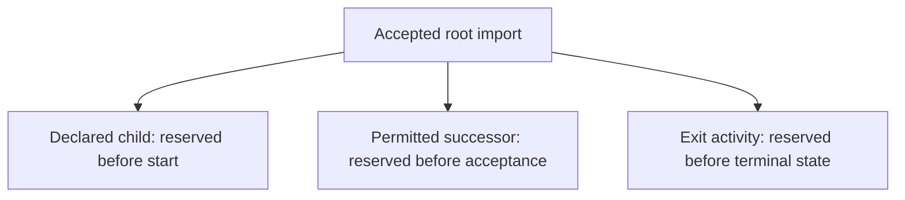

# Read the background-work API

This page explains the calls and settings used by a service that accepts background work and a worker that performs it.
The [walkthrough](./01-basics.md) builds that application from an ordinary function; the
[Workflow README](../../packages/workflow/README.md) provides the complete local example and public entry points.

Think of a policy as the service's promise when it accepts a job: how much work it may create, how long an attempt may
hold permission, when retry is allowed, and how long its saved answers remain available. The worker must honor the
policy saved with that job, even if its next deployment uses different defaults.

The short snippets on this page are call-site excerpts, not standalone programs. `store` is an already opened workflow
store, `CorePolicy` is its checked policy, and `Parse` is the registered activity. The complete runnable assembly is
linked from [the consumer guide](./02-consumers.md); keep that assembly when changing one setting below.

## Accept and inspect work

Construct a client with a borrowed store and an explicit policy:

```ts
const client = workflow.client({ store, policy: CorePolicy });
const ref = await client.submit(Parse, input, { scope: input.scope, key: 'import:123' });
const status = await client.get(Parse, ref);
const result = await client.wait(Parse, ref, { signal });
```

`Parse` is an activity definition. A workflow definition uses the same calls. Construction starts no worker, pool,
timer, or migration. `submit()` validates input and returns after acceptance commits. `get()` reads the current saved
state and validates any saved successful value. Its `value` may describe an intended success while finalization is still
running. Check `state` before presenting the run as finished. `wait()` returns only after the run reaches `completed`.
It throws `ExitError` for failed, cancelled, or blocked work. That error retains the saved snapshot. Aborting the wait
stops observation without cancelling the run.

A reference contains namespace, scope, run ID, and exact definition identity. Always inspect it through its definition.
Scope separates application domains or tenants in storage. It does not replace the application's user authorization.

The duplicate key includes namespace, scope, definition kind, definition ID, and command key. A matching duplicate also
needs the same version, validated input, and saved policy. A changed command under that key fails with
`admission_conflict`. Retry the same key after an uncertain response. Use a new key for a new command.

Use `client.in(tx).submit(...)` to accept work inside an application transaction. The transaction must come from
`postgres.begin(sql, callback)` with this store's exact pool. Inside an activity's guarded transaction, use
`client.in(tx, { claim: ctx.claim })` for an allowed successor. This ties source publication and follow-up acceptance to
the same commit. Do not return a provisional reference as accepted before the outer transaction commits.

## Read the policy

`workflow.PolicySchema.parse()` checks plain configuration data. The client copies that policy and saves it with each
accepted run. Changing a worker's configuration cannot change rules for an existing run. Keep its accepted policy
registered until that work finishes.

| Group             | Setting                                                      | Meaning                                                                           |
| ----------------- | ------------------------------------------------------------ | --------------------------------------------------------------------------------- |
| Identity          | `id`, `version`                                              | Name and revision of these rules                                                  |
| Saved data        | `inputBytes`, `resultBytes`, `historyBytes`                  | Maximum encoded input, result, and total instruction data bytes                   |
| Queue limits      | `pendingRoots`                                               | Maximum accepted root runs that still hold obligations                            |
| Reserved work     | `reservedSuccessors`, `pendingChildren`, `pendingFinalizers` | Capacity reserved for follow-up runs, child runs, and exit activities             |
| Worker permission | `claims.leaseMs`                                             | How long one attempt can run without renewal                                      |
| Renewal           | `claims.renewEveryMs`                                        | How often the worker renews that permission                                       |
| Recovery scan     | `claims.recoverEveryMs`                                      | Maximum recovery scan spacing while work is due; saved deadlines can wake earlier |
| Activities        | `definition`, `maxAttempts`, `deadlineMs`                    | Exact code identity, total try budget, and time limit per try                     |
| Crash response    | `recovery: 'retry'`                                          | The application asserts that repeating this activity after process loss is safe   |
| Crash response    | `recovery: 'reconcile'`                                      | Block after process loss so an operator can inspect uncertain effects             |
| Failure retry     | `retry`, `delay`                                             | Whether transient failures retry and the bounded doubling delay in milliseconds   |
| Capabilities      | `requires`                                                   | Storage or provider guarantees that the actual worker must supply                 |
| Workflows         | `maxInstructions`, `maximumChildren`, `children`             | Bound requested steps and declare permitted child counts                          |
| Successors        | `from`, `maximum`, `choices`                                 | Bound follow-up acceptance from an activity                                       |
| Finalizers        | `roots`, `activity`, attempt settings                        | Run an exit activity before reporting a root's terminal state                     |
| Retention         | `dedupeMs`, `resultsMs`, `auditMs`                           | Minimum preservation obligations, not automatic deletion schedules                |

A **root** is a run accepted by the service rather than created by another run. A **successor** is a follow-up run
accepted through a guarded activity transaction. A **child** is a run requested by a workflow instruction. A
**finalizer** is an activity that must finish before the run's intended exit becomes terminal.

For example, accepting an import can promise a resolution child, a permitted follow-up, and exit cleanup. Reserved
capacity makes room for those obligations before they become runnable work:



This is a policy relationship, not three activities running together. Pending reservations count promised work;
worker capacity counts attempts actually running. A policy must describe a finite family, and the host must still
start eligible workers. The [continuation guide](./15-continuation.md#declare-the-budget) explains how reservations
multiply when each segment can promise more work; a per-segment limit alone does not bound the whole family.

Reservations stop a full root queue from preventing work that an accepted run already promised. The policy must describe
a finite tree of those promises. Recursive reservation cycles are rejected. The
[complete Core policy](../../tests/workflows/scenarios/core.ts) shows one permitted successor and one exit activity. The
[Intelligence policy](../../tests/workflows/scenarios/intelligence.ts) shows two permitted child runs. Their subsecond
worker-permission timings are test values. Choose production values from measured execution and database delays.

Started attempts count against `maxAttempts`, including attempts whose worker died. A known transient failure can retry
if policy permits it. An unknown outcome blocks rather than assuming that repeating it is safe. Static activity timeout
and retry declarations must agree with the saved policy. This profile rejects incompatible declarations with
`resilience_binding`.

## Bind a worker

The application supplies `store`, `policies`, `engine`, `workflows`, `activities`, `resources`, `capacity`, `hostId`,
and `shutdown`. The complete [host](../../tests/workflows/scenarios/host.ts) shows those values and their owners. The
host supports import, research, capture, publication, and combined fixture roles. Its role switch lists every
implementation directly.

A worker registers only its local implementations. A workflow can request an activity or child whose implementation runs
elsewhere. The requested definition must still appear in the workflow declaration and accepted policy. Each local
activity must permit this worker's engine and have its declared resources. Each local implementation must satisfy its
policy capabilities and retry rules. An absent remote implementation leaves its jobs queued. Readiness does not prove
that all other roles are online.

`hostId` names one worker registration. Use a unique ID for simultaneous workers. Replacing the same ID invalidates the
previous registration. The database also distinguishes its successive registrations. A PID alone is unsuitable across
containers because each container can use PID 1. The container test supplies a unique `WORKER_ID` explicitly.

| Capacity      | Work it bounds                                     |
| ------------- | -------------------------------------------------- |
| `activations` | Short advances of workflow programs                |
| `activities`  | Ordinary running activity attempts                 |
| `control: 1`  | This profile's database scan loop                  |
| `finalizers`  | Exit activities with separate reserved local slots |

A waiting timer or child uses no activity slot. An activity retains its slot while its cleanup still runs. More workers
add capacity for their registered code. They do not enlarge a run's saved queue or retry limits.

## Stop or recover work

`client.cancel(ref, reason)` requests durable cancellation. It returns `too_late` if the run has already proposed its
exit. Cancellation does not undo committed application rows or an accepted remote request. Independent children keep
their own obligations.

`client.repair(ref, { actor, reason, epoch, attempts })` grants bounded additional attempts to blocked work. Supply the
current `epoch` from `get()` so a stale operator request cannot repair a different recovery state. The repair records
who requested it and why. It preserves job IDs, receipt keys, external request keys, and the prior attempt count. An
operator must first resolve any uncertain remote write. Repair cannot enlarge the accepted policy or rewrite a terminal
result.

`serving.drain()` stops new work and awaits active code and cleanup. A deadline rejection does not mean cleanup
finished. `serving.closed` and async disposal join actual work. `serving.check({ signal })` checks current schema,
database access, registration, and scan health. The application owns HTTP readiness, dependency probes, process signals,
and its final kill deadline. See [recovery](./04-recovery.md) for failure order and lock rules.
