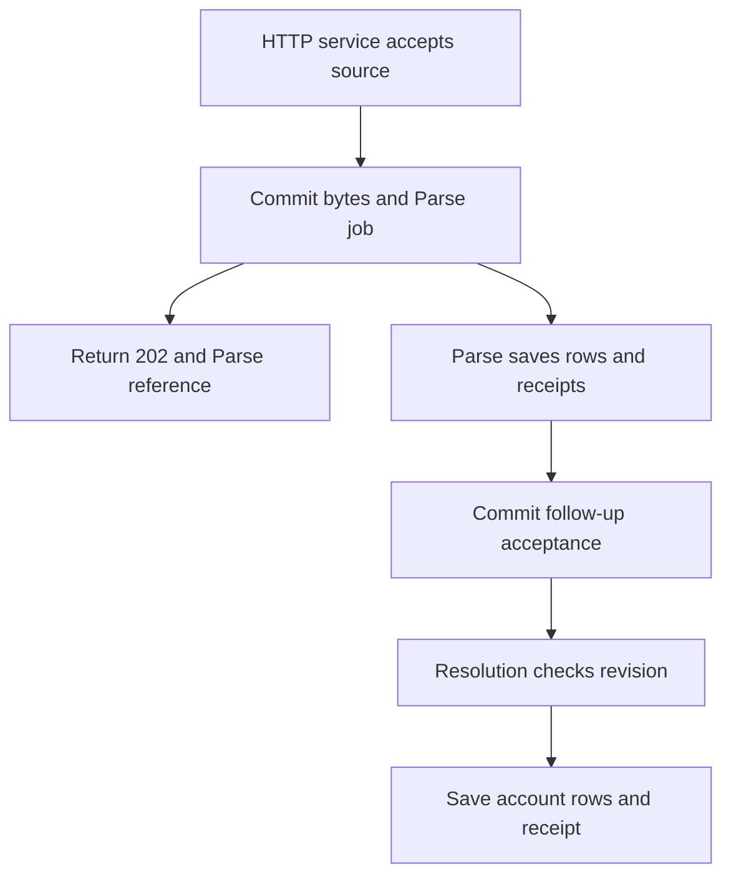

# Import a CSV without losing saved corrections

The [connected consumer guide](./14-consumers.md) adds the preferred trigger API, process/thread engines, standard
progress, and durable registered cleanup. Its smaller fixtures complement the full domain scenarios described here.

The customer needs usable accounts from an uploaded CSV. The customer may correct a row while background work is
interrupted. A worker restart must preserve both the uploaded values and those corrections. This fixture tests that
contract. Core is the separate application that inspired this scenario; the fixture runs without changing or installing it.

Read [core.ts](../../tests/workflows/scenarios/core.ts) for the complete definitions, implementations, and policy. Read
[service.ts](../../tests/workflows/scenarios/service.ts) for the complete HTTP admission path. The
[domain schema](../../tests/workflows/scenarios/schema.sql) defines the application tables.

## Follow the user's request

The user submits a source ID, revision, command key, and CSV body to `POST /imports`. The service computes the body
digest. It saves the source and accepts the `Parse` activity in one transaction. It returns HTTP `202` with the run
reference after commit. The user checks `GET /imports?id=...&scope=...` for saved status.

The accepted Parse result includes a `next` reference when it admits resolution or verification. Parse completion means
source ingestion finished. It does not mean the independently accepted resolution has completed. The container test
checks resolved account rows separately. An application UI must track the follow-up reference if its visible outcome
requires resolved accounts. The fixture does not implement a customer UI or an aggregate import-status endpoint.

A repeated matching command key returns the same run. A changed input under that key conflicts. The fixture trusts its
isolated callers. Core would still own user authentication and authorization for the source and scope.

## Follow Parse and resolution

Follow one uploaded source through its two separately accepted runs. The service replies after acceptance commits;
it does not hold the HTTP request open until accounts are resolved:

On recovery, each worker reads its receipt before repeating a business write. A changed source revision prevents stale
resolution; it does not roll back previously committed rows. The application owns corrections and the customer's
final import status, so Parse success alone must not be presented as resolved accounts. The caller reads the Parse
result to find its `next` reference and follows that separate run. The diagram omits batch loops
and finalizer calls to keep that difference between acceptance and completion visible.

| Step                  | Owner                                    | Saved result                                                                         |
| --------------------- | ---------------------------------------- | ------------------------------------------------------------------------------------ |
| Accept source         | HTTP service                             | Source bytes and runnable Parse job commit together                                  |
| Check source          | Parse activity                           | Digest must match the accepted source bytes                                          |
| Read CSV              | Parse activity                           | At most 1,000,000 rows, 32 columns, and 65,536 characters per cell                   |
| Save rows             | Parse activity                           | Batches of at most 1,000 original rows and one receipt per batch                     |
| Publish source state  | Parse activity                           | Parsed or rejected state, permitted follow-up reference, and receipt commit together |
| Resolve accounts      | Resolution workflow and Resolve activity | Each batch checks source revision and writes resolved account values                 |
| Verify rejected input | Independent Verify activity              | Original source digest is checked even when CSV parsing failed                       |
| Record exit           | RecordExit finalizer                     | One exit record before the run becomes terminal                                      |

The fixture collects a bounded CSV document before writing batches. It does not demonstrate streaming an arbitrary-size
object store. The 2 MiB source-table bound also limits the fixture's actual input size. A production object store must
preserve equivalent immutable source identity.

`source_rows.original` contains the uploaded cells. `source_rows.correction` contains a later customer edit. Parse never
assigns the correction column. Resolve chooses the correction when one exists. It checks the source revision and digest
inside its write transaction. A superseded revision produces a saved `superseded` result instead of publishing stale
accounts.

The final Parse transaction accepts either Resolution or Verify using `client.in(tx, { claim: ctx.claim })`. The policy
reserved that successor capacity when Parse was accepted. A full queue of new root imports therefore cannot prevent this
promised follow-up. If that transaction rolls back, neither the source state nor follow-up acceptance commits.

## Follow a crash

Suppose the worker dies after the first row batch commits. That batch's original rows and receipt remain in PostgreSQL.
The next worker checks the receipt before repeating the write. It then continues with unfinished batches. A correction
entered while the first worker was absent remains untouched.

Suppose the worker dies after the final source transaction commits. The replacement reads the final receipt before
reopening source bytes. The already accepted successor remains accepted. It does not create another resolution run under
a new accidental identity.

Suppose a Resolve worker dies after saving a batch. The workflow replays its saved steps. Resolve's receipt returns the
already committed batch result. The workflow can rebuild its `after` position and continue.

The [container test](../../tests/workflows/containers.test.ts) covers a real worker-container kill after a row commit.
The [process recovery suite](../../tests/workflows/recovery.test.ts) covers all three committed boundaries, rollback
during a write, changed source bytes, and stale mapping revisions.

## Keep business rules in the application

Utils owns saved jobs, attempts, retry timing, worker permission, recorded steps, and receipts. Core still owns source
storage, CSV interpretation, row corrections, mapping revisions, and account publication rules. The service and worker
still own their SQL pools, resources, probes, signals, and deployment. The policy remains explicit application
configuration.

Cancellation does not undo committed rows or cancel independent follow-up work automatically. To withdraw a mapping,
first update its revision under the application's lock. Then request cancellation and reconcile work already accepted.
See [recovery](./04-recovery.md) for this distinction.
