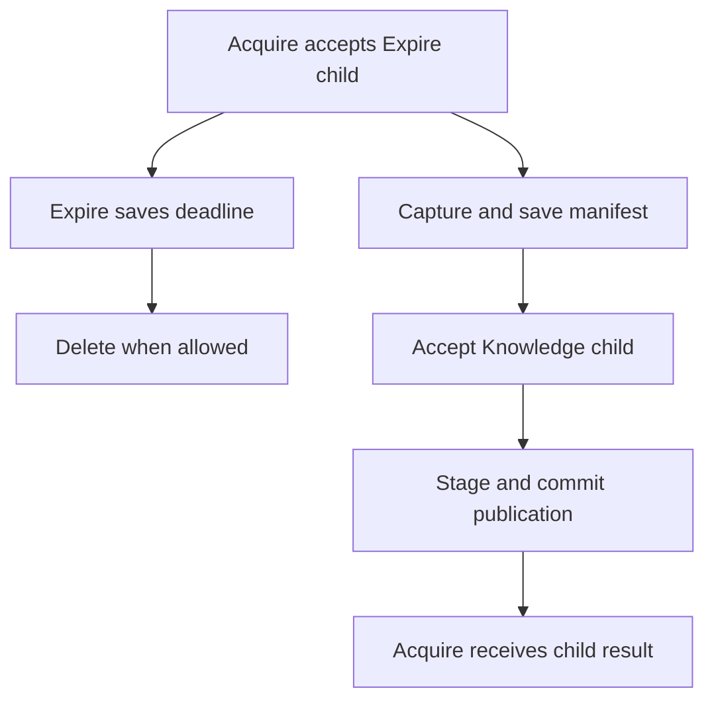

# Publish research and expire its capture data

The [connected consumer guide](./14-consumers.md) adds the preferred trigger API, process/thread engines, standard
progress, and durable registered cleanup. Its smaller fixtures complement the full domain scenarios described here.

The customer needs one useful published contribution from requested research. Raw capture data also has an expiry
obligation. Publication can finish before expiry, so those outcomes need separate saved work. This fixture tests those
rules without calling paid services. Intelligence is the separate application that inspired this scenario; the fixture
does not require that application.

Read [intelligence.ts](../../tests/workflows/scenarios/intelligence.ts) for all definitions, implementations, and
policy. The [receiver](../../tests/workflows/scenarios/provider.ts) is an actual HTTP process with persistent capture
receipts. The [host](../../tests/workflows/scenarios/host.ts) supplies each resource binding.

## Follow the user's request

The user submits a research ID, scope, URL, grant, expiry time, and command key to `POST /research`. The service saves
the research record and accepts `Acquire` in one transaction. It returns HTTP `202` with a run reference. The user
checks `GET /research?id=...&scope=...` for the saved result. Completion returns the committed contribution ID after
required finalization. It does not wait for future raw-data expiry.

The fixture creates a simple grant record for trusted test callers. It does not reproduce Intelligence's authorization
service, evidence storage, browser fleet, models, or publication stores. Those remain application-owned concerns.

## Follow the saved steps

| Step                                | What it does                                             | Why it is separate                                          |
| ----------------------------------- | -------------------------------------------------------- | ----------------------------------------------------------- |
| Authorize                           | Check the current grant and expiry                       | Reject work that no longer has business permission          |
| Accept Expire child                 | Save independent deletion work before capture            | Parent failure must not lose the deletion obligation        |
| Capture                             | Request capture over HTTP and save the returned manifest | A lost response must reuse the same receiver identity       |
| Extract                             | Read the referenced raw bytes and check their digest     | Missing or expired data must not silently trigger recapture |
| Analyze                             | Produce the fixture's bounded analysis result            | Represents a separately recorded computation                |
| Accept and wait for Knowledge child | Run Stage then Commit                                    | Parent success requires completed publication               |
| Expire waits                        | Save an absolute due time in PostgreSQL                  | No worker stays occupied during the wait                    |
| Delete                              | Close the raw scope and remove capture bytes             | Later duplicate delivery must not recreate deleted evidence |

Acquire's generator requests these steps in order. The generator itself performs no SQL or HTTP calls. Activities own
those calls. The policy bounds the steps and permits exactly the required child types.

The Expire child uses `result: 'discard'` and `cancellation: 'independent'`. `discard` means the parent does not wait
for that child's result. It does not mean the child is disposable. The database retains the deletion obligation after
parent failure or cancellation.

The Knowledge child uses `result: 'wait'` and independent cancellation. Acquire waits for its committed result.
Publication that has already been accepted keeps its own obligations if the parent is later cancelled. An application
must decide whether that is the desired business rule.

## Split work between containers

The cleanup deadline and the desired publication are separate obligations. Scheduling deletion first means a failed
capture or a parent that never reaches publication cannot silently leave raw bytes without an owner:

Read this as logical order, not a promise that the deadline fires after publication. Expiry can become due while
capture or publication is still pending. Expire owns that wait and Delete's bounded deferrals; Acquire owns waiting
for the Knowledge result. Dispatch and history retain the handoffs so no live JavaScript call stack has to remain
running. The domain's current grant and safe deletion time still decide whether a write or deletion is allowed.

The research worker registers Acquire, Expire, and their local activities. A publication worker supplies the Knowledge
child with Stage and Commit. It does not register Capture in the container scenario. A separate capture worker registers
only Capture under `fixture.capture`. Both workers read the same saved queue through their borrowed adapter views.

When Acquire requests Capture, utils saves a Capture job and suspends that workflow advance. The research worker
releases its local slot. The capture worker takes that job, calls the receiver, and saves its result. A later
research-worker advance receives the saved manifest and continues with Extract. No live function or resource connection
travels between the containers.

A new capture worker can join while research waits. Multiple capture workers can compete for Capture jobs. PostgreSQL
grants one current attempt permission per job. The engine name alone does not create or scale those workers.

## Preserve one remote capture and one publication

The capture receiver uses a stable key derived from scope and research ID. It saves that key with one capture version
and digest. A duplicate request returns that same capture. The fixture stores its receiver record in PostgreSQL so the
test can inspect the real committed effect. A production receiver needs its own equivalent contract.

If the capture container dies after the receiver commits, the replacement sends the same key. It does not use a new
attempt ID as a new business request key. Stage and Commit use local transactions and receipts. A crash after
publication commits therefore returns the same contribution rather than creating another one.

Grant checks also occur at the write itself. Capture, Stage, and Commit reject a closed or expired grant while holding
the research row lock. A startup grant check alone would leave a race with revocation. Utils' temporary attempt
permission does not replace this domain permission.

## Expire bytes without recreating them later

Expire stores an absolute deadline through `wait({ until })`. The worker can stop during that wait. Another worker
reconstructs the timer from PostgreSQL and schedules Delete when due. Delete may defer if a recent write extends the
safe deletion time. That new due time is saved in its result. The workflow bounds those deferrals to eight passes before
requiring inspection.

This fixture waits at least two seconds after the latest raw write before deletion. That is an application safety
window. It is separate from the worker's permission timeout. A production application must choose its own retention
rule.

The receiver and Delete lock the same research row. Delete closes the scope before clearing capture bodies. The receiver
rejects a new raw write after closure. It keeps the old receipt, version, and digest when bytes are deleted. A duplicate
request can return prior metadata without recreating the bytes. The published contribution remains available.

The [container scenario](../../tests/workflows/containers.test.ts) checks the cross-engine handoff, receiver-commit
crash, one publication, a pending saved timer, and deletion after service and worker replacement. The
[process recovery cases](../../tests/workflows/recovery.test.ts) add grant revocation, missing raw bytes,
independent-child cancellation, deferred deletion, and individual publication crash windows.

## Keep the production scheduler choice explicit

Actual Intelligence uses native Inngest functions for some work. This PostgreSQL fixture is a test of utils' own
saved-work profile. It does not migrate or deploy Intelligence. Read
[where Inngest fits](./09-design.md#where-inngest-fits) before choosing the durable owner for application work.
