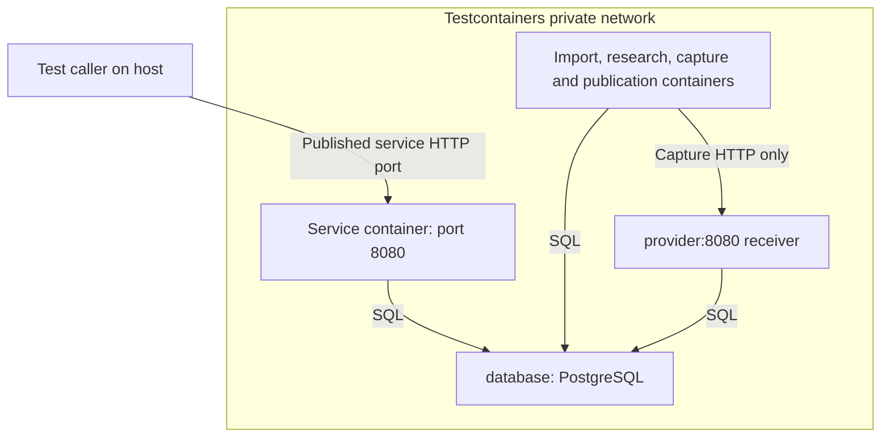

# Understand the container test deployment

The [container suite](../../tests/workflows/containers.test.ts) exercises the service-to-worker flow described in
[the walkthrough](./01-basics.md). The [test guide](./07-tests.md) explains each assertion and the finer recovery cases.

Each suite run creates its own network and PostgreSQL database. The setup migrates adapter tables and installs the
fixture's application schema. It starts a capture receiver on the private network. Each scenario starts its own HTTP
service and worker containers with a new workflow namespace.

| Container          | Connection path                             | Responsibility                                                |
| ------------------ | ------------------------------------------- | ------------------------------------------------------------- |
| Service            | HTTP from test caller; SQL to `database`    | Accept commands and read saved status                         |
| Import worker      | SQL to `database`                           | Import original rows and resolve corrected accounts           |
| Research worker    | SQL to `database`                           | Advance acquisition and recover expiry waits                  |
| Capture worker     | SQL to `database`; HTTP to `provider`       | Run the capture activity on its declared engine               |
| Publication worker | SQL to `database`                           | Run Knowledge, stage the contribution, and publish its commit |
| Receiver           | HTTP from capture worker; SQL to `database` | Save one capture for each stable business request key         |
| PostgreSQL         | SQL from each owner                         | Keep business state and workflow progress after process loss  |

The workers exchange input and results through database records. They do not invoke each other's JavaScript functions or
transfer live connections. The test caller uses the service's published HTTP port. Private aliases resolve within the
Testcontainers network.

The service's published port is the test caller's entry point. Inside the private network, the receiver is named
`provider` and PostgreSQL is named `database`. The fixture supplies those aliases explicitly:

The worker box groups separate containers; it is not a single process that runs every role. SQL arrows carry saved
requests, results and domain writes, while the capture arrow is a real HTTP call. The telemetry collector is omitted
because it observes the scenario rather than deciding job completion. A workflow namespace separates saved work; it
does not create a network, container or machine. This is a local Docker test, not Kubernetes deployment evidence.

The suite builds ESM from the same TypeScript consumers used by the process tests. It copies the resulting files into
pinned Node containers. This proves that the worker can run with its bundled dependencies outside the host checkout. It
does not certify a separately maintained production Dockerfile or deployment manifest.

The worker image does not contain a database queue server. The queue is the adapter's saved PostgreSQL jobs. The
worker's `serve()` loop selects matching jobs and renews running-attempt permission. The engine is only an allowed
environment name. The test explicitly creates containers; the library never creates them.

A forced container stop interrupts real running code. Replacement containers start fresh code against the same database.
The after hook closes its SQL pool, stops the containers it created, removes the network, and deletes temporary bundles.
It never selects unrelated containers for cleanup.

This topology is closer to an application deployment than the local child-process cases. It still uses one local
PostgreSQL instance and a synthetic capture receiver. Database failover, orchestrator restarts, rolling production
images, paid providers, and sustained throughput need their own tests.
