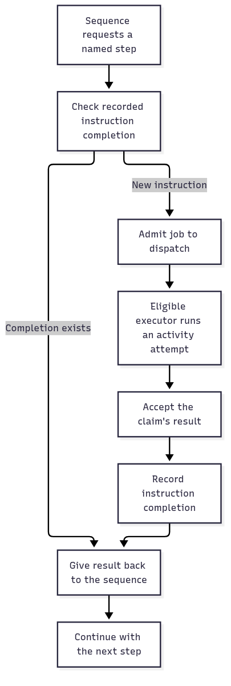

# Replay completed steps in a local photo upload

This guide follows a photo upload from ordinary calls to recorded local instructions. It also serves as a reference
for local scheduling. Read [the durable service chapters](./README.md) when committed work must survive worker crashes.

## See what ordinary calls repeat

Save a title, then put its new ID into an album. Repeat the same call to see why reusing a completed instruction can
be useful. This first program deliberately does not record anything.

Save this first program as `ordinary-upload.ts` and run `mise exec -- deno run ordinary-upload.ts`.
It uses only ordinary JavaScript and needs no package setup. Before recording anything, consider those calls. Each call to `save` appends a title. Repeating the function
therefore appends twice, even though its input is unchanged:

```ts runnable=ordinary-upload.ts
const titles: string[] = [];
const album: string[] = [];
async function save(title: string): Promise<string> {
	titles.push(title.toUpperCase());
	return `asset-${titles.length}`;
}
async function upload(title: string): Promise<string> {
	const id = await save(title);
	album.push(id);
	return id;
}
console.log(await upload('summer trip'), await upload('summer trip'));
console.log(titles.length, album.length);
```

```text output
asset-1 asset-2
2 2
```

## Record the same two writes

Keep those two writes, but ask the scheduler for each result instead of calling it directly. In a workflow generator,
`yield* ctx.trigger(SaveTitle, input)` means “request this named job, then continue with its result.” JavaScript pauses
this generator at the instruction. The scheduler either supplies a compatible recorded answer or runs the job. `await`
still belongs inside the ordinary activity implementation that actually writes the data.

These objects divide responsibility for running and remembering the two photo writes:

| Owner | Role in this upload |
| --- | --- |
| Activity definition / implementation | Describe checked save/album calls / supply their ordinary async functions. |
| Resource collection | Acquire the photo store and own its cleanup; activities borrow it. |
| Engine and local provider | Select and execute implementations in this process. Declaring an engine starts nothing. |
| Dispatch and executor | Retain pending jobs / take those jobs and run the provider. |
| History and scheduler | Retain completed instructions / decide whether a request reuses or runs work. |
| Context | Supply cancellation and local cleanup lifetime. It does not persist an execution. |

From the repository root, run `mise run prepare -- --kind deps` once. Save the next block as `recorded-upload.ts` and run
`mise exec -- deno run recorded-upload.ts`. These workspace imports need no published package or network service.

```ts runnable=recorded-upload.ts
import * as activity from '@okikio/activity';
import * as engine from '@okikio/activity/engine';
import * as local from '@okikio/activity/local';
import * as context from '@okikio/context';
import * as resource from '@okikio/capability/resource';
import * as dispatch from '@okikio/workflow/dispatch';
import * as history from '@okikio/workflow/history';
import * as workflow from '@okikio/workflow';
import * as schema from '@okikio/schema';

const TextSchema = schema.string();
const Local = engine.define({ id: 'local' });
const Store = resource.define<{
	save(title: string): Promise<string>;
	addToAlbum(id: string): Promise<string>;
}>({ id: 'photo.store', description: 'Save titles and append photo IDs to an album.' });
const titles: string[] = [];
const album: string[] = [];
const store = resource.implement(Store, {
	create: () => ({
		async save(title) {
			titles.push(title);
			return `asset-${titles.length}`;
		},
		async addToAlbum(id) {
			album.push(id);
			return id;
		},
	}),
});
const SaveTitle = activity.define({
	id: 'photo.save-title',
	version: '1',
	input: schema.string({ minLength: 1 }),
	result: TextSchema,
	placement: engine.require(Local),
	resources: [Store],
});
const AddToAlbum = activity.define({
	id: 'photo.add-to-album',
	version: '1',
	input: TextSchema,
	result: TextSchema,
	placement: engine.require(Local),
	resources: [Store],
});
const saveTitle = activity.implement(SaveTitle, {
	async run(ctx) {
		return await (await ctx.get(Store)).save(ctx.input.toUpperCase());
	},
});
const addToAlbum = activity.implement(AddToAlbum, {
	async run(ctx) {
		return await (await ctx.get(Store)).addToAlbum(ctx.input);
	},
});
const UploadPhoto = workflow.define({
	id: 'photo.upload',
	version: '1',
	input: TextSchema,
	result: TextSchema,
	activities: [SaveTitle, AddToAlbum],
});
const uploadPhoto = workflow.implement(UploadPhoto, function* (ctx) {
	const id = yield* ctx.trigger(SaveTitle, ctx.input);
	return yield* ctx.trigger(AddToAlbum, id);
});

await using parent = context.create({ id: 'photo-parent' });
await using stores = resource.create(resource.implementations(store), { ctx: parent, host: {} });
await using jobs = dispatch.memory();
await using records = history.memory();
await using scheduler = workflow.scheduler({
	activityDispatch: jobs,
	history: records,
});
await using executor = await workflow.executor({
	dispatch: jobs,
	engine: Local,
	hostId: 'photo-host',
	capacity: 1,
	provider: local.create({ engine: Local, implementations: [saveTitle, addToAlbum], resources: stores }),
});
for (const pass of ['first run', 'replay']) {
	await using run = await workflow.context({
		definition: UploadPhoto,
		runId: 'photo-upload-1',
		input: 'summer trip',
		ctx: parent,
	});
	console.log(pass, await workflow.run({ ctx: run, implementation: uploadPhoto, scheduler }));
}
console.log('Saved titles:', titles.join(','));
console.log('Album entries:', album.join(','));
```

Expected output:

```text output
first run asset-1
replay asset-1
Saved titles: SUMMER TRIP
Album entries: asset-1
```

Compare the output before changing the input. The remaining sections explain the options and limits; the
[package example](../../packages/workflow/README.md) also places this operation among adjacent capabilities.

## Save a photo, then add it to an album

An album upload has two writes: save the photo's title and add its returned ID to the album. Calling the same functions
again could create a second photo or album entry. The example above runs those two jobs, then runs the same workflow
again. Its recorded completions provide the answer without repeating either write.

`yield* ctx.trigger(SaveTitle, input)` is the unfamiliar part. Read it as “ask for the SaveTitle job's result, then
continue.” It uses JavaScript's generator protocol: a request yields an instruction object; the scheduler supplies a
completion; the request returns the completion's value to the program. It is not an async function call hidden behind
new spelling. Use `await` for ordinary live promises; use `yield*` inside this workflow program when the scheduler must
identify and record the instruction.

| Contract                      | Simplified contents                                                     | Role in the album example                                  |
| ----------------------------- | ----------------------------------------------------------------------- | ---------------------------------------------------------- |
| `WorkflowDefinition`          | ID, version, input/result schemas, declared activities and dependencies | Describe what the program accepts and returns.             |
| `WorkflowImplementation`      | Definition plus a generator function                                    | Describe the order of instructions.                        |
| `WorkflowOperation<Value>`    | An iterable yielding a `WorkflowInstruction` and returning `Value`      | Connect one requested instruction to its typed completion. |
| Completion                    | Success with a value, declared failure, fault, or cancellation          | Tell the suspended request how that step finished.         |
| History / dispatch / executor | Recorded instructions / admitted activity items / supplied provider     | Decide whether to reuse a completion or run new work.      |

Underneath `workflow.run()`, the runner validates the run's input and steps through the generator. For each instruction,
the scheduler computes an identity at that instruction's path and asks history for a compatible completion. A matching
record supplies the value. New activity work goes through dispatch to an eligible executor, whose accepted completion
returns through the scheduler. The runner then resumes the generator and validates its eventual result.

That separation lets a program describe “prepare, then save” without choosing a thread or transport in its call sites.
It also requires more setup than an async function. Stable run/instruction identities and trustworthy adapters matter;
neither an in-memory record nor replay alone guarantees that a remote side effect happens exactly once.

## See the sequence and the record of completed work

Read this diagram from top to bottom. A recorded completion can provide the step's result without another provider call.
A step without a completion needs the configured dispatch and executor.



[Editable diagram source](../../packages/workflow/diagram.mmd). This is the successful path. It omits retry timing,
cancellation and stale-claim rejection, which the later sections explain. Reusing a result does not rewind the
JavaScript process. Durable recovery needs authoritative storage and host services: the memory stores in the demo above
disappear when their process exits.

Use a regular function for a simple sequence that can start over safely. Use [task](../../packages/task/README.md) for
an owned local operation. Use a workflow when named instruction results, independently executed jobs or controlled
replay are part of the application's requirements.

For shared terms such as `await` and `await using`, see
[the short glossary](../02-learn.md#read-the-small-amount-of-code-you-need).

For the exact functions, types and field explanations, read the
[Workflow package README and entry-point map](../../packages/workflow/README.md#choose-an-entry-point).

## Apply the same shape to a larger job

| Scenario                  | Named activity steps                                                          | What the application must supply                                         |
| ------------------------- | ----------------------------------------------------------------------------- | ------------------------------------------------------------------------ |
| Prepare a photo           | Inspect dimensions, create preview, save preview location                     | Image tools, storage resources and a duplicate-write policy.             |
| Import customer records   | Validate a batch, store accepted records, publish import result               | Input limits, authoritative storage and stable commit identities.        |
| Send work to another host | Request a job, let an eligible executor claim it, receive its accepted result | Shared authoritative dispatch/history and that host's activity provider. |

For resource use, start with
[the activity save-title demo](../../packages/activity/README.md#save-a-photo-title-with-a-supplied-store). For a
simpler local import, start with [the bounded CSV composition](../03-composition.md#import-rows-with-bounded-work).
Adding workflow is useful when replay and dispatch solve a real problem; it is not necessary just to run two functions.

## Choose the local or saved execution path

The example above uses local memory stores to teach recorded steps. `workflow.run()` returns the checked result after
cleanup. The scheduler reads an instruction and checks whether history already has its result. If it does, the scheduler
returns that result to the generator. Otherwise, dispatch queues the activity and an executor runs its implementation.
Here, an executor is the local owner that takes jobs and calls an activity provider. Both stores disappear when their
process exits.

For work that must survive process loss, use `client()` and `serve()` with the optional PostgreSQL adapter. The adapter
supplies a saved queue, step results, timers, and recovery. The application supplies service admission, business rules,
live resources, worker processes, and deployment. The [background-work walkthrough](./01-basics.md) introduces each part
in order. The [complete consumers](./02-consumers.md) show every binding and policy.

| Path                  | Start work        | Run work                                       | Progress lifetime                    |
| --------------------- | ----------------- | ---------------------------------------------- | ------------------------------------ |
| Local recorded steps  | `workflow.run()`  | Scheduler, memory dispatch, executor, provider | While its memory owners survive      |
| Saved background work | `client.submit()` | `serve()` workers and PostgreSQL adapter       | Committed state survives worker loss |

These are different assemblies of the programming model. Do not add a local executor and a second `serve()` retry loop
around the same job. A direct activity can be submitted without wrapping it in a workflow.

## Read a workflow program

`workflow.define()` names the workflow and declares its input, result, activities, child workflows, and expected
failures. `workflow.implement()` supplies a generator. `yield* ctx.trigger(...)` asks for one activity and receives
its result. The program describes order. Activity implementations perform SQL, HTTP, and other external work.

When a recorded workflow resumes, the program starts from its beginning. Completed instructions return their recorded
answers. Those answers rebuild local variables without repeating completed activities. This is replay. It does not
restore a JavaScript stack. Keep live connections, resource collections, callbacks, and signals out of workflow input
and saved results. Do not read ambient time, random values, files, or network state directly in a replayed program. Put
those operations in activities so their results can be recorded.

The local Scheduler supports the following instruction families:

| Operation                                  | Meaning                                                          |
| ------------------------------------------ | ---------------------------------------------------------------- |
| `ctx.trigger(Activity, input)`              | Request a declared activity                                      |
| `sleep(duration)`                       | Wait for a relative timer through the command host               |
| `sleep({ until })`                          | Wait for an absolute UTC timer through the command host          |
| `wait(Event, { key })`                     | Receive an event through the borrowed local inbox                |
| `ctx.trigger(Child, input)`                 | Request a declared child workflow                                |
| `effect()`                                 | Ask the configured effect owner to accept a declared consequence |
| `defer()`                                  | Register serializable cleanup through the scheduler              |
| `continue()`                               | End this run and validate the next input                         |
| `parallel()`, `map()`, `race()`, `retry()` | Coordinate local instruction branches                            |

The PostgreSQL profile also supports activities, children, relative and absolute timers, event waits, `parallel()`,
`map()`, `race()`, and `retry()`. It saves unfinished branches and releases the worker's replay slot. The
[execution guide](./13-execution.md) compares branch limits, race decisions, wake-ups, and cleanup ownership across
hosts. The deprecated custom-host `wait(signal, input)` and generic workflow-level `effect()` have no durable
implementation and block with `unsupported_instruction`. Background triggers have a separate supported acceptance
contract. Durable `defer()` saves activity or child cleanup when policy requires `workflow.cleanup` and reserves cleanup
capacity. Bounded root `continue()` starts a new segment only after registered cleanup settles; it needs a finite
`maxContinuations` policy budget and cannot run inside branches or children. See [cleanup and execution](./13-execution.md)
and [continuation restrictions](./15-continuation.md). Suspending a saved workflow does not run generator `finally` code.
