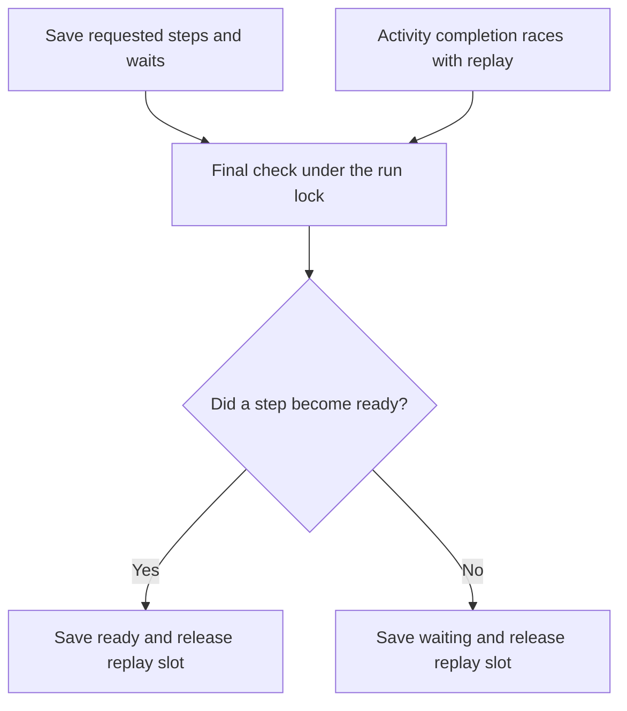

# Run the same program locally and in a worker

A service can run short work in its own process. A background worker can run work that must survive a restart. Both
hosts accept the same activity requests and workflow operations. Their storage and lifetime differ.

Start with the complete [Core import](./05-core.md) and [Intelligence](./06-intelligence.md) setups. Those examples show
the service, resources, policies, workers, readiness, and shutdown. The
[execution scenario](../../tests/workflows/scenarios/execution.ts) then runs one program through both hosts. The
[execution tests](../../tests/workflows/execution.test.ts) compare the results and kill real worker processes.

Here, an **activation** is one worker turn that rebuilds a workflow until it finishes or reaches saved waits. Waiting
for approval can end that turn: the database retains the wait and the worker can run something else. By contrast,
`await fetch(...)` inside an activity only lets JavaScript service other callbacks. The activity still holds its admitted
slot and any borrowed resources until its call and cleanup settle. This distinction matters when sizing a host.

## Observe a complete local approval before adding saved execution

The customer approves an import before publication. This small program uses the same named event as a saved workflow,
but a memory inbox makes delivery inspectable without PostgreSQL. `run` steps the generator; `yield*` exposes each
instruction to the scheduler; the outer `await` receives the final string. The following source fragments then extend
that pattern with actual imported batch activities.

From the repository root, run `mise run prepare -- --kind deps` once. Save the complete block as the named `.ts` file in your project and run
`mise exec -- deno run approve-import.ts`. These examples use workspace imports; they need no published package or network service.

```ts runnable=approve-import.ts
import * as context from '@okikio/context';
import * as schema from '@okikio/schema';
import * as workflow from '@okikio/workflow';
const Approved = workflow.signal({ id: 'import.approved', value: schema.boolean() });
const Import = workflow.define({
	id: 'example.approved-import',
	version: '1',
	input: schema.string(),
	result: schema.string(),
});
const ImportLive = workflow.implement(Import, function* (ctx) {
	const decision = yield* workflow.wait(Approved, { key: 'publish' });
	return decision.type === 'received' && decision.value ? `Published ${ctx.input}` : 'Rejected';
});
await using owner = context.create({ id: 'approval-owner' });
using inbox = workflow.events({ capacity: 1 });
await using scheduler = workflow.scheduler({ events: inbox });
await using run = await workflow.context({ definition: Import, runId: 'import-1', input: 'customer rows', ctx: owner });
await inbox.send(run.runId, Approved, true, { key: 'publish' });
console.log(await workflow.run({ ctx: run, implementation: ImportLive, scheduler }));
```

```text output
Published customer rows
```

This demonstrates addressed delivery, not crash recovery. It sends `true` before the program starts, so no timing race is
needed. A real publication write belongs in an activity. The saved tests below use SQL, independent processes and
interruption boundaries for that additional claim.

## Request work in the program

An import can split independent writes into branches. It can then wait for approval before publishing. This example uses
the definitions exported by the executable test scenario. The application still supplies each activity's implementation
and resources.

```ts
import * as workflow from '@okikio/workflow';
import { Approved } from '../../tests/workflows/scenarios/events.ts';
import { Work } from '../../tests/workflows/scenarios/execution.ts';

const Import = workflow.define({
	id: 'example.import',
	version: '1',
	input: Work.input,
	result: Work.result,
	activities: [Work],
});
const ImportLive = workflow.implement(Import, function* (ctx) {
	const rows = yield* workflow.parallel({
		first: ctx.trigger(Work, ctx.input),
		second: ctx.trigger(Work, { value: 2 }),
	}, { concurrency: 2 });
	const approval = yield* workflow.wait(Approved, { key: 'publish' });
	return approval.type === 'received' ? rows.first + rows.second : 0;
});
```

`parallel()` requests independent branches. `concurrency: 2` permits two unfinished branches at once. A branch waiting
for an event still occupies a branch position. The worker's `capacity.activities` separately limits activity code that
runs in that worker. Several workers can share queued work without sharing their JS memory.

`map()` applies the same branch limit to an ordered list. `retry()` repeats a failed operation within a logical attempt
budget. Activity recovery has a separate budget because a process can disappear during any logical attempt. A fault or
cancellation does not become a business failure that `retry()` can catch. Settled failures retain their declared failure
occurrence. Select serializable data from that occurrence when constructing a saved final result.

`race()` returns the first terminal branch observed by its host. Simultaneous completions have no guaranteed winner.
PostgreSQL saves the observed winner before the parent continues. A replacement reads that saved decision. Losing queued
attempts lose permission to write through the workflow store. Running code observes cancellation when its next renewal
fails. Its worker retains the occupied activity slot until that code and its cleanup settle.

Local races join losing branches before returning. Across durable workers, revoking permission cannot prove that a
remote process has stopped or completed external cleanup. Put crash-safe cleanup in saved activities and receipts.
External receivers need their own idempotency or cancellation contract.

## Save work before releasing a worker slot

The PostgreSQL runner performs a short replay:

1. Read the next requested step from the generator.
2. Return its saved result if the step already completed.
3. Otherwise save its activity, child request, event wait, or timer.
4. Visit other eligible branches.
5. Check unfinished steps while holding the run's database lock.
6. Save `waiting` if they are still unfinished. Save `ready` if one completed during the scan.

The last check prevents a lost wake-up. An activity can finish between steps 3 and 5. Its result cannot be overwritten
by a later `waiting` update. If the worker dies during replay, the saved steps remain. When its permission expires, a
replacement rebuilds local variables from completed results and saves the missing branches.

A dormant workflow has saved rows. It has no live generator, event subscription, or activity slot. One worker-level
notification subscription can wake any of that worker's eligible runs. The hosting platform must keep a worker
available. PostgreSQL notifications cannot start a stopped container. Starting a worker does not resume every dormant
run. Its saved event, activity completion, child result, or timer makes it ready again.

## Wake a worker efficiently

The last replay check closes a race that matters to the person waiting for a result. A completed activity must not
leave its workflow asleep just because completion arrived during replay:



The lock keeps the decision and state update together. A later completion can make waiting work ready through the
store's normal wake-up path. A notification only prompts inspection; it cannot provision a missing worker.

| Work being counted | While it waits | When the slot is released |
| --- | --- | --- |
| A live activity attempt | An ordinary `await` still holds its activity slot | After the activity and owned cleanup settle |
| One workflow replay activation | It saves unfinished instructions rather than retaining a generator indefinitely | After the ready/waiting decision is saved |
| A dormant saved workflow | Rows remain in the store, with no running activation | It holds no replay slot while dormant |

This view omits retry and lease timing. Those settings decide when another activation may run; they do not turn a
JavaScript Promise into durable saved work.

The adapter uses PostgreSQL `LISTEN` and `NOTIFY`. A notification contains only the namespace. It tells a worker to scan
saved work. It does not contain the work or grant permission to run it.

The worker subscribes before its first scan. A small local counter remembers notifications received during a scan. This
prevents a notification from falling between a scan and the next wait. Reconnecting the listening session requests a
fresh scan. The local subscription uses `@okikio/observables`.

A quiet worker waits until the earliest saved timer, delayed retry, or attempt expiry. The database clock measures the
remaining delay. An already-due queued retry also requests another scan when the worker has capacity for that
definition. This closes the gap where a retry becomes due just after dispatch checks it. A full worker does not poll
that queued job. A ready workflow skipped because its row is locked also requests another scan when a replay slot is
available. Releasing a row lock may not send another notification. Each deadline query reads the first eligible row from
the relevant indexes. The worker also performs a fallback scan at most `pollIntervalMs` milliseconds apart. The default
is 1000 ms. A local activity completion wakes its worker immediately so available capacity can take more work.

Lease renewal still runs while the worker is idle or draining. Renewing a lease and reporting progress do not send
notifications. Neither action means new work became runnable. `claims.recoverEveryMs` remains the accepted bound on
recovery scan spacing when work is due. A known deadline wakes the scan. A recent recovery batch can delay the next
recovery check by that interval. This avoids spinning on an overdue backlog.

The adapter owns one listening connection per worker subscription. It closes that connection during drain, including a
session created after reconnecting. The application continues to own its query pool. Use a direct connection or session
pooling for notifications. With transaction pooling, disable notifications and choose the fallback interval:

```ts
import * as postgres from '@okikio/storage/workflow/postgres';
import * as workflow from '@okikio/workflow';
import { Policy, ProgramLive, WorkLive } from '../../tests/workflows/scenarios/execution.ts';
import { Engine } from '../../tests/workflows/scenarios/events.ts';

const store = postgres.open({ database, namespace: 'imports', notifications: false });
const worker = await workflow.serve({
	store,
	workflows: [ProgramLive],
	activities: [WorkLive],
	engine: Engine,
	resources,
	policies: [Policy],
	hostId: 'imports-1',
	shutdown: stop.signal,
	pollIntervalMs: 1000,
	capacity: { activations: 2, activities: 4, finalizers: 1, control: 1 },
});
// The application's shutdown path runs these in order.
await worker.drain();
await store[Symbol.asyncDispose]();
await resources[Symbol.asyncDispose]();
await database.end();
```

The complete scenario supplies the definitions and bindings shown here. Keep application authorization and resource
construction explicit. Calling `open()` alone starts no worker and opens no connection.

A notification is delivered only if its transaction commits. A rollback publishes no work. PostgreSQL can reject a
transaction if its notification queue is full. Treat this as a failed transaction and retry it under the same command
key. The service must not report acceptance before commit.

## Wait for time or an event

Use `yield* workflow.sleep(duration)` for a relative delay and `yield* workflow.wait(Approved, options)` for an event. Each pauses only
its branch while the runner saves or completes the instruction.

```ts
// Relative timer. A saved run starts it once and keeps that deadline after a crash.
const resumed = yield * workflow.sleep({ minutes: 5 });

// Absolute timer. Read the deadline from validated workflow input or a completed activity.
const expired = yield * workflow.sleep({ until: ctx.input.expiresAt });

// Event with an optional absolute deadline. The result distinguishes delivery from timeout.
const approval = yield * workflow.wait(Approved, { key: 'publish', until: ctx.input.expiresAt });
if (approval.type === 'timeout') return { published: false };
```

Both timer results are `Temporal.Instant` values. A saved timer returns its stored deadline, not a new reading of the
clock after restart. Event results are `{ type: 'received', value }` or `{ type: 'timeout' }`. Cancellation cancels the
workflow; it is not an event timeout. An event key names one logical wait within a run. Use different keys for separate
waits. A relative duration cannot accompany an event wait.

Local timers use the scheduler's command host. The saved service owns PostgreSQL timers and event storage. It releases
its execution slot while the run waits. No active generator or application listener must remain alive for saved work.
The runner resumes when the deadline is due or delivery is committed. A wait inside `parallel()` pauses only its branch.

Keep normal generator composition. A small generator can wait and return a result to its caller:

```ts
function* approve(expiresAt: string) {
	// Approved is the event declaration from the complete example above.
	return yield* workflow.wait({ event: Approved, key: 'publish', until: expiresAt });
}

// Inside a workflow implementation:
const approval = yield * approve(ctx.input.expiresAt);
```

The runner sees each yielded instruction even through delegated generators. Saved work starts the generator again and
supplies recorded answers. It does not restore its stack. Keep instruction order, keys, and deadlines stable. Put time
reads and external work in activities or workflow input so replay does not change the request.

`defer()` still registers cleanup. It does not mean sleep or delayed execution. Local cleanup runs when the scheduler
closes the program. Durable `defer()` saves activity or child cleanup. Require `workflow.cleanup` in policy and reserve
cleanup slots. A killed process cannot run generator `finally` blocks. Use activity receipts or idempotency keys to make
repeated external writes safe.

Use `sleep(duration)` or `sleep({ until })` for timers and `wait(Event, options)` for events. The older object-form
waits, `sleepUntil()`, and `waitForEvent()` remain compatible. Timer instructions keep the same saved representation.
The older `sleepUntil()` returns a string; `sleep({ until })` returns a `Temporal.Instant`. A custom local host hook
should use the explicit three-argument `wait(signal, input, options)` form. It is separate from saved event waiting.

## Recover after a crash

For a Core import, the service first saves the request. A worker takes a batch and writes rows with a receipt in one
transaction. If it dies after commit, a replacement reads the receipt. If it dies before commit, PostgreSQL rolls back
the writes. Completed sibling batches keep their saved results.

For Intelligence, the program can wait for an approval event or a capture deadline. Event delivery saves both the event
and the waiting instruction's result in one transaction. No live event subscriber is required. A relative wait uses the
database clock once and saves an absolute deadline. Replaying `sleep(duration)` does not move that deadline forward.
Both relative and absolute `sleep` return a `Temporal.Instant` in either host.

The new tests cover process death, completed sibling reuse, retained timer deadlines, event delivery with no live
waiter, completion during parking, notification connection loss, notification shutdown, transaction rollback, namespace
isolation, bounded fallback polling, and idle workers that do not scan continuously. Existing Core and Intelligence
container tests continue to cover receipts, remote writes, finalizers, and stale attempts.

## Keep the supported boundary visible

Both hosts support activities, relative and absolute timers, event waits, children, `parallel()`, `map()`, `race()`, and
`retry()`. Local timers and children need a command host. Durable workers use the PostgreSQL store for those requests.
The local scheduler uses its borrowed inbox for event waits.

The deprecated `wait(signal, input)` custom host hook and generic workflow-level `effect()` have no durable
implementation. Background trigger effects have their explicit admission contract. Durable `defer()` saves cleanup;
[bounded root continuation](./15-continuation.md) creates a fresh segment after that cleanup. Activity effects can
report saved progress. Policy finalizers can supply additional durable exit work after registered cleanup. Suspending a
saved workflow does not run arbitrary generator `finally` code.

Run the schema migration from an explicit maintenance entrypoint before starting new workers. Revision 2 requires
drained older workers and adds operator control, history, retention timestamps, and continuation metadata. Current
revisions return without DDL. Include `workflow.controls` in policies that use saved branches. The
[operations guide](./16-operations.md) covers pause/resume, explicit bounded pruning, capacity inspection, and failure
test. Container provisioning and autoscaling remain application deployment concerns.

## What we learned from other PostgreSQL queues

[Graphile Worker](https://worker.graphile.org/docs/faq) combines notifications with polling. Future deadlines still need
time-based checks. It also requests new jobs when occupied workers finish. We use that completion wake-up and retain a
fallback scan.

[pg-boss](https://github.com/timgit/pg-boss/blob/master/docs/database-backends.md) separates the storage contract from
optional notification support. Our store can also operate with notifications disabled.

[PGMQ](https://pgmq.github.io/pgmq/api/sql/functions/) exposes a visibility timeout, visibility extension, explicit
acknowledgement, archival, and deletion. A visibility timeout permits redelivery after a reader disappears. Our existing
leases and saved attempt rules serve that recovery role. They also reject writes from replaced attempts. Neither
approach makes an arbitrary external write safe to repeat. The PostgreSQL adapter now supplies explicit terminal-family
pruning with a total row budget and preservation windows; it does not provide a separate archive store.

[PostgreSQL's LISTEN guidance](https://www.postgresql.org/docs/current/sql-listen.html) requires establishing the
subscription before inspecting initial database state. Its
[NOTIFY guidance](https://www.postgresql.org/docs/current/sql-notify.html) explains commit delivery and notification
queue limits. These rules determine our startup order, fallback path, and acceptance boundary. No PostgreSQL extension
is required for this implementation.

See [connected consumers](./14-consumers.md) for the preferred `ctx.trigger()`, `sleep()`, and event-only `wait()`
forms, and the complete process/thread setup. The object-form wait examples in this chapter remain supported for
compatibility.
