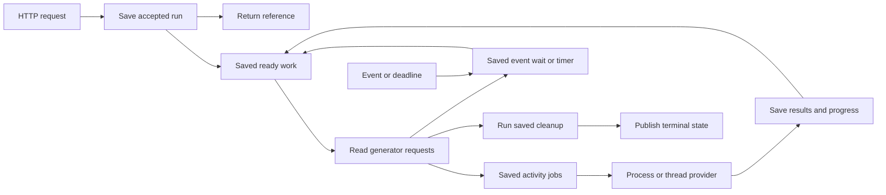

# 14 — Connect the service, workflow, and engines

A customer starts an import. The service saves the request and returns a reference. A worker writes batches in a
separate process. The customer can read progress and approve the import. If the worker stops, a replacement uses the
saved results. It does not start the completed batches again.

The Intelligence example uses the same request API. It analyzes two branches in threads, waits for both, and publishes
through a child workflow. Each branch can register cleanup. The parent continues only after the required branch cleanup
finishes.

These are small test scenarios inspired by Core and Intelligence. They do not change either application. Their SQL
writes stand in for imports, analysis, publication, and notifications. The older chapters retain deeper application
examples with local guarded transactions and external receivers.

## Follow one import from a button to its final answer

`Import` is the accepted command. `Write` saves its bounded batches. `Approved` is the later boolean decision.
The caller first authorizes the account and validates input, then uses `client.trigger(Import, input, { scope, key })`.
That call commits acceptance and returns a reference; it does not write the batches. A `serve` worker binds the exact
`Write` implementation and database resources, takes saved work, and records the completed batches. The generator
requests the next batch with `yield* ctx.trigger(Write, ...)`. When it asks for `Approved`, the database retains that
wait and releases its execution slot. `client.send` accepts the addressed approval even if the worker is down.
`client.wait(Import, ref)` eventually supplies the terminal result after saved cleanup.

```text
Authorized submission -> saved Import reference -> worker runs Write -> saved batch receipt
                                                                    -> saved approval wait
Authorized approval  -> saved Approved event    -> replacement can resume -> cleanup -> final result
```

Read each row left to right; the repeated saved records are the handoff between processes. This omits SQL row-lock order,
which the recovery reference owns. The reference grants no account access by itself. If a worker dies after a write but
before its completion is recorded, the stable domain write key prevents a duplicate; a progress count does not.

To exercise this complete fixture, prepare dependencies and run from the repository root:

```sh
mise run prepare -- --kind deps
mise exec -- deno test -A tests/workflows/consumers.test.ts
```

Docker must be running: the suite owns a disposable PostgreSQL 18.3 container and launches real process/thread engines.
It reports named test results, including forced replacement and cleanup cases. These are integration-test entrypoints,
not an application server command or a throughput test. To build your own service, preserve the same ownership
trace and replace its fixture SQL and trusted test endpoints with authorized application operations.

Read the complete source in this order. No application bootstrap functions are omitted:

1. [Contracts and programs](../../tests/workflows/scenarios/consumers/contracts.ts): schemas, resources, activities,
   signals, generators, engine placement, and the full policy.
2. [Activity bodies](../../tests/workflows/scenarios/consumers/activities.ts): dependency access, writes, progress, and
   the deliberate interruption points used by tests.
3. [Entrypoints](../../tests/workflows/scenarios/consumers/main.ts): the service, worker, SQL pool, resource bindings,
   process provider, thread provider, LogTape, readiness, and shutdown. The role selects a complete entrypoint in this
   file. Process and thread entrypoints acquire their own resources.
4. [Recovery tests](../../tests/workflows/consumers.test.ts): PostgreSQL Testcontainers, real operating-system
   processes, real Web Worker threads, HTTP requests, forced shutdown, replacement, and repair.

The database runs in a container. This suite launches its engines as processes and threads on the test host. It does not
prove container orchestration, autoscaling, or production deployment. The separate [container suite](./08-containers.md)
covers the existing container topology.

## Request work the same way

The following fragments are reference excerpts from the linked `contracts.ts` and `main.ts`, not standalone files. Inside a generator, `yield*` requests work and receives its
result. It also lets ordinary generator functions compose without introducing a new runtime.

```ts
const result = yield * ctx.trigger(Write, { source, batch: 1, label: 'rows' });
const published = yield * ctx.trigger(Knowledge, { source, batch: result.value, label: 'publication' });
```

The workflow declares these activity and child definitions. This declaration identifies the operations its program may
request. It does not list allowed database connections or pass open resources across processes.

Outside a workflow, the client saves work and returns its reference:

```ts
const ref = await client.trigger(Import, input, { scope: workspaceId, key: requestId });
```

The application authorizes `workspaceId`. `requestId` identifies a repeated request at the service boundary. Repeating
that request returns the accepted work; changing its input under the same identity conflicts. Steps inside the workflow
need no authored keys. Their generator positions supply saved identities. Do not change an accepted program's step order
under the same definition version.

## Accept background work through an effect

```ts
// Wait for acceptance. Do not wait for notification completion.
yield * ctx.trigger(Notify, input, { background: true });
```

In durable execution, the runner saves a child request with an independent lifetime. The policy must allow that child,
including an activity used as background work. Its reserved child budget prevents an unbounded stream of requests.
Parent cancellation does not cancel this independent request.

A local scheduler needs an explicit recipient. It can use a durable client:

```ts
await using scheduler = workflow.scheduler({
	effect: client.effects({ scope: workspaceId }),
});
```

This routes background trigger effects to durable acceptance. It starts no worker. Emission rejects if acceptance fails.
The saved key combines the local run identity and instruction identity. The caller must reuse the same local run
identity when retrying that acceptance. A new run identity means new work. Other effects still need their own recipient;
`client.effects()` rejects effects it does not own.

The durable generator does not execute arbitrary effect recipients during replay. Background triggers have a specific
saved-work interpretation. Activities remain the place for business effects and external I/O.

## Keep time and events separate

```ts
yield * workflow.sleep({ minutes: 5 });
yield * workflow.sleep({ until: '2030-01-01T00:00:00Z' });
const approval = yield * workflow.wait(Approved);
await client.send(ref, Approved, true);
```

`sleep()` saves a timer. `wait()` waits for a named event. Both release the workflow execution slot while dormant.
Sending an event before the wait is installed is safe. The event remains in PostgreSQL. A notification wakes an
available worker; it cannot start a stopped container.

One wait per event per run needs no key. Repeated logical rounds use matching explicit addresses:
`wait(Approved, { key: 'round:2' })` and `client.send(ref, Approved, true, { key: 'round:2' })`.
`wait(Approved, { until })` adds an event deadline. Existing object-form waits, `sleepUntil()`, `activity()`, `child()`,
and `client.submit()` remain compatible. A legacy custom-host `wait(event, input, options)` should supply all three
arguments, so its input cannot be confused with event options.

## Report progress without making it the result

```ts
await effect.emit(ctx, task.ProgressEffect, {
	completed: 200,
	total: 1000,
	unit: 'rows',
	message: 'Saved batch',
	data: { phase: 'write' },
});
```

Declare `task.ProgressEffect` in an activity's `effects`. The durable runner recognizes it automatically. A local Task
recognizes it without a `progress` option. Custom progress effects remain supported.

Reports contain optional counters, a unit, a message, and application JSON data. Validation rejects negative or invalid
counters, non-JSON values, cycles, accessors, excessive nesting, and reports larger than 64 KiB. This is a snapshot, so
it needs no occurrence key. Business effects still require explicit keys.

`work.progress` holds a local Task's latest report. `work.updates` uses `@okikio/observables` for subscribers. The
Task's `done` promise owns its terminal result. A subscription does not own cancellation or completion.

For saved work, use `client.get(Import, ref, { children: true })` or `client.watch(ref, { children: true, signal })`.
Each report includes its owning run, operation, attempt, revision, and plain `progress` value. A snapshot holds at most
1000 reports and marks truncation. A watch rejects a truncated snapshot rather than silently hiding reports. Query a
child reference for a smaller view.

A retry may emit the same count again. Display the latest value per job and effect, and use revisions to ignore an
unchanged saved snapshot. Counters can move backward on a new attempt. A watch follows the root's lifetime and ends when
that root settles. Independent background children can continue afterward. Observe their own references when that longer
lifetime matters. Choose HTTP polling, SSE, WebSocket, or another UI transport in the application.

## Register cleanup before it is needed

```ts
yield * workflow.defer(ctx.trigger(Clean, { ...input, batch: 0, label: 'outer' }));
yield * workflow.defer(ctx.trigger(Clean, { ...input, batch: 0, label: 'inner' }));
```

`defer()` registers work. It does not run that work now. Local execution closes its operation scope and joins cleanup.
Durable execution saves the registration. A dormant event wait does not close the scope or run its cleanup.

When the scope finishes, the runner starts the latest registration first: `inner`, then `outer`. Cleanup can request an
activity or a child workflow. Parallel branches close their own scopes before returning their values. A race closes
losing scopes before continuing with the saved winner. Ordinary composed generators share their surrounding scope.

Durable policy must require `workflow.cleanup`. This reserves cleanup capacity at acceptance. The worker also needs a
finalizer slot. The example reserves one process-provider slot so ordinary process work cannot occupy every place needed
by cleanup. A policy exit activity, when configured, runs after these registrations.

The root keeps its intended result while cleanup runs. Its state is `settling` until cleanup succeeds. Cancellation and
business failure also run saved cleanup. Exhausted activity cleanup blocks the run with `cleanup_exhausted`. Inspect it,
repair its destination, and call `client.repair()` with an operator, reason, observed epoch, and bounded extra attempts.
The test verifies that repair retains the original business result.

A cleanup child owns its own recovery. If it blocks, the parent retains its pending cleanup and exposes
`cleanup_child_blocked`. Inspect the child through `utils_workflow.cleanups.child` and repair that child. The parent
continues when the child completes. Repairing the parent cannot fix a blocked child.

Cleanup is still repeatable work. It needs the same safe-write rules as other activities. JavaScript `finally` cannot
survive a killed process. Use resource disposal for local connections and saved cleanup for obligations that must
survive that process.

## Know which package owns each part

| Package                                                             | Role in this flow                                                                                         |
| ------------------------------------------------------------------- | --------------------------------------------------------------------------------------------------------- |
| `schema`                                                            | Validates application and transport values through Standard Schema.                                       |
| `resource`                                                          | Defines dependencies and acquires them within each host. Typed direct definitions need one call.          |
| `context`, `dispose`                                                | Own cancellation and joined local cleanup. They do not save execution state.                              |
| `task`                                                              | Controls one local operation and defines the standard progress effect. It is not a durable queue.         |
| `effect`                                                            | Delivers reports and background acceptance to explicit recipients.                                        |
| `workflow`                                                          | Interprets generator requests, controls branches, and coordinates saved work.                             |
| `postgres/workflow`                                                 | Saves acceptance, jobs, results, waits, cleanup, policy, and recovery permission.                         |
| `activity`                                                          | Binds checked work to implementations and engine placement.                                               |
| `activity/process`, `process`, `process/channel`                    | Pool child processes and carry checked requests, results, and reverse effects.                            |
| `activity/worker`, `worker`                                         | Pool Web Worker threads and carry the same activity contract.                                             |
| `pool`                                                              | Reuses exclusive execution hosts and joins their disposal. The coordinator does not duplicate this logic. |
| `server/service`, `server/endpoint`, `server/http`, `http/response` | Describe, implement, mount, and serialize the service boundary.                                           |
| `deno/signals`                                                      | Attaches process stop signals to a separately owned shutdown context.                                     |
| `telemetry/instrument`, LogTape                                     | Observe utility execution. The application configures destinations and resets logging last.               |
| `record`                                                            | Checks plain progress data without invoking getters or accepting inherited configuration.                 |

The saved workflow queue already exists in the PostgreSQL adapter. Adding `queue.local()` would create a second
acceptance authority. `concurrency` is useful inside activity code for streaming batches; it does not replace durable
branch scheduling. `capacity` and `resilience` help callers with local admission or retry contracts. The runner uses
saved policy for those durable decisions, so an extra local retry loop must not silently multiply attempts. `csv`,
`streams`, `hash`, and `codec` belong in actual parsing and artifact activities when those capabilities are required;
this small fixture writes structured test rows and does not pretend to parse source files.

## Read capacity, readiness, and shutdown literally

The example permits two generator replays, four ordinary activities, one recovery loop, and one cleanup activity at a
time in this worker. Its process provider permits three attempts, with one slot reserved for cleanup. Its thread
provider permits two. A provider's pool maximum must support its declared budget. These are simultaneous work limits,
not CPU counts or queue lengths. A sleeping workflow occupies no activity or replay slot.

`workflow.serve()` validates bindings and policy, registers its definitions in storage, listens for wake-ups, and scans
for eligible saved work. It runs short generator replays and dispatches activity attempts. Completed attempts save
results. Those results make dependent work ready. The loop also renews permission and finds work abandoned by crashed
workers. It borrows the store, resources, and providers; the application closes them after the worker joins.



The fixture's `/ready` checks database/schema access, worker registration, and recent coordinator scans. It does not
prove that every lazy process or thread can boot, that application credentials work, or that a business recipient is
available. Add application probes for those dependencies before routing production traffic.

On SIGTERM, the separate shutdown context tells the worker to stop taking jobs. Providers retain their active contexts
while the worker joins attempts and cleanup. The HTTP listener closes, then the service runtime, provider pools, store,
resources, and SQL pool close through their explicit owners. LogTape resets after those owners finish. The harness
checks graceful exit and uses forced termination only for deliberate recovery tests. A deployment may need to stop new
HTTP admission earlier; this combined fixture leaves admission available during drain so accepted work can wait for a
replacement.

If the entire worker dies, its saved work remains. Another compatible worker waits for expired permission, replays
completed results, and retries unfinished work according to saved policy. A write committed just before the crash may
already exist. The fixture uses a unique `(namespace, job)` database key to demonstrate idempotency across that gap.
This does not reject every stale business write. Local guarded transactions and remote domain write services have
different safety contracts. Remote engines cannot use a copied local store claim: startup rejects remote policy
requirements for `postgres.transactions` and `postgres.receipts`.

The tests prove the stated process/thread and PostgreSQL boundaries. They do not prove arbitrary external writes are
exactly once, profiles are collected, engines are automatically launched by notifications, or resources survive a
crashed process.
