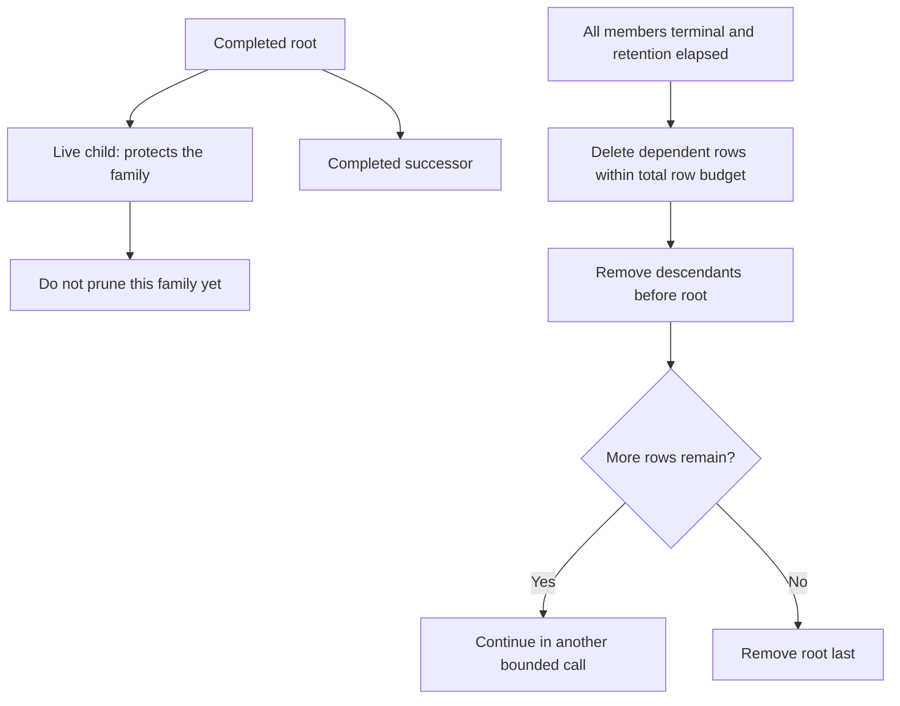

# 16. Operate and test durable execution

An import has stopped moving. First inspect the saved run and its attempts. A paused run, an overdue wait, and a
failed worker may look the same to the customer, but they call for different actions:

| What you need to do | Start here |
| --- | --- |
| Find what the run is waiting on | [Inspect state, waits, and history](#inspect-state-time-progress-and-history). |
| Stop a run from taking new work while you investigate | [Pause the physical run](#pause-and-resume-a-physical-run). In-flight work can still settle. |
| Find out if a business write can be repeated | [Recover after a worker stops](./04-recovery.md). Check receipts before requesting repair. |
| Bring workers back after the database primary failed | [Recover after a PostgreSQL primary fails](#recover-after-a-postgresql-primary-fails). |

These controls use saved PostgreSQL state. Your application still owns the database pool, authorization, worker
deployment, log configuration, and business effects.

A **slot** is permission to keep one operation active, not a measurement of how much CPU it currently uses. Waiting on
a network call often uses little CPU, but the operation still holds memory, connections, or a browser. Releasing its
slot merely because it is awaiting I/O would allow more work than the configured resource budget.

Saved workflow waits behave differently. The runtime stores what it needs to resume, returns from the current worker
turn, and later rebuilds the generator from saved instruction results. The table distinguishes these two cases so an
operator can choose limits without assuming that a paused task has disappeared.

## What releasing work means

| Operation                                 | What remains live                                        | What survives process loss              | Capacity behavior                                                                                                     |
| ----------------------------------------- | -------------------------------------------------------- | --------------------------------------- | --------------------------------------------------------------------------------------------------------------------- |
| Await ordinary asynchronous I/O           | Activity invocation, its context, and borrowed resources | Only work already committed elsewhere   | JavaScript can service other I/O; the activity still occupies an admitted slot.                                       |
| Durably wait for a timer, event, or child | Saved instruction and run reference                      | The wait and committed step results     | The replay advance returns and releases its activation slot.                                                          |
| Pause a local Task                        | Its invocation and cooperative checkpoint gate           | No local stack or gate                  | The task retains its slot until it actually settles.                                                                  |
| Pause a saved run                         | Persisted admission flag                                 | Pause state and revision                | No new ordinary job or activation claims; already claimed work can settle.                                            |
| Cancel saved work                         | Cleanup and any currently stopping invocation            | Cancellation and required cleanup       | Permission is revoked according to the store contract; local capacity remains occupied until code and cleanup settle. |
| Continue a root chain                     | A new physical run and explicit new input                | The link, new input, and prior evidence | Fresh replay history; no suspended JavaScript stack is moved to another thread.                                       |

A synchronous CPU loop cannot be safely interrupted and resumed at an arbitrary instruction by this API. Place CPU work
in an explicit worker provider and divide long operations at application checkpoints. Killing a thread or process loses
its volatile state; recovery uses durable instructions and safe activity repetition. A progress counter is an
observation, not proof of a committed business checkpoint.

## Pause and resume a physical run

`client.get()` includes `control: { paused, revision }` on the PostgreSQL store. Use that revision for an operator
decision. The example assumes an already authorized `ref`, its `Definition`, and an existing durable `client`:

```ts
const before = await client.get(Definition, ref, { follow: true });
const paused = await client.pause(before.ref, {
	actor: operatorId,
	reason: 'Inspect a delayed source before starting more work',
	revision: before.control!.revision,
});

await client.resume(before.ref, {
	actor: operatorId,
	reason: 'Source recovered; continue queued work',
	revision: paused.revision,
});
```

The application checks whether that operator may control that tenant and run. An actor string records attribution; it
does not grant permission. The adapter validates the full reference, actor, reason, and expected control revision under
the owner lock. A stale revision fails with `control_conflict`. Repeating the desired state at the current revision is a
no-op. A change increments the control revision and records its operator attribution in the same transaction. It does
not change the attempt recovery epoch or invalidate an already permitted receipt transaction.

Pause is local to this physical run. Existing children and independent successors keep their own controls. Events can
arrive while paused, timers can become due, and already running activities can complete. Their saved readiness remains
available for resumption. Cleanup, finalization, and cancellation can progress while paused. Resume permits admission;
it does not repair a blocked run, reset an attempt budget, or revive a terminal run.

Once a continuation intent is accepted, cancellation returns `too_late`, including if its cleanup later blocks.
Supported activity cleanup can be retried through audited repair. Replacing a terminal failed cleanup child is an
explicitly unsupported operation: `repair_policy` preserves the evidence instead of claiming a successful repair.

`get()` reads a physical segment by default. `{ follow: true }` follows a bounded continuation chain to its current
segment. `wait()` follows those links automatically to the final result. Pause, resume, cancel, repair, and event
delivery act on the supplied physical reference. Read [continuation](./15-continuation.md) before combining those APIs.

## Inspect state, time, progress, and history

Construct an inert inspector with the same borrowed pool:

```ts
import * as postgres from '@okikio/storage/workflow/postgres';

const inspect = postgres.inspector({ database: sql, namespace: 'crawl' });
const run = await inspect.inspect(ref);
const attempts = await inspect.attempts(ref);
const waits = await inspect.waits(ref);
const progress = await inspect.progress(ref);
const history = await inspect.history(ref);
const queue = await inspect.queue({ scope: authorizedScope });
```

Each method reads one consistent view of the database in a read-only, repeatable-read transaction. The next page
opens a new transaction, so changes between pages can affect what you see. A page contains up to 25 rows by default,
or up to 100 if you ask for more. To use a cursor, keep the same operation, reference, and filters. See the
[inspection guide](../postgres/03-inspection.md) for the exact method and cursor contracts.

Run metadata includes creation, material-update, and completion times, current lease and host, control revision, policy
identity, and continuation membership. Attempt metadata includes start, end, elapsed milliseconds, retry generation, and
outcome kind. Queue inspection reports counts for the selected scope/states and oldest accepted or time-due job ages.
Time-due jobs include paused runs and do not establish placement or capacity eligibility. `hosts()` is a separate
namespace administration operation; do not expose it through an ordinary tenant-scoped endpoint.

There are three observation channels with different guarantees:

- `client.watch()` presents the latest saved progress per job/effect. A reconnect reads current reports, but fast
  intermediate values may have been replaced. It finishes at a terminal, blocked, or continued physical segment.
- `inspector.history()` reads committed run, job, and operator transitions in per-run sequence order. Save its tail
  cursor to resume polling. Retention gaps fail explicitly. Migration creates a labeled baseline for old runs rather
  than inventing missing historical events.
- Existing telemetry supplies logs, spans, and metrics through application-configured LogTape and OpenTelemetry.
  Diagnostic logs and trace exports have their own destination, retention, and delivery behavior.

The operational timeline contains metadata, not copied inputs, results, or progress bodies. Inspector responses also
omit free-form failure and operator-reason text. Full progress values remain available through the existing authorized
client API. Timeline row storage is reported separately from the replay `historyBytes` budget. Long-lived runs can
accumulate operational history; measure that storage, use finite chains, and schedule terminal-family retention.

## Reserve capacity before running code

`worker.state()` exposes phase, total active work, activation/activity/finalizer counts and capacities, and per-engine
admitted counts, total capacity, and cleanup reservations. These counts include asynchronous policy validation and
unfinished cleanup. They are coordinator admission counts, not operating-system CPU or memory measurements.

The coordinator reserves a provider slot immediately after claiming a job, before asynchronous preflight. Previously,
the provider incremented its count only inside invocation, allowing two jobs into a provider configured for one slot.
The regression in `packages/workflow/serve.test.ts` holds the first invocation open and proves that the second job stays
queued until the entire first attempt settles.

PostgreSQL job selection skips locked owners before applying the candidate limit. A prefix of 32 locked owners can no
longer hide an available later job. Recovery also retains the earlier fixes that filter inactive parent runs before
limiting expired-claim and timer candidates. These are specific starvation repairs. They do not implement weighted
tenant scheduling, rate limiting, or preemption of running code.

When the service checks whether it can accept a new root run, it finds the namespace's live families once. It then
adds up their root reservations for the selected policy. A completed root still holds its reservation while a child
or continuation segment is live. Several live descendants of one root still count as one family.

This check does not change how the service handles duplicate commands. It avoids searching for live members under
each retained root, but it still adds up reservations for each new root. Measure that cost with your own run counts
and request rate.

## Upgrade the schema deliberately

Schema revision 2 adds operator control, timestamps, operational history, and continuation metadata. Drain workers and
stop old admission/maintenance processes before the first upgrade. Call `postgres.migrate({ database: sql })` from an
application-owned maintenance entrypoint, then start compatible workers. No import or `open()` call migrates data.

Migrations serialize using a database advisory lock. A current revision returns without DDL, so repeating the call does
not drop and recreate triggers while workers hold rows. A future or invalid revision is rejected before schema changes.
An actual upgrade refuses live, non-draining registered hosts. New worker registration shares the migration lock and
checks the schema version before it publishes capacity.

This is an explicit maintenance upgrade, not a rolling mixed-version deployment protocol. Existing old workers do not
know about the new registration guard. PostgreSQL lock timeouts bound actual DDL acquisition, and the migration
transaction rolls back on failure. The library does not implement downgrade or database backup/restore orchestration.

Legacy terminal rows receive migration-time `finished_at` values when their true completion times are unavailable. That
conservatively starts a fresh preservation window. Legacy progress timestamps similarly indicate observation at
migration, not recovered historical report times.

## Prune expired families within a strict budget

Retention is now an explicit store operation:

```ts
const result = await store.prune({ limit: 500 });
console.log(result.deleted, result.runs, result.families, result.more);
```

`limit` is 1 through 1000 and bounds the total deleted rows across every dependent table and run row in that call. It is
not a count of roots with unlimited cascading deletion. `more` is a current hint that eligible work remains. Choose the
maintenance frequency and total work budget in the application; `serve()` never starts a pruning loop.

A family is eligible only after every remaining member is terminal and has passed the longest of that member's
`dedupeMs`, `resultsMs`, and `auditMs` preservation periods, measured from completion. A live child, blocked cleanup,
unfinished successor, or active continuation segment protects the entire family. Pruning locks the family root, deletes
dependent data in foreign-key order, and retains the root until its descendants are gone. A large expired family can
therefore be removed over many small, resumable transactions.

Host-registration generations are retained separately. Pruning them without a monotonic fencing design could revive old
generation numbers, so this operation does not collect host records. Choose stable host identities for replacement and
budget separately for deployments that continually introduce new identities.

Think of retention as protecting a related family until its last obligation ends. In this example a live child keeps
the completed root and successor available too:



The upper branch explains why a family is retained; the lower branch starts only after it becomes eligible. Each
deletion call shares one total-row limit across dependent records and runs. The diagram omits individual SQL tables;
their foreign-key order is the store's responsibility. An application row is never implied to be disposable merely
because the workflow records have expired.

Pruning does not delete application business tables. Application foreign keys can intentionally refuse deletion. After
an expired command and its family have been completely removed, the same submission key may create new work. Use
application-owned permanent business identity when a business consequence must remain deduplicated beyond workflow
retention. Old segments remain stored while their chain is live; continuation bounds replay work per segment, while the
finite continuation budget bounds the total number of segments.

## Reproduce the checks locally

Use the repository tool versions from `mise.toml`, install the locked workspace dependencies, and run type checking:

```sh
mise install
mise exec -- pnpm install --frozen-lockfile
mise run check -- --kind types
```

The canonical runner requires an explicit disposable database and runs the PostgreSQL family sequentially. It includes
workflow recovery, queue/state adapters, inspection, process/thread consumers and the PostgreSQL-backed HTTP replay test:

```sh
# Create this disposable database first; the runner does not create a database service.
export UTILS_TEST_DATABASE_URL=postgres://localhost/utils_test
mise run test -- --suite postgres
# Or select the real HTTP host-death/replay workflow alone:
mise run test -- --suite postgres tests/workflows/streaming.test.ts
```

Several test modules can also provision their own PostgreSQL container when invoked directly without a suite URL.
Use the canonical runner for a visible, shared database selection. Operations tests recreate the tested adapter
schema and test incompatible revisions; never borrow application data. Application-table fixtures use owned schemas
where supported, and tested production adapter schemas remain shared within the disposable database.

For direct suite invocation without containers, the following variables select separate disposable databases. These
are not overrides for `mise run test -- --suite postgres`: that runner requires `UTILS_TEST_DATABASE_URL`, copies its value into
all suite variables below, and runs the selected suites sequentially. Prefer the runner above unless you need to
isolate a directly invoked suite.

| Suite                             | Database variable                        | Isolation requirement                                                                               |
| --------------------------------- | ---------------------------------------- | --------------------------------------------------------------------------------------------------- |
| Operations/maintenance            | `UTILS_WORKFLOW_OPERATIONS_DATABASE_URL` | Recreates `utils_workflow` and tests incompatible revisions; must have its own disposable database. |
| Inspection                        | `UTILS_INSPECTION_TEST_DATABASE_URL`     | Dedicated disposable inspection database.                                                           |
| Continuation, execution, pressure | `UTILS_WORKFLOW_TEST_DATABASE_URL`       | Dedicated test database; run suites sequentially.                                                   |
| Native consumers                  | `UTILS_WORKFLOW_TEST_DATABASE_URL`       | Owns a temporary application schema; tested adapter schemas still share the disposable database.                 |

Create these databases before running the tests; the suites do not create databases themselves. Do not point any of
these fixtures at an application database. The default container path isolates databases automatically.

The pressure suite defaults to 128 accepted runs and one activation slot. It verifies that all waits park, kills the
worker, delivers events while it is offline, and checks every result from a fresh worker process. To increase this
bounded local load, set `UTILS_WORKFLOW_PRESSURE_RUNS` between 33 and 2000. A passing local test establishes that
specific failure behavior; it is not a throughput SLO, regional disaster-recovery result, or production soak test.

Read the [capability comparison and remaining work](./comparison/README.md) before describing this engine as equivalent
to Temporal, Inngest, or Effect Workflow. The current candidate strengthens the embedded PostgreSQL execution model.
Managed scheduling, tenant fairness, version rollouts, container provisioning, and fleet operations remain separate
engineering work with their own acceptance criteria.


## Recover after a PostgreSQL primary fails

Run the [physical failover drill](../maintenance/07-recovery.md#recover-saved-work-after-the-database-writer-disappears)
to see a saved cursor, queue claim and workflow receipt survive an acknowledged synchronous commit and primary loss.
It owns both database containers and promotes a real physical standby. Its multi-host pool selects a writable server;
reconstructed consumers reject the stale claimant and complete accepted work without duplicating the saved note.

The operator must keep the old primary fenced, select the new writer, inspect committed identities and receipts, and
restore the chosen replication policy. A driver reconnect is not an election or a fence. The checkout pins Postgres.js
4.0.0: the drill now rejects interrupted work and recovers through the same pool in the same process. A late callback
from the lost transaction cannot write or end its replacement transaction. Upgrade caller-owned pools too, following
the linked migration instructions. A connection loss around COMMIT still requires reconciliation because the caller
may not know whether that write committed. Never replay a remote effect solely because its local transaction failed.

The [continuous-write and lost-COMMIT-reply drills](../maintenance/07-recovery.md#keep-writes-running-while-the-primary-is-unavailable)
keep guarded writes active during promotion and verify that a rejected write can already have a committed receipt.
Use `target_session_attrs: 'primary'` for the tested Postgres.js 4.0.0 topology; its `read-write` selection can admit
an unpromoted standby. Reconcile the original receipt identity under a current claim before repeating a SQL write.
The finite load cases do not establish a production capacity or multi-hour availability target.

The [lease and soak drills](../maintenance/07-recovery.md#keep-permission-alive-during-a-long-database-run) separate recovery within a live lease
from replacement after expiry. Renew the host before its claims, and never revive expired permission by retrying a
write. The opt-in two-hour test checks exact receipts while renewal and bounded recovery scans continue through one
physical promotion. It exercises an explicit store-level renewal loop; `workflow.serve()` cancels an attempt when
automatic renewal fails. Read the guide before applying the test's retry policy to a service.
