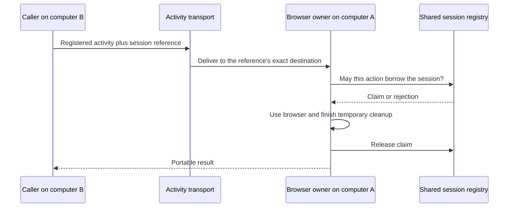

# Keep a browser login between actions

Suppose your application needs to read a report from a website that requires an account. A person would open the site,
sign in, and then open the report. Your program must do those steps too. Starting Chrome only starts a browser; it does
not tell the website which account the program may use. A new automated browser does not automatically inherit the
login from the Chrome window on your desktop.

After a successful sign-in, many websites send the browser a **cookie**: a small value that the browser stores and
sends back on later requests to that site. The site checks that value to recognize the signed-in account. Without an
accepted login cookie or another authentication mechanism, the report request can return a sign-in page or an HTTP
`401` response, which means authentication is required. Each website decides how its authentication works.

Now split the job into two actions. The first signs in. A later action opens the account page and reads its contents.
For example, those actions might be separate requests to your application. If the first action closes its browser
state, the second cannot continue that login. If each action creates a fresh isolated browser context, the second
starts signed out. Keeping Chrome running is not enough: the second action needs the same state within it.

For example, a user might connect an account, then ask for its latest report in a later request. Making each report
request sign in again adds work and may require the user to complete another verification step. The later request
can reuse the login while the context stays open and the website still accepts its cookie. Keep a separate context
for each account that needs isolated state.

This guide uses **browser automation**, which means code opens pages, clicks controls and reads displayed content.
Collecting information from pages is often called scraping. You do not need prior scraping experience here. The example
uses a tiny local website and a pretend account so you can observe the login boundary without real credentials.

## Know which part of the browser must stay alive

[Playwright](https://playwright.dev/docs/browser-contexts) controls the browser from JavaScript. It separates three things:

| Thing | What it does in this example | When it closes |
| --- | --- | --- |
| Browser | Runs Chromium, the browser engine used here | When the application finishes |
| Browser context | Keeps one isolated set of cookies and other site state | When this retained login is no longer needed |
| Page | Opens one document, like a browser tab | When its action finishes |

The contexts below run inside the same browser, but they do not share login cookies. Pages inside one context do share
its cookies. This is why “launch Chrome again” and “open another page for the same login” have different results:

```text
Chromium browser
├── Context for this account       keep between actions
│   ├── Sign-in page               close after signing in
│   └── Later account page         uses the retained cookie
└── Another fresh context          starts without that cookie
```

This picture shows where the login state lives, not how Chromium divides its operating-system processes. A browser
context is also different from the Utils `Context`, which groups cancellation and cleanup for an operation.

For one short script, keep an ordinary Playwright context in a variable, perform both steps, then close it. You do not
need resource sessions just to open a browser or read a public page. Sessions become useful when separately invoked
actions need to find and safely use one particular live object after its creation call has returned.

A **resource session** gives that object an explicit lifetime. One owner keeps the browser context in memory; callers
keep a small **reference** identifying which retained context they need. Each action temporarily borrows that context,
finishes its work and closes its temporary pages. Returning the borrow leaves the context available for the next action.
Closing the session closes the retained context too. By default, only one action can borrow that context at a time.
For example, one action cannot start signing out while another reads the report through the same session owner.

A website's login session and a Utils resource session have different jobs. The website decides whether its cookie
still grants account access. Utils decides which live browser context an action may borrow and who must close it.
Keeping the context alive cannot prevent the website from expiring a login or asking the user to sign in again.

Use an ordinary resource collection when the object only needs to live as long as one operation. Use sessions when
several actions need one particular live instance. If state must survive a process crash, save supported portable state
or an application checkpoint separately: saving a reference does not save its browser, sockets or memory.

## Open once, use twice, then close

The example starts a local website with a **Sign in as Ada** button and an account page. Before sign-in, the account
page returns `401`. Clicking the button submits an HTTP `POST`; the website responds with `Set-Cookie` and redirects
the browser to the account page. Playwright follows that interaction just as a browser user would.

The first action then closes its page. The second action opens a different page in the retained context, requests the
account page and reads the displayed name. The browser sends the retained cookie automatically; the second action does
not insert or copy it. Replacing the retained context with a fresh context would make that account request return `401`.

After the [root checkout setup](../../README.md#work-on-the-repository), install the browser once and run the example:

```sh
mise exec -- pnpm exec playwright install chromium
mise exec -- node examples/sessions/browser.ts
mise exec -- node examples/sessions/check.browser.ts
```

The program prints `Ada`. The check asserts that result. If Playwright cannot find Chromium, run the install command
above. Playwright uses its own browser build, separate from the Chrome you may already have installed.

The [example directory](../../examples/sessions/README.md) contains both files. `website.ts` owns the small HTTP server;
`browser.ts`, shown below, owns the browser and sessions. Keep them together when copying the example. The fixture uses
a fixed demonstration cookie and no password; it teaches state retention, not secure authentication for deployment.
All HTTP traffic stays on your computer. This browser program is checked on Node; the session primitives use the same
TypeScript on Deno, Node and Bun.

```ts
/** Reuse one actual browser cookie jar across actions; close each temporary page before the next action. */
import { chromium } from 'playwright';
import type { BrowserContext } from 'playwright';
import { AsyncDisposableStack } from '@okikio/dispose';
import * as resource from '@okikio/capability/resource';
import * as session from '@okikio/capability/resource/session';
import { openWebsite } from './website.ts';

/** Sign in on one page, then read the account on another page through the same retained browser context. */
export async function readProfile(): Promise<string> {
	await using website = await openWebsite();
	await using application = new AsyncDisposableStack();
	const browser = application.adopt(await chromium.launch(), (value) => value.close());

	// A browser context is an isolated cookie jar. Its definition names the value later actions borrow.
	const Profile = resource.define<BrowserContext>()({
		id: 'browser.profile',
		description: 'Retain one browser login.',
	});
	const ProfileLive = resource.implement(Profile, {
		async create({ ctx }) {
			// Adopt immediately: a later acquisition failure must still close this new browser context.
			return ctx.adopt(await browser.newContext(), (value) => value.close());
		},
	});
	// This scope retains browser contexts between actions. Local defaults own renewal, bounds and cleanup.
	await using profiles = await session.open(ProfileLive);
	const reference = await profiles.create();

	await profiles.use(reference, async (profile, action) => {
		const page = await profile.newPage();
		action.defer(() => page.close());
		// A new context starts signed out. Launching Chromium alone does not establish a login.
		const before = await page.goto(`${website.url}/account`);
		if (before?.status() !== 401) throw new Error('A fresh profile should start signed out.');
		await page.goto(`${website.url}/login`);
		await page.getByRole('button', { name: 'Sign in as Ada' }).click();
		await page.waitForURL(`${website.url}/account`);
		// The website's response set a cookie. Closing this page leaves it in the context.
	});

	const account = await profiles.use(reference, async (profile, action) => {
		const page = await profile.newPage();
		action.defer(() => page.close());
		const response = await page.goto(`${website.url}/account`);
		if (response?.status() !== 200) throw new Error('The second action did not retain the login.');
		// Read what the page displays, rather than reading a cookie directly.
		return await page.getByRole('heading').innerText();
	});

	// Close joins both resource and temporary-page cleanup. The reference cannot reopen this login.
	await profiles.close(reference);
	return account;
}

if (import.meta.main) console.log(await readProfile());
```

Read the calls in the order of their purpose:

| Call | Why this step exists |
| --- | --- |
| `resource.define<BrowserContext>()(...)` | Name the kind of live value later code may borrow. It opens nothing. |
| `resource.implement(Profile, ...)` | Supply the actual browser constructor. `ctx.adopt()` registers its close operation immediately. |
| `session.open(ProfileLive)` | Own the retained instances and their cleanup. Local defaults supply the lifetime, lease bookkeeping and bounds. |
| `profiles.create()` | Open one fresh browser context and return its reference. Another create opens a separate login. |
| `profiles.use(reference, action)` | Lend that exact browser context for one action, with exclusive use by default. |
| `action.defer(() => page.close())` | Close the temporary page before the borrow ends. The browser context and its cookies remain. |
| `profiles.close(reference)` | Stop new use, cancel and join active actions, then close that browser context. |

The two `use()` calls perform different actions on the same object. The first completes the local website's sign-in
interaction; the second receives the account page because that context still holds the cookie. The reference stays
ordinary data. The browser context stays on its owner.

`await using profiles` closes any remaining sessions on error or function exit. The explicit `profiles.close(reference)`
ends this particular login as soon as both actions finish. Either path waits for the cleanup it owns.

A `using` declaration inside the action can own temporary resources that support disposal. `action.defer()` covers
APIs such as `page.close()` and keeps that cleanup inside the borrow. Registering the page on a longer application
Context would leave it open after this action has returned the browser context to another caller.

## Start with local defaults; configure the host when it grows

`session.open()` creates a local Context for cancellation and cleanup, a bounded in-memory registry, and a fresh local
owner identity. A **registry** records whether a reference may still be borrowed. The **owner** holds the actual live
objects and closes them. A Context groups cancellation and cleanup; it does not locate those objects or coordinate
borrowing. The supported composition keeps these roles together so local callers do not construct each one.

| Local default | Meaning |
| --- | --- |
| `maximum: 100` | At most 100 opening, live and closing instances together. Excess creation rejects. |
| One borrow at a time | Another action gets `busy`; there is no hidden waiting queue. |
| Owner and borrow leases: 30 seconds | A healthy owner renews these permissions automatically. |
| Idle lifetime: 5 minutes | Close a session that has not been borrowed again within this budget. |
| 64 terminal records | Bound local history while permitting repeated creation and closure. Old references remain unusable after eviction. |

These are local starting budgets, not a deployment performance guarantee. Override them where your measured scheduling,
network or resource costs require it. For example:

```ts
// The application has measured that each browser login is expensive, so admit only four.
await using profiles = await session.open(ProfileLive, {
	maximum: 4,
	policy: { idleMs: 120000 },
});
```

Supply `ctx` when the application already owns a parent lifetime. Closing the session owner leaves that parent borrowed.
Supply resource dependencies and construction settings through the same options accepted by `resource.open()`.
`configure(input)` can select those settings separately for each `create({ input })`; its input type is inferred from
your callback. Validate external input at the activity boundary and use the resource's environment schema to check raw
configuration. A custom binding can therefore use a different account or connection setting for each instance.

The lower-level `session.owner()` accepts an explicit factory that transfers a value and its close operation. It is
useful when adapting a native lifetime outside resource collections. Use it deliberately; it is not an extra step
required after `session.open()`.

## Return remote actions to the same owner

Computer B cannot receive a browser object from computer A as JSON. It sends an activity request containing the saved
reference. Placement selects A's exact executor and, for a pooled provider, its exact thread or process. The configured
activity transport delivers that request. A then checks admission before lending its local object.



The host configures a shared registry and its registered executor identity once. Unlike local defaults, an injected
registry requires an explicit `owner`: the library cannot guess which deployment registration represents this host.
`owner.id` names that registration; `generation` rejects saved work for an earlier registration. These are not OS
thread numbers. A random incarnation also rejects references from a replaced session owner with the same registration.

In a creation activity, capture the provider's physical host in the reference itself:

```ts
// ctx.physicalHost comes from the trusted provider, not from untrusted activity input.
const reference = await profiles.create({ signal: ctx.signal, host: ctx.physicalHost });
```

Later workflow calls use `workflow.placement.session(reference)`. The helper selects the exact physical host when the
reference contains one; callers no longer pair separate saved session and host values. The receiving activity calls
its local `profiles.use(reference, action, { signal: ctx.signal })`. Callbacks run there; they are not serialized or
sent over the network. Local examples above demonstrate ownership; native-host integration tests exercise transport.

Only parse `ReferenceSchema` when a reference arrives as unknown data, such as JSON outside a checked activity contract.
A reference returned by `create()` is already validated. Re-parsing it after every local call adds no useful step.

If A disappears, the reference becomes lost. An idle host B cannot recover the old browser by receiving its identifier.
The application must reconcile any outstanding external effects, then deliberately open a replacement if its use case
permits that. The replacement gets a new reference.

When a physical host has died, a request pinned to its saved reference can fail during routing before an activity
runs. A surviving owner can instead reject an expired reference with `SessionError('lost')`. Both mean the caller
must stop using that live instance. Inspect shared authority when available, report the lost session, and explicitly
create a new session or restore a separately saved checkpoint. Do not resend the old reference to another pool member
to make the request succeed: that member does not hold the original browser or its cookies.

## Ownership and borrowing rules

The composition keeps resource creation alive after its factory returns. Internally, it registers newly acquired
values on a disposable stack and transfers that stack to the session after acquisition succeeds. If acquisition fails,
the original stack closes partial construction. A `using` scope around the collection inside the factory alone would
close it before a later action could borrow it. Feature code uses `session.open()` instead of reproducing that transfer.

Each session has a unique ID, resource kind, executor ID/generation and random
owner incarnation. A new physical owner has a new incarnation even if deployment
reuses the executor name. A replacement session receives a new ID. References
are validated portable data; values and borrow claims stay on the owner.

Omitted `maximumBorrows` means **one exclusive borrow**. A higher explicit limit,
up to 128, permits concurrent borrowing only when the resource and callbacks
support it. `busy` rejects immediately; there is no hidden wait queue. This limit
includes pending authority admissions and cleanup, so a slow database cannot
accumulate unbounded borrow requests inside an owner. `maximum` bounds opening,
live and closing sessions together. The memory store separately bounds retained
records, including terminal records, to 4096 by default.

`close(reference)` revokes new admission, aborts current borrows, waits for their
callbacks and cleanup, then closes the transferred resource. If acquisition is
still pending, it first joins that acquisition before recording revocation, so a
delayed store creation cannot publish a new open record after closure. Repeated close on
the same owner joins closure or accepts an already terminal record. Owner disposal
stops all renewal and joins all acquisitions, borrows and resource closes. It
never disposes an injected registry or database pool. Cleanup failures remain
visible to the owner, with bounded retained error evidence.

The recommended ownership rule is therefore one physical owner, with exclusive
borrowing unless sharing is a deliberate resource capability. A reference is
not a transferable resource object or an authorization credential.

## Lease and idle rules

`session.open()` supplies the defaults above. Each explicit duration is a whole-millisecond value, from 30 to 86400000:

| Policy | Meaning | Renewal |
| --- | --- | --- |
| `leaseMs` | How long authority accepts owner liveness | The owner renews while healthy |
| `borrowMs` | How long one active borrow remains live | Only while that action or its cleanup remains held |
| `idleMs` | Retention after the last borrow releases | Heartbeats do not extend it |

The owner renews about every third of the shortest configured duration, with a
10ms minimum interval. Choose durations above realistic database, host scheduling
and network delays. Short fixture leases demonstrate failure handling; they are
not production defaults. Required resource counts, application idle lifetimes
and recovery latency determine deployment policy.

PostgreSQL evaluates expiry using database time inside a per-reference locked
transaction. Different client clocks do not decide lease validity. The memory
store uses `Date.now()` unless a test supplies a clock. Neither adapter treats
wall-clock time as a CPU-time quota.

Any elapsed owner lease, idle deadline or active borrow lease makes the reference
**permanently lost**. In particular, an expired borrow does not become available
for a competitor: its previous callback may still be running. Late renewal
cannot revive it. An authority error makes the physical owner stop using and
close the local resource after its borrowers join. Cancellation alone does not
release a still-running borrow.

A `lost` or `closed` record means admission is revoked. It does not prove physical
cleanup finished. `Owner.close()` joins local cleanup; a remote host needs an
acknowledgement after its own finalization. Noncooperative JavaScript requires a
separately killable host. Forced termination can prevent all application cleanup.

## Persist authority and route work

The application supplies and owns the Postgres.js pool. Explicitly call
`migrate({ database })` from `@okikio/storage/session/postgres`, then construct:

```ts
import * as session from '@okikio/capability/resource/session';
import * as postgres from '@okikio/storage/session/postgres';

// The application owns database and runs migrations before accepting work.
// Opening this view borrows the pool; it does not open a connection or migrate.
const store = postgres.open({ database, namespace: 'my-app' });
const registry = session.registry(store);
```

This fragment assumes the application's `database`. Opening issues no SQL;
migration installs the separate `utils_session` revision-one schema. It does not
migrate Workflow tables. Unknown revisions reject. Each mutation locks one
namespace/ID, reads database time, validates the record and commits atomically.
The adapter borrows its pool. It sets a transaction-local statement timeout;
pool connection and reservation limits remain application policy. A lost commit
response has an unknown outcome: inspect the record rather than treating an
error as permission to borrow. Namespace and identity do not provide tenant
access control; expose these APIs only through trusted application authorization.

Create sessions in an activity, outside replaying workflow code. Use the complete-reference routing shown above.
[Placement](./17-placement.md) explains nested scopes, while [physical hosts](./19-hosts.md) covers provider retirement.
The owner still checks resource kind, executor generation and incarnation before lending a value. Routing selects a
location; it does not grant access. The application owns authentication, authorization and external orphan recovery.

## Recovery and external effects

Handle failures explicitly. Registry inspection shows state and timing; it does not contain a dedicated persisted loss-reason field:

| Code | Application response |
| --- | --- |
| `busy` | Apply bounded retry/backoff or choose another independently created session |
| `limit` | Close idle sessions, remove retained terminal records, or change a measured budget |
| `owner` | Correct routing, resource kind or deployment generation |
| `closed` | Stop using that reference; normal admission was revoked |
| `lost` | Use the operation error and resource-specific recovery policy; never renew or silently substitute |

The recommended recovery rule is to fail the old reference permanently, reconcile
external effects/orphans where necessary, and explicitly create a fresh session.
That may rebuild state from an application checkpoint or fail the surrounding
workflow. It cannot recover arbitrary browser state or a native connection from
an identifier. A new reference may represent a different resource and should be
recorded as a new workflow result. Do not rewrite an old saved reference to make
replay attach to the replacement.

`Registry.close(reference, 'lost')` is an explicit operator revocation. The owner
observes it on renewal, aborts borrowers and joins cleanup. `inspect(id)` also
atomically records expiry. `remove(id)` removes a terminal record for application
retention; do this after cleanup or orphan reconciliation, and never reuse IDs.
Persistent storage retention is application-owned. There is no unbounded event
history or automatic scan of all application sessions in the renewal loop.

A borrow token correlates an operation; it cannot by itself stop a stale external
write. Exactly-once external effects are not promised. A sink must support an
appropriate fence or atomically validate authority with its own write. Creating
a fresh session does not prove an old external operation stopped. Exclusive
external devices and remotely hosted browsers therefore need resource-specific
fencing or orphan reconciliation before replacement.

Observation remains separate: EventTarget, Observables and streaming reports
can describe sessions, but their delivery does not grant borrowing, extend a
lease or establish cleanup completion. The record and joined operation decide.

## Join physical host cleanup before acknowledging shutdown

Worker and process servers now accept `finalize()`. It runs once after request
cleanup joins and before the successful shutdown acknowledgement. The executable
entry can close its owned session collection and pool there. It must not close
borrowed application resources. Hook failure, including `throw undefined`, rejects
the child server's `closed` promise and withholds normal acknowledgement. The
parent follows its configured retirement timeout; a forced exit still cannot
promise external cleanup.

The complete executable fixtures are `tests/fixtures/session-thread.ts`,
`session-process.ts` and `session-coordinator.ts`. Their resource factory writes
an external SQL close receipt. Tests require that receipt after graceful shutdown
and deliberately observe its absence after forced owner loss.

## Verify and measure

The [testing guide](../maintenance/01-testing.md) gives commands and explains
the evidence boundaries. The tests use real PostgreSQL, Node
threads, child processes and Docker containers. They cover nested memory and
saved workflows, reuse, exclusive contention, cancellation cleanup, revocation
during a borrow, idle expiry, native host crashes, forced whole-container loss,
explicit replacement and host finalization. Container labels alone are not proof:
receipts include actual native PIDs and thread IDs.

```sh
node tools/testing/run.ts node \
  packages/capability/session.test.ts \
  packages/worker/thread/mod.test.ts \
  packages/worker/process/channel/mod.test.ts
UTILS_TEST_DATABASE_URL=postgres://... node tools/testing/run.ts postgres \
  tests/workflows/resource-sessions.test.ts
node tools/testing/run.ts containers tests/workflows/session-containers.test.ts
node tools/testing/run.ts deno \
  packages/capability/session.test.ts tests/activity-providers.test.ts
deno task --cwd=packages/capability bench:check
UTILS_BENCH_DATABASE_URL=postgres://... node bench/resource-sessions.bench.ts --check
```

Use only explicitly disposable databases. The container task owns its network,
database and executor containers. The native process-group drill is tested on
POSIX and skipped on Windows. These checks do not test live Kubernetes,
browser-specific reconstruction, cross-machine performance, arbitrary stack
migration or external exactly-once writes.
