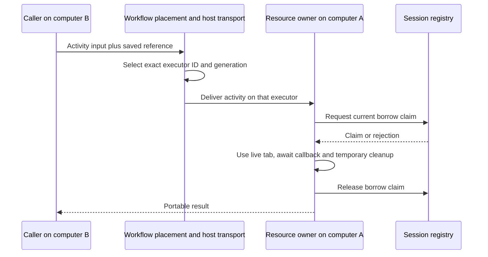

# Keep a resource session on its physical owner

A resource session lets several activities reuse one live object, such as a
browser context with cookies or an open connection. That object stays in the
thread or process that created it. Activities carry a portable reference and
route work back to that owner. A saved workflow can retain the reference;
the live object does not survive its owner. “Distributed” describes where the
callers and references can live, not a resource that moves between hosts.

This guide is for library consumers implementing that host and maintainers
operating its leases. `@okikio/capability/resource/session` owns references,
borrowing and local cleanup. `@okikio/storage/session/postgres` supplies durable
lease authority. Workflow placement routes activity work to the registered
executor. Deployment owns the executor and any external orphan recovery.

For example, imagine a browser tab logged in to an account on computer A.
A request on computer B wants to read a page using that login. Sending the tab
object as JSON cannot move its sockets or memory. Instead, B sends a reference
that names A's registered executor. The host routes an activity to A, and A
briefly lends the tab to that activity. That temporary use is a **borrow**.

The reference identifies the resource; it is not a login credential. The
registry records whether that owner still has permission to serve the resource.
That time-limited permission is a **lease**. A short-lived claim records one
borrow, so closing a session can wait for the code that still uses it.



The arrows show responsibility, not a transport supplied by `session.owner()`.
That API manages the live value locally. Workflow placement selects the owner;
the configured host transport delivers work there. The later integration examples
exercise actual threads and processes. If A disappears, B cannot recreate that
tab from the reference: it must receive a loss result and deliberately open a
replacement. A generation rejects work for an old executor lifetime; the session's
incarnation also distinguishes a new owner within a reused executor name.

## Share a host without sharing an exclusive resource

An owner can retain several sessions. Each session can be exclusive even while
unrelated work runs on the same host. If an activity awaits a page load,
JavaScript can run another ready callback on that thread. The original activity
still holds its borrow. Waiting does not make its tab safe for another borrower.

Scheduling limits answer different questions. A concurrency limit counts active
callbacks, including callbacks awaiting I/O. A capacity lease reserves named
quantities until it is released. A resource borrow protects a particular live
object until its action and cleanup finish. None automatically observes CPU
idleness and transfers a slot. To reserve CPU budget only for a compute phase,
release that capacity before unrelated I/O and reacquire it for the next compute
phase, provided no protected invariant needs it held. Keep exclusive resource
borrows for as long as the resource is actually in use.

[Capacity](../capacity.md#reserve-only-the-phase-that-uses-a-scarce-resource)
shows this separation. [Worker](../../packages/worker/README.md) explains when a
separate runtime is needed. A synchronous CPU loop cannot be preempted by adding
`await` elsewhere. Work must cooperate by yielding, or run in a separately owned
thread/process. Load balancing can choose a host for new work; work tied to a
live session must return to that session's exact owner rather than any idle host.

## Create, borrow and close

From this experimental source checkout, use the root README's prerequisites.
Save the following as `session-example.ts`, and run
`deno run session-example.ts` from the repository root. This complete example needs no database or native host.
It demonstrates the session API; the later integration tests prove transport.

```ts runnable
import * as context from '@okikio/context';
import * as resource from '@okikio/capability/resource';
import * as session from '@okikio/capability/resource/session';

/** The value stays inside its owner; only the session reference can be saved. */
interface CounterType {
	/** Number of increments accepted by this resource. */
	count: number;
	/** Borrow cleanups that finished before the next exclusive use. */
	finished: number;
}

const Counter = resource.define<CounterType>()({
	id: 'example.counter',
	description: 'Retain a counter within one session.',
});
const CounterLive = resource.implement(Counter, {
	create: () => ({ count: 0, finished: 0 }),
});

// Declare the parent first: reverse disposal closes the owner before its Context.
await using ctx = context.create({ id: 'example' });
const registry = session.registry(session.memory({ maximum: 100 }));
await using owner = session.owner({
	ctx,
	registry,
	owner: { id: 'thread:one', generation: 1 },
	resource: Counter.id,
	maximum: 2,
	policy: {
		leaseMs: 30000,
		idleMs: 60000,
		borrowMs: 10000,
	},
	async create() {
		const collection = resource.create(resource.implementations(CounterLive), {
			ctx,
			host: {},
		});

		try {
			// Return the value together with its close operation. This transfers
			// collection ownership to the session after acquisition succeeds.
			const value = await collection.get(ctx, Counter);
			return {
				value,
				async [Symbol.asyncDispose]() {
					await collection[Symbol.asyncDispose]();
				},
			};
		} catch (error) {
			// Until transfer succeeds, the factory must close partial construction.
			try {
				await collection[Symbol.asyncDispose]();
			} catch (cleanup) {
				throw new AggregateError([error, cleanup], 'Acquisition and cleanup failed.');
			}
			throw error;
		}
	},
});

const reference = await owner.create();
const saved = session.ReferenceSchema.parse(JSON.parse(JSON.stringify(reference)));

await owner.use(saved, (counter, borrow) => {
	counter.count++;
	// Real borrowed resources put temporary close operations here. This counter
	// records the joined cleanup so the next use can check the ordering.
	borrow.defer(() => {
		counter.finished++;
	});
});

const count = await owner.use(saved, (counter) => {
	if (counter.finished !== 1) throw new Error('Previous borrow cleanup is incomplete.');
	return counter.count;
});
console.log(count);

// Await close to join physical cleanup. Inspecting a 'closed' authority record
// alone cannot prove that the owner's cleanup has finished.
await owner.close(saved);
console.log((await registry.inspect(saved.id))?.state);

// Remove terminal history only after cleanup. Never reuse this ID for a
// replacement resource; create a fresh session reference instead.
await registry.remove(saved.id);
```

```text output
1
closed
```

The factory transfers the returned resource's disposal authority to the session
owner. Here the transferred object owns a resource collection. That collection
still uses the existing resource dependency and acquisition model. A factory
owns partial construction until it returns successfully. `owner.create({ signal })`
can cancel acquisition; cancellation after it returns does not dispose the session.

Creation reserves local capacity before publishing the lease record. Renewal
starts only after that publication succeeds: a missing record while its creation
is still pending does not mean the owner died. After publication, renewal also
covers a resource factory that is still opening. This distinction matters on a
cold host after a crash, where opening a database connection can take longer than
one renewal interval. Failed or cancelled acquisition still joins publication
before revoking the record and closing any resource the factory transferred.

`owner.use()` borrows the value without transferring it. Its callback must await
its work, and put temporary cleanup in `borrow.defer()` or an awaited disposal
scope. The owner joins that cleanup before releasing the claim or returning the
result. Registering cleanup on an unrelated activity context can run too late.
Do not return live resources, launch detached work using the borrowed value, or
await `owner.close()` from inside that session's own borrow or cleanup.

## Ownership and borrowing rules

Each session has a unique ID, resource kind, executor ID/generation and random
owner incarnation. A new physical owner has a new incarnation even if deployment
reuses the executor name. A replacement session receives a new ID. References
are validated portable data; values and borrow claims stay on the owner.

Omitted `maximumBorrows` means **one exclusive borrow**. A higher explicit limit,
up to 128, permits concurrent borrowing only when the resource and callbacks
support it. `busy` rejects immediately; there is no hidden wait queue. This limit
includes pending authority admissions and cleanup, so a slow database cannot
accumulate unbounded borrow requests inside an owner. `maximum` bounds opening,
live and closing sessions together. The memory store separately bounds retained
records, including terminal records, to 4096 by default.

`close(reference)` revokes new admission, aborts current borrows, waits for their
callbacks and cleanup, then closes the transferred resource. If acquisition is
still pending, it first joins that acquisition before recording revocation, so a
delayed store creation cannot publish a new open record after closure. Repeated close on
the same owner joins closure or accepts an already terminal record. Owner disposal
stops all renewal and joins all acquisitions, borrows and resource closes. It
never disposes an injected registry or database pool. Cleanup failures remain
visible to the owner, with bounded retained error evidence.

The recommended ownership rule is therefore one physical owner, with exclusive
borrowing unless sharing is a deliberate resource capability. A reference is
not a transferable resource object or an authorization credential.

## Lease and idle rules

All three durations are explicit whole milliseconds, from 30 to 86400000:

| Policy | Meaning | Renewal |
| --- | --- | --- |
| `leaseMs` | How long authority accepts owner liveness | The owner renews while healthy |
| `borrowMs` | How long one active borrow remains live | Only while that action or its cleanup remains held |
| `idleMs` | Retention after the last borrow releases | Heartbeats do not extend it |

The owner renews about every third of the shortest configured duration, with a
10ms minimum interval. Choose durations above realistic database, host scheduling
and network delays. Short fixture leases demonstrate failure handling; they are
not production defaults. Required resource counts, application idle lifetimes
and recovery latency determine deployment policy.

PostgreSQL evaluates expiry using database time inside a per-reference locked
transaction. Different client clocks do not decide lease validity. The memory
store uses `Date.now()` unless a test supplies a clock. Neither adapter treats
wall-clock time as a CPU-time quota.

Any elapsed owner lease, idle deadline or active borrow lease makes the reference
**permanently lost**. In particular, an expired borrow does not become available
for a competitor: its previous callback may still be running. Late renewal
cannot revive it. An authority error makes the physical owner stop using and
close the local resource after its borrowers join. Cancellation alone does not
release a still-running borrow.

A `lost` or `closed` record means admission is revoked. It does not prove physical
cleanup finished. `Owner.close()` joins local cleanup; a remote host needs an
acknowledgement after its own finalization. Noncooperative JavaScript requires a
separately killable host. Forced termination can prevent all application cleanup.

## Persist authority and route work

The application supplies and owns the Postgres.js pool. Explicitly call
`migrate({ database })` from `@okikio/storage/session/postgres`, then construct:

```ts
import * as session from '@okikio/capability/resource/session';
import * as postgres from '@okikio/storage/session/postgres';

// The application owns database and runs migrations before accepting work.
// Opening this view borrows the pool; it does not open a connection or migrate.
const store = postgres.open({ database, namespace: 'my-app' });
const registry = session.registry(store);
```

This fragment assumes the application's `database`. Opening issues no SQL;
migration installs the separate `utils_session` revision-one schema. It does not
migrate Workflow tables. Unknown revisions reject. Each mutation locks one
namespace/ID, reads database time, validates the record and commits atomically.
The adapter borrows its pool. It sets a transaction-local statement timeout;
pool connection and reservation limits remain application policy. A lost commit
response has an unknown outcome: inspect the record rather than treating an
error as permission to borrow. Namespace and identity do not provide tenant
access control; expose these APIs only through trusted application authorization.

Create sessions in an activity, outside replaying workflow code. The activity
returns only a validated reference. Subsequent activity input includes it and
uses `workflow.placement.on(reference.owner)`. For scoped nested work, use
`placement.scope()` as described in [Placement](./17-placement.md). For a multi-host provider, save the creation activity's `ctx.physicalHost` with
the session reference and use `placement.host(executor, host)` for subsequent
work. See [Physical hosts](./19-hosts.md) for identity and retirement rules.

The receiving activity calls the corresponding local `owner.use()`. The owner
checks resource kind, executor generation and incarnation before exposing a
value. Placement and this check are complementary. A wrongly routed reference
fails instead of constructing a new resource on whichever host received it.
There is no implicit network RPC or resource serialization in this API: existing
activity transports carry references and invoke the owner. A browser-specific
remote debugging transport remains an application-owned capability.

## Recovery and external effects

Handle failures explicitly:

| Code | Application response |
| --- | --- |
| `busy` | Apply bounded retry/backoff or choose another independently created session |
| `limit` | Close idle sessions, remove retained terminal records, or change a measured budget |
| `owner` | Correct routing, resource kind or deployment generation |
| `closed` | Stop using that reference; normal admission was revoked |
| `lost` | Inspect the cause and resource-specific recovery policy; never renew or silently substitute |

The recommended recovery rule is to fail the old reference permanently, reconcile
external effects/orphans where necessary, and explicitly create a fresh session.
That may rebuild state from an application checkpoint or fail the surrounding
workflow. It cannot recover arbitrary browser state or a native connection from
an identifier. A new reference may represent a different resource and should be
recorded as a new workflow result. Do not rewrite an old saved reference to make
replay attach to the replacement.

`Registry.close(reference, 'lost')` is an explicit operator revocation. The owner
observes it on renewal, aborts borrowers and joins cleanup. `inspect(id)` also
atomically records expiry. `remove(id)` removes a terminal record for application
retention; do this after cleanup or orphan reconciliation, and never reuse IDs.
Persistent storage retention is application-owned. There is no unbounded event
history or automatic scan of all application sessions in the renewal loop.

A borrow token correlates an operation; it cannot by itself stop a stale external
write. Exactly-once external effects are not promised. A sink must support an
appropriate fence or atomically validate authority with its own write. Creating
a fresh session does not prove an old external operation stopped. Exclusive
external devices and remotely hosted browsers therefore need resource-specific
fencing or orphan reconciliation before replacement.

Observation remains separate: EventTarget, Observables and streaming reports
can describe sessions, but their delivery does not grant borrowing, extend a
lease or establish cleanup completion. The record and joined operation decide.

## Join physical host cleanup before acknowledging shutdown

Worker and process servers now accept `finalize()`. It runs once after request
cleanup joins and before the successful shutdown acknowledgement. The executable
entry can close its owned session collection and pool there. It must not close
borrowed application resources. Hook failure, including `throw undefined`, rejects
the child server's `closed` promise and withholds normal acknowledgement. The
parent follows its configured retirement timeout; a forced exit still cannot
promise external cleanup.

The complete executable fixtures are `tests/fixtures/session-thread.ts`,
`session-process.ts` and `session-coordinator.ts`. Their resource factory writes
an external SQL close receipt. Tests require that receipt after graceful shutdown
and deliberately observe its absence after forced owner loss.

## Verify and measure

The [testing guide](../maintenance/01-testing.md) gives commands and explains
the evidence boundaries. The tests use real PostgreSQL, Node
threads, child processes and Docker containers. They cover nested memory and
saved workflows, reuse, exclusive contention, cancellation cleanup, revocation
during a borrow, idle expiry, native host crashes, forced whole-container loss,
explicit replacement and host finalization. Container labels alone are not proof:
receipts include actual native PIDs and thread IDs.

```sh
node tools/testing/run.ts node packages/capability/session.test.ts packages/worker/thread/mod.test.ts packages/worker/process/channel/mod.test.ts
UTILS_TEST_DATABASE_URL=postgres://... node tools/testing/run.ts postgres tests/workflows/resource-sessions.test.ts
node tools/testing/run.ts containers tests/workflows/session-containers.test.ts
node tools/testing/run.ts deno packages/capability/session.test.ts tests/activity-providers.test.ts
deno task --cwd=packages/capability bench:check
UTILS_BENCH_DATABASE_URL=postgres://... node bench/resource-sessions.bench.ts --check
```

Use only explicitly disposable databases. The container task owns its network,
database and executor containers. The native process-group drill is tested on
POSIX and skipped on Windows. These checks do not test live Kubernetes,
browser-specific reconstruction, cross-machine performance, arbitrary stack
migration or external exactly-once writes.
