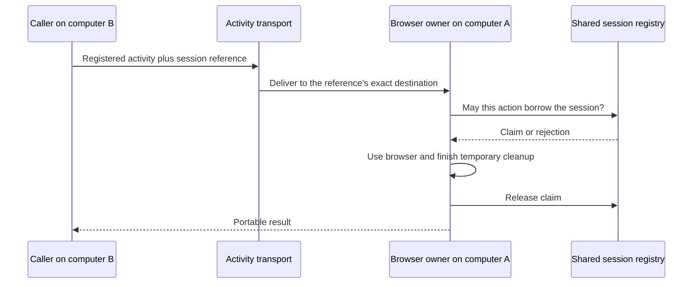

# Keep a browser login between actions

A sign-in action opens a browser context and receives cookies. A later action needs those same cookies. Closing the
browser context after sign-in loses that login. Opening a fresh one for every action also loses it.

A **resource session** keeps that live object between actions. Its owner retains the object; callers keep a small
reference identifying it. An action temporarily borrows the object, finishes its work and temporary cleanup, then
returns it for another action. Closing the session ends that retained lifetime.

Use an ordinary resource collection when the object only needs to live as long as one operation. Use sessions when
several actions need one particular live instance. If state must survive a process crash, save portable data or a
checkpoint separately: saving a session reference does not save its browser, sockets or memory.

## Open once, use twice, then close

This complete program uses actual Chromium. A browser context is an isolated cookie jar inside a running browser.
The first action sets an account cookie. The second opens another page and reads the same cookie. Neither action needs
a real website or credentials. The example tests retained browser state; it does not simulate a real authentication protocol.

After the root checkout setup, install the browser once and run the authored example:

```sh
mise exec -- pnpm exec playwright install chromium
mise exec -- node examples/sessions/browser.ts
```

Expected output: `Ada`. The [copyable example](../../examples/sessions/README.md) includes the real-browser check.
The session primitives use the same TypeScript on Deno, Node and Bun; this browser program is checked on Node.

```ts
/** Reuse one actual browser cookie jar across actions; close each temporary page before the next action. */
import { chromium } from 'playwright';
import type { BrowserContext } from 'playwright';
import { AsyncDisposableStack } from '@okikio/dispose';
import * as resource from '@okikio/capability/resource';
import * as session from '@okikio/capability/resource/session';

/** Run without an external website. The two actions share real Chromium cookies and separate pages. */
export async function readProfile(): Promise<string> {
	await using application = new AsyncDisposableStack();
	const browser = application.adopt(await chromium.launch(), (value) => value.close());

	// A browser context is an isolated cookie jar. Its definition names the value later actions borrow.
	const Profile = resource.define<BrowserContext>()({
		id: 'browser.profile',
		description: 'Retain one browser login.',
	});
	const ProfileLive = resource.implement(Profile, {
		async create({ ctx }) {
			// Adopt immediately: a later acquisition failure must still close this new browser context.
			return ctx.adopt(await browser.newContext(), (value) => value.close());
		},
	});
	// This scope retains browser contexts between actions. Local defaults own renewal, bounds and cleanup.
	await using profiles = await session.open(ProfileLive);
	const reference = await profiles.create();

	await profiles.use(reference, async (profile, action) => {
		const page = await profile.newPage();
		action.defer(() => page.close());
		await page.setContent('<h1>Account sign-in</h1>');
		// A real sign-in would set this cookie through its HTTP response. No credentials or network are needed here.
		await profile.addCookies([{ name: 'account', value: 'Ada', url: 'https://example.invalid/' }]);
	});

	const account = await profiles.use(reference, async (profile, action) => {
		const page = await profile.newPage();
		action.defer(() => page.close());
		await page.setContent('<h1>Account report</h1>');
		const cookie = (await profile.cookies('https://example.invalid/')).find((value) => value.name === 'account');
		if (!cookie) throw new Error('The second action did not retain the login.');
		return cookie.value;
	});

	// Close joins both resource and temporary-page cleanup. The reference cannot reopen this login.
	await profiles.close(reference);
	return account;
}

if (import.meta.main) console.log(await readProfile());
```

Read the calls in the order of their purpose:

| Call | Why this step exists |
| --- | --- |
| `resource.define<BrowserContext>()(...)` | Name the kind of live value later code may borrow. It opens nothing. |
| `resource.implement(Profile, ...)` | Supply the actual browser constructor. `ctx.adopt()` registers its close operation immediately. |
| `session.open(ProfileLive)` | Own the retained instances and their cleanup. Local defaults supply the lifetime, lease bookkeeping and bounds. |
| `profiles.create()` | Open one fresh browser context and return its reference. Another create opens a separate login. |
| `profiles.use(reference, action)` | Lend that exact browser context for one action, with exclusive use by default. |
| `action.defer(() => page.close())` | Close the temporary page before the borrow ends. The browser context and its cookies remain. |
| `profiles.close(reference)` | Stop new use, cancel and join active actions, then close that browser context. |

The two `use()` calls perform different actions on the same object. The first changes the cookie jar; the second
observes that change. The reference stays ordinary data. The browser context stays on its owner.

`await using profiles` also closes remaining sessions on failure or scope exit. A plain `await using` around the
resource collection inside its creation factory would close the resource before the caller could use it. The session
composition instead uses a disposable stack, then transfers that stack after acquisition succeeds. If acquisition
fails, the original stack still closes partial construction. You do not need to reproduce that transfer in feature code.

A `using` declaration inside the action can own temporary resources that support disposal. `action.defer()` covers
APIs such as `page.close()` and keeps that cleanup inside the borrow. Registering the page on a longer application
Context would leave it open after this action has returned the browser context to another caller.

## Start with local defaults; configure the host when it grows

`session.open()` creates a local Context for cancellation and cleanup, a bounded in-memory registry, and a fresh local
owner identity. A **registry** records whether a reference may still be borrowed. The **owner** holds the actual live
objects and closes them. A Context groups cancellation and cleanup; it does not locate those objects or coordinate
borrowing. The supported composition keeps these roles together so local callers do not construct each one.

| Local default | Meaning |
| --- | --- |
| `maximum: 100` | At most 100 opening, live and closing instances together. Excess creation rejects. |
| One borrow at a time | Another action gets `busy`; there is no hidden waiting queue. |
| Owner and borrow leases: 30 seconds | A healthy owner renews these permissions automatically. |
| Idle lifetime: 5 minutes | Close a session that has not been borrowed again within this budget. |
| 64 terminal records | Bound local history while permitting repeated creation and closure. Old references remain unusable after eviction. |

These are local starting budgets, not a deployment performance guarantee. Override them where your measured scheduling,
network or resource costs require it. For example:

```ts
// The application has measured that each browser login is expensive, so admit only four.
await using profiles = await session.open(ProfileLive, {
    maximum: 4,
    policy: { idleMs: 120000 },
});
```

Supply `ctx` when the application already owns a parent lifetime. Closing the session owner leaves that parent borrowed.
Supply resource dependencies and construction settings through the same options accepted by `resource.open()`.
`configure(input)` can select those settings separately for each `create({ input })`; its input type is inferred from
your callback. Validate external input at the activity boundary and use the resource's environment schema to check raw
configuration. A custom binding can therefore use a different account or connection setting for each instance.

The lower-level `session.owner()` accepts an explicit factory that transfers a value and its close operation. It is
useful when adapting a native lifetime outside resource collections. Use it deliberately; it is not an extra step
required after `session.open()`.

## Return remote actions to the same owner

Computer B cannot receive a browser object from computer A as JSON. It sends an activity request containing the saved
reference. Placement selects A's exact executor and, for a pooled provider, its exact thread or process. The configured
activity transport delivers that request. A then checks admission before lending its local object.



The host configures a shared registry and its registered executor identity once. Unlike local defaults, an injected
registry requires an explicit `owner`: the library cannot guess which deployment registration represents this host.
`owner.id` names that registration; `generation` rejects saved work for an earlier registration. These are not OS
thread numbers. A random incarnation also rejects references from a replaced session owner with the same registration.

In a creation activity, capture the provider's physical host in the reference itself:

```ts
// ctx.physicalHost comes from the trusted provider, not from untrusted activity input.
const reference = await profiles.create({ signal: ctx.signal, host: ctx.physicalHost });
```

Later workflow calls use `workflow.placement.session(reference)`. The helper selects the exact physical host when the
reference contains one; callers no longer pair separate saved session and host values. The receiving activity calls
its local `profiles.use(reference, action, { signal: ctx.signal })`. Callbacks run there; they are not serialized or
sent over the network. Local examples above demonstrate ownership; native-host integration tests exercise transport.

Only parse `ReferenceSchema` when a reference arrives as unknown data, such as JSON outside a checked activity contract.
A reference returned by `create()` is already validated. Re-parsing it after every local call adds no useful step.

If A disappears, the reference becomes lost. An idle host B cannot recover the old browser by receiving its identifier.
The application must reconcile any outstanding external effects, then deliberately open a replacement if its use case
permits that. The replacement gets a new reference.

When a physical host has died, a request pinned to its saved reference can fail during routing before an activity
runs. A surviving owner can instead reject an expired reference with `SessionError('lost')`. Both mean the caller
must stop using that live instance. Inspect shared authority when available, report the lost session, and explicitly
create a new session or restore a separately saved checkpoint. Do not resend the old reference to another pool member
to make the request succeed: that member does not hold the original browser or its cookies.

## Ownership and borrowing rules

Each session has a unique ID, resource kind, executor ID/generation and random
owner incarnation. A new physical owner has a new incarnation even if deployment
reuses the executor name. A replacement session receives a new ID. References
are validated portable data; values and borrow claims stay on the owner.

Omitted `maximumBorrows` means **one exclusive borrow**. A higher explicit limit,
up to 128, permits concurrent borrowing only when the resource and callbacks
support it. `busy` rejects immediately; there is no hidden wait queue. This limit
includes pending authority admissions and cleanup, so a slow database cannot
accumulate unbounded borrow requests inside an owner. `maximum` bounds opening,
live and closing sessions together. The memory store separately bounds retained
records, including terminal records, to 4096 by default.

`close(reference)` revokes new admission, aborts current borrows, waits for their
callbacks and cleanup, then closes the transferred resource. If acquisition is
still pending, it first joins that acquisition before recording revocation, so a
delayed store creation cannot publish a new open record after closure. Repeated close on
the same owner joins closure or accepts an already terminal record. Owner disposal
stops all renewal and joins all acquisitions, borrows and resource closes. It
never disposes an injected registry or database pool. Cleanup failures remain
visible to the owner, with bounded retained error evidence.

The recommended ownership rule is therefore one physical owner, with exclusive
borrowing unless sharing is a deliberate resource capability. A reference is
not a transferable resource object or an authorization credential.

## Lease and idle rules

`session.open()` supplies the defaults above. Each explicit duration is a whole-millisecond value, from 30 to 86400000:

| Policy | Meaning | Renewal |
| --- | --- | --- |
| `leaseMs` | How long authority accepts owner liveness | The owner renews while healthy |
| `borrowMs` | How long one active borrow remains live | Only while that action or its cleanup remains held |
| `idleMs` | Retention after the last borrow releases | Heartbeats do not extend it |

The owner renews about every third of the shortest configured duration, with a
10ms minimum interval. Choose durations above realistic database, host scheduling
and network delays. Short fixture leases demonstrate failure handling; they are
not production defaults. Required resource counts, application idle lifetimes
and recovery latency determine deployment policy.

PostgreSQL evaluates expiry using database time inside a per-reference locked
transaction. Different client clocks do not decide lease validity. The memory
store uses `Date.now()` unless a test supplies a clock. Neither adapter treats
wall-clock time as a CPU-time quota.

Any elapsed owner lease, idle deadline or active borrow lease makes the reference
**permanently lost**. In particular, an expired borrow does not become available
for a competitor: its previous callback may still be running. Late renewal
cannot revive it. An authority error makes the physical owner stop using and
close the local resource after its borrowers join. Cancellation alone does not
release a still-running borrow.

A `lost` or `closed` record means admission is revoked. It does not prove physical
cleanup finished. `Owner.close()` joins local cleanup; a remote host needs an
acknowledgement after its own finalization. Noncooperative JavaScript requires a
separately killable host. Forced termination can prevent all application cleanup.

## Persist authority and route work

The application supplies and owns the Postgres.js pool. Explicitly call
`migrate({ database })` from `@okikio/storage/session/postgres`, then construct:

```ts
import * as session from '@okikio/capability/resource/session';
import * as postgres from '@okikio/storage/session/postgres';

// The application owns database and runs migrations before accepting work.
// Opening this view borrows the pool; it does not open a connection or migrate.
const store = postgres.open({ database, namespace: 'my-app' });
const registry = session.registry(store);
```

This fragment assumes the application's `database`. Opening issues no SQL;
migration installs the separate `utils_session` revision-one schema. It does not
migrate Workflow tables. Unknown revisions reject. Each mutation locks one
namespace/ID, reads database time, validates the record and commits atomically.
The adapter borrows its pool. It sets a transaction-local statement timeout;
pool connection and reservation limits remain application policy. A lost commit
response has an unknown outcome: inspect the record rather than treating an
error as permission to borrow. Namespace and identity do not provide tenant
access control; expose these APIs only through trusted application authorization.

Create sessions in an activity, outside replaying workflow code. Use the complete-reference routing shown above.
[Placement](./17-placement.md) explains nested scopes, while [physical hosts](./19-hosts.md) covers provider retirement.
The owner still checks resource kind, executor generation and incarnation before lending a value. Routing selects a
location; it does not grant access. The application owns authentication, authorization and external orphan recovery.

## Recovery and external effects

Handle failures explicitly. Registry inspection shows state and timing; it does not contain a dedicated persisted loss-reason field:

| Code | Application response |
| --- | --- |
| `busy` | Apply bounded retry/backoff or choose another independently created session |
| `limit` | Close idle sessions, remove retained terminal records, or change a measured budget |
| `owner` | Correct routing, resource kind or deployment generation |
| `closed` | Stop using that reference; normal admission was revoked |
| `lost` | Use the operation error and resource-specific recovery policy; never renew or silently substitute |

The recommended recovery rule is to fail the old reference permanently, reconcile
external effects/orphans where necessary, and explicitly create a fresh session.
That may rebuild state from an application checkpoint or fail the surrounding
workflow. It cannot recover arbitrary browser state or a native connection from
an identifier. A new reference may represent a different resource and should be
recorded as a new workflow result. Do not rewrite an old saved reference to make
replay attach to the replacement.

`Registry.close(reference, 'lost')` is an explicit operator revocation. The owner
observes it on renewal, aborts borrowers and joins cleanup. `inspect(id)` also
atomically records expiry. `remove(id)` removes a terminal record for application
retention; do this after cleanup or orphan reconciliation, and never reuse IDs.
Persistent storage retention is application-owned. There is no unbounded event
history or automatic scan of all application sessions in the renewal loop.

A borrow token correlates an operation; it cannot by itself stop a stale external
write. Exactly-once external effects are not promised. A sink must support an
appropriate fence or atomically validate authority with its own write. Creating
a fresh session does not prove an old external operation stopped. Exclusive
external devices and remotely hosted browsers therefore need resource-specific
fencing or orphan reconciliation before replacement.

Observation remains separate: EventTarget, Observables and streaming reports
can describe sessions, but their delivery does not grant borrowing, extend a
lease or establish cleanup completion. The record and joined operation decide.

## Join physical host cleanup before acknowledging shutdown

Worker and process servers now accept `finalize()`. It runs once after request
cleanup joins and before the successful shutdown acknowledgement. The executable
entry can close its owned session collection and pool there. It must not close
borrowed application resources. Hook failure, including `throw undefined`, rejects
the child server's `closed` promise and withholds normal acknowledgement. The
parent follows its configured retirement timeout; a forced exit still cannot
promise external cleanup.

The complete executable fixtures are `tests/fixtures/session-thread.ts`,
`session-process.ts` and `session-coordinator.ts`. Their resource factory writes
an external SQL close receipt. Tests require that receipt after graceful shutdown
and deliberately observe its absence after forced owner loss.

## Verify and measure

The [testing guide](../maintenance/01-testing.md) gives commands and explains
the evidence boundaries. The tests use real PostgreSQL, Node
threads, child processes and Docker containers. They cover nested memory and
saved workflows, reuse, exclusive contention, cancellation cleanup, revocation
during a borrow, idle expiry, native host crashes, forced whole-container loss,
explicit replacement and host finalization. Container labels alone are not proof:
receipts include actual native PIDs and thread IDs.

```sh
node tools/testing/run.ts node packages/capability/session.test.ts packages/worker/thread/mod.test.ts packages/worker/process/channel/mod.test.ts
UTILS_TEST_DATABASE_URL=postgres://... node tools/testing/run.ts postgres tests/workflows/resource-sessions.test.ts
node tools/testing/run.ts containers tests/workflows/session-containers.test.ts
node tools/testing/run.ts deno packages/capability/session.test.ts tests/activity-providers.test.ts
deno task --cwd=packages/capability bench:check
UTILS_BENCH_DATABASE_URL=postgres://... node bench/resource-sessions.bench.ts --check
```

Use only explicitly disposable databases. The container task owns its network,
database and executor containers. The native process-group drill is tested on
POSIX and skipped on Windows. These checks do not test live Kubernetes,
browser-specific reconstruction, cross-machine performance, arbitrary stack
migration or external exactly-once writes.
