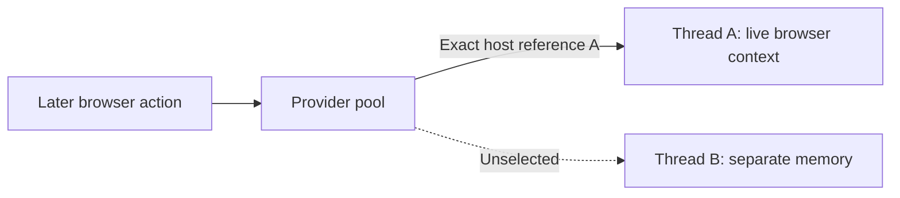

# Select one thread or process inside a provider pool

Suppose one action signs in to a website and a later action reads its account page. The first action's browser context
holds the login cookies. Sending the later action to another empty browser context will not carry that login with it.
The [sessions guide](./18-sessions.md) explains this browser state and how to retain it between actions.

Now let the application run actions in several JavaScript threads or child processes. Each has its own memory. A
**provider** starts those hosts and sends activities to them; its **pool** is the set it can choose from. Naming the
provider selects that group, but does not yet identify which member holds this login. For example, if thread A opened
the context and thread B is idle, the later report request still has to go to A. A **physical-host reference** identifies
that particular member of the pool.

For stateless work, such as resizing an image from supplied bytes, any eligible free host may be suitable. Retained
browser state creates a different requirement: return to the host that actually owns it. A reference routes the request;
it does not transfer browser memory to another host or authenticate the caller.

This guide is for consumers building that flow and maintainers changing pool
admission or shutdown. A host reference contains two identifiers: `pool` names
one provider lifetime, and `id` names one host lifetime inside it. Both change
when their owner is replaced. Neither identifier is an OS PID, a thread number,
a reusable pool index, an authorization credential or a capacity reservation.

Follow the later report request through the pool below. If A is busy, the call reports busy; if A has gone away,
the call reports lost. Neither case can fall back to B because B does not have the signed-in context.



The arrows show routing through the supplied provider, not shared memory between the threads. Saved resource-session
references add a separate borrowing and lease policy, explained in [resource sessions](./18-sessions.md).

## Run work on the selected host

This complete Node example starts two actual threads in one provider, selects
the second, then retires it. Use this experimental checkout's root prerequisites
and keep the following three files together. This walkthrough uses `host-example/`;
you can choose another parent directory.

```text
host-example/
├── contracts.ts
├── thread.ts
└── main.ts
```

Run `node host-example/main.ts` from the repository root.

`contracts.ts` defines work without starting a thread:

```ts
import * as schema from '@okikio/schema';
import * as activity from '@okikio/activity';
import * as engine from '@okikio/activity/engine';
import * as workflow from '@okikio/workflow';

/** Both sides use this contract; defining it starts no native host. */
export const Engine = engine.define({ id: 'example.threads' });

/** Return the host that actually ran the attempt, so selection is observable. */
export const Inspect = activity.define({
	id: 'example.inspect',
	version: '1',
	input: schema.unknown(),
	result: workflow.placement.HostSchema,
	placement: engine.require(Engine),
});
/** The provider supplies physicalHost; application input cannot choose its value. */
export const InspectLive = activity.implement(Inspect, {
	run(ctx) {
		if (!ctx.physicalHost) throw new Error('This activity requires a native provider.');
		return ctx.physicalHost;
	},
});
/** A workflow can coordinate elsewhere while its activity stays on the chosen host. */
export const Read = workflow.define({
	id: 'example.read',
	version: '1',
	input: schema.unknown(),
	result: workflow.placement.HostSchema,
	activities: [Inspect],
});
```

`thread.ts` serves that activity and owns its resource collection:

```ts
import * as context from '@okikio/context';
import * as resources from '@okikio/capability/resource';
import * as worker from '@okikio/activity/worker';
import * as native from '@okikio/runtime/node/worker';
import { Engine, InspectLive } from './contracts.ts';

await using ctx = context.create({ id: 'example.thread' });
await using collection = resources.create(resources.implementations(), { ctx, host: {} });
using scope = native.scope();

// A normal shutdown acknowledgement must follow resource cleanup. The outer
// disposal scope also covers failure before the server takes responsibility.
await using server = worker.serve({
	engine: Engine,
	implementations: [InspectLive],
	resources: collection,
	scope,
	finalize: () => collection[Symbol.asyncDispose](),
});
await server.closed;
```

`main.ts` owns the provider and registers it once. The activities choose hosts
inside that registration:

```ts
import * as context from '@okikio/context';
import * as activity from '@okikio/activity';
import * as worker from '@okikio/activity/worker';
import * as native from '@okikio/runtime/node/worker';
import * as workflow from '@okikio/workflow';
import { Engine, Inspect, Read } from './contracts.ts';

await using ctx = context.create({ id: 'example.owner' });

// Prewarm two hosts so discovery can show a real choice. Each host admits one
// active attempt; maximumWaiting bounds ordinary, unpinned pool admission.
await using provider = await worker.create({
	ctx,
	engine: Engine,
	activities: [Inspect],
	module: new URL('./thread.ts', import.meta.url),
	minimum: 2,
	maximum: 2,
	concurrency: 1,
	maximumWaiting: 4,
	create: (module) => native.create(module),
});
await using scheduler = workflow.scheduler();
const compute = { id: 'example.pool', generation: 1 };
await using registration = await scheduler.register({
	engine: Engine,
	provider,
	hostId: 'example.owner',
	compute,
	capacity: 2,
});

/** Run one fresh workflow while pinning its activity to an exact host lifetime. */
async function identify(host: workflow.placement.HostType) {
	await using run = await workflow.context({
		definition: Read,
		input: null,
		runId: crypto.randomUUID(),
		ctx,
	});
	const implementation = workflow.implement(Read, function* () {
		return yield* activity.request(Inspect, null, {
			location: workflow.placement.host(compute, host),
		});
	});
	return await workflow.run({ ctx: run, scheduler, implementation });
}

const hosts = provider.hosts();
console.log(hosts.length);
const chosen = hosts[1]!;
console.log((await identify(chosen)).id === chosen.id);

// Retirement revokes new admission and joins this host's cleanup. A request
// carrying its old identity must reject instead of running on the sibling.
await provider.retire(chosen);
let rejected = false;
try {
	await identify(chosen);
} catch {
	rejected = true;
}
if (!rejected) throw new Error('Retired host selection unexpectedly succeeded.');
console.log('lost');
```

Expected output:

```text
2
true
lost
```

For child processes, `@okikio/activity/process` exposes the same `hosts()` and
`retire()` methods. Keep its existing process adapter, stdin/stdout channel and
executable setup; only selection changes. The real checks fixture in
`tests/fixtures/session-coordinator.ts` shows both assemblies.

## Identity, discovery and saved work

`provider.hosts()` returns an immutable snapshot of live references, excluding
explicitly retiring hosts. Providers remain lazy unless `minimum` prewarms them.
An empty list can therefore mean no host has been created yet. Factory results
become discoverable only after the pool records ownership; a half-published
creation must not produce a selectable reference. Discovery neither
waits for protocol readiness nor guarantees a host remains available. A host can
fail immediately after inspection; the operation must handle that failure.

An unpinned activity can return `ctx.physicalHost` alongside its ordinary result.
Save that reference with its exact executor ID/generation when subsequent work
needs the same host. `placement.host(executor, host)` requires both. Ancestor
constraints still apply, and nested scopes cannot change either exact identity.
Work without a physical selection retains ordinary bounded pool admission.

Saved execution persists this selection with the workflow and activity job.
Child workflows, cleanup and replay inherit the intersected constraints. The
SQL job reader, durable invocation bridge and memory scheduler all forward it
to the provider. Workflow coordinators may replay elsewhere; the activity still
runs on the selected native host. No live JavaScript stack or resource moves.

Provider identity changes after a provider restart, including whole-container
replacement. Host identity changes after native host replacement. Old references
remain lost even if deployment reuses an executor name, PID or pool position.
No permanent in-memory tombstone list is needed to reject them.

## Busy, lost and retirement

| Situation | Behavior | Caller action |
| --- | --- | --- |
| Selected host has a free attempt slot | Reserve that host; return only after work and request cleanup join | Use the result |
| Selected host is full or changing ownership | Immediate `busy`; no selected-host wait queue or sibling fallback | Apply a bounded retry policy if useful |
| Missing, retired or old provider/host reference | Immediate `lost`; no host creation under the old identity | Reconcile resource state and explicitly select/create new work |
| Idle host ages out under existing pool policy | Its reference becomes lost | Configure retention for the intended resource lifetime |
| Provider drains or the caller cancels | Existing cancellation and joined cleanup rules apply | Await the owning operation; cancellation is not proof of cleanup |

Native providers return `{ type: 'lost', code: 'busy' | 'lost', reason }` for exact
selection failures. `reason` is a `HostSelectionError` from
`@okikio/activity/selection`, with the same `code`. The durable bridge records
`host_busy` or `host_lost` as its execution error. Authored retry policy may retry
the same exact selection; it never grants permission to choose another host.
A local provider cannot satisfy physical selection and rejects it. Custom
providers must honor `attempt.location.host` or reject it too.

`provider.retire(reference)` stops admission immediately. It waits for every
attempt already assigned there, including cancellation cleanup, then joins
native close and its host finalizer. Other hosts remain available. Repeated
retirement while the host remains owned joins its receipt. After removal, the
reference is lost. Never await retirement from inside an attempt running on that
host: it would wait for itself. Retirement is graceful, with no separate deadline
for a noncooperative activity; use the application's cancellation and kill policy
when a hard stop is required. A crash can lose every attempt sharing that host.

Closing capacity remains reserved until native close finishes. A close failure
rejects retirement and remains visible to provider shutdown. Imports do not
create hosts, and observation through EventTarget or Observables never grants
selection or changes retirement authority.

## Connect this to resource sessions

A resource session means reusing a live browser context, connection or other
stateful object between activities. The value stays on its owner. A portable
session reference names it, while its registry controls borrow leases and expiry.
“Distributed” describes the callers and saved references, not a resource that
moves between machines or survives owner loss.

For a multi-host provider, create the session inside an activity and include `ctx.physicalHost` in its reference.
Save that complete reference as the activity result. Later activities use `placement.session(reference)` to select its
executor and exact thread or process, then call `profiles.use(reference, ...)` on that host. The host fields select
the execution location; the session ID selects a live resource there. You do not need a separate saved host value.
Retiring that host closes its owned sessions through `finalize()`. Killing it leaves old references
lost after lease expiry; browser-specific reconstruction and external orphan
reconciliation remain application responsibilities. See [Resource sessions](./18-sessions.md).

The lower-level `@okikio/pool` now also offers `select(ctx, value)` and
`retire(value)`. These use a unique `Object.is` value identity, not portable host
references. Ambiguous equal values reject. Selected acquisition never creates a
substitute, queues, or changes the pool's existing lifetime owner.

## Verify the behavior

Use an explicitly disposable PostgreSQL database for the native/durable tests.
The Docker suite creates and removes its own database, executor containers,
network and bundles in your project. The tests use two actual native hosts in one
provider, inspect PID/thread receipts, retire a busy host, verify its sibling,
crash and replace a host, and reject saved references after whole-container loss.
The shared fixture runs the same nested memory and durable flow for both host kinds.

```sh
mise run test -- --runtime node packages/pool packages/activity packages/workflow/placement.test.ts packages/workflow/scheduler.test.ts
mise run test -- --runtime deno packages/pool packages/activity tests/activity-providers.test.ts
UTILS_TEST_DATABASE_URL=postgres://... mise run test -- --suite postgres tests/workflows/resource-sessions.test.ts tests/workflows/placement.test.ts
mise run test -- --suite containers tests/workflows/session-containers.test.ts
mise run bench -- --project pool --check
```

The pool benchmark holds work fixed at 100 exact selections among eight values,
including creation, release, retirement and close. Its oracle checks identity and
resource counts. Timing excludes native startup and transport; real-host tests
test those behaviors separately. Local timings do not establish cluster
capacity, task fairness or leak freedom. This slice does not provision pods,
migrate live stacks or reconstruct native resources.
