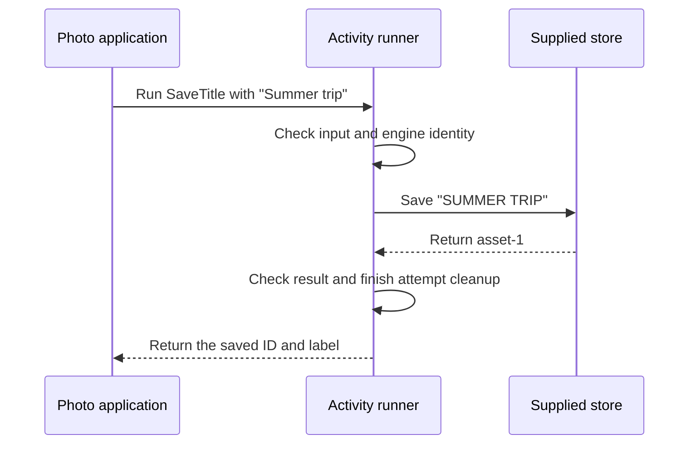

# `@okikio/activity`

An activity is one named job that accepts an input and returns a checked result. For example, a photo application can
have jobs to read a photo's dimensions, create its preview, and save its description. Each job does one useful piece of
work. The application decides how to connect those pieces.

Start with a regular function when that is all you need. Activities become useful when several callers or execution
locations need the same rules: what input is accepted, what result comes back, which dependencies are available, and
what should stop when the caller cancels. You declare those rules once and attach the actual function separately.

## Follow one job from input to result

Imagine saving a title for an uploaded photo. The activity checks the submitted title, asks the supplied store to save
it, and checks the returned receipt before giving it to the caller. Read this diagram from top to bottom; the caller,
activity runner and store are separate participants.



The store does the saving; the activity adds one consistent call contract around it. Resource declarations describe and
type the job's dependencies; they are not a sandbox for untrusted implementations. This picture shows a successful local
attempt. A failed input check stops before the implementation runs. Cancellation asks cooperative work to stop; it does
not undo a write that the store has already accepted. Retries and durable scheduling belong to a host such as
[workflow](../workflow/README.md), rather than to this direct call.

The examples use a few names that can otherwise make this small idea feel larger:

| Name           | Meaning in this guide                                                                              |
| -------------- | -------------------------------------------------------------------------------------------------- |
| Definition     | The job's name, version, input and result rules. Declaring it starts no work.                      |
| Implementation | The function that actually performs the job.                                                       |
| Engine         | A declared execution category that must match the chosen runner. A name does not launch a process. |
| Attempt        | One execution of the job. A later retry is another attempt.                                        |
| Resource       | A supplied dependency, such as a store or browser. The job borrows it.                             |
| Context        | The attempt's identity, cancellation signal, deadline and cleanup lifetime.                        |

For shared terms such as `await` and `await using`, see
[the short glossary](../../docs/learn.md#read-the-small-amount-of-code-you-need).

## Run a complete example

The explicit polyfill imports let this example run when the host lacks Temporal or disposal globals. An existing native
implementation is preserved.

```ts runnable
import '@okikio/duration/polyfill';
import '@okikio/dispose/polyfill';
import * as activity from '@okikio/activity';
import * as engine from '@okikio/activity/engine';
import * as context from '@okikio/context';
import * as resource from '@okikio/resource';
import { z } from 'zod';

const Local = engine.define({ id: 'local' });
const Upper = activity.define({
	id: 'text.upper',
	version: '1',
	input: z.string(),
	result: z.string(),
	placement: engine.require(Local),
});
const UpperLive = activity.implement(Upper, { run: (ctx) => ctx.input.toUpperCase() });
await using ctx = context.create({ id: 'uppercase' });
await using resources = resource.create(resource.implementations(), { ctx, host: {} });
const value = await activity.run({
	ctx,
	engine: Local,
	resources,
	implementation: UpperLive,
	input: 'hello',
	jobId: 'uppercase-1',
	attempt: 1,
});
console.log(value);
```

Expected output:

```text output
HELLO
```

`activity.run()` returns `Promise<string>` for this definition and resolves to `HELLO`. It validates input and result
and owns a local attempt context. The caller owns the resource collection and parent context. Declared failures and
unexpected faults have separate contracts; placement metadata alone does not launch another process.

Read this first demo in three steps. `Upper` says that this job accepts text and returns text. `UpperLive` supplies the
uppercase function. `run()` supplies `hello` and returns `HELLO` after checking both sides. Changing the input to
`summer trip` changes the result to `SUMMER TRIP`; it does not change the job's identity. The empty resource collection
means this particular job needs no external dependency.

The setup is deliberately visible. The engine declares where the job is eligible to run, the context owns this call's
lifetime, and `await using` closes the owners when the module ends. You do not need this setup merely to uppercase a
string; the small transformation makes the surrounding execution rules easier to inspect.

## Save a photo title with a supplied store

This complete mini-demo performs the scenario above. Its store is an in-memory array, so it needs no account, network,
database or credentials. The result is a receipt: the saved ID plus the normalized label.

```ts runnable=save-title.ts
import '@okikio/duration/polyfill';
import '@okikio/dispose/polyfill';
import * as activity from '@okikio/activity';
import * as engine from '@okikio/activity/engine';
import * as context from '@okikio/context';
import * as resource from '@okikio/resource';
import { z } from 'zod';

const Local = engine.define({ id: 'local' });
const InputSchema = z.object({ title: z.string().min(1) });
const ReceiptSchema = z.object({ id: z.string(), label: z.string() });
const Store = resource.define<{ save(label: string): Promise<string> }>()({
	id: 'photo.store',
	description: 'Save a photo label and return its ID.',
});
const labels: string[] = [];
const StoreLive = resource.implement(Store, {
	create: () => ({
		async save(label) {
			labels.push(label);
			return `asset-${labels.length}`;
		},
	}),
});
const SaveTitle = activity.define({
	id: 'photo.save-title',
	version: '1',
	input: InputSchema,
	result: ReceiptSchema,
	placement: engine.require(Local),
	resources: [Store],
});
const SaveTitleLive = activity.implement(SaveTitle, {
	async run(ctx) {
		const store = await ctx.get(Store);
		const label = ctx.input.title.toUpperCase();
		return { id: await store.save(label), label };
	},
});
await using owner = context.create({ id: 'photo-upload' });
await using stores = resource.create(resource.implementations(StoreLive), { ctx: owner, host: {} });
const receipt = await activity.run({
	ctx: owner,
	engine: Local,
	resources: stores,
	implementation: SaveTitleLive,
	input: { title: 'Summer trip' },
	jobId: 'save-title-1',
	attempt: 1,
});
console.log(receipt.id, receipt.label);
console.log(labels.join(','));
```

```text output
asset-1 SUMMER TRIP
SUMMER TRIP
```

The first line is the returned result. The second line confirms that the supplied store received the label. The
definition's `resources: [Store]` lets the implementation ask for that store through `ctx.get(Store)`. Changing the
store implementation can change where the label is saved without changing the activity's input or result contract. The
activity borrows the store; the `stores` collection closes its acquired resources.

Try changing the input title to `Family visit`. Both output labels become `FAMILY VISIT`. An empty title fails the input
schema before the save function runs. This array is a teaching store, not durable storage, and repeating the call adds
another entry. A real save operation needs its own duplicate-write policy.

## Choose the next piece for your scenario

| You need to achieve                                   | Combine                                                                 | What changes for the caller                                                                              |
| ----------------------------------------------------- | ----------------------------------------------------------------------- | -------------------------------------------------------------------------------------------------------- |
| Validate and save one submitted title                 | Activity + [resource](../resource/README.md)                            | The caller receives a checked receipt and the job borrows a declared store.                              |
| Stop an upload when its caller leaves                 | Activity + [context](../context/README.md)                              | Pass cancellation to the actual upload operation and release its local resources.                        |
| Create a preview, then save its location              | Activities + [workflow](../workflow/README.md)                          | The sequence requests named steps and can reuse recorded completions through its configured history.     |
| Run costly work outside the caller's execution thread | Activity [Worker provider](./worker.ts) + [worker](../worker/README.md) | Serializable input and results cross a transport; the receiving host supplies its own live dependencies. |

The workflow guide runs two real activity implementations through a local provider. Start there before adding a remote
host. Sharing dispatch and history across computers needs authoritative adapters; drawing an engine in a diagram does
not supply that infrastructure.

## Build on the example

Start with a direct local attempt, then register the same definition with a workflow executor. Add resource declarations
when the operation needs a browser or storage client; add permission requirements and effects when it changes
authoritative state. The activity owns its attempt context and borrows the collection. A Worker or process provider
changes execution location; it does not move live closures, sockets or promises. Dispatch and storage adapters still own
durable placement, leases and recovery.

[Choose related utilities by outcome](../../docs/outcomes.md). The sections below explain the remaining contracts and
variations. Examples that introduce application-owned clients or schemas are composition sketches; supply those
dependencies before running them.

`@okikio/activity` defines externally meaningful work. Definitions are immutable and import-safe. They describe what one
activity accepts, returns, can fail with, can emit, requires, and where it can run. They do not open a provider or start
work.

```ts
import * as activity from '@okikio/activity';
import * as engine from '@okikio/activity/engine';
import * as effect from '@okikio/effect';
import * as permission from '@okikio/permission';

const Browser = engine.define({ id: 'browser' });

const Download = activity.define({
	id: 'media.download',
	version: '1',
	input: DownloadInputSchema,
	result: DownloadResultSchema,
	placement: engine.require(Browser),
	resources: [Http, Storage],
	requirements: [permission.require(ReadSource)],
	effects: [DownloadCommitted],
});
```

Definitions keep direct requirements separate from requirements that are only reachable through resource dependencies.
Runtime admission applies direct active requirements. Reachable permissions remain available for later dynamic checks.

## Start here

`activity.request()` creates one serializable workflow operation. It does not execute the implementation.

```ts
const saved = yield * activity.request(Download, input);
```

`activity.try()` creates the same request but converts only declared activity failures into `@okikio/result`. Unexpected
faults and cancellation still escape.

## Direct attempts

`activity.run()` executes one exact implementation in the current host. A host supplies the engine identity, input,
parent context, resource collection, job identity, attempt number, and optional permission/effect services.

```ts
const DownloadLive = activity.implement(Download, {
	async run(ctx) {
		await permission.assert(ctx, ReadSource, { url: ctx.input.url });
		const http = await ctx.get(Http);
		const writer = ctx.use(await openWriter());

		for await (const chunk of http.get(ctx.input.url, ctx.signal)) {
			await ctx.checkpoint();
			await writer.write(chunk);
			await ctx.heartbeat({ bytes: chunk.byteLength });
		}

		await effect.emit(ctx, DownloadCommitted, {
			url: ctx.input.url,
		}, {
			key: `download:${ctx.input.id}`,
		});

		return { ok: true };
	},
});
```

The direct attempt performs this sequence:

1. Validate the job and attempt identities.
2. Validate input with the activity schema.
3. Create one owned child context.
4. Attach the requirement runtime and reachable permission view.
5. Attach only the effects declared by the activity.
6. Expose the declared resource types to the implementation and retain collection requirement checks.
7. Apply direct active requirements unless a Scheduler already admitted them.
8. Run the initial cooperative checkpoint.
9. Invoke the exact implementation.
10. Validate the result schema.
11. Reject an expected failure that the activity did not declare.
12. Dispose attempt-owned values.

An implementation receives `ctx.get()` for borrowed resources and standard owned-context operations such as `use()`,
`adopt()`, and `defer()` for values it creates itself.

## Scheduler admission

The default workflow Scheduler applies an activity's direct active requirements before it reserves engine capacity. It
then marks the fenced attempt as already admitted. The provider calls `activity.run()` with that attempt, which binds
dynamic permission/effect/resource scopes without repeating the admission check.

A caller that invokes `activity.run()` directly has no Scheduler above it, so direct requirements are applied by `run()`
itself.

## Engine placement

`@okikio/activity/engine` owns static execution-target definitions and placement choices:

```ts
const placement = engine.oneOf(
	engine.prefer(Browser),
	engine.allow(Server),
);
```

`require()` selects one exact engine. `prefer()` and `allow()` define an ordered fallback choice. Placement does not
start a process or Worker. Live engine providers run through `workflow.executor()`; `scheduler.register()` is the
attached-host convenience.

## Provider subpaths

The package includes generic providers that compose existing runtime utilities:

- `@okikio/activity/local` executes an implementation in the executor host.
- `@okikio/activity/worker` composes `@okikio/pool` and `@okikio/worker`.
- `@okikio/activity/process` composes `@okikio/pool`, `@okikio/process`, and the typed process channel.

Activity dispatch remains the authority for logical item identity, attempt number, and terminal result. Providers report
success, declared failure, fault, cancellation, or loss. Executors commit retry decisions through dispatch rather than
silently creating another logical item.

Permissions, effects, and heartbeats cross Worker/process transports as correlated reverse calls. The authoritative host
validates the permission target or effect definition again before it answers. A heartbeat becomes meaningful only after
the executor renews the exact active dispatch claim.

## Pause and cancellation

Pause is cooperative. A running implementation pauses only when it calls `ctx.checkpoint()` or returns control. A
`fetch()`, codec call, filesystem mutation, or database operation is not suspended at an arbitrary JavaScript
instruction.

Cancellation changes the local `AbortSignal` immediately. Worker and process providers also send the matching
cancellation message. Cleanup still follows the owned activity context.

## Convenience and the manual equivalent

| Convenience                                  | Manual equivalent                                                                                                 | Concrete value                                                |
| -------------------------------------------- | ----------------------------------------------------------------------------------------------------------------- | ------------------------------------------------------------- |
| `activity.define()` + `activity.implement()` | freeze metadata, keep a handler map, then validate input/result/failure schemas around every call                 | one activity identity and validation contract                 |
| `activity.request()`                         | construct a typed workflow instruction, suspend the generator, dispatch it, then validate the completion yourself | scheduler-facing request semantics without transport coupling |
| `activity.try()`                             | catch declared failures separately from unexpected faults and rebuild the discriminated result                    | declared failure stays data instead of becoming an exception  |

`@okikio/activity` is a convenience layer, not a hidden runtime. You can reproduce its core mechanics with a function
call plus your own attempt IDs, permission checks, resource lookup, cancellation, and result transport.

Use the utility when those rules must stay identical across local, Worker, and process execution.

## Operations and failures you will reach for next

After the basic definition/request/run path, these exports cover composition and result handling:

- `catalog()` and `select()` build and narrow named activity definition sets.
- `document()` produces deterministic, JSON-safe definition metadata for tooling.
- `try()` converts a declared activity failure into a Result branch. Unexpected faults and cancellation still throw.
- `isFailure()` checks whether a result contains one declared activity failure.
- `InvalidEngineError` reports a provider that claims the wrong engine definition.
- `UndeclaredFailureError` reports an implementation that returns a failure the activity definition did not declare.

## Source guide

Start with this README, then use the source in this order when you need more detail:

1. `mod.ts` shows the supported runtime operations and the composition shape.
2. `types.ts`, when present, shows the public value and behavior contracts.
3. `*.test.ts` files show edge cases, cancellation, invalid input, and lifecycle behavior as executable examples.
4. `remote.ts` owns the common activity identity, catalog checks, and protocol schemas for process and Worker providers.
   `process.ts` and `worker.ts` retain their separate host startup, transport, and shutdown behavior.
5. Read other internal implementation files only when you need the exact state transition or performance-sensitive loop.

The README is the primary user documentation. It intentionally stays close to the public source instead of maintaining a
separate hand-written API reference.

## Unexpected runtime diagnostics

Unexpected thrown values are projected through `@okikio/fault` before they cross runtime or durable seams. This is
separate from `@okikio/failure`, which represents expected declared failures with stable application identity.
