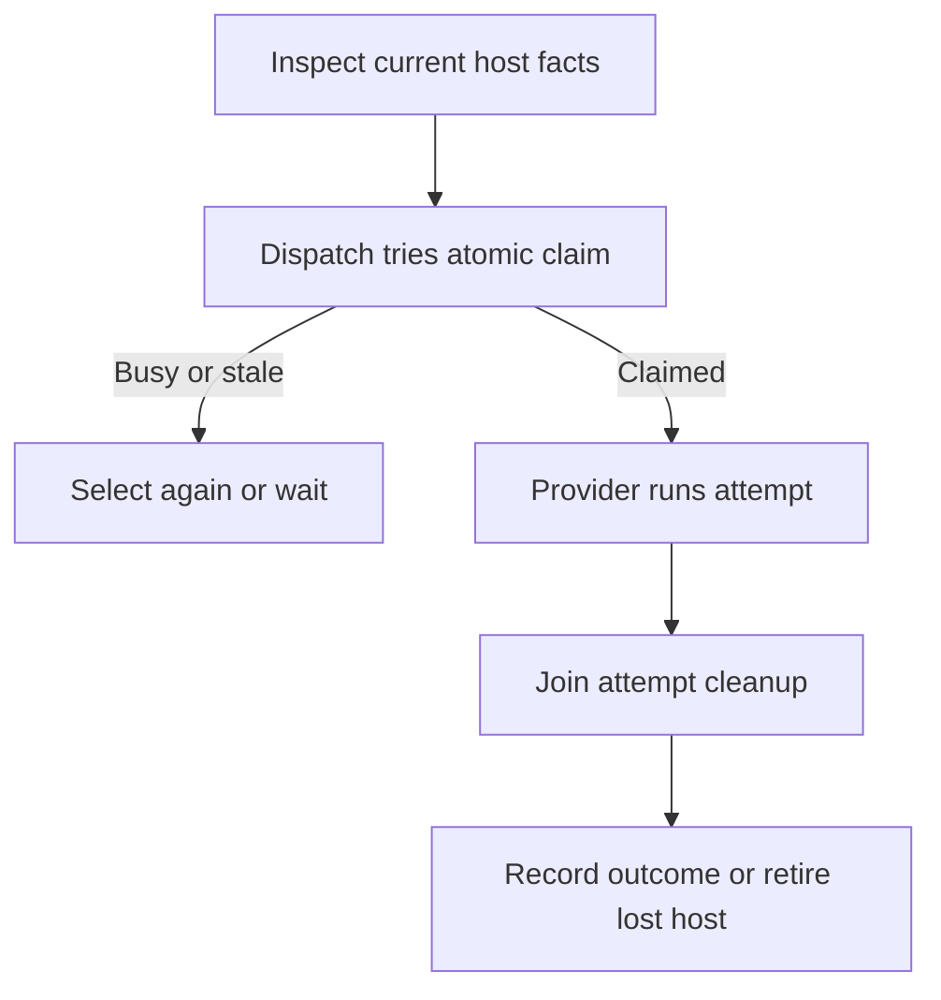

# `@okikio/activity`

An activity is one named job that accepts an input and returns a checked result. For example, a photo application can
have jobs to read a photo's dimensions, create its preview, and save its description. Each job does one useful piece of
work. The application decides how to connect those pieces.

For Deno, Node, and Bun execution, see [run a portable example](../../docs/05-runtime.md#run-a-portable-example-in-your-own-project). Host-specific adapters keep their native runtime requirements.

A request handler can save a title with a regular function. Keep that call if the handler is its only caller.
When a request handler and a background worker both need to save titles, an activity gives them one contract:
what input is accepted, what result comes back, which dependencies are available, and what should stop when the
caller cancels. Declare those rules once, then attach the function that saves the title.

An activity definition is a description. Its implementation is a function. A queued job requests that activity for one
input. An attempt is one invocation of its implementation. Neither `define()` nor `implement()` runs the work. Use
`activity.call()` for a local call or `client.submit()` for saved background work with an explicit store and policy. The
[background-work guide](../../docs/workflows/01-basics.md) explains that service-to-worker path.

The same title-saving function can run in either setting. The application still chooses whether to use a queue,
starts any background worker, and makes the save safe to repeat if a failed attempt can run again.

## Save a photo title with a supplied store

Save a submitted title, then reject a blank submission before it reaches the store. The store is an in-memory array, so
it needs no account, network, database or credentials. The result is a receipt: the saved ID plus the normalized label.

The business operation is still an ordinary function: trim the submitted title, uppercase it, then
`await store.save(label)`. The declaration adds input/result checks around that call. Nothing is saved until
`activity.call()` invokes the implementation.

`Store` describes the dependency, `StoreLive` supplies it, and `stores` owns the acquired instance. Each call creates
its own cancellation and cleanup lifetime. The activity borrows the store through `ctx.get(Store)` and must not close
it itself. Placement defaults to the current process; no worker, queue or saved job is created.

From the repository root, run `mise run prepare -- --kind deps` once. Save the complete block as the named `.ts` file and run
`mise exec -- deno run save-title.ts`. These examples use workspace imports; they need no published package or network service.

```ts runnable=save-title.ts
import * as activity from '@okikio/activity';
import * as resource from '@okikio/capability/resource';
import { SchemaValidationError } from '@okikio/schema';
import * as schema from '@okikio/schema';

const InputSchema = schema.object({ title: schema.string({ pattern: /\S/ }) });
const ReceiptSchema = schema.object({ id: schema.string(), label: schema.string() });

// Describe the dependency first; the implementation below decides where its values live.
const Store = resource.define<{ save(label: string): Promise<string> }>()({
	id: 'photo.store',
	description: 'Save a photo label and return its ID.',
});

const labels: string[] = [];
// Supply a local demo store. The declaration above describes the resource; this implementation creates it.
const StoreLive = resource.implement(Store, {
	create: () => ({
		/** Keep demo data in memory; this method does not persist across process loss. */
		async save(label) {
			labels.push(label);
			return `asset-${labels.length}`;
		},
	}),
});

const SaveTitle = activity.define({
	id: 'photo.save-title',
	version: '1',
	input: InputSchema,
	result: ReceiptSchema,
	resources: [Store],
});

// Bind behavior to the checked activity definition before running an attempt.
const SaveTitleLive = activity.implement(SaveTitle, {
	/** Borrow the declared store through this attempt's context, then return the declared result. */
	async run(ctx) {
		const store = await ctx.get(Store);
		const label = ctx.input.title.trim().toUpperCase();
		return { id: await store.save(label), label };
	},
});

// Share one lazily opened store across both calls; this scope owns its cleanup.
await using stores = await resource.open(StoreLive);
const receipt = await activity.call(SaveTitleLive, { title: 'Summer trip' }, { resources: stores.collection });
console.log(receipt.id, receipt.label);

// Check the rejected path too: validation must keep a blank title out of the store.
try {
	await activity.call(SaveTitleLive, { title: '   ' }, { resources: stores.collection });
} catch (error) {
	if (!(error instanceof SchemaValidationError)) throw error;
	console.log('Empty title rejected');
}
console.log('Saved labels:', labels.join(','));
```

```text output
asset-1 SUMMER TRIP
Empty title rejected
Saved labels: SUMMER TRIP
```

The first line is the checked receipt. The next two lines show that whitespace-only input is rejected and the store
still contains only the accepted title. `call()` returns `Promise<{ id: string; label: string }>` for this definition.
The definition's `resources: [Store]` lets the implementation ask for that store through `ctx.get(Store)`. Changing the
store implementation can change where the label is saved without changing the activity's input or result contract. The
activity borrows the store; the `stores` collection closes its acquired resources.

For a single call, pass `{ resources: StoreLive }` instead. The call opens that binding lazily and closes its value
before returning. Keep `resource.open(StoreLive)` when several calls should reuse one connection or client. Supply
`{ ctx: requestContext }` when an HTTP request's cancellation should also stop the call; the call borrows that Context
and never closes it. These options change ownership, not the input and result checks.

| You need to | Use | Who owns execution details |
| --- | --- | --- |
| Await one checked call in this process | `activity.call(implementation, input, options?)` | The call creates its own attempt identity and cleanup lifetime. |
| Run an attempt already admitted by a scheduler | `activity.run(options)` | The scheduler supplies job ID, attempt number, engine and borrowed resources. |
| Describe work for a workflow to schedule | `activity.request(definition, input)` | The workflow scheduler owns when and where it runs; creating the request starts no work. |

Omitting placement selects `engine.local`, the exported identity for this process. A definition with explicit placement
keeps that restriction: a local call rejects if its engine is not allowed. Passing an engine to `call()` identifies this
host; it does not launch or contact that engine. Remote execution belongs to the provider and workflow paths below.

Try changing the input title to `Family visit`. Both output labels become `FAMILY VISIT`. An empty title fails the input
schema before the save function runs. This array is a teaching store, not durable storage, and repeating the call adds
another entry. A real save operation needs its own duplicate-write policy.

## Reuse the same job contract in another caller

A photo preview and an invoice calculation can share the same checked-call model. Define each input and result
separately; implementations supply the business work.

Use a normal function for one local transformation. Add Workflow when accepted work must be scheduled or resumed, and
select an engine only when placement matters.

The activity result is authoritative. Progress and effects have separate recipients; an engine choice alone does not
make a job durable.

## Choose an entry point

Use the table to find a focused import for the job you need. Contract links open the exact public source, including its
options and types.

| Import                     | Use it to                                                                | Exact contract           |
| -------------------------- | ------------------------------------------------------------------------ | ------------------------ |
| `@okikio/activity`         | Use the package entry shown in the complete examples above.              | [Contract](./mod.ts)     |
| `@okikio/activity/engine`  | Declare execution targets and select placement without starting a host.  | [Contract](./engine.ts)  |
| `@okikio/activity/http` | Call an authenticated HTTP activity service; the application owns its listener and durable claims. | [Contract](./http.ts), [guide](./http.md) |
| `@okikio/activity/http/duplex` | Let a remote activity call its original authorities through paired HTTP requests; sessions are temporary. | [Contract](./http/duplex.ts), [guide](./http/duplex.md) |
| `@okikio/activity/local`   | Bind activity implementations to the process-local engine.               | [Contract](./local.ts)   |
| `@okikio/activity/process` | Run activities in an owned pool of child processes.                      | [Contract](./process.ts) |
| `@okikio/activity/selection` | Validate physical host references and recognize busy/lost selection. | [Contract](./selection.ts) |
| `@okikio/activity/types`   | Import public types for this capability; this entry does not start work. | [Contract](./types.ts)   |
| `@okikio/activity/worker`  | Run activities in an owned pool of Web Workers.                          | [Contract](./worker.ts)  |

## Inspect placement before reserving work

`engine.inspect(activity, hosts, { maximumHosts: 1000, now: Date.now() })` reports each registration's eligibility and
the first authored engine with a current eligible host. Supply registration ID, stable host ID, engine ID, supported
activity ID/version pairs, capacity and active counts. Optional expiry, closed/draining flags and affinity facts reject
candidates in that order. A full host rejects before the activity match; an expired preferred host allows the next
authored fallback. Excess hosts reject rather than returning a misleading selection from a truncated list. The report
contains identities and reasons, without copying credentials or calling a provider. It shares the in-memory dispatch
constraints; dispatch still owns the later atomic claim. Refresh stale snapshots before presenting diagnostics. Nothing
in the report grants capacity, permissions or a reusable claim. Activity payload schemas remain the provider boundary's
responsibility.

For queued work, inspecting a host and claiming its capacity are separate steps. Another caller can take the slot
between them. The dispatch store must make the claim; a displayed eligibility report cannot reserve it.



This is the hosted scheduling path, not an extra requirement for the local `call()` example. See
[physical hosts](../../docs/workflows/19-hosts.md) for the registration, claim and retirement owners.

Worker and process Activity peers now negotiate internal contract `okikio.activity.attempt`, version 1, with required
cleanup and reverse-call features before encoding an attempt. Upgrade both host and provider together: a legacy or
incompatible host fails the handshake instead of accepting unchecked payloads. This negotiation does not authenticate a
remote host. Process framing limits must match both peers, including envelope overhead above the application value. The
native conformance corpus checks failure identity, heartbeat and predispatch cancellation across all three providers;
remote pool cancellation may reject the original context reason while local execution can return a cancelled outcome.
Neither form publishes late success. Cancellation is clean only when work stopped for the Context's cancellation
reason and all owned cleanup finished. An unrelated error or a failed `ctx.defer()` disposer while stopping is not
clean cancellation. Worker and process providers report `lost` with the transport fault diagnostics and retire that
physical host; reconcile the attempt before choosing whether to retry. A request to stop does not prove that an
external write was rolled back. The host lease remains reserved until the cleanup receipt or host retirement joins.
The dispatch claim remains the authority for accepting a terminal result.

## Measure attempts and host selection

The [real-host cancellation benchmark](../../bench/activity-cleanup.bench.ts) measures the stop request through the
joined cleanup receipt. It starts actual `node:worker_threads` hosts and child processes; Deno and Bun runs use their
Node compatibility APIs. `--check` runs independent receipt and lease-release oracles without collecting timings.
Clean cancellation reuses its host. A disposer failure retires the host, so those trials include replacement startup
and must not be compared as equivalent work. Timings do not establish leak freedom or a shutdown latency guarantee.

The attempt benchmark compares `run()` and `call()` with direct arithmetic under the same input/result number
validation. The direct path omits attempt identity and cleanup ownership. A separate placement benchmark compares
`engine.inspect()` across 10–1,000 hosts with a selection-only scan of the same fixture, where earlier hosts are full
and the last matching host is free. That scan omits diagnostic report construction and does not cover every production
eligibility rule. Provider startup and remote execution remain root scenarios.

From the repository root, run the package's tests and untimed benchmark checks before collecting timings:

```sh
mise run test -- --project activity
mise run bench -- --project activity --check
mise run bench -- --project activity
```

These commands use package-owned fixtures and development dependencies. The
[benchmark protocol](../../docs/benchmarks/01-running.md#choose-a-comparison-that-answers-the-question) explains fair
comparisons, raw report collection and the limits of local measurements.

## Send short attempts to an HTTP service

Use the optional [authenticated HTTP adapter](./http.md) to connect an existing Fetch service to an activity engine.
The application owns authentication, authorization, listener lifetime and durable claim recovery. The unary transport
does not forward Scheduler heartbeat, permission or effect calls; the receiving host supplies those authorities.
The optional [duplex HTTP adapter](./http/duplex.md) forwards those calls to the original caller through authenticated paired requests.

## Select a host inside a provider

Worker and process providers expose `hosts()` for live references and
`retire(reference)` for joined graceful removal. Use
`workflow.placement.host(executor, reference)` to select one pool entry in memory
or saved work; busy/lost selection never falls back to another host. Activities
can return `ctx.physicalHost` with their result for later work.
See the [complete physical-host example](../../docs/workflows/19-hosts.md) for
identity, bounded admission, errors and resource-session ownership.

## Read further

The [Activity guide](https://github.com/okikio/utils/blob/main/docs/activity.md) explains the model, manual
alternatives, and composition.
