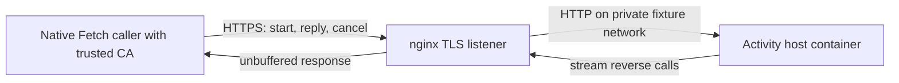

# Let an HTTP activity call its original authority

An activity running in another service may still need an answer from the original caller. For example, a job may
need more time to finish, but only the caller can renew its temporary claim on the queued item.
`@okikio/activity/http/duplex` gives the job a way to ask. Unlike the [single request and response](../http.md) path,
the start response carries questions back to the caller. Separate authenticated POST requests return the answers
while the activity is still running.

For example, a remote activity asks to renew its queue claim. The caller receives that request and awaits its actual
`ActivityAttemptControl.heartbeat()`. Only after that authority resolves does the remote activity receive an
acknowledgement and continue. A network connection staying open does not renew a lease.

```mermaid
sequenceDiagram
    participant Caller as Scheduler caller
    participant Host as HTTP activity host
    participant Authority as Caller claim/effect/permission owner
    Caller->>Host: authenticated start POST (fenced attempt)
    Host-->>Caller: response stream: hello, reverse call
    Caller->>Authority: validate exact declared call; await authority
    Authority-->>Caller: accepted result or rejection
    Caller->>Host: authenticated reply POST (session, claim, generation, call ID)
    Host->>Host: continue activity; join calls and Context cleanup
    Host-->>Caller: one terminal frame; stream EOF
```

## Connect both sides

Reuse the definitions, `provider`, credential source and authorization policy shown in the unary HTTP guide. Replace
its client and handler construction with the following. The `provider` can be `local.create()` with real activity
implementations and application-owned resources; the duplex adapter supplies that provider's attempt-owned permission,
effect and heartbeat services. Those exact services take precedence over local provider defaults for this attempt.
Defaults remain available to direct local calls whose control supplies no corresponding service.

```ts
import * as duplex from '@okikio/activity/http/duplex';

// Mount this callable at one dedicated route. The application owns TLS and the listener.
const accept = duplex.handler({
	provider,
	activities: [Length],
	authenticate: verifyCredentials,
	// This runs for start, reply and cancel. Validate the actor against the exact attempt,
	// including tenant, registration, generation and the authoritative current claim.
	authorize: authorizeAttempt,
	concurrency: 8,
	maximumPending: 4,
	maximumCalls: 128,
	timeoutMs: 30_000,
	cleanupMs: 5_000,
});
const client = duplex.create({
	engine: Engine,
	activities: [Length],
	url: endpoint,
	headers: readCredentials,
	maximumPending: 4,
	maximumCalls: 128,
	timeoutMs: 30_000,
	cleanupMs: 5_000,
});

// Register client with the Scheduler. Its run(ctx, attempt, control) receives
// the original control; each reverse call uses that exact control and Context.
// During shutdown, stop/drain the listener first, then cancel and join owned sessions.
await accept.close();
```

The fragment uses the application-owned objects from the complete unary example. `verifyCredentials` accepts the
Request and returns a boolean; `authorizeAttempt` accepts the Request and exact ActivityAttemptType and returns a
boolean. Both may return promises. `readCredentials` accepts the attempt and returns HeadersInit, synchronously or
asynchronously. Never copy credentials or session tokens into application logs.

This topology uses a response stream and ordinary complete POST bodies. It needs no streaming request upload, WebSocket
upgrade or incoming connection to the caller. Browsers restrict Fetch uploads to half-duplex behavior, so a single
streaming upload cannot serve as a portable simultaneous reverse-call channel. See the [Chrome Fetch streaming
documentation](https://developer.chrome.com/docs/capabilities/web-apis/fetch-streaming-requests),
[Node Fetch API](https://nodejs.org/api/globals.html#fetch), and [Deno Streams API](https://docs.deno.com/api/web/streams/).
For browser clients, the application must configure CORS for its dedicated route and credential/header policy. Proxies
must forward response chunks promptly instead of buffering the complete stream.

## Keep sessions temporary and bounded

The wire protocol uses version 2. A start response first sends an unpredictable session token, claim ID and registration
generation. Each reverse call adds a strictly increasing call ID. Every reply and cancel is authenticated again and
reauthorized against that stored attempt. The session token appears only in JSON bodies, never a URL. It identifies a
temporary conversation; it is not authorization or a durable run identity.

Replies must match the session, claim, generation, call ID and call kind. Wrong or already-settled calls receive 409;
a wrong reply kind receives 400. The handler also rejects a duplicate start for a currently active claim. After the
session ends its token is retired. The handler has no persistent replay ledger: the application's authorization and
Scheduler store must reject dispatch of expired/replaced claims and decide whether an uncertain activity can be retried.
There is no reconnect, resume, automatic retry or transparent fallback to unary execution.

The default frame/request budget is 1 MiB, the total response-stream budget is 8 MiB, the call budget is 128 and at most
8 calls may await answers. The configurable maxima are 16 MiB per frame, 64 MiB per stream, 1024 total calls and 64
pending calls. Native response-stream backpressure and the pending-call limit bound queued call frames. The default
30-second session lifetime and five-second cleanup grace are finite; choose values that fit the activity's lease and
latency requirements. The application still owns server upload/idle timeouts and credential-verifier limits.

## Distinguish cancellation from joined cleanup

When the caller cancels, the client sends an authenticated cancel POST and keeps reading the original response.
The host asks the attempt to stop and rejects any unanswered calls back to the caller. It keeps the attempt's slot
until the provider and Context finish cleanup. Only then does it send the final message. Before accepting that
message as the result, the client also waits for its own callbacks and for the host to acknowledge their replies.

A reply POST can cross the independent cancel POST. If cancellation retires its call first, the reply receives 409.
The client provisionally retains a 409 observed after it requested cancellation and continues reading the stream. It
accepts that stale reply only after the explicit cancel POST succeeds, the matching terminal result is `cancelled`, and
original authority calls and reply requests have joined. A 409 observed before cancellation, a rejected cancel request,
403/500 or network failure, a missing terminal, or a successful terminal does not supply that proof and remains `lost`.

If cleanup finishes within the grace and that cancellation evidence is complete, the caller receives `cancelled`.
If the connection disappears, the grace expires,
a control acknowledgement is lost, or a borrowed authority callback does not settle before the finite deadline, the
caller receives `lost`. A lost response cannot prove whether a side effect committed. The caller must reconcile its
authoritative claim and effect receipts before retrying.

A provider fault or cleanup error that occurs after an abort remains a fault. The handler does not turn it into a
successful cancellation merely because the signal is aborted. Without a clean cancelled terminal, the cancelling client
returns `lost` and the owner must inspect the failed cleanup before reclaiming resources. Already-running authority
callbacks are borrowed cooperative operations; the transport cannot undo a committed write or forcibly terminate
JavaScript callbacks. The supplied provider must preserve its own faults when returning a terminal result. The
container tests exercise the local Activity provider. Separate real Worker and child-process tests also preserve
post-abort faults, invalidate the failed physical host, and keep its lease until cleanup joins.

A physical response disconnect aborts the host attempt too. After the cleanup grace, a stalled output is failed so an
unread hello/terminal frame cannot keep a dead stream alive. Uncooperative provider cleanup can still keep its slot
occupied; the transport never frees that slot while the provider owns resources. `close()` rejects new session
publication, cancels existing sessions, aborts active body reads and joins provider cleanup. The application must stop
and drain its listener before closing; credential/authorization callbacks and underlying request-source cleanup remain
borrowed application lifetimes. An authorization promise that finishes after close cannot publish a new session.

Tests open real listeners and cover original heartbeat/permission/effect authority, cancellation with delayed cleanup,
physical disconnect, unanswered authority expiry, stale/replayed/wrong-kind replies, detached calls, retained admission,
unread-response backpressure, shutdown and authorization races. The socket benchmark measures 1 and 8 actual reverse
calls and cancellation-through-cleanup. Its direct-control baseline excludes transport guarantees; socket results exclude
TLS, persistent business storage and container deployment.

## Exercise a browser and an isolated host

The maintained [browser/container tests](../../../tests/workflows/duplex-browser.test.ts) open real Chromium, Firefox
and WebKit documents on one loopback origin. Each document sends Fetch requests to a different origin served inside
a container. The application wrapper permits exactly the fixture's origin, answers OPTIONS before credential checks,
allows the Authorization, Content-Type and two activity protocol headers, and exposes `x-okikio-activity-version` to
the caller. It also sets `Vary: Origin`. An unrelated origin is rejected before provider dispatch. These are application
settings in the [fixture host](../../../tests/fixtures/duplex/host.ts), not a global CORS policy installed by Activity.
The [Fetch CORS protocol](https://fetch.spec.whatwg.org/#http-cors-protocol) defines the browser checks.

The start response must deliver reverse calls before the provider can finish. Thus an end-to-end success checks actual
response streaming, rather than only checking that an HTTP response eventually arrives. Separate cases cancel with
provider cleanup deliberately held open, close a document during work, reject bad credentials and cross cancellation
with an already-sent reply. Both the browser caller and the container's provider must retain ownership until cleanup
finishes. This is a provider-finally barrier; the fixture does not acquire a real browser pool or distributed session.

From this checkout, install the pinned tools and dependencies first. Prepare all three engines and the exact image
declared by [the container fixture](../../../tests/fixtures/duplex/container.ts), then select only these resource tests:

```sh
mise run prepare -- --kind deps
mise run prepare -- --kind browser -- firefox webkit
docker pull node:26.10.0-bookworm-slim@sha256:3ffc19ea878019d9e9ae8971732ad4a03cda44f167107173174b60ed7c65bed3
mise run test -- --suite containers tests/workflows/duplex-containers.test.ts
mise run test -- --suite containers tests/workflows/duplex-browser.test.ts
```

The fixture never pulls images implicitly. `UTILS_DUPLEX_NODE_IMAGE` can explicitly select a prepared local image;
record its actual runtime and image identity with the result. A missing browser or launch failure fails the requested
matrix instead of silently skipping that engine. Launch waits are finite. Install or run the browser on a supported
host to resolve that failure; a successful Node test cannot replace it. [Playwright's browser guide](https://playwright.dev/docs/browsers)
describes its version-specific installations. Bundles, metrics and run evidence remain under `.tmp/`.

Keep the two workspace Playwright pins and their browser downloads together. The pinned Playwright 1.65.0 includes
the [upstream Firefox startup fix](https://github.com/microsoft/playwright/pull/43494) for the application-data lookup
that could prevent a temporary profile from opening on macOS 27. Updating only the profile path or increasing the
launch timeout does not address that lookup. Use the matching browser installation before investigating a new launch
failure; the fixture uses Firefox's default launch settings without changing the user's home, privacy permissions or
browser sandbox. The [upstream investigation](https://github.com/microsoft/playwright/issues/42768) explains why the
older sandbox-extension and graphics log messages did not identify the actual cause.

The optional root benchmarks use the same container and browser contract:

```sh
node bench/duplex-containers.bench.ts --check
node bench/duplex-containers.bench.ts
UTILS_DUPLEX_BROWSER=chromium node bench/duplex-browser.bench.ts --check
UTILS_DUPLEX_BROWSER=chromium node bench/duplex-browser.bench.ts
```

Repeat the browser commands with `webkit` or `firefox` on a host where that engine launches. The 1/8/32-call workloads
check original heartbeat, permission and effect receipts before timing. Browser timings include Playwright RPC,
browser scheduling, CORS/Fetch and container networking; cancellation includes provider entry, the cancel POST and
joined cleanup. Build, browser launch and container startup are outside timing. Final metrics check that no provider
work remains active. These measurements exclude TLS, reverse proxies, durable business writes and Kubernetes routing.
Test those exact deployment settings separately; direct container evidence does not establish production proxy behavior.


## Deploy behind a TLS edge

The client requires HTTPS outside the explicit loopback HTTP test option. The application owns certificate trust and
termination. Do not disable certificate verification to make a deployment pass. For a Node client using an internal
CA, set `NODE_EXTRA_CA_CERTS=/path/to/ca.pem` before starting the process; Node reads this setting at startup.
See [Node's CA trust contract](https://nodejs.org/api/cli.html#node_extra_ca_certsfile).



The maintained [TLS/proxy matrix](../../../tests/workflows/duplex-proxy.test.ts) starts a separate nginx container,
a private network, an Activity host and native Node caller processes. Each run creates a fresh test CA. Positive calls
validate the certificate; separate controls reject the missing CA and wrong hostname before provider admission.
The redirect control points to a live local route, so a failed DNS lookup cannot masquerade as redirect rejection.

Configure the edge for incremental responses and independent control POSTs. The following directives show the route's
streaming contract; add the application's real certificate, access policy, limits and upstream address. The idle timeout
must fit the longest interval without response bytes, not just average activity duration.

```nginx
location = /attempt {
    proxy_pass http://activity:8080/attempt;
    proxy_http_version 1.1;
    proxy_set_header Connection "";

    # Deliver reverse calls before the activity can finish.
    proxy_buffering off;
    proxy_request_buffering off;
    gzip off;

    # Disconnects must reach the owner; retries can duplicate uncertain work.
    proxy_ignore_client_abort off;
    proxy_next_upstream off;
    proxy_read_timeout 60s;
}
```

[nginx's proxy reference](https://nginx.org/en/docs/http/ngx_http_proxy_module.html) explains buffering, upstream
inactivity timeouts and retry behavior. Preserve authentication headers and the protocol response headers. Do not route
start, reply and cancel to independent in-memory handlers: their temporary session state belongs to the same handler
instance. A multi-replica deployment needs explicit affinity or a separately designed shared session protocol.

The matrix verifies original heartbeat/permission/effect receipts, authenticated reply/cancel requests, held cleanup
after cancellation or disconnect, idle-timeout loss, a deliberately buffering route, and an actual provider cleanup
exception. A client result alone is never the cleanup oracle: tests read the host's active/finally receipts and release
a manual cleanup gate. Small sequential authority calls establish incremental delivery; they do not measure TCP
backpressure or production load.

```sh
# Docker must be running. The fixture pulls its pinned images if they are not cached.
mise run test -- --suite containers tests/workflows/duplex-proxy.test.ts
node bench/duplex-proxy.bench.ts --check
node bench/duplex-proxy.bench.ts
```

The optional proxy benchmark checks exact authority receipts and final zero active scopes. Its timings include cold
caller-process startup, TLS setup and cleanup. Certificate generation and container startup are excluded. Compare only
matching workloads; the earlier warm socket benchmark has different costs. Temporary keys, bundles and diagnostics
stay under `.tmp/`, and fixture disposal removes its exact owned containers and network.

This evidence covers native Node Fetch through nginx TLS termination to a private plaintext HTTP upstream. It does
not establish browser trust-store configuration, encrypted upstreams, mutual TLS, HTTP/2 or HTTP/3, arbitrary proxy
products, production replica routing, durable writes, replay or Kubernetes scheduling. The browser matrix above
continues to establish cross-origin browser behavior separately.
