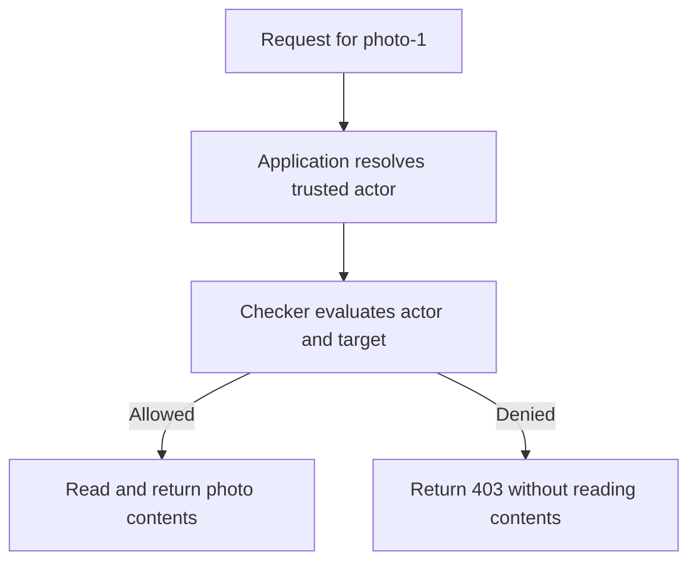

# Ask whether the current actor may read a picture

Authorization connects a trusted actor, a named action and the object being protected. Permission asks your checker
about that action and target. Role groups canonical actions for trusted membership. Entitlement checks a plan feature;
it does not decide which picture a person may read. All three are independent capabilities in this package.

For Deno, Node, and Bun execution, see [run a portable example](../../docs/05-runtime.md#run-a-portable-example-in-your-own-project). Host-specific adapters keep their native runtime requirements.

An **actor** is the person or service making the request. A **target** is the particular object they want, such as
`photo-1`. Signing in establishes an identity; it does not establish permission to every target. A **checker** is your
application function that answers the concrete access question using trusted identity and object data.

The request path below checks before returning contents. Follow the denied branch as well as the allowed one; declaring
a permission cannot stop code that forgets to ask it. This diagram leaves login and storage implementation to the host.




## Enforce access before returning contents

From the `utils` checkout root, review `mise.toml` and run `mise trust`, `mise install`, and `mise run prepare -- --kind deps`.
Save the complete block as `gallery.ts` and run `mise exec -- deno run gallery.ts`. No server or database is needed.

```ts runnable=gallery.ts
import * as context from '@okikio/context';
import * as permission from '@okikio/authz/permission';
import * as schema from '@okikio/schema';
const TargetSchema = schema.object({ id: schema.string() });
const Read = permission.define({ id: 'asset.read', target: TargetSchema });
const grants = new Set(['photo-1']);
await using owner = context.create({ id: 'asset-download' });
const ctx = permission.scope(owner, {
	permissions: [Read],
	checker: {
		maximumChecks: 10,
		/** Apply this demo actor's grants to each concrete asset target. Authentication happens elsewhere. */
		async check(_ctx, requests) {
			return requests.map((entry) => ({ allowed: grants.has(TargetSchema.parse(entry.target).id) }));
		},
	},
});
/** Check the target before returning its contents; denial must not enter the read path. */
async function download(id: string): Promise<Response> {
	if (!await permission.check(ctx, Read, { id })) return new Response('Forbidden', { status: 403 });
	return new Response(`Contents of ${id}`);
}
const allowed = await download('photo-1');
const denied = await download('photo-2');
console.log(allowed.status, await allowed.text());
console.log(denied.status, await denied.text());
```

```text output
200 Contents of photo-1
403 Forbidden
```

The checker uses local grants for one actor and returns ordered decisions. The handler enforces them before returning
contents. Authentication and the real grant lookup belong to your application. A Context carries cancellation, time and
cleanup; the permission scope borrows it. Declaring Read is metadata, not authentication or an operating-system grant.

The setup separates three questions that must not be confused:

| Value | Question it answers | Why the application supplies it |
| --- | --- | --- |
| `Read` | Which action and target shape are being checked? | The same declaration can be shared by routes, documentation and policy. It contains no actor or decision. |
| `owner` | How long may this operation run? | Its Context carries cancellation and cleanup. Inside an existing request, use that request's Context instead of creating another owner. |
| `ctx` | Which checker and actions apply to this operation? | `permission.scope()` adds an actor-specific policy view while borrowing `owner`. It does not create a second cleanup owner. |

`maximumChecks: 10` accepts at most ten individual action/target questions in one logical call. It is not a limit of
ten requests over the owner's lifetime. The two calls above each ask one question. Choose the bound to match the
application's batch size and policy provider; it prevents an unexpectedly large expression from reaching the checker.
The checker remains explicit because the library cannot infer who owns a picture or which actor is trusted.

## Explain why a combined check denies

This complete variation adds Write to the same gallery policy. The actor may read photo-1 but may not write it. The
bounded report exposes decision categories without target values or raw provider failures. Save as `gallery-explain.ts`
and run `mise exec -- deno run gallery-explain.ts`.

```ts runnable=gallery-explain.ts
import * as context from '@okikio/context';
import * as permission from '@okikio/authz/permission';
import * as schema from '@okikio/schema';
const TargetSchema = schema.object({ id: schema.string() });
const Read = permission.define({ id: 'asset.read', target: TargetSchema });
const Write = permission.define({ id: 'asset.write', target: TargetSchema });
const grants = new Set(['photo-1']);
await using owner = context.create({ id: 'asset-download' });
const ctx = permission.scope(owner, {
	permissions: [Read, Write],
	checker: {
		maximumChecks: 10,
		/** Apply this demo actor's grants to each concrete asset target. Authentication happens elsewhere. */
		async check(_ctx, requests) {
			return requests.map((entry) => ({
				allowed: entry.definition === Read && grants.has(TargetSchema.parse(entry.target).id),
			}));
		},
	},
});
const expression = permission.all(permission.on(Read, { id: 'photo-1' }), permission.on(Write, { id: 'photo-1' }));
console.log(await permission.check(ctx, expression));
const report = await permission.explain(ctx, expression, {
	maximumNodes: 3,
	maximumDepth: 2,
	details: false,
	maximumDetailCodeUnits: 0,
});
console.log(report.outcome);
```

```text output
false
denied
```

For `all`, an explicit denial decides the result even beside a returned provider fault. For `any`, an explicit allow
can decide it. Every leaf is evaluated in the logical batch. Node/depth budgets reject before the provider call. Detailed
reasons are opt-in, bounded privileged diagnostics; do not return them to a client without application disclosure policy.
Missing configuration, malformed responses and checker exceptions still throw rather than becoming ordinary denials.

## Choose static grants or plan availability

Use the [Role example](./role/README.md) to resolve authenticated membership and apply a target policy. Use
[Entitlement](./entitlement/README.md) when CSV export requires a purchased plan feature. Neither declaration stores
users, grants permissions by itself, or contacts a billing provider.

## Choose an entry point

Use the table to find a focused import for the job you need. Contract links open the exact public source, including its
options and types.

| Import                                 | Use it to                                                                             | Exact contract                          |
| -------------------------------------- | ------------------------------------------------------------------------------------- | --------------------------------------- |
| `@okikio/authz`                        | Use the package entry shown in the complete examples above.                           | [Contract](./mod.ts)                    |
| `@okikio/authz/permission`             | Check an action and target through an application-supplied evaluator.                 | [Contract](./permission/mod.ts)         |
| `@okikio/authz/permission/definition`  | Declare permission identities without loading execution contexts.                     | [Contract](./permission/definition.ts)  |
| `@okikio/authz/permission/types`       | Import public types for this capability; this entry does not start work.              | [Contract](./permission/types.ts)       |
| `@okikio/authz/role`                   | Group canonical permission objects; resolve external role IDs before checking grants. | [Contract](./role/mod.ts)               |
| `@okikio/authz/role/types`             | Import public types for this capability; this entry does not start work.              | [Contract](./role/types.ts)             |
| `@okikio/authz/entitlement`            | Check feature requirements through application-owned plan policy.                     | [Contract](./entitlement/mod.ts)        |
| `@okikio/authz/entitlement/types`      | Import public types for this capability; this entry does not start work.              | [Contract](./entitlement/types.ts)      |
| `@okikio/authz/entitlement/definition` | Declare feature requirements without choosing a billing provider.                     | [Contract](./entitlement/definition.ts) |

## Migration

The former @okikio/permission, @okikio/role and @okikio/entitlement names are retired; use this package’s explicit
subpaths. Keep exact imported declaration identities when moving call sites.

## Measure local permission decisions

The focused benchmarks measure 1–256 accepted/denied local checks and redacted explanations with 10–1,000 denied leaves.
The benchmark compares against direct predicate without scope, validation or evidence. This does not measure a remote
policy service.

From the repository root, run the package's tests and untimed benchmark checks before collecting timings:

```sh
deno task --cwd=packages/authz test
deno task --cwd=packages/authz bench:check
deno task --cwd=packages/authz bench
```

These commands use package-owned fixtures and development dependencies. The
[benchmark protocol](../../docs/benchmarks/01-running.md#choose-a-comparison-that-answers-the-question) explains fair
comparisons, raw report collection and the limits of local measurements.
