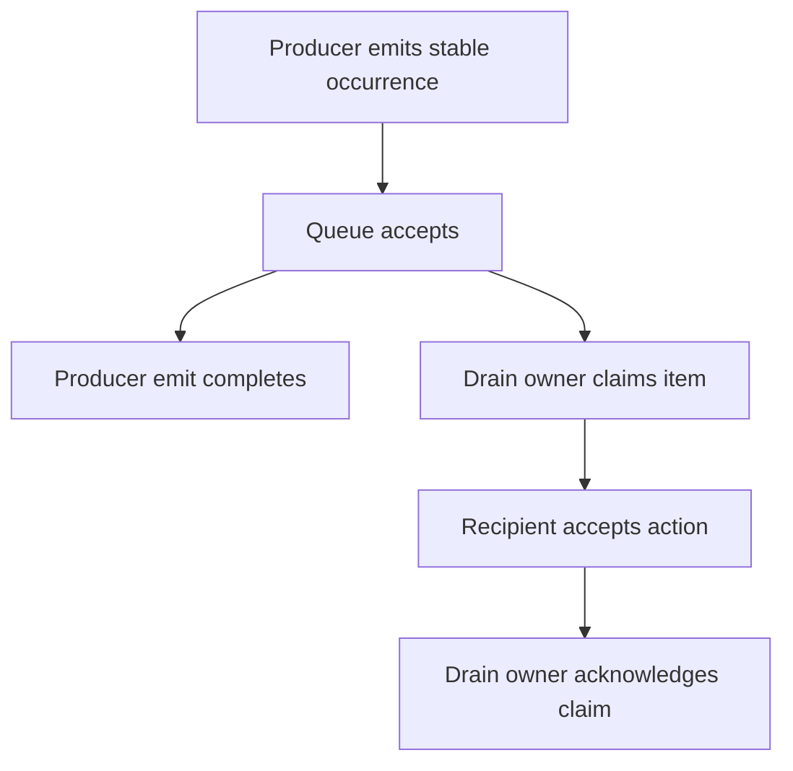

# `@okikio/capability/effect`

After saving a picture, an application may need to announce “asset saved” to an audit trail or another service.
`@okikio/capability/effect` gives that announcement a validated shape and a stable key, then waits for a configured
recipient to accept it. The recipient can be an in-memory callback, a queue, or an application-owned outbox.

An **effect definition** names the kind of announcement and its data. An **occurrence** is one particular announcement,
such as saving `asset-1`. An **emitter** is the live recipient responsible for accepting it. The package does not save
the picture itself.

```text
Application saves asset-1
          |
          v
Validate announcement: asset.saved, key save:asset-1
          |
          v
Configured emitter accepts it -> emit() resolves
```

The visual shows acceptance of an announcement. It does not prove that the picture was saved or that an external
subscriber has acted on the announcement. Those guarantees depend on the application and emitter.

## Give a save announcement an explicit recipient

Context supplies its own clock and cleanup support. Importing this utility does not require changing runtime globals.

From a checkout of this experimental workspace, run `mise trust`, `mise install`, then `mise run prepare -- --kind deps` at the repository root. Save the following program as `example.ts` and run `mise exec -- deno run example.ts`. These commands use the workspace export maps; they do not assume a published registry version.

```ts runnable
import * as context from '@okikio/context';
import * as effect from '@okikio/capability/effect';
import * as schema from '@okikio/schema';

// Define the announcement before choosing who will accept it.
const Saved = effect.define({ id: 'asset.saved', value: schema.object({ id: schema.string() }) });

// This lifetime owns cancellation and cleanup, not downstream delivery.
await using owner = context.create({ id: 'save' });

// This recipient accepts into memory only; restart would lose these records.
const accepted: string[] = [];
const ctx = effect.scope(owner, {
	effects: [Saved],
	emitter: {
		/** Accept the occurrence in this local demo; production persistence belongs to the receiver. */
		async emit(_ctx, occurrence) {
			accepted.push(occurrence.key);
		},
	},
});

// The stable key identifies this occurrence. An in-memory receiver alone cannot deduplicate across restarts.
await effect.emit(ctx, Saved, { id: 'asset-1' }, { key: 'save:asset-1' });
console.log(accepted.join(','));
```

Expected output:

```text output
save:asset-1
```

## Follow the occurrence to its recipient

The demo declares an `asset.saved` announcement whose value must contain a string ID. Its emitter appends the occurrence
key to `accepted`. After `emit()` completes, that array contains `save:asset-1`, which is what you see printed. This is
a local acceptance demo, not a database or durable delivery demo. Try emitting an ID value that fails the schema to
observe validation before the recipient accepts it.

The names describe three ordinary JavaScript values. `define()` returns metadata containing an ID and schema. `create()`
returns a Promise of a checked record. `emit()` awaits a supplied callback and returns the accepted record. There is no
separate computation language to run.

This is the part of the occurrence contract relevant to the demo:

```text
occurrence
  kind:       "effect-occurrence"
  definition: Saved                 the exact object passed to define()
  key:        "save:asset-1"         this logical save, across retries
  value:      { id: "asset-1" }      the schema-validated payload
```

`effect.scope(owner, options)` attaches the allowed definitions and emitter to a borrowed view of `owner`. In this
README a Context is simply the operation's cancellation signal, clock, identity, and cleanup owner. The view shares that
lifetime; it does not start work or add a second owner. `await using owner` releases the owner's cleanup when its block
ends.

On `emit()`, the utility checks cancellation and exact declaration membership, validates a newly supplied payload, and
awaits `emitter.emit(ctx, occurrence)`. The emitter's successful return is the handoff point. This split lets you keep
the same declaration while changing a local callback to a persistent outbox. The emitter, rather than the producer's
call syntax, determines what acceptance guarantees.

Read the [source contracts](./types.ts) for the complete definition, occurrence, emitter, and outbox contracts.

## Prepare the same save announcement before deciding when to send it

You can use definition and occurrence creation without a Context or recipient. This prepares the same asset announcement; creation validates it but does not send it.

Save this complete variation as `prepare-save.ts` and run `mise exec -- deno run prepare-save.ts` after the same checkout setup.

```ts runnable=prepare-save.ts
import * as effect from '@okikio/capability/effect';
import * as schema from '@okikio/schema';

// Define the announcement before choosing who will accept it.
const Saved = effect.define({ id: 'asset.saved', value: schema.object({ id: schema.string() }) });
const occurrence = await effect.create(Saved, { id: 'asset-1' }, { key: 'save:asset-1' });
console.log(occurrence.key, occurrence.value.id);
```

```text output
save:asset-1 asset-1
```

- **Send a confirmation after an import:** combine [CSV](../../format/csv/README.md) parsing with an application-owned
  save, then announce the accepted import through an effect. If save and announcement must commit together, the
  application needs a transactional outbox; calling two functions in sequence does not create a transaction.
- **Deliver announcements later:** use the [complete queue-backed example below](#queue-an-announcement-then-deliver-it) with
  [Queue](../../scheduler/queue/README.md). Stable keys support recipient deduplication; only a durable, atomic queue
  adapter and replay-safe recipient can supply the corresponding restart and duplicate-delivery guarantees.

## Queue an announcement, then deliver it

A producer can finish once a queue accepts an announcement, while a later delivery step calls its recipient. This
complete variation keeps the same saved-asset shape. Its in-memory queue lets you see those two moments separately;
process restart would lose queued announcements. After the same checkout setup, save it as `queued-save.ts` and run
`mise exec -- deno run queued-save.ts`.

Read the sequence in two parts. The producer finishes after queue acceptance. Delivery starts only when an owner calls
drain; it must acknowledge the claimed item after the recipient finishes. The same logical key follows both parts.



A lost acknowledgement can lead to repeat delivery, so the recipient must deduplicate by the logical key where needed.
This diagram omits persistence: the memory queue below loses items on restart. For atomic business writes and durable
announcements, use the [transactional outbox guide](../../../docs/postgres/02-outbox.md).

```ts runnable=queued-save.ts
import * as context from '@okikio/context';
import * as effect from '@okikio/capability/effect';
import type { EffectEncoded, EffectReceiptType } from '@okikio/capability/effect';
import * as queue from '@okikio/scheduler/queue';
import * as schema from '@okikio/schema';


// Define the announcement before choosing who will accept it.
const Saved = effect.define({ id: 'asset.saved', value: schema.object({ id: schema.string() }) });

// This lifetime owns cancellation and cleanup, not downstream delivery.
await using owner = context.create({ id: 'save-asset-1' });
await using pending = queue.memory<EffectEncoded, EffectReceiptType>();
const delivered: string[] = [];
await using box = effect.outbox({
	queue: pending,
	handlers: [
		effect.implement(Saved, (_ctx, occurrence) => {
			// A real recipient must make this business action safe to repeat after a lost acknowledgement.
			delivered.push(occurrence.value.id);
		}),
	],
});
const ctx = effect.scope(owner, { effects: [Saved], emitter: box });
await effect.emit(ctx, Saved, { id: 'asset-1' }, { key: 'save:asset-1' });
console.log('Delivered before drain:', delivered.length);
// No background loop runs implicitly. The owner explicitly admits one queued delivery.
const result = await box.drain(owner, { limit: 1 });
console.log('Delivered after drain:', delivered.join(','), result.accepted);
```

```text output
Delivered before drain: 0
Delivered after drain: asset-1 1
```

`emit()` accepts into the queue; `drain()` claims the queued occurrence and awaits its exact handler before acknowledging
it. The example owns the queue and outbox separately: closing the outbox does not close its borrowed queue. A durable
queue can preserve acceptance across restart, but saving a picture and emitting afterward still are two commits.
Use the [transactional PostgreSQL outbox](../../../docs/postgres/02-outbox.md) when the picture update and announcement
must commit together. Stable keys support retry identity; the recipient still owns duplicate-safe business effects.

## Choose what acceptance must guarantee

Create an occurrence without delivery when staging work, then emit it through an owner that accepts or rejects it. Add a
queue-backed emitter when the application needs delayed delivery. Stable keys let an authoritative sink deduplicate
retries; the utility cannot make arbitrary external side effects exactly once. Declared effects restrict what a scope
may emit, and cancellation after acceptance does not revoke the accepted fact.

`@okikio/capability/effect` lets code declare and announce externally observable side effects without coupling the
declaration to a queue, database, workflow engine, or provider SDK.

An effect answers two questions:

1. Which side effect may this execution announce?
2. Which live owner accepts responsibility when that side effect occurs?

It is not the Effect TypeScript runtime. It is also not the generic logging or metrics API. Optional observations belong
in telemetry. An effect is used when announcing the side effect is part of the operation's declared behavior.

## Meter

Use `@okikio/capability/effect/meter` for validated, timestamped usage facts delivered through an effect recipient.
Pricing and ledger storage remain application-owned.

Read the [subpath example](./meter/README.md). The former `@okikio/meter` package is retired.

## Keep data conversion and delivery separate

An effect's data contract accepts a native schema or an explicit codec. `create()` reads its declared input into the
application value. `encode()` writes that application value into the transport representation, and `decode()` reads it
using the receiving definition. A one-way transforming schema cannot supply its own inverse and therefore rejects during
encoding. Wrap an external identity validator with `codec.identity()` only when it accepts its own output unchanged.

The outbox derives retry identity from the execution key, exact effect ID and occurrence key. It hashes an unambiguous
JSON tuple with a version prefix, so separators inside IDs cannot merge distinct effects and long valid occurrence keys
still fit the queue's limit. This key format differs from older concatenated keys; drain or explicitly migrate an
existing outbox before switching formats.

## Compose an effect view with other capabilities

`scope(ctx)` retains an existing effect declaration and recipient. Supplying scope options replaces them explicitly.
Capability's [complete save-note example](../README.md#save-a-note-with-explicit-dependencies) combines this effect view
with resource borrowing and requirement interpretation. Required effect acceptance remains separate from optional
Context state observations and telemetry. A recipient may be shared across those scopes without transferring its cleanup
ownership.

## Choose adjacent capabilities

Use Effect when a declared recipient must accept a fact. Use effect/observe to display accepted occurrences and Meter
when the fact describes usage. The recipient owns delivery durability; an observer owns neither that handoff nor the
operation result.

The [package choice map](../README.md#choose-an-entry-point) lists the other public entries and when to use them.

## Read further

The [numbered guide](https://github.com/okikio/utils/blob/main/docs/effect/01-guide.md) explains the model, manual
alternatives, and composition.

Use [`observe()`](https://github.com/okikio/utils/blob/main/docs/effect/01-guide.md) to expose accepted effects through
`@okikio/observables`. Selected progress reports remain declared effects, while the Task or workflow result stays
separate.
