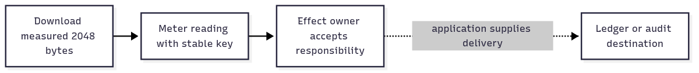

# `@okikio/capability/effect/meter`

A download accepted 2,048 bytes. You want one named usage fact that can later feed an audit or billing system, rather
than an unexplained counter. `meter` defines what is being measured and records the reading through an explicit effect
owner. An **effect owner** is the component that accepts responsibility for the fact under its declared delivery policy.



[Editable diagram source](./diagram.mmd). Solid arrows show the acceptance path used in the demo. The dotted arrow is
later application-owned delivery; the example's in-memory recipient supplies no durable ledger. Acceptance alone does
not prove that a billing provider processed a reading.

A reading is one named fact, such as `{ value: 2048, unit: "byte" }` for a particular download. The **aggregation**
describes how a recipient should combine readings; `sum` adds them. The **key** identifies this occurrence so a recipient
can detect a repeated submission. A key by itself does not store a receipt or remove duplicates.

Use the bytes actually accepted by the operation you are accounting for. Bytes queued in a local stream and bytes
acknowledged by a remote peer are different observations. Choose which one your product bills for before recording it.

## Record the size of a downloaded file

Download a local `data:` payload, measure the bytes accepted into this application's memory, then record that count.
This uses Fetch and actual response bytes without an external server or network permission. It does not measure remote
receipt. Context supplies its own clock and cleanup support; no global polyfill setup is needed.

After the [checkout setup](../../../../README.md#work-on-the-repository), run `mise run prepare -- --kind deps` from the root.
Save the next complete TypeScript block as
`example.ts` at that root, then run `mise exec -- deno run example.ts`.

```ts runnable
import * as context from '@okikio/context';
import * as effect from '@okikio/capability/effect';
import * as meter from '@okikio/capability/effect/meter';
import { MeterReadingSchema } from '@okikio/capability/effect/meter';
import * as schema from '@okikio/schema';
const Bytes = meter.define({ id: 'download.bytes', unit: 'byte', aggregation: 'sum' });
await using owner = context.create({ id: 'download' });
const accepted: number[] = [];
const ctx = effect.scope(owner, {
	effects: [meter.effect(Bytes)],
	emitter: {
		async emit(_ctx, occurrence) {
			accepted.push((await schema.parse(MeterReadingSchema, occurrence.value)).value);
		},
	},
});
// Read the complete local payload before measuring what this operation actually accepted.
const response = await fetch('data:application/octet-stream,' + 'x'.repeat(2048), { signal: ctx.signal });
if (!response.ok) throw new Error(`Download failed: HTTP ${response.status}`);
const bytes = new Uint8Array(await response.arrayBuffer());
// The key identifies this reading. The receiver decides how it is retained and aggregated.
const occurrence = await meter.record(ctx, Bytes, bytes.byteLength, { key: 'download:asset-1' });
console.log((await schema.parse(MeterReadingSchema, occurrence.value)).value);
console.log(accepted.join(','));
```

Expected output:

```text output
2048
2048
```

The first line is the measured reading; the second is what the recipient actually accepted. Both are `2048`: the local
payload contains 2,048 ASCII `x` bytes. Fetch reads those bytes, and Meter records their count. A real network download
can use the same measured count after its body read succeeds; choose a stable download identity for the key. Buffering
the complete body is suitable for this small example. Large downloads need incremental byte accounting and an explicit
input limit, not an unbounded `arrayBuffer()` call.

You do not need to learn the rest of the utility collection to read this call. `context.create()` makes the cleanup
owner, signal, and clock for this operation. `effect.scope()` attaches one allowed announcement and one callback to a
borrowed view of that owner. `await using owner` cleans up when the block ends. The meter uses this existing effect
contract so it does not need a separate queue or reporting runtime.

```text
MeterDefinition: { kind: "meter", id, unit, aggregation, effect }
MeterReadingType: { value: number, at: string, attributes?: { [name]: string | number | boolean } }
Accepted occurrence: { definition: Bytes.effect, key: "download:asset-1", value: reading }
```

`record()` builds the reading using `ctx.clock.now()`, validates it through the meter's effect schema, and awaits the
configured emitter. It returns `Promise<EffectOccurrence>`, not a bill or an aggregate. `unit` and `aggregation` are
metadata for the receiving system; `aggregation: 'sum'` does not maintain a hidden running total. See the
[schema and occurrence contracts](./types.ts) for the exported schemas and occurrence types.

### Timestamp validity and precision

`at` requires a four-digit year, `T`, seconds, and either `Z` or an explicit `±HH:MM` offset. Offset hours are 00
through 23 and minutes are 00 through 59. The schema uses the owned Temporal implementation for calendar validity, so an
impossible February date or hour `24` rejects. Leap-second spellings are not accepted by this epoch-time contract.

The accepted string is returned unchanged, including its offset and fractional precision. RFC 3339 allows fractions
longer than Temporal's nine digits, so the schema checks that fraction as text and omits it only while validating the
calendar fields. Meter records keep the supplied Context clock; validation does not replace it with the host clock.

```ts runnable=timestamp-profile.ts
import { MeterReadingSchema } from '@okikio/capability/effect/meter';
const reading = MeterReadingSchema.parse({ value: 1, at: '2024-02-29T12:34:56.123456789123+05:30' });
console.log(reading.at);
console.log('issues' in MeterReadingSchema['~standard'].validate({ value: 1, at: '2026-02-31T12:00:00Z' }));
```

```text output
2024-02-29T12:34:56.123456789123+05:30
true
```

## Connect a usage fact to its recipient

- Declare a meter's effect in an [Activity](../../../activity/README.md) that downloads a file, then let an
  [Effect](../README.md) owner accept the usage fact. Use a stable key and a sink whose replay policy matches your
  delivery needs.
- Use [Capacity](../../../scheduler/capacity/README.md) for “may another download start?” and Meter for “what did the
  download consume?” Admission and usage accounting are different decisions; a measurement does not enforce a quota.

Define a measurement once, record it with a stable idempotency key, then attach attributes for later aggregation. A real
owner may persist the occurrence to a ledger or outbox. The example owner accepts in memory only; it is not a billing
backend. Meter definitions describe units and aggregation, while application policy decides pricing and entitlement.

## Choose adjacent capabilities

Use this for validated usage facts that an explicit recipient accepts. Telemetry describes execution for diagnosis; it
is not billing acceptance. The application owns units, deduplication, prices, and the durable usage ledger.

The [package choice map](../../README.md#choose-an-entry-point) lists the other public entries and when to use them.

## Read further

The [numbered guide](https://github.com/okikio/utils/blob/main/docs/effect/meter.md) explains the model, manual
alternatives, and composition.
