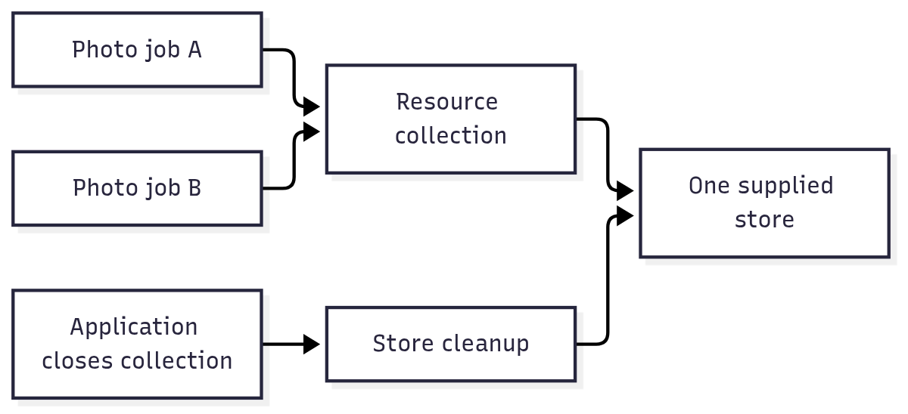

# `@okikio/capability/resource`

Share something a job needs without making every function open and close its own copy. For example, ten photo jobs can
borrow one application-owned storage client instead of opening ten connections. A resource describes that dependency; a
resource collection creates the supplied implementation when it is first needed and owns its cleanup.

This package does not choose a storage vendor or provide a database. It connects your supplied clients to the jobs that
declare their use, and makes their lifetimes explicit. Access requirements are checked when a caller borrows a resource.

A **dependency** is a value a function needs from outside itself, such as a client with `save()` and `read()` methods.
The **host** is the application code that chooses the real client. The resource definition names the expected methods;
the implementation supplies them. This is ordinary JavaScript dependency injection with an explicit cleanup owner.

For example, a request can borrow a database client without knowing its password or opening another connection. The
collection owns that client until disposal. This does not imply exclusive borrowing: use a Pool for interchangeable
exclusive loans, or a resource session when later work must return to one particular live object.

## Follow one shared dependency

Read the arrows as requests to borrow the same store. The collection opens it lazily, shares the admitted creation, and
closes the owned store when the collection ends. The two jobs do not close their borrowed copy themselves.



[Editable diagram source](./diagram.mmd). The picture shows one resource inside one collection. Another collection can
own a separate instance. It omits dependency ordering and access checks, which are explained below. The collection is
not a cross-machine connection pool.

## Save and read a note through a storage client

The `await using` declaration below closes the collection when its block ends, including on errors.
`open()` supplies its cancellation and cleanup lifetime. `await stores.get(Store)` waits for the client; the collection
still owns closing it. The factory receives `ctx` so it can register cleanup when it acquires something.

After the [checkout setup](../../../README.md#work-on-the-repository), run `mise run prepare -- --kind deps` from the root.
Save the next complete TypeScript block as
`example.ts` at that root, then run `mise exec -- deno run example.ts`.

```ts runnable
import * as resource from '@okikio/capability/resource';
const Store = resource.define<{
	save(id: string, text: string): void;
	read(id: string): string | undefined;
}>()({ id: 'store', description: 'Save and read notes.' });
const StoreLive = resource.implement(Store, {
	/** Tie the demo store to the resource context so scope exit also releases its contents. */
	create({ ctx }) {
		const notes = new Map<string, string>();
		ctx.defer(() => notes.clear());
		return {
			save(id: string, text: string): void {
				notes.set(id, text);
			},
			read(id: string): string | undefined {
				return notes.get(id);
			},
		};
	},
});
// open() owns the default lifetime. The Store binding stays lazy until the first get().
await using stores = await resource.open(StoreLive);
const store = await stores.get(Store);
store.save('note-1', 'Bring the family photo');
console.log(store.read('note-1'));
```

Expected output:

```text output
Bring the family photo
```

`open()` returns an owned, lazy collection without opening the store. `get()` returns a Promise of the
borrowed `{ save(), read() }` client, creating it lazily. `save()` writes the note to the supplied in-memory store, and
`read()` returns the same text. The collection clears that store at disposal through the registered cleanup callback.
The caller borrows the client and must not dispose it independently.

The reason for a definition and separate implementation is to keep consumers on the same storage contract when the host
changes providers. This offline implementation stores actual notes in a Map; a database implementation can supply the
same capability with database-specific ownership and persistence. No external file or database is used here.

For one binding, `open(StoreLive)` is enough. For several bindings, pass an array, such as
`open([StoreLive, CacheLive])`. `implementations(...)` builds a reusable, validated set when a host needs to inspect or
share the same configuration; it is not a required step for every local collection.

A collection has a lifetime, and each caller can have a shorter one. `stores.get(Store)` uses the collection's default
context. For a request with its own cancellation or access requirements, use `stores.get(Store, requestContext)`.
This checks that caller's requirements on every borrow, even when the client was opened earlier. A cancelled request
stops waiting without cancelling construction that another request still needs. Creating a new Context is therefore
useful when an operation needs a separate lifetime; it is not required merely to read a local resource.

When Activity or Service supplies that caller context for you, pass `stores.collection` to its resource configuration.
The lower-level `create(implementations, { ctx, host })` remains available for a host that already owns its lifetime and
native construction capabilities. Its `get(ctx, Store)` makes the borrower explicit. See the table below for that contract.

The curried call `resource.define<Value>()({ id, description })` separates the TypeScript value type from the runtime
metadata and retains the literal resource ID, so equal-shaped resources remain distinct in declarations. The first
parentheses tell the compiler what a consumer will receive. The second create a definition; they do not connect to
storage. `implement()` binds that exact definition to a factory. `open()` owns the lazy collection and supplies its
lifetime; `create()` is the lower-level constructor when the host already supplies that lifetime. The
[source contracts](./types.ts) give the full generic signatures; the local model is:

```text
ResourceDefinition<Value>       names the dependency and the value callers may use
ResourceImplementation         { definition, create(arguments) }
Opened collection              { get(definition, ctx?): Promise<Value>, collection }
ResourceCollection             { get(ctx, definition): Promise<Value>, has(definition) }
```

On the first `get()`, the collection checks the borrower's direct use requirements, resolves dependencies, and calls the
factory. Concurrent borrowers of the same definition share the pending creation. A later `get()` rechecks its caller's
requirements before returning the retained value. Factories can register cleanup through their supplied `ctx.defer()`,
`ctx.adopt()`, or `ctx.use()`; newly created disposable results are adopted once unless the implementation declares
borrowed ownership. This makes the collection the cleanup owner while a consumer only borrows the client. A borrowed
Context supplies the consumer's cancellation and identity; `await using stores` closes the collection when its block
ends.

Disposal cancels in-flight acquisition, waits for its cleanup, then closes acquired resources. A cleanup failure during
that shutdown is reported to the collection's owner even if the borrower has stopped waiting. A sole failure retains its
exact value; independent acquisition and resource-stack cleanup failures form an `AggregateError`. Each failed
acquisition still uses `SuppressedError` to retain both its cleanup error and the factory or cancellation error. All
owned cleanup is attempted before disposal settles. An ordinary factory failure whose cleanup succeeds remains the
borrower's error and does not make disposal fail.

## Save a value once and read it from another operation

The next example uses the same `open()` facade with a real in-memory Map. Two operations borrow that Map, and the
factory runs once. Sharing a collection needs no extra Context or host setup. Leaving its block clears the Map through
the registered cleanup, making ownership visible in the final line.

```ts runnable=shared-store.ts
import * as resource from '@okikio/capability/resource';
const Store = resource.define<Map<string, string>>()({ id: 'notes', description: 'Share saved notes.' });
let opened = 0;
const retained = new Map<string, string>();
const StoreLive = resource.implement(Store, {
	create({ ctx }) {
		opened++;
		ctx.defer(() => retained.clear());
		return retained;
	},
});
{
	await using stores = await resource.open(StoreLive);
	const writer = await stores.get(Store);
	writer.set('note-1', 'Remember the photo');
	const reader = await stores.get(Store);
	console.log(reader.get('note-1'));
	console.log(writer === reader, opened);
}
console.log(retained.size);
```

```text output
Remember the photo
true 1
0
```

The Map is shared within this collection. A different collection has a different lifetime; whether its factory creates a
different Map is application policy. The example closes in-memory state only. A database factory should register its
actual client-close operation and leave persistent records according to the database's own contract.

| Situation                                       | Combine                                                                      | Useful outcome                                                                                      |
| ----------------------------------------------- | ---------------------------------------------------------------------------- | --------------------------------------------------------------------------------------------------- |
| Several photo jobs need the same storage client | Resource + [activity](../../activity/README.md)                              | Each job declares its dependency; the collection owns the live client.                              |
| A local import owns a temporary client          | Resource + [task](../../task/README.md) + [context](../../context/README.md) | The task borrows the client and its owner releases it after work ends.                              |
| Different users share one client                | Resource + [permission](../../authz/README.md)                               | Check each actor's permitted use, rather than treating the first borrow as permission for everyone. |

See [the complete manifest-saving demo](../../../docs/03-composition.md#share-a-resource-with-a-finite-operation) for a
task that writes and reads a real in-memory value through a resource. Choose [pool](../../pool/README.md) when work
needs exclusive leases from a limited set of instances rather than shared access to one value.

## Add dependencies without adding another owner

Add dependency declarations when one resource needs another, validate implementation coverage before startup, and scope
access to the exact resources an activity may use. Collections own created values; callers borrow them and must not
close them individually. Acquisition requirements apply at creation, while actor-specific use requirements are checked
on public borrowing. Remote work must reconstruct its local resources rather than serialize live clients.

## Borrow an existing client explicitly

Use `ownership: 'borrowed'` on an implementation whose returned value already has an application owner. The collection
can share that value and apply its requirements, but will not dispose the returned client. Cleanup explicitly registered
by the factory still belongs to that acquisition.

Values supplied through `dependencies` are always borrowed. Returning a dependency from a derived resource does not
adopt it a second time. Attempting to register that dependency with `ctx.use()` or `ctx.adopt()` rejects. Repeated
registration of one value within the same acquisition is idempotent; an unrelated acquisition cannot silently create a
second owner for it.

`ExecutionContext<Allowed>` is the shared execution view used by Activity and Task. It connects owned cleanup,
requirement interpretation, effect delivery, declared resource borrowing and cooperative checkpoints. Activity adds
input and placement; Task adds process-local completion and progress.

## Use the collection from an ordinary function

`capability.scope(owner, { resources: { collection, allowed: [Store] } })` exposes `ctx.get(Store)` and `ctx.has(Store)`
while preserving the owner's fields. The collection stays borrowed. The allowlist is required and uses exact definition
objects; a new scope without resources permits no borrowing. Combine requirement and effect options in the same call
when the function needs them. The [complete save-note example](../README.md#save-a-note-with-explicit-dependencies)
shows that composition. Task and Activity use the same implementation while owning their distinct execution lifetimes.

## Choose adjacent capabilities

Use this for lazy shared dependencies with declared access and cleanup. Pool lends exclusive reusable instances; a
resource collection instead resolves declared dependency identities. The application supplies the concrete factories and
host.

The [package choice map](../README.md#choose-an-entry-point) lists the other public entries and when to use them.

## Read further

The [numbered guide](https://github.com/okikio/utils/blob/main/docs/resource.md) explains the model, manual
alternatives, and composition.
